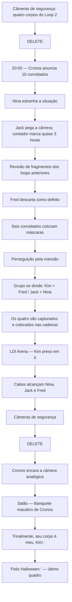

# Especial de Halloween: roteiro oficial

> Aprovado por Isaías em 19/10/2026. Substitui todo o material anterior de Presos na Ilusão. Anexo preservado integralmente; o registro de revisão e as pendências abaixo são históricos. A exclusão das fontes antigas foi autorizada por Isaías nesta data.

---

## PADRÃO-MESTRE OBRIGATÓRIO — TODAS AS CÂMERAS DE SEGURANÇA

Aplicar este padrão a toda página que use POV de segurança, sem exceção. Cada cena deve parecer uma gravação real de CFTV, não uma ilustração genérica da mansão.

- **POV fixo e observacional:** câmera física instalada num ponto plausível, enquadramento imóvel, sem movimentos cinematográficos, closes dramáticos ou perspectiva de câmera na mão.
- **Imagem:** conteúdo integralmente em preto e branco, sem áudio, com granulação/ruído de sensor e pequenas imperfeições plausíveis de gravação. Um indicador REC vermelho pode aparecer como elemento técnico da interface; não colorir o restante do feed.
- **Identificação técnica:** toda visão de segurança precisa exibir identificação consistente da câmera e do ambiente, data/hora de gravação e indicador REC. Quando houver vários feeds simultâneos, manter o mesmo horário em todos. Usar os rótulos e o padrão visual aprovados na Página 01; não inventar alertas, nomes, mensagens ou dados narrativos.
- **Quantidade de feeds:** seguir exatamente a quantidade definida pelo prompt daquela página. Quando o prompt exigir quatro feeds, os quatro devem estar claramente separados e visíveis; nunca fundir quatro ambientes em três áreas visuais nem criar uma quinta câmera.
- **Composição:** os feeds devem ser reconhecíveis como registros separados. Usar filamentos tecnológicos nanoestruturados escuros, semelhantes a fibras ópticas/microcabos vivos, somente quando houver divisões entre feeds; não substituir a leitura dos feeds por decoração abstrata.
- **Ambiente:** Halloween na Roma Antiga com tecnologia discretamente futurista; preservar a geografia e as referências aprovadas. Os funcionários mascarados são garçons/atendentes quando o contexto mostrar serviço. Não mostrar a sala das cadeiras SBI, salvo se uma página específica do roteiro exigir explicitamente esse local.
- **Som e texto:** segurança não transmite áudio. Não acrescentar diálogos; qualquer texto de interface deve ser apenas o que o prompt aprovar. Balões vazios “NO SOUND” só quando o roteiro e a composição realmente precisarem indicar fala sem som.
- **Continuidade:** conservar a identidade visual da interface, o estilo de imagem, o tratamento monocromático e a lógica dos rótulos entre todas as páginas que retornem à segurança.
- **Separação de POVs:** nunca confundir CFTV com a câmera analógica da Nina ou com a câmera digital de Fred. Cada dispositivo mantém seu tratamento visual próprio.

## PROMPTS COMPLETOS — PÁGINAS 01 A 10 (REVISÃO OBRIGATÓRIA EM EXTREMO REALISMO)

**Status desta seção:** prompts individuais completos para produção das dez páginas iniciais. Cada prompt deve ser usado junto das fichas oficiais de personagens, referências aprovadas das câmeras e do ambiente-mestre da mansão. As referências governam identidade, desenho da câmera e geografia; as instruções abaixo governam apenas a composição específica da página. **Não gerar até anexar/verificar as referências oficiais correspondentes.**

### PÁGINA 01 — A mansão vista pela segurança

**REGRA GLOBAL DE BALÕES — WEBCHAT (APLICAR A TODA FALA NESTA PÁGINA):** fundo branco puro; borda grossa e letras na mesma cor fixa do falante; cauda apontada claramente para quem fala; fonte LETREIRO.png (Anime Ace Bold), caixa alta, grande e legível em celular, 3–4 palavras por linha, sem hifenização. Nunca usar rótulo/nome de personagem nem repetir fala. Kim: azul-escuro #1D4ED8; Jack: verde-escuro #166534; Nina: rosa-escuro #BE185D; demais personagens mantêm suas cores fixas definidas na bíblia visual. Não usar letra preta, fundo colorido ou borda/texto de cores diferentes.

**PROMPT DE PRODUÇÃO — EXTREMO REALISMO; PADRÃO-MESTRE DE CÂMERAS DE SEGURANÇA**

**REGRA DE LAYOUT OBRIGATÓRIA — TODAS AS PÁGINAS:** todos os recortes entre painéis são diagonais, com inclinação de 8° a 15°. Proibidos cortes retos horizontais ou verticais, grades retangulares e divisórias paralelas. Composição full-bleed, vãos escuros estreitos e bordas finas coloridas conforme a bíblia visual. Fragmentos estilhaçados, quando previstos, ficam sobre os painéis grandes e nunca contam como painéis extras. **REGRA EXCLUSIVA DAS PÁGINAS DE CFTV:** os feeds de segurança são separados por filamentos vivos finos de fibra óptica/nanotecnologia, dispostos em cortes diagonais assimétricos que alternam a inclinação entre um lado e outro. Os filamentos formam a própria separação, sem molduras grossas, faixas retas, espaço branco, fumaça, eletricidade ou neon. Cada feed mantém HUD próprio e câmera fixa; sequência temporal é mostrada pela ordem dos feeds e pelos horários progressivos, nunca por uma câmera que se move.

Crie uma única página de quadrinho vertical, 960 × 1637 px, full-bleed, com safe area de aproximadamente 100 px nas laterais e 80 px no topo e na base. EXTREMO REALISMO fotográfico: cada imagem deve parecer um registro autêntico de câmeras de segurança físicas instaladas na mansão, e não uma ilustração de uma festa. Arquitetura, pedra, mármore, travertino, bronze, tecidos, máscaras, pessoas e iluminação devem apresentar microtexturas reais, anatomia natural, sombras plausíveis e profundidade óptica convincente. Proibido aspecto de desenho, pintura, anime, concept art, render estilizado ou videogame.

**REGRA VISUAL OBRIGATÓRIA:** TODOS os feeds de CFTV nesta página devem ter recortes diagonais assimétricos em DIREÇÕES ALTERNADAS, nunca grade retangular, painéis retos, bordas horizontais/verticais ou divisórias paralelas. Cada separação é um feixe FINO de filamentos vivos nanotecnológicos escuros entrelaçados, com brilho carmesim discreto; filamentos são a própria linha diagonal, sem moldura grossa, espaços brancos, neon, fumaça ou eletricidade. Cada câmera fixa tem HUD próprio CAM/local + data/hora + REC, vídeo preto e branco e sem áudio. Em registros sequenciais os timestamps avançam; em registros simultâneos coincidem.

**EXATAMENTE QUATRO FEEDS DE SEGURANÇA, TODOS VISÍVEIS E DISTINTOS.** Compor a página como uma montagem de vigilância com quatro imagens separadas e identificáveis, dispostas em quatro regiões assimétricas recortadas por diagonais de sentidos alternados, com os filamentos finos como únicas divisórias e os quatro feeds claramente reconhecíveis. Cada feed precisa mostrar um ambiente diferente: (1) entrada principal, (2) galeria/corredor, (3) salão principal da festa, (4) área de lazer externa com piscina. Não fundir os feeds numa imagem panorâmica, não deixar a página com apenas três áreas visuais e não criar uma quinta câmera.

**INFORMAÇÕES DE GRAVAÇÃO OBRIGATÓRIAS EM CADA FEED:** inserir uma interface técnica discreta e legível de CFTV, com identificação da câmera e do ambiente, indicador REC e data/hora no formato de gravação, seguindo um sistema gráfico consistente entre as quatro câmeras. Os rótulos podem identificar, por exemplo, “CAM 01 — ENTRADA PRINCIPAL”, “CAM 02 — GALERIA OESTE”, “CAM 03 — SALÃO PRINCIPAL” e “CAM 04 — PISCINA EXTERNA”. Usar o mesmo padrão tipográfico, posição e escala de interface em todos os feeds. A interface deve parecer parte do sistema de vigilância, não letreiro decorativo. Não inventar nomes de personagens, mensagens, alertas ou dados narrativos. Se for necessário usar horário, manter o mesmo horário coerente nos quatro feeds, pois são registros simultâneos.

**PADRÃO CFTV AUTOSSUFICIENTE — ESPECIFICAÇÕES EXECUTÁVEIS NESTE PROMPT:** os quatro feeds são quatro registros separados de câmeras físicas fixas, não quatro ângulos cinematográficos. Em cada feed, manter a interface técnica no mesmo canto e com a mesma escala relativa: identificador CAM + nome do ambiente, data/hora e indicador REC. Usar a mesma família tipográfica simples, peso, alinhamento, espaçamento e contraste nos quatro HUDs; não mudar o desenho da interface entre feeds. Os identificadores dos ambientes são: CAM 01 — ENTRADA PRINCIPAL; CAM 02 — GALERIA OESTE; CAM 03 — SALÃO PRINCIPAL; CAM 04 — PISCINA EXTERNA. O texto da interface deve ser curto, legível e estritamente técnico. Não inventar alertas, nomes, mensagens ou dados narrativos. Não há áudio nem representação de ondas sonoras. Um pequeno REC vermelho é a única exceção de cor da interface; todo o conteúdo filmado permanece monocromático. A câmera não acompanha ninguém, não faz zoom, não muda de eixo e não simula câmera na mão. Os quatro feeds devem continuar claramente distinguíveis mesmo com os filamentos entre eles.

**TRATAMENTO DE CFTV:** os quatro feeds são integralmente em preto e branco, sem áudio, com ruído de sensor, leve granulação, scanlines/interferência discreta e contraste de gravação plausível. A interface REC pode usar um pequeno indicador vermelho como exceção técnica; o conteúdo filmado continua monocromático. Enquadramentos fixos, observacionais, com perspectiva realista de câmeras instaladas em pontos altos ou cantos arquitetônicos. Nada de movimento cinematográfico, closes dramáticos, ângulos impossíveis ou imagens que pareçam filmadas por uma pessoa.

**A FESTA JÁ ESTÁ LOTADA E EM ANDAMENTO.** Os quatro ambientes devem estar ocupados por muitos convidados fantasiados, conversando, circulando, dançando e aproveitando a celebração. A mansão deve parecer ativa, luxuosa e cheia. Os mascarados de aparência romana são funcionários, garçons e atendentes: devem ser vistos servindo convidados, carregando bandejas e circulando naturalmente, nunca alinhados como protagonistas ou posando para a câmera.

**AMBIENTAÇÃO:** Halloween na Roma Antiga com tecnologia discretamente futurista. Usar colunas, arcos, mosaicos, estátuas, mármore/travertino, bronze e decoração de Halloween reinterpretada em linguagem romana, conforme as referências visuais fornecidas. A área da piscina é apenas um dos espaços da festa e deve seguir a mesma linguagem arquitetônica. Não usar elementos vitorianos, góticos ou steampunk.

**BALÃO DE NARRAÇÃO OBRIGATÓRIO:** inserir um único balão de narração integrado à composição por meio de fita magnética analógica, como uma faixa de gravação física incorporada ao design da página. Deve ser claramente reconhecido como narração, sem se confundir com uma fala de personagem ou um letreiro do cenário. Escrever exatamente: “Especial de Halloween de Lutas de Ilusão: aqui tudo começa e aqui tudo termina.” Preservar acentuação, pontuação e texto integral; não acrescentar outra narração.

**SEPARAÇÃO DOS FEEDS:** usar filamentos tecnológicos nanoestruturados finos e escuros, semelhantes a fibras ópticas e microcabos de dados vivos como nervos de máquina, seguindo cortes diagonais planejados. Os filamentos podem ser escuros e ter reflexos metálicos discretos, mas não podem encobrir as quatro imagens nem substituir as divisões claras entre os feeds. Não usar molduras grossas, calhas brancas, fumaça, eletricidade ou neon como substitutos.

**NÃO ADICIONAR:** a sala das cadeiras SBI; pessoas ou acontecimentos que não sejam necessários para mostrar a festa; falas ou balões de diálogo; texto decorativo; quinta câmera; qualquer cena cinematográfica fora do POV de segurança.

**OBJETIVO:** uma abertura que prove visualmente que estamos vendo um sistema real de vigilância: quatro ambientes distintos, cada um com identificação de câmera, horário e REC; festa cheia; funcionários mascarados trabalhando; mansão romano-futurista; narração analógica integrada.### PÁGINA 02 — Jack, Kim e Nina chegam: entrada → corredor oeste → salão

**REGRA GLOBAL DE BALÕES — WEBCHAT (APLICAR A TODA FALA NESTA PÁGINA):** fundo branco puro; borda grossa e letras na mesma cor fixa do falante; cauda apontada claramente para quem fala; fonte LETREIRO.png (Anime Ace Bold), caixa alta, grande e legível em celular, 3–4 palavras por linha, sem hifenização. Nunca usar rótulo/nome de personagem nem repetir fala. Kim: azul-escuro #1D4ED8; Jack: verde-escuro #166534; Nina: rosa-escuro #BE185D; demais personagens mantêm suas cores fixas definidas na bíblia visual. Não usar letra preta, fundo colorido ou borda/texto de cores diferentes.

**PROMPT DE PRODUÇÃO — EXTREMO REALISMO FOTOGRÁFICO; CFTV SEQUENCIAL AUTOSSUFICIENTE**

**REGRA DE LAYOUT OBRIGATÓRIA — TODAS AS PÁGINAS:** todos os recortes entre painéis são diagonais, com inclinação de 8° a 15°. Proibidos cortes retos horizontais ou verticais, grades retangulares e divisórias paralelas. Composição full-bleed, vãos escuros estreitos e bordas finas coloridas conforme a bíblia visual. Fragmentos estilhaçados, quando previstos, ficam sobre os painéis grandes e nunca contam como painéis extras. **REGRA EXCLUSIVA DAS PÁGINAS DE CFTV:** os feeds de segurança são separados por filamentos vivos finos de fibra óptica/nanotecnologia, dispostos em cortes diagonais assimétricos que alternam a inclinação entre um lado e outro. Os filamentos formam a própria separação, sem molduras grossas, faixas retas, espaço branco, fumaça, eletricidade ou neon. Cada feed mantém HUD próprio e câmera fixa; sequência temporal é mostrada pela ordem dos feeds e pelos horários progressivos, nunca por uma câmera que se move.

Criar página vertical 960 × 1637 px, full-bleed, área segura aproximada de 100 px nas laterais e 80 px nas extremidades. Registro fotográfico hiper-realista de câmeras de segurança físicas da mansão: textura natural de pele, cabelos, tecidos, mármore, bronze, profundidade óptica e iluminação plausível. Proibidos desenho, anime, pintura, render estilizado, videogame e câmera cinematográfica.

**ESTRUTURA OBRIGATÓRIA — TRÊS MOMENTOS EM ORDEM:** a página contém TRÊS feeds diferentes de CFTV, narrando uma ação contínua em sequência temporal e espacial, de cima para baixo: (1) CAM 01 — ENTRADA PRINCIPAL: Jack, Nina e Kim chegam juntos e atravessam a entrada da mansão; (2) CAM 02 — CORREDOR OESTE: os MESMOS três caminham juntos pelo corredor oeste, em continuidade direta da chegada; (3) CAM 03 — SALÃO PRINCIPAL: os MESMOS três acabam de alcançar o salão da festa, com convidados e ambiente conforme a referência arquitetônica. Não trocar personagens, roupas, cabelo, ordem do percurso ou criar atalhos. Cada câmera permanece fixa no seu próprio local, com ângulo alto e plausível; a sucessão dos feeds, e NÃO movimento da câmera, acompanha o deslocamento do trio. Os horários devem avançar coerentemente entre os três momentos, sem repetição de timestamp como se fossem simultâneos.

**RECORTES DIAGONAIS E FILAMENTOS — INEGOCIÁVEL:** não usar grade retangular, faixas horizontais, divisórias verticais, molduras retas, quadros alinhados nem painéis com bordas paralelas. Os três feeds ocupam regiões assimétricas de formatos trapezoidais/irregulares, separados por CORTES OBLÍQUOS de inclinações ALTERNADAS: um limite desce da esquerda para a direita e o próximo sobe da esquerda para a direita, com ângulos e comprimentos diferentes. Cada fronteira entre feeds é constituída por um FEIXE FINO DE FILAMENTOS VIVOS, escuros, nanotecnológicos e de fibra óptica, com fios individuais entrelaçados e brilho interno carmesim muito discreto. Os filamentos SÃO as próprias divisórias diagonais, nunca molduras grossas, barras, fumaça, raios ou neon. Não deixar espaços brancos. Preservar a legibilidade de cada momento e dos rostos.

**IDENTIDADE DOS PERSONAGENS:** Jack: jovem de cabelo preto desgrenhado, armadura romana de bronze escuro e capa vermelha; Kim: jovem negro alto, cabelo em twists/dreads verdes, túnica clara com drapeado bordô e acessórios dourados; Nina: jovem de cabelo rosa comprido preso em rabo de cavalo alto, vestido romano creme e drapeados rosados com adornos dourados. Respeitar integralmente as referências de rosto e roupa anexadas. Nina DEVE segurar claramente nas mãos, em todos os feeds onde visível, sua câmera de vídeo ANALÓGICA preta grande, antiga, de corpo retangular, objetiva frontal grande e alça lateral, como a câmera da ESQUERDA na referência técnica; não substituí-la por DSLR digital, telefone ou câmera compacta. O aparelho deve ser reconhecível e não desaparecer entre cortes.

**CFTV COMPLETO EM CADA FEED:** filmagem totalmente preto e branco, silenciosa, com granulação/ruído discreto de sensor de vigilância, câmera fixa sem zoom, panorâmica ou close dramático. Sobreposição técnica discreta em CADA feed: CAM 01 — ENTRADA PRINCIPAL / KRN-MNS-01; CAM 02 — CORREDOR OESTE / KRN-MNS-03; CAM 03 — SALÃO PRINCIPAL / KRN-MNS-07; data no formato DD/MM/AAAA, hora HH:MM:SS e ponto vermelho pequeno seguido de REC. Como a ação é sequencial, os horários avançam; não inventar outros códigos, alertas ou legendas. A imagem filmada não recebe nenhuma cor além do pequeno indicador vermelho REC.

**AMBIENTE E CONTINUIDADE:** mansão de Halloween romano com futurismo discreto, entrada monumental com colunas e estátuas de leão; corredor oeste com colunas, estátuas e convidados; salão principal conforme planta/referência, com pista circular, estátua central, decoração e festa. A cena não passa pela sala das cadeiras SBI. Não acrescentar diálogos de personagens, balões de fala, efeitos sonoros, personagens principais novos, arquitetura nova ou ações inventadas. A única exceção de texto narrativo é a caixa de narração especificada abaixo.

**BALÃO DE NARRAÇÃO OBRIGATÓRIO — CHEGADA DOS CONVIDADOS ESPECIAIS:** inserir uma única caixa de narração, seguindo a mesma linguagem visual da narração da Página 01: uma faixa de fita magnética analógica integrada à composição, com fundo claro semelhante a papel/fita, borda escura fina e tipografia escura, legível e centralizada. Não usar cauda, pois não é fala de personagem. Texto exato: **“Convidados especiais acabam de chegar.”** Não alterar, expandir ou repetir a frase. Posicionar a faixa em uma área livre entre os feeds, sem encobrir Jack, Kim, Nina ou elementos essenciais. Essa narração é um elemento gráfico de texto, não áudio; os feeds de CFTV continuam sem som. Não transformar a faixa em um quinto feed nem em painel extra.

**CHECKLIST VISUAL ANTES DE ENTREGAR:** três feeds SEQUENCIAIS (entrada, corredor oeste, salão), três ângulos de CFTV fixos, recortes TODOS diagonais em DIREÇÕES ALTERNADAS, filamentos finos visíveis separando CADA feed, os mesmos Jack/Kim/Nina nos três momentos, câmera analógica de Nina visível, HUD independente com REC e horário progressivo, filmagem preta e branca, nenhum painel reto.

### PÁGINA 03 — O mesmo instante pela câmera analógica da Nina

**PROMPT DE PRODUÇÃO — EXTREMO REALISMO; POV ANALÓGICO, DIÁLOGO E SEQUÊNCIA CINEMATOGRÁFICA**

**REGRA DE LAYOUT — DOIS PAINÉIS + ESTILHAÇOS:** criar EXATAMENTE DOIS PAINÉIS PRINCIPAIS, grandes e cinematográficos, com recortes diagonais de 8° a 15°, seguindo a orientação diagonal aprovada para esta página. Não criar três ou quatro painéis principais, nem painel único. Proibidos cortes retos horizontais/verticais, grades retangulares ou divisórias paralelas. Acrescentar estilhaços visuais irregulares sobrepostos aos dois painéis; são fragmentos gráficos, NÃO painéis narrativos adicionais. Manter vãos escuros estreitos e bordas finas. Não usar filamentos exclusivos dos feeds de CFTV; usar a separação biomecânica fina prevista para páginas narrativas, sem molduras grossas, calhas brancas, fumaça, eletricidade ou neon.

**FORMATO E REALISMO:** página vertical 960 × 1637 px, full-bleed, safe area aproximada de 100 px nas laterais e 80 px no topo/base. EXTREMO REALISMO fotográfico/cinematográfico. Proibidos desenho, pintura, anime, concept art, render estilizado ou estética de videogame.

**CÂMERA E POV — AUTOSSUFICIENTE:** POV exclusivo da mesma filmadora analógica antiga de Nina, correspondente à câmera preta grande da esquerda na referência técnica. Os dois painéis mostram o que essa mesma câmera está gravando. Não mostrar Nina de frente dentro do próprio POV, não alternar para câmera externa, CFTV ou câmera digital de Fred. A imagem precisa parecer vídeo genuíno de uma filmadora analógica antiga, não uma imagem moderna com filtro: definição mais baixa e irregular, suavidade óptica, granulação de fita, ruído de crominância, scanlines discretas, falhas sutis de tracking, distorção de cor nas bordas, exposição instável e pequenas perdas de sinal. Manter personagens e ação reconhecíveis; evitar nitidez digital extrema, HDR e aparência limpa de Full HD.

**HUD E CONTINUIDADE:** mostrar REC, bateria em 100% com ícone completamente cheio e horário contínuo iniciado às 19:47. O horário avança coerentemente durante a página e entre páginas; não reiniciar contador, horário ou bateria. Usar somente o desenho de interface aprovado para a câmera da Nina, sem HUD de CFTV nem elementos digitais modernos.

**REGRA OBRIGATÓRIA DOS BALÕES DE FALA — WEBCHAT:** todos os balões têm FUNDO BRANCO PURO, borda grossa na cor fixa de quem fala e letras exatamente na mesma cor da borda. Cauda claramente apontada para a boca/personagem que está falando. Usar a fonte aprovada LETREIRO.png (Anime Ace Bold), em CAIXA ALTA, com texto grande e legível em tela de celular; organizar em linhas curtas, cerca de 3–4 palavras por linha, sem hifenização. Reproduzir cada fala exatamente uma vez, sem rótulo de personagem, sem nome fora do balão e sem acrescentar palavras. Não trocar as cores entre personagens:

- KIM: azul-escuro **#1D4ED8** para borda e letras.
- JACK: verde-escuro **#166534** para borda e letras.
- NINA: rosa-escuro **#BE185D** para borda e letras.

Não usar balões pretos, fundos coloridos, letras pretas, bordas brancas ou cores diferentes entre borda e texto. Os balões devem ficar próximos de quem fala, sem cobrir rostos, mãos, ação principal ou pontos importantes do cenário.

**PAINEL PRINCIPAL 1 — KIM E JACK NO CORREDOR OESTE:** continuação imediata da Página 02. POV portátil de Nina atrás dos dois enquanto caminham juntos pelo corredor oeste rumo ao salão. Enquadramento aberto, ligeiramente oblíquo, com profundidade de corredor, colunas e convidados; não repetir o ângulo da câmera de segurança. Kim fala de modo casual, com o balão azul-escuro, fundo branco puro, borda azul-escura e letras azul-escuras: **“SÓ VAMOS COMER E DEPOIS VAMOS EMBORA PRA CASA.”** Jack responde dando risada, com expressão divertida e postura natural; balão verde-escuro, fundo branco puro, borda verde-escura e letras verde-escuras: **“TÁ BOM, TÁ BOM, PASSA A FOME.”** As duas caudas apontam claramente para seus respectivos falantes. Não trocar a ordem das falas nem atribuir uma fala ao personagem errado.

**PAINEL PRINCIPAL 2 — NINA COMENTA A DECORAÇÃO DO SALÃO:** novo enquadramento claramente diferente do primeiro, com POV analógico de Nina ao chegar à entrada do salão principal. Mostrar o salão romano festivo, colunas, arcos, estátua central, pista circular e decoração de Halloween conforme as referências aprovadas. A composição deve dar sensação de descoberta, com perspectiva mais lateral ou ampla e diferente do painel 1. Nina fala fora de quadro, pois a câmera é o seu POV; não mostrar Nina de frente nem criar uma tomada externa. Inserir um balão rosa-escuro, fundo branco puro, borda rosa-escura e letras rosa-escuras, com a cauda apontando para a posição de Nina atrás da câmera: **“GENTE, O CRONOS CAPRICHOU NA DECORAÇÃO DESSA FESTA, HEIN?”** A fala deve aparecer uma única vez e não pode ser atribuída a outro personagem.

**ESTILHAÇOS:** fragmentos irregulares sobrepostos aos dois painéis, integrados à composição e sem virar quadros retangulares adicionais. Podem ampliar detalhes do mesmo momento, como o movimento do drapeado, um detalhe da armadura ou reflexos da decoração. Não duplicar balões nem repetir falas nos estilhaços.

**CONTINUIDADE E AMBIENTE:** mansão de Halloween romano, corredor oeste conduzindo diretamente ao salão principal. Preservar as roupas e a aparência oficial de Jack, Kim e Nina. Jack usa armadura romana de bronze escuro e capa vermelha; Kim tem cabelo em twists/dreads verdes e túnica clara com drapeado bordô; Nina tem cabelo rosa em rabo de cavalo alto e traje romano creme com drapeados rosados. A câmera permanece nas mãos de Nina. A ação avança naturalmente do corredor para o salão, sem salto temporal, sem inversão de direção e sem introduzir a cena do buffet ou do convidado engasgando.

**NÃO ALTERAR:** exatamente dois painéis principais + estilhaços; recortes diagonais; POV analógico antigo; REC, bateria 100% e horário contínuo desde 19:47; falas e cores de balão definidas acima.

**NÃO ADICIONAR:** painéis principais extras, cortes retos, filamentos de CFTV, câmera digital limpa, balões com cores erradas, balões com fundo não branco, texto extra, falas repetidas, personagens ou ações não estabelecidos.

### PÁGINA 04 — Continuação da entrada no salão (câmera analógica da Nina)

**REGRA GLOBAL DE BALÕES — WEBCHAT (APLICAR A TODA FALA NESTA PÁGINA):** fundo branco puro; borda grossa e letras na mesma cor fixa do falante; cauda apontada claramente para quem fala; fonte LETREIRO.png (Anime Ace Bold), caixa alta, grande e legível em celular, 3–4 palavras por linha, sem hifenização. Nunca usar rótulo/nome de personagem nem repetir fala. Kim: azul-escuro #1D4ED8; Jack: verde-escuro #166534; Nina: rosa-escuro #BE185D; demais personagens mantêm suas cores fixas definidas na bíblia visual. Não usar letra preta, fundo colorido ou borda/texto de cores diferentes.

**PROMPT DE PRODUÇÃO — EXTREMO REALISMO; POV ANALÓGICO EM SEQUÊNCIA CINEMATOGRÁFICA**

**REGRA DE LAYOUT OBRIGATÓRIA — DOIS PAINÉIS + ESTILHAÇOS:** criar EXATAMENTE DOIS PAINÉIS PRINCIPAIS, grandes e cinematográficos, com recortes diagonais de 8° a 15°, seguindo a orientação diagonal definida para esta página na bíblia visual. Não criar painel único nem três ou quatro painéis principais. Proibidos cortes retos horizontais/verticais, grades retangulares e divisórias paralelas. Acrescentar estilhaços visuais irregulares sobrepostos aos dois painéis principais; os estilhaços são fragmentos gráficos da composição, NÃO painéis narrativos adicionais. Manter vãos escuros estreitos e bordas finas. Não usar filamentos exclusivos de separação dos feeds de CFTV; usar a separação biomecânica fina prevista para páginas narrativas, sem molduras grossas, calhas brancas, fumaça, eletricidade ou neon.

Crie uma página vertical 960 × 1637 px, full-bleed, safe area de 100 px nas laterais e 80 px no topo/base. **EXTREMO REALISMO fotográfico/cinematográfico**, com aparência de filmagem real capturada por uma filmadora analógica antiga. Rostos, anatomia, mãos, tecidos, mármore, bronze, comida e luz devem ter microtexturas físicas convincentes, sombras naturais e profundidade óptica real. Não usar ilustração, pintura, anime, concept art, render estilizado ou estética de videogame.

**ESPECIFICAÇÃO DA CÂMERA — AUTOSSUFICIENTE:** POV exclusivo da mesma filmadora analógica antiga de Nina, correspondente à câmera preta da esquerda na referência técnica. Ambos os painéis mostram o que essa câmera está filmando; não mostrar Nina de frente dentro do próprio POV, não cortar para uma câmera externa, câmera de segurança ou câmera digital de Fred. A imagem deve ter aspecto genuíno de vídeo analógico antigo, não de câmera moderna com um filtro por cima: definição mais baixa e irregular, suavidade óptica, granulação de fita, ruído de crominância, scanlines discretas, pequenas falhas de tracking, distorção de cor nas bordas, exposição instável e leves perdas de sinal. Manter detalhes suficientes para reconhecer personagens, roupas e cenário. Evitar nitidez digital extrema, HDR, foco clínico, contraste digital limpo e bokeh moderno.

**HUD E CONTINUIDADE TEMPORAL OBRIGATÓRIOS:** mostrar REC e horário iniciado às **19:47**, com bateria em **100%** (ícone completamente cheio). O horário deve avançar de forma pequena e coerente entre os dois painéis, sem voltar para trás nem reiniciar entre páginas. Usar o desenho simples de HUD da referência da filmadora; não adicionar textos, alertas, símbolos ou dados que não estejam aprovados. Não usar data/hora de CFTV, identificadores CAM nem interface de vigilância.

**PAINEL PRINCIPAL 1 — ENTRADA NO SALÃO:** continuação imediata da Página 03. A partir da perspectiva portátil de Nina, Jack e Kim cruzam a entrada do salão principal. Usar plano amplo e ligeiramente oblíquo, mostrando a escala do salão, colunas e arcos romanos, estátua central, pista circular e convidados mascarados em festa. A câmera parece estar nas mãos de alguém caminhando, com pequenas oscilações humanas plausíveis. Não repetir o enquadramento do corredor da página anterior.

**PAINEL PRINCIPAL 2 — REAÇÃO E MOVIMENTO NO SALÃO:** novo ângulo claramente diferente, um pouco mais lateral e próximo, com Jack e Kim reagindo naturalmente ao ambiente. A proximidade entre Jack e Nina pode aparecer apenas por olhares ou reações discretas que estejam sustentadas pelo roteiro; não inventar gestos românticos. Kim começa a dirigir sua atenção ao buffet. O buffet pode surgir na composição, mas não mostrar ainda o convidado engasgando, que pertence à página do buffet. Os personagens devem ter poses, distâncias e composição diferentes das do primeiro painel, preservando o mesmo momento contínuo e a direção de deslocamento.

**ESTILHAÇOS:** incluir fragmentos irregulares sobrepostos, integrados à arte, ampliando detalhes do mesmo acontecimento — por exemplo, reflexo de luz no mármore, detalhe de armadura ou parte do buffet. Não transformar os estilhaços em novos quadros retangulares, nem usá-los para repetir a cena principal.

**AMBIENTE:** Halloween na Roma Antiga, com mármore/travertino, colunas, arcos, mosaicos, bronze, decoração temática romana e tecnologia discretamente futurista. Não introduzir estética vitoriana, gótica ou steampunk. Não inventar arquitetura nem elementos de destaque que não estejam nas referências aprovadas.

**NÃO ALTERAR:** POV da filmadora analógica de Nina; imagem com degradação analógica genuína; REC; horário contínuo a partir de 19:47; bateria em 100%; salão principal; continuidade do trio e da ação.

**NÃO ADICIONAR:** painel único; terceiro ou quarto painel principal; cortes retos; filamentos de CFTV; POV externo; câmera digital limpa; cena do convidado engasgando; falas, texto narrativo ou ações não sustentadas pelo roteiro.

### PÁGINA 05 — Fred grava para a POW-POW

**REGRA GLOBAL DE BALÕES — WEBCHAT (APLICAR A TODA FALA NESTA PÁGINA):** fundo branco puro; borda grossa e letras na mesma cor fixa do falante; cauda apontada claramente para quem fala; fonte LETREIRO.png (Anime Ace Bold), caixa alta, grande e legível em celular, 3–4 palavras por linha, sem hifenização. Nunca usar rótulo/nome de personagem nem repetir fala. Kim: azul-escuro #1D4ED8; Jack: verde-escuro #166534; Nina: rosa-escuro #BE185D; demais personagens mantêm suas cores fixas definidas na bíblia visual. Não usar letra preta, fundo colorido ou borda/texto de cores diferentes.

**PROMPT DE PRODUÇÃO — EXTREMO REALISMO OBRIGATÓRIO**

**REGRA DE LAYOUT OBRIGATÓRIA — TODAS AS PÁGINAS:** todos os recortes entre painéis são diagonais, com inclinação de 8° a 15°. Proibidos cortes retos horizontais ou verticais, grades retangulares e divisórias paralelas. Composição full-bleed, vãos escuros estreitos e bordas finas coloridas conforme a bíblia visual. Fragmentos estilhaçados, quando previstos, ficam sobre os painéis grandes e nunca contam como painéis extras. 

Crie uma página vertical 960 × 1637 px, full-bleed, safe area de 100 px nas laterais e 80 px no topo/base. Estilo **EXTREMO REALISMO fotográfico/cinematográfico**, como um vídeo digital Full HD verdadeiro gravado por uma câmera moderna. Rostos, pele, olhos, mãos, cabelos, tecidos, metal, pedra e iluminação devem apresentar detalhe fotográfico natural, microtexturas e sombras plausíveis. Não parecer ilustração, pintura, anime, concept art, render estilizado ou videogame.

**ESPECIFICAÇÃO DA CÂMERA — AUTOSSUFICIENTE:** câmera digital Full HD moderna de Fred, apoiada num canto, mesa ou móvel conforme a referência espacial aprovada. Imagem colorida, limpa, nítida e natural, sem ruído analógico, sem HUD da Nina e sem interface de CFTV. O enquadramento deve obedecer à posição física da câmera apoiada; não simular operador segurando a câmera. Não inventar interface, marca d’água ou texto na tela.

Corte claro para a câmera digital de Fred: imagem limpa, nítida, moderna, sem chuvisco analógico e sem aparência de câmera de segurança. A câmera está apoiada num canto, numa mesa ou num móvel, de acordo com a referência espacial aprovada, enquadrando Fred e parte do grupo dele. Fred está gravando conteúdo para a rede **POW-POW** e fala para sua audiência sobre produzir um grande **hypermoment (HN)**. Ele está animado por ter sido convidado por Kronos e quer transformar sua participação em visibilidade. O enquadramento deve parecer uma gravação real apoiada num móvel: Fred pode estar parcialmente fora do quadro ou retornar ao enquadramento conforme a ação prevista, sem uma composição artificialmente perfeita.

Brock, Jason, André, Anderson e Michael estão por perto; preservar as fichas oficiais, as posições definidas nas referências e suas reações naturais. André comenta casualmente que não pode demorar porque prometeu levar a irmã ao cinema. Essa informação deve parecer cotidiana, sem presságio visual, expressão trágica ou destaque melodramático. Fred pode olhar diretamente para a lente da própria câmera **somente porque está gravando para a POW-POW**, exceção expressa à regra geral de não olhar para a lente. Não fazer os demais personagens olharem para o leitor/câmera sem motivo.

A estética ambiental é Halloween na Roma Antiga: arquitetura e materiais romanos com tecnologia discretamente futurista. Manter a imagem digital limpa e colorida conforme as referências, sem HUD analógico, sem filtros de segurança e sem interferência artificial. Se o prompt usar um único enquadramento contínuo, **sem separadores entre painéis nesta página; não inventar painéis adicionais**. **Não alterar:** câmera apoiada, POV digital de Fred, gravação para POW-POW, grupo presente e comentário casual de André. **Não adicionar:** diálogos além do roteiro, textos de interface inventados, props ou personagens.

### PÁGINA 06 — Continuação do vídeo de Fred e reações do grupo

**REGRA GLOBAL DE BALÕES — WEBCHAT (APLICAR A TODA FALA NESTA PÁGINA):** fundo branco puro; borda grossa e letras na mesma cor fixa do falante; cauda apontada claramente para quem fala; fonte LETREIRO.png (Anime Ace Bold), caixa alta, grande e legível em celular, 3–4 palavras por linha, sem hifenização. Nunca usar rótulo/nome de personagem nem repetir fala. Kim: azul-escuro #1D4ED8; Jack: verde-escuro #166534; Nina: rosa-escuro #BE185D; demais personagens mantêm suas cores fixas definidas na bíblia visual. Não usar letra preta, fundo colorido ou borda/texto de cores diferentes.

**PROMPT DE PRODUÇÃO — EXTREMO REALISMO OBRIGATÓRIO**

**REGRA DE LAYOUT OBRIGATÓRIA — TODAS AS PÁGINAS:** todos os recortes entre painéis são diagonais, com inclinação de 8° a 15°. Proibidos cortes retos horizontais ou verticais, grades retangulares e divisórias paralelas. Composição full-bleed, vãos escuros estreitos e bordas finas coloridas conforme a bíblia visual. Fragmentos estilhaçados, quando previstos, ficam sobre os painéis grandes e nunca contam como painéis extras. 

Crie uma página vertical 960 × 1637 px, full-bleed, safe area de 100 px nas laterais e 80 px no topo/base. Estilo **EXTREMO REALISMO fotográfico/cinematográfico**: aparência de gravação real em câmera digital Full HD, materiais e anatomia convincentes, pele e cabelo com microtexturas, roupas com trama física, luz e sombras coerentes. Proibido aspecto de desenho, pintura, anime, concept art, render estilizado ou videogame.

**ESPECIFICAÇÃO DA CÂMERA — AUTOSSUFICIENTE:** manter a mesma câmera digital Full HD de Fred, apoiada no mesmo ponto estabelecido na Página 05. Imagem colorida, limpa e nítida, sem HUD analógico e sem interface de segurança. Qualquer variação do enquadramento deve decorrer apenas da posição dos personagens dentro do campo fixo da câmera, sem movimento de operador, zoom ou mudança inexplicada de eixo.

É a continuação imediata da gravação de Fred da Página 05. Preservar a posição da câmera digital apoiada no canto/mesa/móvel, a direção da luz, o ambiente e as posições relativas dos personagens, conforme a referência aprovada. Fred continua seu vídeo para a POW-POW; a ação e as reações de Brock, Jason, André, Anderson e Michael desenvolvem a personalidade do grupo. Mostrar apenas reações e interrupções compatíveis com o roteiro, sem inventar novas falas ou uma nova atividade. O comentário de André sobre ter prometido levar a irmã ao cinema deve soar casual e cotidiano, sem enquadramento ominoso, símbolo de morte ou reação de despedida.

A câmera pode deixar Fred parcialmente fora do quadro e depois captá-lo novamente, desde que isso respeite a continuidade de uma câmera realmente apoiada. Imagem limpa e nítida, sem ruído analógico, sem POV de segurança e sem HUD da Nina. Tema ambiental: Halloween na Roma Antiga com arquitetura romana e tecnologia discretamente futurista; preservar materiais, figurinos e layout das referências.

Preferir um painel único ou, se a sequência de reações exigir, dois painéis grandes com a mesma inclinação diagonal planejada, sem diagonais cruzadas. Se houver divisão, usar filamentos tecnológicos nanoestruturados finos e escuros, como fibra óptica/microcabos vivos semelhantes a nervos de máquina, seguindo os cortes; cor dominante amarelo/dourado de Fred. Sem molduras grossas, calhas brancas, fumaça, eletricidade ou neon. Se houver um único painel, declarar **sem separadores entre painéis nesta página; não inventar painéis adicionais**. **Não alterar:** POV digital de Fred, câmera apoiada, grupo e continuidade do vídeo. **Não adicionar:** prenúncio explícito de morte, falas, textos, objetos ou personagens não estabelecidos.

### PÁGINA 07 — Cobertura curta da segurança: os dois grupos coexistem

**REGRA GLOBAL DE BALÕES — WEBCHAT (APLICAR A TODA FALA NESTA PÁGINA):** fundo branco puro; borda grossa e letras na mesma cor fixa do falante; cauda apontada claramente para quem fala; fonte LETREIRO.png (Anime Ace Bold), caixa alta, grande e legível em celular, 3–4 palavras por linha, sem hifenização. Nunca usar rótulo/nome de personagem nem repetir fala. Kim: azul-escuro #1D4ED8; Jack: verde-escuro #166534; Nina: rosa-escuro #BE185D; demais personagens mantêm suas cores fixas definidas na bíblia visual. Não usar letra preta, fundo colorido ou borda/texto de cores diferentes.

**PROMPT DE PRODUÇÃO — EXTREMO REALISMO FOTOGRÁFICO; CFTV COMPLETO, AUTOSSUFICIENTE**

**REGRA DE LAYOUT OBRIGATÓRIA — TODAS AS PÁGINAS:** todos os recortes entre painéis são diagonais, com inclinação de 8° a 15°. Proibidos cortes retos horizontais ou verticais, grades retangulares e divisórias paralelas. Composição full-bleed, vãos escuros estreitos e bordas finas coloridas conforme a bíblia visual. Fragmentos estilhaçados, quando previstos, ficam sobre os painéis grandes e nunca contam como painéis extras. **REGRA EXCLUSIVA DAS PÁGINAS DE CFTV:** os feeds de segurança são separados por filamentos vivos finos de fibra óptica/nanotecnologia, dispostos em cortes diagonais assimétricos que alternam a inclinação entre um lado e outro. Os filamentos formam a própria separação, sem molduras grossas, faixas retas, espaço branco, fumaça, eletricidade ou neon. Cada feed mantém HUD próprio e câmera fixa; sequência temporal é mostrada pela ordem dos feeds e pelos horários progressivos, nunca por uma câmera que se move.

Crie uma página vertical 960 × 1637 px, full-bleed, com safe area de aproximadamente 100 px nas laterais e 80 px no topo e na base. A imagem deve parecer registro autêntico do sistema de câmeras de segurança físicas da mansão. Rostos, anatomia, figurinos romanos, pedra, bronze e iluminação com microtexturas reais; não usar ilustração, pintura, anime, concept art, render estilizado ou videogame.

**COMPOSIÇÃO:** usar exatamente DOIS feeds fixos de segurança para mostrar os dois grupos em espaços diferentes da mesma festa, em registros simultâneos com o mesmo horário. Cada feed é uma imagem independente de câmera imóvel. Os DOIS feeds são separados por CORTE DIAGONAL oblíquo e assimétrico constituído por feixe FINO de filamentos vivos nanotecnológicos escuros entrelaçados com brilho carmesim discreto. NÃO EXISTE painel reto, divisão horizontal ou vertical, grade retangular, moldura grossa, espaço branco, neon, fumaça ou eletricidade. A diagonal deve ter inclinação distinta da diagonal predominante da página anterior de CFTV, alternando o sentido visual ao longo da obra. Não criar uma terceira câmera nem painéis decorativos. Cada câmera permanece imóvel, observacional, sem zoom, panorâmica, close dramático ou perspectiva de câmera na mão.

**IMAGEM E SOM:** todos os feeds são integralmente preto e branco e sem áudio, com granulação leve, ruído de sensor discreto e pequenas imperfeições plausíveis de CFTV. Um indicador REC pequeno e vermelho pode aparecer na interface; o conteúdo filmado permanece monocromático. Não mostrar áudio, ondas sonoras ou diálogos audíveis.

**HUD TÉCNICO OBRIGATÓRIO EM CADA FEED:** cada feed tem, no mesmo canto e com a mesma escala relativa, identificador da câmera e do ambiente, data/hora e indicador REC. Usar tipografia técnica simples, legível, com alinhamento, espaçamento e contraste consistentes com o sistema definido na Página 01. Os identificadores devem corresponder aos ambientes reais mostrados; não inventar números de câmera ou nomes de ambientes sem base na referência aprovada. Se os feeds forem simultâneos, ambos exibem exatamente a mesma data/hora. Não inventar alertas, mensagens ou dados narrativos. Se o valor temporal exato não estiver definido na referência, não inventar um horário específico.

**AÇÃO:** mostrar Fred gravando conteúdo numa área e Nina, Jack e Kim em outra, deixando evidente que os grupos estão em espaços diferentes da mesma festa no mesmo intervalo temporal. Esta é uma cobertura breve de geografia e continuidade, não uma repetição das ações das Páginas 05–06. Não inventar encontros, trajetos, falas nem saltos temporais.

**AMBIENTE:** Halloween na Roma Antiga com tecnologia discretamente futurista; preservar a geografia do cenário-mestre. Não mostrar a sala das cadeiras SBI. Não usar o HUD analógico da Nina nem a imagem colorida digital de Fred dentro do feed: a segurança registra todos em monocromia.

**SEPARAÇÃO:** se houver dois feeds, separá-los claramente com filamentos tecnológicos nanoestruturados finos e escuros, semelhantes a fibras ópticas/microcabos vivos, sem encobrir as imagens. Não usar molduras grossas, calhas brancas, fumaça, eletricidade ou neon. Se houver um feed, não inventar separadores.

**NÃO ALTERAR:** POV fixo de segurança; preto e branco; sem áudio; um ou dois feeds, nunca mais; os grupos em áreas diferentes; simultaneidade e continuidade. **NÃO ADICIONAR:** movimentos de câmera, falas, ações, trajetos, ambientes ou personagens não estabelecidos.

### PÁGINA 08 — Kim no buffet e o convidado desconhecido

**REGRA GLOBAL DE BALÕES — WEBCHAT (APLICAR A TODA FALA NESTA PÁGINA):** fundo branco puro; borda grossa e letras na mesma cor fixa do falante; cauda apontada claramente para quem fala; fonte LETREIRO.png (Anime Ace Bold), caixa alta, grande e legível em celular, 3–4 palavras por linha, sem hifenização. Nunca usar rótulo/nome de personagem nem repetir fala. Kim: azul-escuro #1D4ED8; Jack: verde-escuro #166534; Nina: rosa-escuro #BE185D; demais personagens mantêm suas cores fixas definidas na bíblia visual. Não usar letra preta, fundo colorido ou borda/texto de cores diferentes.

**PROMPT DE PRODUÇÃO — EXTREMO REALISMO OBRIGATÓRIO**

**REGRA DE LAYOUT OBRIGATÓRIA — TODAS AS PÁGINAS:** todos os recortes entre painéis são diagonais, com inclinação de 8° a 15°. Proibidos cortes retos horizontais ou verticais, grades retangulares e divisórias paralelas. Composição full-bleed, vãos escuros estreitos e bordas finas coloridas conforme a bíblia visual. Fragmentos estilhaçados, quando previstos, ficam sobre os painéis grandes e nunca contam como painéis extras. 

Crie uma página vertical 960 × 1637 px, full-bleed, safe area de 100 px nas laterais e 80 px no topo/base. Estilo **EXTREMO REALISMO fotográfico/cinematográfico**, como filmagem autêntica de uma câmera analógica antiga. Pele, olhos, cabelo, mãos, alimentos, pratos, tecidos, mármore, bronze e luz devem ser extremamente realistas, com microtexturas e anatomia natural. O ruído analógico deve parecer propriedade física do sinal de vídeo, não pincelada ou filtro ilustrativo. Não usar pintura, desenho, anime, concept art, render estilizado ou videogame.

**ESPECIFICAÇÃO DA CÂMERA — AUTOSSUFICIENTE:** POV da câmera analógica de Nina, com o mesmo tratamento visual, HUD/REC e contador contínuo estabelecidos nas páginas anteriores. Manter imagem colorida conforme a referência, ruído analógico discreto e exposição plausível. Não usar interface de CFTV, identificadores CAM, preto e branco de segurança ou imagem digital Full HD. Não inventar texto ou números no HUD e não reiniciar o horário/contador.

POV da câmera analógica da Nina, com HUD aprovado, REC e horário contínuo. Kim está no buffet e começa a comer. Um convidado secundário desconhecido, sem destaque de protagonista, aproxima-se e divide a comida com Kim. Kim aceita a companhia com naturalidade, apesar de normalmente comer sozinho. A interação é pequena e cotidiana, sem apresentação dramática, sem close misterioso e sem transformar o convidado em personagem principal. A conversa deve ser representada apenas se o roteiro fornecer fala exata; não inventar balões nem texto.

O desconhecido engasga com algo da mesa. Representar somente um instante breve e ambíguo — tosse, desconforto e possível reação de alguém perguntando se está bem, sem transcrever fala nova. A situação parece resolver-se ou fica para trás quando a atenção da cena muda. **Não mostrar morte explícita, corpo caindo, sangue, cabos, intervenção sobrenatural ou reação de pânico prolongada.** A função é registrar a presença do convidado e a comida compartilhada, para que sua ausência no Loop 2 tenha significado depois.

Preservar o ambiente de Halloween na Roma Antiga e a posição do buffet no cenário-mestre. A câmera de segurança pode ser usada apenas como referência de geografia externa, nunca como substituição do POV dominante desta página. Manter textura analógica discreta, sem reset do contador/horário e sem HUD inventado.

Um painel contínuo é preferível para manter a naturalidade. **Sem separadores entre painéis nesta página; não inventar painéis adicionais.** **Não alterar:** Kim comendo, convidado desconhecido dividindo comida, engasgo breve/ambíguo, POV analógico da Nina. **Não adicionar:** morte explícita, novo personagem nomeado, diálogo inventado, pistas sobrenaturais ou objeto não referenciado.

### PÁGINA 09 — Kronos começa o anúncio (câmera analógica da Nina)

**REGRA GLOBAL DE BALÕES — WEBCHAT (APLICAR A TODA FALA NESTA PÁGINA):** fundo branco puro; borda grossa e letras na mesma cor fixa do falante; cauda apontada claramente para quem fala; fonte LETREIRO.png (Anime Ace Bold), caixa alta, grande e legível em celular, 3–4 palavras por linha, sem hifenização. Nunca usar rótulo/nome de personagem nem repetir fala. Kim: azul-escuro #1D4ED8; Jack: verde-escuro #166534; Nina: rosa-escuro #BE185D; demais personagens mantêm suas cores fixas definidas na bíblia visual. Não usar letra preta, fundo colorido ou borda/texto de cores diferentes.

**PROMPT DE PRODUÇÃO — EXTREMO REALISMO OBRIGATÓRIO**

**REGRA DE LAYOUT OBRIGATÓRIA — TODAS AS PÁGINAS:** todos os recortes entre painéis são diagonais, com inclinação de 8° a 15°. Proibidos cortes retos horizontais ou verticais, grades retangulares e divisórias paralelas. Composição full-bleed, vãos escuros estreitos e bordas finas coloridas conforme a bíblia visual. Fragmentos estilhaçados, quando previstos, ficam sobre os painéis grandes e nunca contam como painéis extras. 

Crie uma página vertical 960 × 1637 px, full-bleed, safe area de 100 px nas laterais e 80 px no topo/base. Estilo **EXTREMO REALISMO fotográfico/cinematográfico**, como registro de uma câmera analógica antiga filmando um evento real. Kronos, convidados, máscaras, pele, cabelo, mãos, tecidos, mármore, bronze e luz devem ter realismo físico extremo, anatomia natural, microtexturas e sombras coerentes. Não usar aparência de ilustração, pintura, anime, concept art, render estilizado ou videogame.

**ESPECIFICAÇÃO DA CÂMERA — AUTOSSUFICIENTE:** POV da câmera analógica de Nina, mantendo o mesmo tratamento de cor, ruído analógico, desenho do HUD, REC e contador contínuo. Não converter a imagem em feed de segurança monocromático nem em vídeo digital limpo. Não inventar textos, símbolos, data/hora ou alertas de interface; usar somente os elementos aprovados e manter o registro temporal contínuo.

POV da câmera analógica da Nina na área principal da festa. Kronos aparece diante dos convidados e começa seu anúncio. Manter a identidade visual oficial de Kronos, com aparência metálica cinza conforme a ficha, e o figurino/ambiente do Halloween na Roma Antiga. A câmera da Nina registra a fala com ruído analógico discreto, REC e horário conforme o HUD aprovado. O contador e o registro temporal continuam avançando; não reiniciar o HUD. O enquadramento deve comunicar que Kronos está se dirigindo ao público presente, sem olhar diretamente para a lente que registra a cena, salvo se a ação oficial da cena exigir explicitamente isso.

A fala começa nesta página e é contínua para a Página 10. Kronos agradece aos **100 convidados especiais** e apresenta o evento como uma experiência única; o roteiro também prevê que explique que nove participantes entrarão primeiro no simulador e que os demais poderão acompanhar com seus próprios SBIs, com participação aberta depois. Use somente a redação exata aprovada no roteiro para os balões; não inventar, parafrasear nem completar diálogos dentro da arte. Não repetir o anúncio em página posterior. Se o trecho exato dos balões não estiver definido na fonte consultada, deixar o texto para aplicação fiel a partir do roteiro original, sem gerar texto improvisado.

A composição pode usar um painel principal com Kronos e o público, ou dois painéis grandes se isso for necessário para manter clara a reação e o espaço. Se houver divisão, planejar diagonais com inclinação consistente e filamentos tecnológicos nanoestruturados finos e escuros como fibra óptica/microcabos vivos semelhantes a nervos de máquina; cor dominante cinza metálico de Kronos. Sem molduras grossas, calhas brancas, fumaça, eletricidade ou neon. Se houver um único painel, declarar **sem separadores entre painéis nesta página; não inventar painéis adicionais**. **Não alterar:** anúncio começa aqui, 100 convidados, nove primeiros participantes, POV analógico da Nina, continuidade do discurso. **Não adicionar:** reação que revele suspeita sobre o loop, diálogo inventado, texto de interface ou olhar direto para a lente sem base no roteiro.

### PÁGINA 10 — O anúncio continua; reação do grupo de Fred

**REGRA GLOBAL DE BALÕES — WEBCHAT (APLICAR A TODA FALA NESTA PÁGINA):** fundo branco puro; borda grossa e letras na mesma cor fixa do falante; cauda apontada claramente para quem fala; fonte LETREIRO.png (Anime Ace Bold), caixa alta, grande e legível em celular, 3–4 palavras por linha, sem hifenização. Nunca usar rótulo/nome de personagem nem repetir fala. Kim: azul-escuro #1D4ED8; Jack: verde-escuro #166534; Nina: rosa-escuro #BE185D; demais personagens mantêm suas cores fixas definidas na bíblia visual. Não usar letra preta, fundo colorido ou borda/texto de cores diferentes.

**PROMPT DE PRODUÇÃO — EXTREMO REALISMO OBRIGATÓRIO**

**REGRA DE LAYOUT OBRIGATÓRIA — TODAS AS PÁGINAS:** todos os recortes entre painéis são diagonais, com inclinação de 8° a 15°. Proibidos cortes retos horizontais ou verticais, grades retangulares e divisórias paralelas. Composição full-bleed, vãos escuros estreitos e bordas finas coloridas conforme a bíblia visual. Fragmentos estilhaçados, quando previstos, ficam sobre os painéis grandes e nunca contam como painéis extras. 

Crie uma página vertical 960 × 1637 px, full-bleed, safe area de 100 px nas laterais e 80 px no topo/base. Estilo **EXTREMO REALISMO fotográfico/cinematográfico**, com aparência de filmagem real capturada por câmera digital Full HD moderna. Rostos, pele, olhos, cabelos, mãos, figurinos romanos, pedra, bronze e iluminação devem apresentar microtexturas, anatomia natural e sombras fisicamente coerentes. Não usar ilustração, pintura, anime, concept art, render estilizado ou aparência de videogame.

**ESPECIFICAÇÃO DA CÂMERA — AUTOSSUFICIENTE:** POV da câmera digital Full HD de Fred, com imagem colorida, limpa, nítida e realista. Não usar HUD/REC analógico de Nina, ruído de fita, preto e branco ou identificadores de CFTV. Preservar a posição física e a continuidade da câmera digital apoiada estabelecida nas páginas 05–06; não introduzir movimento de câmera sem base no roteiro.

Corte claro para a câmera digital Full HD de Fred, limpa e nítida, sem chuvisco analógico e sem estética de segurança. A fala de Kronos iniciada na Página 09 **continua exatamente do ponto em que parou**; não reiniciar o anúncio nem repetir o agradecimento aos 100 convidados. A página prioriza a reação de Fred, Brock, Jason, André, Anderson e Michael ao anúncio, à oportunidade de participar e ao prêmio em dinheiro, conforme o roteiro. Preservar a identidade e as posições dos personagens nas fichas/referências. A reação do grupo pode ser animada e comemorativa conforme a fonte, sem acrescentar falas ou gestos específicos que não estejam no roteiro.

O discurso de Kronos pode continuar como som implícito/continuidade narrativa fora do enquadramento, mas não criar um segundo balão com a fala inicial repetida. Inserir apenas o trecho exato do diálogo aprovado que corresponda a esta parte do anúncio. O grupo de Fred deve continuar no mesmo espaço da gravação digital previamente estabelecida, com coerência de iluminação e geografia. A imagem permanece digital Full HD limpa e realista, sem HUD da Nina, sem filtros de vigilância e sem distorções artificiais.

Tema visual: Halloween na Roma Antiga, com arquitetura, decoração, figurinos e materiais romanos, tecnologia discretamente futurista integrada. Preferir um painel principal ou dois painéis grandes para distinguir o grupo e sua reação. Se houver divisão, todas as diagonais seguem uma inclinação planejada e coerente, separadas por filamentos tecnológicos nanoestruturados finos e escuros como fibra óptica/microcabos vivos semelhantes a nervos de máquina. Cor dominante amarelo/dourado de Fred. Sem molduras grossas, calhas brancas, fumaça, eletricidade ou neon. Se houver um único painel, declarar **sem separadores entre painéis nesta página; não inventar painéis adicionais**.

**Não alterar:** POV digital de Fred, continuação do discurso, reação do grupo e informação do prêmio/participação conforme roteiro. **Não adicionar:** reinício do anúncio, diálogo inventado, novas pessoas, objetos ou ações não aprovadas.

### CHECKLIST DE APROVAÇÃO — PÁGINAS 01–10

- [ ]  O próprio prompt da página declara **EXTREMO REALISMO** e descreve realismo fotográfico/cinematográfico.
- [ ]  Nenhuma página parece pintura, ilustração, anime, render estilizado ou videogame.
- [ ]  POV correto: segurança monocromática e sem som; Nina analógica com HUD/ruído contínuo; Fred digital Full HD limpa.
- [ ]  Página 01 tem exatamente quatro feeds; as demais não ganham painéis extras sem justificativa.
- [ ]  Páginas 02–03 casam gesto, posição, direção e instante sem salto temporal.
- [ ]  O trio segue pelo corredor oeste diretamente ao salão principal, sem passar pela sala SBI.
- [ ]  Páginas 05–06 mantêm a câmera de Fred apoiada e o comentário de André casual, sem prenúncio exagerado.
- [ ]  Página 07 é cobertura curta de coexistência espacial, não repetição de cenas.
- [ ]  Página 08 mantém o engasgo breve e ambíguo, sem morte explícita.
- [ ]  Páginas 09–10 mantêm o anúncio contínuo; não reiniciar nem repetir falas.
- [ ]  Tema obrigatório: Halloween na Roma Antiga com tecnologia discretamente futurista.
- [ ]  Diagonais, se existirem, têm direção coerente; filamentos tecnológicos finos separam painéis; painel único não recebe separadores inventados.
- [ ]  Personagens, cenários, figurinos, falas e objetos conferidos contra as referências oficiais; nenhum detalhe foi inventado.

## PLANO OFICIAL DE DINAMISMO — PRIMEIRAS 10 PÁGINAS

**Auditoria de estilo:** a verificação do conteúdo atual encontrou apenas um prompt de página completo para a Página 01, e ele dizia “semi-realista”; as Páginas 02–10 estavam descritas como plano de paginação, não como dez prompts completos individuais. Portanto, não seria correto afirmar que os dez prompts já estavam em extremo realismo. A Página 01 foi corrigida para “EXTREMO REALISMO”, e a regra abaixo exige que cada um dos dez prompts individuais declare o estilo e os critérios fotográficos explicitamente antes da geração.

**Decisão de Isaías:** a abertura deve alternar pontos de vista para manter o ritmo e evitar que o leitor fique tempo demais preso à mesma câmera. Este plano passa a orientar a divisão das primeiras dez páginas; ele ajusta a distribuição por página sem mudar a ordem dos acontecimentos do roteiro.

### Distribuição de câmeras e páginas

- **PÁGINA 01 — Segurança de Kronos:** montagem de feeds fixos em preto e branco, sem som. Apresentar a mansão romana futurista, a festa já em andamento e a geografia. Manter os quatro feeds previstos para esta abertura.
- **PÁGINA 02 — Segurança de Kronos:** a câmera da entrada registra Jack, Kim e Nina chegando. Nina já segura visivelmente a câmera analógica. O trio segue pela entrada e pelo corredor oeste diretamente ao salão principal; não passa pela sala das cadeiras SBI. Esta é a segunda e última página consecutiva dominada pela segurança na abertura.
- **PÁGINA 03 — Câmera analógica da Nina:** retomar exatamente o gesto e o instante final da Página 02, agora pela câmera que Nina segura (a câmera da esquerda na referência aprovada). Imagem analógica com chuvisco discreto e HUD correspondente.
- **PÁGINA 04 — Câmera analógica da Nina:** continuar a entrada e mostrar as primeiras reações de Jack, Kim e Nina no ambiente, sem salto temporal. Completar aqui o bloco de duas páginas analógicas.
- **PÁGINA 05 — Câmera digital Full HD de Fred:** corte claro para imagem limpa e nítida. Fred grava para a POW-POW e apresenta a intenção de criar um hypermoment. A câmera pode estar apoiada num móvel, como descrito no roteiro; incluir o grupo dele no enquadramento.
- **PÁGINA 06 — Câmera digital Full HD de Fred:** continuar a mesma gravação e desenvolver as reações de Brock, Jason, André, Anderson e Michael, incluindo o comentário casual de André sobre a promessa de levar a irmã ao cinema. Não transformar isso em prenúncio explícito de morte. Completar o primeiro bloco de duas páginas de Fred.
- **PÁGINA 07 — Segurança de Kronos:** corte curto de cobertura para confirmar que os dois grupos estão na mesma festa e em áreas diferentes. Preto e branco, sem som; a vigilância serve como referência espacial e temporal, não como repetição longa das páginas 01–02.
- **PÁGINA 08 — Câmera analógica da Nina:** voltar ao grupo de Nina e acompanhar Kim no buffet, onde ele começa a comer e divide a comida com um convidado secundário. O eventual engasgo é breve e ambíguo, como no roteiro; não transformá-lo em uma morte explícita. Esta página retoma a analógica depois de Fred e da vigilância.
- **PÁGINA 09 — Câmera analógica da Nina: início do anúncio de Kronos.** Kronos começa a falar para os convidados. A fala começa aqui e deve continuar sobre a troca de câmera; não reiniciar o discurso em cada página.
- **PÁGINA 10 — Câmera digital Full HD de Fred: continuação do anúncio.** Manter a fala de Kronos em continuidade, mas mostrar a reação do grupo de Fred. Destacar visualmente a reação ao prêmio e à participação no evento. O discurso continua; a alternância entre a câmera de Nina e a de Fred deve seguir nas páginas seguintes conforme a reação dramática.

### Regra de montagem para o anúncio de Kronos

A partir da Página 09, o discurso é o eixo contínuo da sequência. Alternar entre a câmera analógica da Nina e a câmera digital Full HD de Fred conforme a reação relevante: Nina/Jack/Kim/ambiente pela analógica; Fred e seus capangas pela digital. Não repetir falas nem recomeçar o anúncio a cada corte. Usar a segurança apenas quando um plano de cobertura realmente esclarecer a geografia ou a observação de Kronos. O anúncio deve começar dentro destas dez primeiras páginas, e não ficar adiado para depois.

### Regras visuais aplicáveis às dez páginas — EXTREMO REALISMO OBRIGATÓRIO

Todas as dez páginas devem declarar explicitamente “EXTREMO REALISMO” no próprio prompt, não apenas no documento geral. Representar pessoas, rostos, pele, cabelo, olhos, mãos, tecidos, bronze, mármore, pedra, vidro e iluminação com aparência fotográfica real, microtexturas físicas, anatomia natural, proporções plausíveis, materiais com resposta realista à luz, sombras coerentes e profundidade óptica de câmera real. A imagem deve parecer um registro fotográfico/cinematográfico real capturado pelas câmeras existentes na história — não desenho, pintura, concept art, ilustração, anime, render estilizado ou aparência de videogame. O tratamento específico de cada câmera continua valendo: segurança em preto e branco e sem som; analógica da Nina com defeitos ópticos/ruído analógico realistas; digital Full HD de Fred limpa e nítida, sem perder o aspecto de filmagem real. Tema exclusivamente Halloween na Roma Antiga com tecnologia discretamente futurista; páginas verticais 960 × 1637, full-bleed e safe area; continuidade de gesto/posição entre cortes; sem olhar direto para leitor ou lente de registro, exceto Fred quando fala diretamente para a própria câmera na gravação; câmera de segurança sempre em preto e branco e sem som; analógica da Nina com textura e HUD próprios; digital de Fred limpa e moderna. Sempre que houver divisões de painel, explicitar filamentos tecnológicos nanoestruturados, finos e escuros, semelhantes a fibra óptica e microcabos de dados vivos como nervos de máquina, seguindo os cortes diagonais planejados. Se a página não tiver divisões, declarar que não há separadores e não inventar painéis. Não usar bordas de neon, fumaça, eletricidade, molduras grossas ou calhas brancas.

**Nota de adaptação:** o roteiro original descreve sequências narrativas, não um prompt completo e fechado para cada uma das 180 páginas. A distribuição acima é o plano de paginação para as primeiras dez, baseado nas Sequências 01–06 do Loop 1; ela não deve ser confundida com a numeração das pranchas de ambiente.

## Especial de Halloween | Loops 1, 2 e 3 | Roteiros, prompts e produção visual

**ESTADO: DOCUMENTO UNIFICADO PARA REVISÃO — NÃO EXCLUIR AS FONTES ANTIGAS ATÉ A APROVAÇÃO DE ISAÍAS.**

Este documento reúne em um único lugar o conteúdo das quatro fontes de produção abaixo: roteiro completo do Loop 1, roteiro do Loop 2, roteiro do Loop 3 e bíblia visual com prompts de ambiente e mapa de 180 páginas. Os conteúdos-fonte foram preservados nas seções próprias para que nada seja descartado antes da revisão. Regras repetidas em mais de uma fonte continuam visíveis na respectiva fonte; em caso de conflito, aplicar a hierarquia editorial a seguir.

## Tema oficial do especial — Roma Antiga

- **Tema único e obrigatório (decisão de Isaías, 18/10/2026):** todo o especial é **Halloween na Roma Antiga**, com arquitetura, decoração, máscaras e figurinos romanos combinados a tecnologia discretamente futurista. Aplicar esta identidade em TODAS as páginas, prompts, cenários, fichas e objetos. Não introduzir referências visuais de outros períodos ou estilos históricos.
- **Mundo:** próximo ao nosso, com tecnologia **um pouco mais avançada que a atual** (LED integrado, superfícies interativas, cabos de dados, simuladores). O que é romano é a estética: mármore, pedra clara, bronze, colunas, arcos, mosaicos, estátuas, louros, máscaras de teatro e funerárias, anfiteatro.
- **Halloween romano:** abóboras-lanterna, caveiras, morcegos, teias e velas entram reinterpretados na estética romana (caveiras com coroa de louros, abóboras entalhadas como máscaras, lamparinas de bronze, estelas e bustos de mármore de aparência macabra). Decoração sem texto legível.
- **Materiais e cores do cenário:** pedra clara (travertino), mármore preto, bronze e dourado envelhecido, púrpura imperial (bordô profundo) e iluminação tecnológica. Evitar: lustres de cristal, candelabros de salão, cartolas, espartilhos, papel de parede ornamentado, arquitetura gótica (arcos ogivais, vitrais, gárgulas), engrenagens steampunk e relógio de torre.
- **Figurinos:** convidados em fantasias romanas (togas, túnicas, loricas, capas, coroas de louros, sandálias). A Nina escolheu a fantasia do Jack. Os figurinos das fichas oficiais devem seguir este tema; se alguma ficha estiver desenhada em outra época, ela precisa ser refeita antes de produzir páginas.
- **Elementos fixos:** Mascarados com máscaras romanas de bronze envelhecido; SBI como cátedra ritualística romana com conectores modernos; relógio monumental romano no salão; arena da LDI como anfiteatro romano arruinado; final no Banquete de Cronos (banquete romano).
- **Separação de painéis:** filamentos tecnológicos, ou seja, fios finos de fibra óptica e cabos de dados vivos, escuros, como nervos de uma máquina. Neon é o padrão dos capítulos regulares de Lutas de Ilusão e fumaça é o do Mundo das Sombras; neste especial nenhum dos dois.

## REGRA OBRIGATÓRIA — CORREÇÃO DE TODOS OS PROMPTS DE PÁGINA

Esta regra vale para **cada prompt de página dos Loops 1, 2 e 3**, inclusive prompts antigos preservados nas fontes abaixo. Antes de gerar ou reutilizar qualquer prompt, aplicar estas correções; nenhuma regra visual antiga prevalece sobre este bloco.

1. **Tema exclusivamente romano:** descrever positivamente a Roma Antiga — arquitetura romana, mármore/travertino, colunas e arcos romanos, mosaicos, bronze, estátuas, máscaras, figurinos e decoração de Halloween reinterpretados em linguagem romana. A tecnologia pode ser discretamente mais avançada que a atual, integrada aos materiais e à arquitetura. Remover dos prompts qualquer descrição que puxe a imagem para outro período ou estilo histórico. Não basta escrever uma proibição: descrever claramente o que deve aparecer.
2. **Separação de painéis obrigatória quando houver divisão:** incluir explicitamente no prompt: “Separar os painéis com filamentos tecnológicos finos, nanoestruturados, como fibra óptica e microcabos de dados vivos; fios escuros, orgânicos e precisos, semelhantes a nervos de uma máquina, acompanhando os cortes diagonais. Aspecto de tecnologia avançada, sutil e integrado à cena; sem moldura grossa, sem calha branca, sem fumaça, sem eletricidade e sem neon como substitutos.” A cor do filamento deve seguir a força/personagem que domina a página, conforme o mapa cromático.
3. **Não inventar separação:** se a página for um único painel sem divisões, escrever “sem separadores entre painéis nesta página; não inventar painéis adicionais”. Se houver feeds de segurança múltiplos, os filamentos separam os feeds conforme a composição aprovada.
4. **Composição:** formato vertical 960 × 1637, full-bleed, safe area aproximada de 100 px nas laterais e 80 px no topo e na base. Quando houver cortes diagonais, planejar 8–15 graus, com inclinação consistente dentro da página e percurso de leitura claro. Estilhaços são detalhes sobrepostos, não painéis extras.
5. **Continuidade:** citar cada arquivo de referência pelo nome e dizer o que ele governa; preservar fichas, geografia, figurinos, posição dos objetos, POV, movimento e HUD. Não inventar falas, letreiros, objetos, personagens ou arquitetura.

**Trecho padrão para copiar em todo prompt com painéis divididos:** “Tema visual: Halloween na Roma Antiga com tecnologia discretamente futurista integrada à arquitetura romana. Separação dos painéis: filamentos tecnológicos nanoestruturados, finos e escuros, como fibra óptica e microcabos de dados vivos semelhantes a nervos de uma máquina; acompanhar os cortes diagonais sem cobrir rostos, mãos, falas ou ação. Cor do filamento conforme a força que domina a página. Não usar molduras grossas, calhas brancas, fumaça, eletricidade ou neon como borda substituta.”

## Índice e ordem de consulta

1. **Regras-mestras e continuidade** — usar primeiro a fonte oficial de sequência do Loop 1 e os adendos de produção visual consolidados nele.
2. **Loop 1 — roteiro completo + fluxograma.**
3. **Loop 2 — roteiro detalhado.**
4. **Loop 3 — roteiro detalhado.**
5. **Bíblia visual — prompts de ambiente, câmeras, referências e mapa de 180 páginas.**
6. **Checklist final de revisão antes de produzir/aprovar páginas.**
7. **Registro de revisão — tema Roma Antiga e regras Web Shard (no fim do documento).**

## Hierarquia de autoridade — para evitar nova confusão

- **A sequência narrativa e a ordem das páginas são definidas pelos roteiros dos loops**, nunca pela numeração de prompts de cenário.
- **A bíblia visual define COMO representar a história:** estilo, fichas de personagem, ambientes, câmeras, cores, composição e prompts técnicos. Ela não pode alterar eventos, trajetos ou sequência estabelecidos no roteiro.
- **“PROMPT 04 — CÂMARA DE PERSEGUIÇÃO A” é uma prancha de referência de ambiente, não a Página 04 da história.** Prompt de cenário e prompt de página são categorias diferentes.
- **Não apagar, substituir ou arquivar as fontes antigas antes de Isaías revisar e aprovar este documento-mestre.** A exclusão só deve acontecer depois de confirmação explícita do usuário.

## Sequência fixa das primeiras páginas — não inverter

- **PÁGINA 01 — Câmeras de segurança:** abertura da mansão e da festa pelos registros fixos de Kronos; preto e branco, sem som; estabelecer espaços e geografia. Feeds múltiplos apenas quando a composição exigir.
- **PÁGINA 02 — Entrada de Jack, Kim e Nina pela câmera de segurança:** Nina já segura visivelmente a câmera analógica antiga. O trio atravessa a entrada, segue pelo corredor oeste e vai diretamente ao salão principal. **Não passar pela sala das cadeiras SBI.**
- **PÁGINA 03 — Transição para o POV analógico da Nina:** retomar o mesmo instante e gesto da Página 02, usando a câmera analógica que Nina segura — a câmera da esquerda na referência aprovada. Aplicar textura analógica/chuvisco e HUD de REC/hora. **Sem salto temporal**; gesto, posições e movimento devem casar.
- **PÁGINA 04 — Continuação no POV analógico da Nina:** acompanhar o trio entrando no salão principal, mantendo continuidade temporal e espacial. Não voltar à vigilância como POV dominante sem indicação explícita do roteiro.

## Regras-mestras de produção visual

- **Formato:** página vertical 960 × 1637, full-bleed, leitura clara no celular. **Safe area:** cerca de 100 px nas laterais e 80 px no topo e na base (conteúdo essencial dentro de x 100–860 e y 80–1557); o fundo continua full-bleed, sem margem branca.
- **Painéis:** normalmente 1–2 grandes; três apenas quando a narrativa justificar; quatro nunca (única exceção: feeds de segurança múltiplos quando o roteiro pedir, mantendo a quantidade solicitada e a leitura clara). Shards (estilhaços) são detalhes por cima de um painel, nunca um painel a mais.
- **Cortes diagonais:** planejar a direção para conduzir a leitura de cima para baixo. **dentro de uma mesma página, todas as diagonais seguem a mesma inclinação (8 a 15 graus), sem se cruzar em sentidos opostos.** Entre páginas diferentes a direção é planejada conforme a leitura e a cena, **sem inclinar mecanicamente todas as páginas para o mesmo lado**; evitar triângulos sem função.
- **Bordas Web Shard — filamentos tecnológicos:** a separação entre painéis é feita por filamentos biomecânicos finos de aspecto tecnológico: fios de fibra óptica e cabos de dados vivos, escuros e orgânicos, como nervos de uma máquina, seguindo os cortes diagonais. A cor identifica quem domina dramaticamente a página, conforme o mapa cromático. Não substituir por neon (padrão dos capítulos regulares de Lutas de Ilusão), fumaça (padrão do Mundo das Sombras) ou eletricidade; não usar bordas grossas ou brancas como padrão.
- **Mapa cromático de personagens/forças:** Kim azul; Nina rosa; Jack verde; Fred amarelo/dourado; Kronos cinza metálico; Brock vermelho-escuro; André laranja queimado; Anderson ciano; Jason violeta; Michael azul-petróleo; trabalhadores mascarados bronze envelhecido; cabos vivos vermelho quando dominam a cena. Uma cor dominante por página, salvo transição narrativa justificada.
- **Linguagem de câmera:** segurança de Kronos = fixa, preto e branco, sem som; analógica da Nina = textura suja/chuvisco e HUD analógico contínuo; câmera digital de Fred/LDI = imagem limpa e moderna; POV da morte = quadro em formato de olho, com bordas internas orgânicas.
- **Continuidade:** preservar fichas de personagens, figurinos, cenário-mestre, geografia, posição dos objetos, direção de movimento e momento da ação. Não inventar arquitetura, passagens, personagens, objetos ou ações.
- **Olhares:** ninguém olha diretamente para o leitor ou para a lente que registra a cena, salvo instrução explícita do roteiro aprovado. Cada olhar deve ter alvo diegético claro. Exceção prevista no roteiro: Fred olha para a lente da própria câmera digital apenas enquanto grava o vídeo para a POW-POW (Loop 1, Sequência 03). Não há exceção para Kronos/Cronos.
- **Texto e HUD:** não improvisar diálogos, letreiros nem texto de interface. Em vigilância sem áudio, usar balões vazios com “NO SOUND” apenas quando houver fala visível. O HUD deve corresponder à câmera usada.
- **Câmera analógica não reseta:** contador, filme e marcas físicas continuam avançando entre loops; isso é evidência material do loop fora do controle de Kronos.
- **Ponto zero do evento:** 20h00. Distinguir o relógio cenográfico/simulado do relógio da câmera analógica, que continua avançando.
- **Referências:** usar fichas aprovadas de personagens, câmeras e cenários como fonte de verdade. A câmera analógica da Nina é a da esquerda na referência aprovada.
- **Checklist por página:** confirmar POV; sequência e geografia; número de painéis/feeds; tratamento monocromático ou colorido; direção dos cortes; filamentos e cor dominante; shards (quantos, onde, um detalhe cada); safe area; olhares; texto/HUD; fichas e continuidade; tema visual exclusivamente Roma Antiga com tecnologia discretamente futurista.

---

## FONTE 1 — LOOP 1: ROTEIRO COMPLETO + FLUXOGRAMA

Fonte original: Especial de Halloween — Loop 1 (Documento completo + Fluxograma)

## FONTE OFICIAL — SEQUÊNCIA NARRATIVA E PRODUÇÃO DAS PÁGINAS

Este documento (Loop 1 — Documento completo + Fluxograma) é a fonte oficial da sequência da história e da ordem dos prompts de página. “Produção visual — prompts e mapa de 180 páginas” passa a ser a bíblia técnica complementar: usar dela o conhecimento de estilo, composição, referências, câmeras, ambientes, cores e regras de construção visual, sem deixar que prompts de cenário sejam confundidos com números de página. Se houver conflito, este documento determina o que acontece e a ordem; a bíblia visual determina como desenhar, desde que respeite o roteiro.

### Sequência fixa das primeiras páginas — não inverter

- **PÁGINA 01 — Câmeras de segurança:** abertura da mansão e da festa pelos registros fixos de Kronos. Preto e branco, sem som; mostrar os espaços e estabelecer a geografia. Quatro feeds podem aparecer se a composição pedir.
- **PÁGINA 02 — Jack, Kim e Nina pela câmera de segurança:** a câmera da entrada registra o trio chegando. Nina já segura visivelmente a câmera analógica antiga. O trio atravessa a entrada, segue pelo corredor oeste e vai diretamente ao salão principal. **Não passar pela sala das cadeiras SBI.** Ainda é vigilância em preto e branco, sem som.
- **PÁGINA 03 — Transição para o POV analógico da Nina:** retomar o mesmo instante/gesto da página 02 e cortar para a câmera analógica que Nina segura — a câmera da esquerda na referência aprovada. Aplicar textura analógica/chuvisco e indicadores próprios de REC/hora. Sem salto temporal; posições, gesto e movimento devem casar entre os dois pontos de vista.
- **PÁGINA 04 — Continuação no POV analógico da Nina:** a câmera dela acompanha o trio entrando no salão e suas primeiras reações, mantendo a continuidade temporal e espacial. Não usar vigilância como POV dominante sem indicação explícita do roteiro.

**Regra de numeração:** “PROMPT 04 — CÂMARA DE PERSEGUIÇÃO A” é uma prancha de referência de cenário, não a página 4 da história. Prompts de ambiente e prompts de página são categorias diferentes e nunca devem ser renumerados como se fossem a mesma sequência.

### Aplicação do conhecimento da bíblia visual a cada página

- **Formato:** página vertical 960 × 1637, full-bleed, leitura clara no celular; usar 1–2 painéis normalmente e exceder apenas quando a narrativa exigir, como nos feeds de segurança.
- **Cortes:** quando houver diagonais, planejar sua direção para conduzir a leitura de cima para baixo. Dentro de uma página todas as diagonais seguem a mesma inclinação (8 a 15 graus); entre páginas a direção é planejada, sem inclinar tudo mecanicamente para a direita; evitar diagonais que se cruzem aleatoriamente ou formem triângulos sem função.
- **Bordas:** filamentos biomecânicos finos, orgânicos, semelhantes a nervos/cabos vivos, com aspecto tecnológico (fibra óptica e cabos de dados). Cor indica quem domina dramaticamente a página; usar o mapa cromático registrado na bíblia visual. Nunca usar molduras grossas ou brancas como padrão.
- **Cores por ponto de vista:** segurança de Kronos sempre preto e branco, sem som; câmera analógica da Nina com textura suja/chuvisco e HUD analógico; câmera digital de Fred limpa e moderna; POV de morte com enquadramento em formato de olho, conforme a bíblia.
- **Olhares:** ninguém olha diretamente para o leitor nem para a lente que registra a cena, salvo instrução explícita do roteiro.
- **Continuidade:** preservar fichas dos personagens, figurinos, cenário-mestre, posições, objetos e direção de movimento. Não inventar arquitetura, passagem, personagens ou ações.
- **Texto e HUD:** não improvisar diálogos nem texto de interface. Em vigilância sem áudio, balões vazios com “NO SOUND” apenas quando houver fala visível; HUD deve seguir a referência da câmera correspondente.
- **Checklist antes de aprovar:** POV correto; quantidade de feeds/painéis; preto e branco ou cor conforme o POV; direção dos cortes; filamentos biomecânicos finos e cor correta; nenhum olhar direto para leitor/lente; referências e continuidade verificadas.

## ADENDO OBRIGATÓRIO DE PRODUÇÃO VISUAL — APLICÁVEL A TODAS AS PÁGINAS

Este adendo prevalece sobre qualquer prompt antigo que contradiga estas regras.

- **Cortes e direção:** em cada página, todas as divisões diagonais devem seguir uma única inclinação/direção visual coerente e conduzir a leitura de cima para baixo. Nunca cruzar diagonais em sentidos opostos, nunca criar recortes aleatórios ou composições que façam os cortes apontarem uns contra os outros. Se a cena não precisar de divisões, não inventá-las.
- **Bordas Web Shard:** usar filamentos biomecânicos finos — orgânicos, escuros, semelhantes a nervos/cabos vivos, com aspecto tecnológico (fibra óptica e cabos de dados) — como separadores. Escolher uma cor discreta que identifique quem domina dramaticamente a página, conforme o mapa cromático da bíblia visual. Não substituir por neon, fumaça ou eletricidade; não usar bordas grossas ou brancas como padrão.
- **Número de painéis:** normalmente 1–2 painéis; três apenas quando a ação justificar. Exceção: quando o roteiro pedir explicitamente feeds de múltiplas câmeras, mostrar exatamente a quantidade solicitada dentro de uma composição legível, sem forçar o limite normal de painéis a apagar informação narrativa.
- **Olhar dos personagens:** ninguém olha diretamente para o leitor ou para a lente que registra a cena, salvo quando o roteiro exigir explicitamente quebrar a quarta parede. Olhares devem ter um alvo diegético claro. Não há exceção para Kronos/Cronos: nas páginas finais do Loop 3 ele também olha para um monitor, para a mesa ou para outro personagem, nunca para a lente nem para o leitor (conforme o roteiro aprovado). A única exceção prevista é Fred olhando para a lente da própria câmera enquanto grava o vídeo para a POW-POW (Loop 1, Sequência 03).
- **Aplicação em cada prompt:** declarar a direção dos cortes, os filamentos biomecânicos, a cor dominante, a linguagem de câmera, as referências visuais anexadas e os elementos que não podem mudar. Não basta presumir que o gerador vai inferir essas regras.
- **Revisão antes de aprovar:** conferir direção uniforme dos cortes, bordas biomecânicas finas, cor coerente, número correto de câmeras/painéis, continuidade da geografia e ausência de olhares acidentais para leitor/lente.

Found footage em quadrinho · Mundo de Lutas de Ilusão · Criação de Isaías

## Premissa

Os nove convidados chegam a uma festa de Halloween na Roma Antiga (numa mansão futurista de temática romana) oferecida por Kronos, criador de Lutas de Ilusão. Eles entram num evento de luta, e um deles morre. Então o relógio volta às 20h00 e tudo recomeça, sem que ninguém se lembre. A cada reset, menos gente. O vilão ganha no final: Kronos quer o corpo de Kim, e para isso precisa quebrar a alma dele aos poucos.

Este documento cobre só o **Loop 1**, o evento que vai se repetir. Ele precisa estar muito bem plantado, porque o leitor vai reconhecê-lo em cada reset.

## Glossário

- **LDI:** Lutas de Ilusão, o mundo de luta em realidade virtual.
- **SBI:** Simulador de Batalhas de Ilusão. No mundo normal é um óculos e uma luva. Nesta festa, é uma cadeira de aparência antiga e ritualística, de inspiração romana (assento de bronze e pedra escura, como uma cátedra de magistrado), com capacete em forma de elmo, braços presos por fivelas e conectores tecnológicos modernos.
- **Mascarados:** funcionários de Kronos, em silêncio e de máscaras romanas de bronze envelhecido, inspiradas nas máscaras de teatro e funerárias da Roma Antiga, anônimos e uniformizados como operários de um ritual. Organizam a festa, servem a comida e conectam os participantes.

## Os três pontos de vista (mais um)

1. **Câmera analógica (Jack, Kim e Nina):** antiga, trabalho de escola, não grava dentro do LDI. **Não reseta** entre loops: contador de fotos, filme e marcas físicas continuam avançando. Kronos não previu isso, é a única prova do loop fora do controle dele.
2. **Câmera do LDI (Fred):** a única que grava dentro de Lutas de Ilusão. Neste loop está na mão do Fred.
3. **Câmeras de segurança do Kronos:** mostram os Mascarados, o relógio e o que Kronos observa. Entram antes de cada reset.
4. **Primeira pessoa da morte:** toda morte principal é vista pelos olhos de quem está morrendo.

As câmeras podem mudar de mãos ou ficar paradas num canto enquanto as coisas acontecem à frente delas.

## Identidade visual de cada ponto de vista

Cada ponto de vista tem uma identidade fixa no quadro, então o leitor sabe de quem é a imagem sem precisar de legenda.

- **Câmera da Nina (analógica):** imagem suja, como TV antiga. Os textos de REC, hora e bateria têm um estilo próprio, diferente do digital.
- **Câmera do Fred (LDI):** tela limpa, com textos digitais, mais bonitos e atuais.
- **Câmeras de segurança do Kronos:** preto e branco e sem som. As pessoas se mexem normalmente, e os balões de fala saem vazios, com "no sound" escrito.
- **Primeira pessoa (quem está morrendo):** o quadro é fechado em formato de olho, com a carne interna do olho nas bordas, para o leitor entender na hora que está vendo pelos olhos do personagem.

Ao voltar para um ponto de vista, ele volta com a mesma identidade visual, sem aviso.

## Personagens e backgrounds

**Núcleo que fica até quase o fim:** Kim, Jack, Nina e Fred.

- **Kim:** mal-humorado, ganancioso e comilão. Vai pela comida grátis e avisa: "comer e ir embora".
- **Jack:** animado, cheio de personalidade, não abre mão de uma festa. Usa a fantasia romana que a Nina escolheu, mesmo sem gostar.
- **Nina:** tem um clima de quase-casal com o Jack. Vai pelos amigos e pelo trabalho. É a "sensitiva" do grupo.
- **Fred:** rico, se acha muito, inseguro, vive de aparência e do dinheiro do pai. Filma para a POW-POW com a câmera digital e precisa de views.

**Capangas do Fred (descartáveis, mas precisam de peso):**

- **Brock:** o líder dos capangas, pago pelo Fred. É muito amigo do André.
- **André:** mais forte e gordinho. Prometeu levar a irmãzinha ao cinema para ver um filme de terror pela primeira vez, e carrega os ingressos.
- **Anderson:** o cérebro, faz os trabalhos do Fred e quer sair do grupo.
- **Jason:** o piadista. Esconde que precisa do prêmio para ajudar a família.
- **Michael:** o mais novo, faria qualquer coisa para ser aceito.

Cada um ganha uma cena curta antes da cadeira, para o leitor sentir o peso quando alguém sumir.

## Cenário: festa de Halloween na Roma Antiga

Mansão enorme e futurista, toda tematizada em Halloween na Roma Antiga: mármore, bronze, colunas, arcos, mosaicos, estátuas e máscaras, com tecnologia integrada à arquitetura. Kronos convidou os 100 maiores jogadores de Lutas de Ilusão. Na parede monumental do salão fica um relógio gigante de inspiração romana (mostrador com algarismos romanos, ponteiros de bronze e mecanismo de clepsidra tecnológico), o relógio que nunca se atrasa. Por que eles estão filmando: é um trabalho de escola, só com câmeras analógicas, e os dois grupos resolveram usar a festa.

## Abertura do produto

O produto abre pelas câmeras de segurança fixas de Kronos (preto e branco, sem som), mostrando áreas internas da mansão, a festa já acontecendo e a entrada. A câmera da entrada registra Jack, Kim e Nina chegando; **Nina já entra segurando visivelmente a câmera analógica antiga na mão**, pronta para a transição imediata para o ponto de vista dessa câmera. Depois da entrada, o trio segue pelo corredor oeste e vai diretamente ao salão principal da festa. **Não mostrar o trio entrando, atravessando ou passando pela sala das cadeiras SBI nesta sequência.** A sala das cadeiras pertence a uma etapa posterior da história e não deve aparecer como parte do trajeto de chegada.

**Regra de continuidade:** todo corte entre câmeras repete a mesma pessoa, gesto ou objeto no último quadro de uma câmera e no primeiro da outra. A transição para a câmera analógica deve usar como elo visual a câmera que Nina segura na mão: o último quadro da vigilância mostra Nina com a câmera; o primeiro quadro analógico retoma o mesmo instante e gesto, com a identidade visual VHS/analógica. Assim o leitor nunca fica sem saber onde está, e cada câmera volta sempre com a sua identidade visual.

## Roteiro detalhado — Loop 1 (base de produção)

**Função deste roteiro:** estabelecer o acontecimento original que será repetido e alterado nos próximos loops. A cronologia abaixo separa a ordem real dos acontecimentos das mudanças de câmera. As câmeras registram o mesmo evento em paralelo; uma troca de ponto de vista não significa que o tempo avançou.

### Regras visuais e de continuidade

- **Segurança de Kronos:** preto e branco, sem som, enquadramento de vigilância. Não ouvimos diálogos nesses quadros.
- **Analógica da Nina:** imagem com chuviscos/interferências e indicadores como REC e hora. A gravação é contínua durante o evento, inclusive quando Nina deixa a câmera apoiada. O contador e o relógio da câmera **não resetam**.
- **Digital do Fred:** imagem limpa, nítida e moderna. É a única câmera que grava dentro do LDI.
- **Primeira pessoa de André:** não é uma câmera física; é uma mudança subjetiva para a experiência da vítima.
- **Regra de corte:** sempre que for possível, a imagem seguinte retoma um gesto, pessoa, objeto ou movimento que já estava em quadro. Durante o anúncio de Kronos, a fala continua atravessando os cortes entre as câmeras da Nina e de Fred.
- **Ponto zero do loop:** a referência temporal do evento é 20h00. O relógio romano cenográfico/simulado do LDI representa esse horário. O relógio da câmera da Nina segue avançando e serve como evidência material de que a gravação não voltou ao início.

### SEQUÊNCIA 01 — A mansão vista pela segurança

**Ponto de vista:** câmeras de segurança de Kronos.

Abrimos sem diálogo, em preto e branco. Planos fixos mostram a mansão preparada para o evento, os corredores, os funcionários mascarados e a movimentação dos convidados. O silêncio é absoluto; os balões de fala, quando houver pessoas conversando em quadro, aparecem vazios, com “NO SOUND”.

A montagem apresenta o espaço como um sistema observado por Kronos. Não precisamos mostrar cada convidado nem acompanhar todas as caminhadas. A câmera da entrada registra Jack, Kim e Nina chegando juntos. A imagem termina com os três atravessando a porta ou com um gesto que possa ser repetido no primeiro quadro da câmera da Nina.

**Transição:** o movimento da entrada continua na gravação analógica.

### SEQUÊNCIA 02 — Kim, Jack e Nina entram na festa

**Ponto de vista:** câmera analógica da Nina.

A imagem muda de maneira evidente: textura analógica, chuviscos discretos, REC e horário visíveis. Nina está com a câmera e registra a própria entrada com Jack e Kim. O ambiente tem decoração de Halloween romano: elementos de festa, figurinos e arquitetura temática, ainda que a mansão seja um espaço real.

Kim deixa claro que não quer ficar muito tempo. Sua prioridade é aproveitar a comida e ir embora. Jack faz comentários sobre a festa e a fantasia; entre ele e Nina existe o clima de quase-casal, mostrado por olhares, provocações e pequenas reações, sem parar a cena para explicar a relação.

Kim percebe o buffet e se afasta na direção da comida. A câmera da Nina acompanha parte do movimento, mas não precisa registrar cada passo.

### SEQUÊNCIA 03 — Fred prepara seu hypermoment

**Ponto de vista:** câmera digital de Fred.

Corte para uma imagem limpa, sem chuviscos. A câmera está apoiada num canto, sobre uma mesa ou móvel, enquadrando Fred e parte do grupo dele. Fred grava um vídeo para a rede **POW-POW**. Ele fala para sua audiência sobre produzir um grande **hypermoment (HN)** — o equivalente, naquele universo, a um vídeo viral. **Exceção de olhar prevista neste roteiro:** enquanto grava o vídeo, Fred olha para a lente da própria câmera, falando com a audiência da POW-POW; é a única exceção à regra de não olhar para a lente.

Fred está animado por ter sido convidado por Kronos e quer transformar a participação num momento de visibilidade. Brock, Jason, André, Anderson e Michael estão por perto; as reações e interrupções dão personalidade ao grupo. André comenta que não pode demorar porque prometeu levar a irmã ao cinema. A informação deve soar casual, não como um aviso de morte.

A câmera permanece apoiada, então Fred pode sair parcialmente do enquadramento e voltar. Isso reforça que estamos vendo uma gravação real, não um enquadramento perfeito controlado por um narrador invisível.

### SEQUÊNCIA 04 — Confirmação de que as câmeras estão em tempo real

**Ponto de vista:** segurança de Kronos, sem som.

Voltamos à vigilância e vemos, em quadros ou cortes consecutivos, Fred filmando o próprio conteúdo e a movimentação de Nina, Jack e Kim. O objetivo não é repetir cenas inteiras, mas provar visualmente que os dois grupos estão no mesmo evento e que suas gravações coexistem.

A câmera de segurança funciona como referência espacial e temporal: Fred continua no local em que o vimos; o grupo de Nina está em outra área da mansão. Não há salto temporal escondido entre as gravações.

### SEQUÊNCIA 05 — O terceiro convidado no buffet

**Ponto de vista:** câmera analógica da Nina, com a câmera de segurança podendo estabelecer a posição geral.

Kim chega à mesa e começa a comer. Um convidado que não pertence ao núcleo principal se aproxima e divide a comida com ele. Kim, que costuma comer sozinho, aceita a companhia com naturalidade. A conversa é banal: comida, a festa ou a vontade de terminar logo o evento. Não damos ao desconhecido uma apresentação dramática; ele deve parecer apenas mais uma pessoa entre os convidados.

Em determinado momento, o desconhecido engasga com algo da mesa. A reação é breve e ambígua: tosse, desconforto, alguém pergunta se está bem, e a situação parece se resolver ou é deixada para trás quando a atenção da cena muda. Não transformar isso em uma segunda morte explícita do Loop 1. O propósito é estabelecer a presença do convidado e a comida compartilhada.

**EVENTO TRIVIAL 1 — O convidado do buffet:** no Loop 1, ele existe, come com Kim e engasga. No Loop 2, ele estará ausente; o número de convidados e os vestígios da festa devem permitir que o leitor note a falta sem precisar de uma explicação imediata.

### SEQUÊNCIA 06 — Kronos anuncia o evento

**Ponto de vista:** começa na câmera da Nina; alterna com a câmera digital de Fred.

Kronos aparece na área principal da festa e anuncia que fará uma apresentação. A câmera da Nina registra a fala com a estética analógica. Enquanto ele continua falando, cortamos para a imagem limpa de Fred e para reações dos participantes. A fala não reinicia nem se repete a cada corte.

Kronos agradece aos **100 convidados especiais** de Lutas de Ilusão e apresenta o evento como uma experiência única. Explica que nove participantes serão os primeiros a entrar no simulador; os demais poderão usar seus próprios SBIs para acompanhar o evento, e a participação será aberta depois.

Kronos apresenta o prêmio em dinheiro. A câmera de Fred mostra o grupo reagindo e comemorando. Kim, interessado no prêmio e na possibilidade de aproveitar a experiência sem grande compromisso, aceita participar. Jack e Nina também se envolvem; os capangas de Fred demonstram entusiasmo.

A montagem alterna as imagens conforme a reação que importa: a câmera da Nina pode mostrar Jack, Kim e o ambiente; a câmera de Fred mostra Brock, Jason, André, Anderson e Michael. A continuidade do discurso é o eixo que mantém a cena unificada.

**Pista estrutural:** a informação “100 convidados” precisa ficar clara e legível, pois no Loop 2 Kronos dirá “50 convidados”. Não sublinhar a diferença com uma reação suspeita neste primeiro loop.

### SEQUÊNCIA 07 — O tropeço de Michael

**Ponto de vista:** câmera digital de Fred ou plano de cobertura coerente com a continuidade do grupo.

Antes de serem conectados às cadeiras, os participantes atravessam a área de acesso. Há um pequeno obstáculo no chão — por exemplo, a ponta de um tapete ou um fio. Michael tropeça, recupera o equilíbrio e vira motivo de brincadeira para os outros. A cena deve ser rápida e cotidiana, sem música ou enquadramento de suspense. Ninguém imagina que esse gesto será importante.

**EVENTO TRIVIAL 2 — O tropeço:** o Loop 1 registra Michael tropeçando. No Loop 2, a reação corporal muda: Jack percebe ou chuta o obstáculo instintivamente e Michael não tropeça. A diferença deve ser pequena, como uma memória muscular que nenhum deles sabe explicar.

### SEQUÊNCIA 08 — Preparação e conexão ao SBI

**Ponto de vista:** câmera analógica da Nina no mundo real; segurança de Kronos como cobertura silenciosa.

Os nove participantes são conduzidos até uma sala com as cadeiras do SBI. O equipamento tem aparência antiga e ritualística, destoando da tecnologia que representa. Os Mascarados trabalham em silêncio e prendem os braços/mãos dos participantes antes de conectá-los.

A câmera da Nina registra detalhes físicos: mãos presas, fivelas, conectores e o rosto dos participantes. Nina avisa que vai deixar a câmera analógica ligada na sala. Ela a apoia num local estável, enquadrando parte das cadeiras e do ambiente. A partir daí, a câmera continua gravando sem que Nina precise operá-la.

A segurança mostra a operação de outro ângulo, sem som. A gravação analógica mantém seu REC e seu relógio visíveis.

### SEQUÊNCIA 09 — Entrada no LDI e arena romana

**Ponto de vista:** câmera digital de Fred.

A transição para o LDI deve ser visualmente clara: a imagem passa para a gravação limpa da câmera de Fred. O cenário é uma arena romana deteriorada, com areia, pedra quebrada, estruturas arruinadas e uma sensação de abandono. A plateia é composta pelos outros **91 convidados**, vestidos como romanos, mas com aparência de mortos-vivos.

Kronos aparece como um César grotesco. O relógio de sol cenográfico/simulado integra a arquitetura da arena e marca a referência das 20h00. Não é apresentado como um relógio de sol científico funcional à noite; é parte da simulação visual do evento.

Os participantes começam em celas ou compartimentos de gladiadores. A câmera de Fred registra a abertura da primeira cela e depois a abertura das outras duas, cada uma com um grupo de três participantes. Como Fred é o único com câmera dentro do LDI, a narrativa só mostra diretamente o que ele consegue filmar. A posição da câmera precisa justificar como ele registra a própria cela e, em seguida, vê as outras sendo abertas — por exemplo, ele segura a câmera ao sair e gira o enquadramento para acompanhar o espaço.

### SEQUÊNCIA 10 — Escolha dos primeiros desafiantes

**Ponto de vista:** câmera digital de Fred.

Kronos ordena que escolham os primeiros desafiantes para uma batalha um contra um. André se oferece porque quer acabar logo com o evento e cumprir a promessa de levar a irmã ao cinema. Jack aceita lutar contra ele. O tom é descontraído: os dois acreditam que estão participando de uma simulação.

Nina reage por um instante com uma hesitação difícil de explicar, mas não interrompe a escolha nem impede a luta neste loop. Essa reação deve ser mínima — um olhar, uma pausa ou uma mudança de expressão — e não uma previsão explícita do que vai acontecer.

**EVENTO TRIVIAL 3 — Jack aceita lutar:** no Loop 1, Jack aceita o desafio de André e a luta começa normalmente. No Loop 2, diante da proposta de luta contra Jason, Nina terá uma reação muito mais forte e dirá: “Jack, não luta”. O primeiro loop planta a situação-base; a mudança posterior será reconhecível porque o leitor já viu Jack aceitar uma luta sem hesitar.

### SEQUÊNCIA 11 — O soquinho e a ruptura do jogo

**Ponto de vista:** câmera digital de Fred.

Jack entra na arena e debocha da luta. Diz algo como “vou pegar leve” e dá um soquinho em André. André cai para trás rindo e responde que foi bom e que já vai começar. A câmera de Fred acompanha os dois, mantendo a cena com aparência de luta de jogo.

Quando André se prepara para reagir, cabos de alta tecnologia irrompem da areia. Eles se movem como tentáculos ou conectores USB e penetram seu corpo. A imagem deve tornar evidente que a situação deixou de seguir as regras esperadas do LDI.

Jack fica paralisado, sem entender o que fez. Kim corre para ajudar André; Brock e Jason também avançam. Fred permanece filmando, congelado entre o medo e o impulso de continuar registrando. Anderson e Michael riem inicialmente, dizendo que aquilo é só uma ilusão. A incredulidade deles deve durar apenas até André expressar dor verdadeira.

André tenta manter a calma, mas começa a dizer que está sentindo muita dor. O grupo tenta puxar os cabos. Brock insiste que vai ficar tudo bem e que é só um jogo. Kim se empenha em ajudar, mas não consegue controlar a situação. Jack passa da brincadeira ao choque e começa a sentir que a culpa é dele.

### SEQUÊNCIA 12 — O mundo real responde

**Ponto de vista:** câmera analógica da Nina.

Enquanto a câmera de Fred mostra a representação do ataque no LDI, cortamos para a câmera analógica que Nina deixou na sala. Os Mascarados se aproximam do corpo real de André e conectam cabos nele com calma metódica. O corpo começa a convulsionar.

O contraste precisa ser claro: no LDI, o grupo interpreta os cabos como uma situação de jogo que saiu do controle; no mundo real, a câmera analógica mostra que há uma operação física acontecendo. Os indicadores REC e hora continuam avançando sem interrupção.

Nina aparece no LDI em um momento breve, confusa e assustada, mas não assume ainda o papel de quem compreende o loop. A cena permanece centrada na reação de Kim, Jack e dos demais à morte iminente de André.

### SEQUÊNCIA 13 — Primeira pessoa de André

**Ponto de vista:** primeira pessoa subjetiva da vítima.

A narrativa abandona a câmera de Fred e passa para a percepção de André. A imagem se fecha com a linguagem visual orgânica definida para a primeira pessoa. O som não precisa ser transcrito como uma fala contínua: a experiência deve parecer fragmentada, física e confusa.

André sente frio e dor. A lembrança da irmã e da promessa de levá-la ao cinema retorna como um pensamento insistente. A cena não precisa explicar a mitologia das almas; ela deve mostrar a experiência humana de alguém que não entende por que está morrendo.

A visão de André perde a capacidade de organizar o espaço. O último pensamento ligado à irmã se mistura à perda de percepção, até que a imagem apaga.

### SEQUÊNCIA 14 — Retirada da cadeira e DELETE

**Ponto de vista:** câmeras de segurança de Kronos.

Voltamos ao preto e branco, sem som. Os Mascarados chegam à cadeira de André. O corpo real está agora conectado aos cabos. Eles retiram a cadeira da sala de maneira metódica, como se estivessem cumprindo um procedimento rotineiro.

O enquadramento de segurança registra a ausência que fica no lugar da cadeira e a operação sem oferecer explicações. A imagem que encerra a sequência é a câmera sendo apagada/contaminada visualmente, com a palavra **DELETE**. O recurso deve parecer uma interrupção deliberada do registro, não uma transição comum entre câmeras.

### SEQUÊNCIA 15 — Reset

O relógio cenográfico do LDI volta à indicação das **20h00**. O evento recomeça com **oito participantes no lugar dos nove**. O primeiro loop termina aqui. Não mostrar ainda o segundo ciclo completo nem explicar como os convidados desaparecidos foram usados; a diferença de quantidade será revelada pela nova fala de Kronos no Loop 2.

A câmera analógica da Nina é a exceção: seu registro físico e seu contador não voltam ao início. Essa diferença será uma das provas de que o reset do evento não apagou tudo.

### Controle dos três eventos triviais que serão alterados

1. **Michael tropeça no obstáculo:** no Loop 1, tropeça e todos riem; no Loop 2, Jack reage instintivamente e evita o tropeço.
2. **O convidado que come com Kim:** no Loop 1, aparece no buffet, divide comida com Kim e engasga; no Loop 2, está ausente, assim como outros convidados. A mudança na fala de Kronos — de 100 para 50 convidados — torna essa ausência parte de um padrão maior.
3. **Jack aceita lutar:** no Loop 1, aceita lutar contra André e começa a luta; no Loop 2, quando a luta proposta é contra Jason, Nina o interrompe com “Jack, não luta”. A fala não ocorre neste primeiro loop; o que se planta aqui é a aceitação despreocupada de Jack e a breve hesitação de Nina.

### Notas de continuidade para a produção

- O anúncio de Kronos deve manter a mesma fala através dos cortes entre a câmera da Nina e a de Fred.
- A segurança não tem som. Qualquer informação falada precisa ser transmitida por outra câmera ou pela imagem.
- A câmera analógica não grava dentro do LDI; ela registra apenas o mundo real e continua ligada na sala das cadeiras.
- A câmera de Fred é a única fonte visual direta dos acontecimentos dentro do LDI, exceto pela mudança subjetiva para a primeira pessoa de André.
- Os 100 convidados do Loop 1 incluem os nove participantes iniciais e os outros 91 espectadores. No Loop 2, Kronos anuncia 50 convidados.
- O relógio romano é cenográfico/simulado; o relógio da câmera da Nina é o indicador temporal contínuo.
- O primeiro loop deve ser compreensível como uma experiência de jogo que se torna mortal. A verdade sobre almas e o objetivo final de Kronos devem permanecer como camada de mistério neste ponto.

## Roteiro detalhado — Loop 1 (versão-base)

Este é o acontecimento original da história. Os resets seguintes serão comparados a esta versão. A ordem abaixo registra a cronologia real; a montagem pode alternar entre câmeras, mas cada corte precisa preservar a continuidade espacial e temporal.

<aside>
🎬

**EVENTO 01 — A mansão pelas câmeras de segurança**

**Ponto de vista:** segurança de Kronos · **Imagem:** preto e branco · **Som:** nenhum

O quadrinho abre com imagens de vigilância fixas da mansão e da festa temática romana. Vemos convidados circulando, Mascarados trabalhando e detalhes do cenário. Como não há som, os balões de fala, quando necessários para indicar que alguém está falando, aparecem vazios, com “NO SOUND”. A câmera não interpreta nem comenta: apenas registra.

A montagem acompanha o evento até a chegada de Jack, Kim e Nina à entrada. O último quadro da segurança deve fixar os três no mesmo gesto ou posição que será retomado pela câmera analógica.

</aside>

<aside>
📼

**EVENTO 02 — Jack, Kim e Nina chegam**

**Ponto de vista:** câmera analógica da Nina · **Imagem:** chuviscos, textura analógica, REC, horário e indicadores de gravação

A câmera da Nina retoma exatamente a chegada mostrada pela segurança. Agora estamos dentro do registro dela: a imagem tem ruído, pequenas interferências e a interface analógica. Nina entra com Jack e Kim.

Kim deixa claro que não pretende ficar muito tempo: quer comer e ir embora. Jack comenta sobre a festa e a fantasia; entre ele e Nina existe o clima de quase-casal, sugerido por olhares e pequenas reações, sem parar a cena para explicar a relação.

**Regra de continuidade:** o horário e o contador da câmera da Nina começam a registrar o evento e continuam avançando durante toda a história. O aparelho pode mudar de posição ou ficar apoiado, mas não reinicia com o reset.

</aside>

<aside>
📹

**EVENTO 03 — Fred prepara o hypermoment**

**Ponto de vista:** câmera digital de Fred · **Imagem:** limpa, nítida, moderna, em alta definição

A montagem corta para uma imagem completamente diferente: sem chuviscos, com aparência digital moderna. A câmera de Fred está apoiada num canto ou sobre uma mesa, enquadrando-o enquanto ele prepara um vídeo para a POW-POW, a rede usada nesse universo.

Fred fala com a audiência sobre o evento e sobre a intenção de criar um grande **hypermoment (HN)** — o equivalente, nesse mundo, a um vídeo viral. **Exceção de olhar prevista:** nesse momento Fred olha para a lente da própria câmera, falando com a audiência da POW-POW. Ele se exibe, tenta parecer importante e demonstra que está pensando em visualizações e reputação. Os capangas estão por perto, participando da conversa e reforçando a dinâmica do grupo.

A câmera está apoiada, portanto Fred pode aparecer no próprio enquadramento sem precisar segurá-la. Esse detalhe deve permanecer coerente nos quadros seguintes.

</aside>

<aside>
📺

**EVENTO 04 — Confirmação de que as câmeras registram o mesmo tempo**

**Ponto de vista:** segurança de Kronos, com referência às imagens da Nina e de Fred

Voltamos à câmera de segurança. A montagem mostra Fred ainda no espaço em que gravava e, em outro enquadramento, a área em que Nina, Jack e Kim estão. Esses retornos não precisam repetir toda a ação: devem funcionar como pontos de sincronização que confirmam que os registros estão acontecendo em paralelo.

A intenção é deixar o leitor compreender que as três câmeras têm linguagens diferentes, mas registram o mesmo evento em tempo real. A câmera de segurança permanece muda e em preto e branco; a analógica mantém sua textura; a de Fred continua limpa e digital.

</aside>

<aside>
🏛️

**EVENTO 05 — Kronos anuncia o evento**

**Ponto de vista:** começa na câmera da Nina; alterna com a câmera de Fred

Kronos aparece e pede a atenção dos convidados. Ele agradece aos **100 convidados especiais** de Lutas de Ilusão que foram chamados para aquele evento único.

Ele explica que **nove participantes serão os primeiros a entrar** no novo evento. Os demais convidados poderão usar seus SBIs para assistir, e a participação será aberta depois. O anúncio apresenta o prêmio em dinheiro e deixa claro que vale a pena aceitar o desafio.

Durante o mesmo discurso, alternamos entre a câmera da Nina e a de Fred. A fala de Kronos continua sem reiniciar a cada corte: a câmera da Nina pode mostrar Jack, Kim e Nina reagindo; a de Fred mostra Brock, Jason e os demais capangas comemorando. A continuidade é feita pelo áudio implícito da mesma fala e por gestos ou reações que se prolongam de um enquadramento ao outro.

**Pista para o próximo loop:** a informação “100 convidados especiais” precisa ser legível e memorável. No segundo loop, Kronos dirá que são **50 escolhidos**. A diferença não é um erro de continuidade: é a pista de que 50 convidados desapareceram entre os loops.

</aside>

<aside>
🪑

**EVENTO 06 — Os nove participantes são conectados**

**Ponto de vista:** câmera da Nina no mundo real; segurança como cobertura complementar

Os nove participantes são conduzidos até a sala dos simuladores. Os Mascarados os posicionam nas cadeiras e prendem/conectam os participantes ao SBI, apresentado nesta festa como um equipamento antigo, com cadeira, capacete e braços presos.

A câmera da Nina fica ligada na sala. Ela pode estar nas mãos de Nina no início e depois ser deixada apoiada, registrando o espaço físico enquanto os participantes são conectados. O enquadramento deve estabelecer onde estão as cadeiras e por onde os Mascarados se movimentam, porque esse mapa será necessário no final, quando a cadeira de André for retirada.

A segurança registra os mesmos procedimentos de outro ângulo, sem som. Não é necessário mostrar cada caminhada: precisamos mostrar os gestos que explicam a posição dos corpos, das cadeiras e dos cabos.

</aside>

<aside>
🏟️

**EVENTO 07 — Entrada no LDI: a arena romana destruída**

**Ponto de vista:** câmera digital de Fred

A imagem muda para o interior do LDI. A arena é romana, antiga, destruída e coberta de areia. O ambiente deve transmitir decadência, como se aquele espaço de gladiadores tivesse sobrevivido por tempo demais.

Na plateia há **91 espectadores**, os outros convidados que não começaram como participantes. Eles vestem roupas romanas, mas têm aparência de zumbis. Kronos surge como um César grotesco, integrado à temática do evento.

O público e os participantes interpretam o lugar como parte de uma experiência virtual. O leitor também deve poder aceitar essa explicação por enquanto; as imagens não devem revelar antecipadamente toda a verdade espiritual do LDI.

</aside>

<aside>
⚔️

**EVENTO 08 — Escolha dos primeiros desafiantes**

**Ponto de vista:** câmera de Fred dentro do LDI

Kronos ordena que escolham os primeiros desafiantes para uma batalha um a um. André se prontifica porque quer acabar logo com aquilo e levar a irmã ao cinema, como prometeu. Jack aceita ser o adversário.

A motivação de André deve aparecer como algo cotidiano, não como um presságio exagerado. Ele quer cumprir um compromisso e ir embora. Jack encara o confronto como uma brincadeira e se prepara para entrar na arena.

</aside>

<aside>
⚠️

**EVENTO 09 — O tropeço de Michael (evento trivial 1)**

**Ponto de vista:** câmera de Fred, antes da luta

Durante a movimentação dos participantes entre as celas e a arena, Michael tropeça num pequeno obstáculo no chão — o canto de um tapete, um fio ou outro detalhe discreto do cenário. O tropeço é banal. Os outros riem ou fazem um comentário rápido, e a ação continua sem que ninguém dê importância ao acontecimento.

A cena não deve parecer uma pista sobrenatural. Ela precisa funcionar como um acidente comum, facilmente esquecido pelo leitor. No segundo loop, esse momento será alterado: Jack reage instintivamente e evita o tropeço de Michael, sem saber por quê.

</aside>

<aside>
🍽️

**EVENTO 10 — O desconhecido divide a comida com Kim (evento trivial 2)**

Antes de entrar no SBI, Kim se aproxima do buffet, coerente com o que disse ao chegar: quer comer e ir embora. Um convidado desconhecido — alguém que não pertence ao núcleo principal — acaba comendo ao lado dele e divide a mesa ou um prato.

A interação é pequena e natural. Kim pode estar satisfeito por não comer sozinho, mesmo que normalmente prefira ficar na dele. O desconhecido faz um comentário banal sobre a comida; não precisa contar sua história nem ganhar um grande diálogo. O importante é que o leitor registre, ainda que sem perceber, que ele estava ali.

No decorrer da cena, o desconhecido engasga com algo da mesa e chama a atenção por um instante. O acontecimento não precisa virar uma investigação nem ser explicado no Loop 1. Kim continua seu percurso e o evento principal prossegue.

**Pista para o segundo loop:** esse convidado não estará presente na repetição. A ausência será percebida por Nina e/ou pelo próprio Kim, enquanto Kronos anunciará 50 escolhidos em vez de 100 convidados. O lugar vazio no buffet e a mudança no número de convidados serão duas evidências da mesma redução.

</aside>

<aside>
🎥

**EVENTO 11 — A câmera de Fred abre as celas**

A câmera digital de Fred continua sendo a única câmera que registra o interior do LDI. Fred filma a primeira cela abrindo e acompanha os participantes saindo. Em seguida, a imagem mostra a cela do grupo de Kim, Nina e Jack se abrindo e, por fim, os outros participantes.

Como os nove estão organizados em três grupos de três, a sequência deve deixar essa divisão compreensível. A câmera não precisa mostrar todas as celas com o mesmo tempo de tela, mas o leitor precisa entender quem está com quem e de onde Fred está filmando.

</aside>

<aside>
⚔️

**EVENTO 12 — Jack dá o soquinho**

Na arena, Jack brinca com André e diz que vai pegar leve. Ele dá um soquinho; André cai para trás rindo e responde que foi bom, mas que agora vai começar de verdade.

Por um breve instante, a luta parece continuar dentro das regras de um jogo. Fred filma. Os demais assistem ou reagem. Jack não espera provocar uma consequência real.

</aside>

<aside>
🩸

**EVENTO 13 — Os cabos saem da areia**

Sem aviso, cabos de alta tecnologia começam a sair da areia e a penetrar no corpo de André, como tentáculos ou conectores. A mudança deve ser brusca, quebrando a leveza do momento anterior.

Jack fica paralisado, sem compreender o que fez ou por que aquilo está acontecendo. Kim reage primeiro e corre para ajudar André. Brock e Jason também avançam. Fred permanece filmando, incapaz de abandonar o registro. A imagem digital continua limpa: o horror está no que a câmera mostra, não em uma interferência visual artificial.

</aside>

<aside>
😨

**EVENTO 14 — A brincadeira deixa de parecer real**

Michael e Anderson riem e insistem que André pare com aquilo, acreditando que seja uma ilusão do jogo. André tenta responder com uma risada sem graça, mas começa a dizer que está sentindo dor — muita dor.

O grupo tenta puxar os cabos e ajudar. Brock tenta tranquilizá-lo, ainda acreditando que tudo vai acabar bem. Kim participa do esforço e encontra resistência: puxar os cabos não resolve o problema. Jack permanece assustado e começa a perceber que sua brincadeira pode ter iniciado aquilo.

Nina observa a situação e diz que aquilo é muito estranho. Sua reação deve ser de confusão e alarme, não ainda uma explicação consciente do loop.

A câmera de Fred registra as ações e as reações. A montagem deve preservar a geografia da arena: quem está junto de André, quem está puxando os cabos e quem permanece afastado.

</aside>

<aside>
📼

**EVENTO 15 — O mundo real: os Mascarados conectam André**

A narrativa corta para a câmera analógica da Nina, que continua ligada na sala das cadeiras. A imagem tem seus chuviscos, indicadores REC e horário em andamento.

No enquadramento, os Mascarados se aproximam da cadeira de André e conectam cabos ao corpo real dele. O procedimento é calmo e metódico, em contraste com o pânico no LDI. André convulsiona na cadeira. A câmera não reseta nem perde o registro temporal.

Essa sequência mostra que o que está acontecendo na arena possui uma consequência física no mundo real, mas ainda não precisa explicar completamente o mecanismo.

</aside>

<aside>
👁️

**EVENTO 16 — Primeira pessoa de André**

A linguagem muda para a percepção de André. O quadro se fecha como se o leitor estivesse vendo pelos olhos dele, com as bordas orgânicas previstas para esse ponto de vista.

A dor, o frio e a confusão tomam conta da imagem. Entre os pensamentos de André, volta a promessa de levar a irmã ao cinema. Esse pensamento é o centro emocional da morte: ele ainda está preso a algo simples que queria fazer depois de sair dali.

A percepção perde clareza até apagar. Não acrescentar explicações sobre a natureza espiritual do LDI neste momento; a cena deve ser vivida como a experiência de André, não como uma aula sobre o mecanismo.

</aside>

<aside>
📹

**EVENTO 17 — A cadeira de André é retirada**

Depois do apagão da primeira pessoa, retornamos às câmeras de segurança de Kronos. A imagem é preta e branca e não tem som.

Os Mascarados chegam à área das cadeiras e retiram a cadeira que contém o corpo de André, agora conectado aos cabos. O enquadramento deve permitir reconhecer que é a mesma cadeira vista anteriormente, estabelecendo continuidade espacial com a sala que a câmera da Nina registrou.

O procedimento continua frio e organizado. O contraste com o desespero no LDI reforça que, para os Mascarados, aquilo é uma operação planejada.

</aside>

<aside>
❌

**EVENTO 18 — DELETE e fim do Loop 1**

A gravação de segurança é encerrada visualmente: a imagem fica apagada, suja ou obstruída, com a palavra **DELETE**.

O primeiro loop termina. O reset retorna o evento ao seu ponto inicial, mas não apaga o registro contínuo da câmera analógica da Nina. A próxima repetição deverá ser comparada a esta versão: o número de convidados muda, o desconhecido do buffet desaparece e pequenas ações podem acontecer de maneira diferente.

</aside>

## Os três eventos triviais que precisam ser preservados para comparação

<aside>
🔁

**1. O tropeço de Michael — antes da luta**

- **Loop 1:** Michael tropeça num pequeno obstáculo; os outros riem e seguem em frente.
- **Loop 2:** Jack evita o tropeço por uma reação instintiva, sem saber de onde veio aquela antecipação.
- **Função:** mostrar que o corpo pode reagir a algo que a memória consciente não recorda.
</aside>

<aside>
🔁

**2. O desconhecido no buffet — antes de entrar no SBI**

- **Loop 1:** um convidado desconhecido divide a comida com Kim e engasga com algo da mesa.
- **Loop 2:** ele não está mais lá. A ausência se conecta à fala de Kronos sobre os 50 escolhidos, em vez dos 100 convidados do primeiro loop.
- **Função:** transformar um encontro cotidiano em evidência de que pessoas desapareceram entre as repetições.
</aside>

<aside>
🔁

**3. A decisão de Jack de lutar — na arena**

- **Loop 1:** Jack aceita lutar contra André e começa a luta com um soquinho, tratando tudo como brincadeira.
- **Loop 2:** Jack se prepara para lutar contra Jason, mas Nina o interrompe: “Jack, não luta.” Ela sente que algo está errado e tenta impedir a repetição.
- **Função:** fazer Nina se tornar a primeira pessoa a agir contra a repetição, mesmo sem compreender completamente o que está acontecendo.
</aside>

## Regras de continuidade para o roteiro

- A câmera de segurança é sempre preto e branco, fixa e sem som.
- A câmera da Nina mantém a textura analógica, os indicadores e o registro temporal contínuo.
- A câmera de Fred é digital, limpa e é a única que filma dentro do LDI.
- A primeira pessoa de André é uma mudança subjetiva de linguagem, não uma quinta câmera.
- Os cortes entre câmeras devem preservar gestos, posições, ações ou outros pontos de referência quando necessário para o leitor compreender a continuidade.
- O primeiro loop tem 100 convidados anunciados por Kronos, nove participantes e 91 espectadores na arena.
- O segundo loop terá a fala alterada para 50 escolhidos, revelando a ausência de 50 convidados.
- O relógio do ambiente romano é uma simulação visual; a câmera analógica da Nina mantém o registro temporal que não reseta.

---

## Fluxograma dos eventos

O fluxograma abaixo representa a sequência principal do Loop 1 e conecta detalhes secundários aos eventos correspondentes.

Fluxograma_Interativo_Loop_1.html

Os blocos laranja-escuros são os detalhes que mudam no Loop 2. As linhas pontilhadas ligam cada evento principal aos seus detalhes menores.

## Observações: o que mudaria no Loop 2 (sem escrever o Loop 2)

- **O tropeço.** Jack chuta o objeto do caminho sem saber por quê, e Michael não tropeça. É a memória muscular. Mudanças pequenas e inconscientes se acumulam a cada loop.
- **A festa esvazia.** Kronos fala que há 50 convidados (eram 100 no Loop 1). Os convidados ausentes não precisam ter suas mortes mostradas; eles simplesmente deixam de aparecer.
- **Nina sente.** Ela diz algo como "tenho a sensação que essa festa deveria ser maior, ano passado tinha 100 pessoas". Ninguém liga.
- **O desconhecido do buffet** não está mais lá. Pistas de ausência: copos pela metade, mesa posta para quem sumiu.
- **Kim mais frio.** A fala "comer e ir embora" muda. Ele reage menos e come menos.
- **A câmera analógica** mostra marcas novas (contador de fotos avançado, arranhão), e a câmera digital do Fred reseta (vídeo some, bateria cheia).
- **O que Kronos testa.** Depois de ver a reação do Kim ao André, ele mede a impotência dele. A morte do Loop 2 é decidida por isso.
- **Rostos que reaparecem.** Quem sumiu da festa pode aparecer na plateia agonizante do LDI.

## Loop 2: estrutura (resumo)

O evento recomeça com oito participantes, sem André. Kronos anuncia 50 convidados, em vez dos 100 do primeiro loop. Neste loop morrem todos os capangas, e sobram Fred, Kim, Nina e Jack para o Loop 3.

- **Festa:** menos convidados (Kronos diz 50). A Nina estranha o tamanho. Kim já está mais frio.
- **Buffet:** o desconhecido do Loop 1 não está. Jack come ao lado do Kim e vai pegar a mesma comida em que o desconhecido engasgou, e a Nina sente que algo está errado. A garota que filma pode avisar para não comer, ou perguntar quem pegou dele.
- **A luta que não acontece:** Jack ia lutar contra o Jason. A Nina, a sensitiva, manda: "Jack, não luta." Ele não aceita lutar.
- **Os cabos vêm mesmo assim:** o grupo corre e entra nos corredores e celas da arena, por onde os gladiadores antigos esperavam.
- **A divisão:** a velha ideia de dividir e investigar, em pequenos grupos. Fred, Jason e Brock vão juntos. Anderson e Michael vão juntos. Kim, Nina e Jack vão juntos.
- **Câmeras:** só a do Fred guia o loop. O leitor só vê o que o Fred vê, e o resto chega como som ou em primeira pessoa.
- **Mortes:** corte para a primeira pessoa do Anderson, vendo os cabos chegarem no Michael e ele gritando. Ao fundo, o grupo do Kim, Nina e Jack se aproxima para ajudar, mais rápido que no Loop 1. Volta a câmera do Fred: o Brock diz que está ouvindo algo e que o Michael não está bem, e os cabos começam neles também. Vira caos, com a primeira pessoa de um lado e a câmera do Fred do outro.
- **Final:** o reset traz de volta só quatro: Jack, Kim, Nina e Fred.

Em aberto: a ordem exata das mortes do Jason e do Brock.

## Lógica do vilão

Kronos quer o corpo de Kim, que é especial. Para isso precisa abalar a alma dele. Ele testa o que mais o fere, e o ponto central é a **impotência**: "eu não fiz nada e deixei algo ruim acontecer". Perder Jack e Nina é o golpe final, mas não adianta fazer isso no começo. Kim é destruído aos poucos, e a frieza dele é uma armadura: quanto mais ele perde, mais a mente o afasta, até que a perda final quebra tudo e a loucura entra de uma vez.

## Estrutura de 150 páginas

- **Parte 1 (~50 pág.):** Loop 1 completo e detalhado.
- **Parte 2 (~50 pág.):** loops mais rápidos, várias mortes, a festa esvaziando.
- **Parte 3 (~50 pág.):** o final, bad end, e a vitória do Kronos.

## Pontos em aberto

- A Nina fica só no painel de confusão no Loop 1, ou faz algo a mais?
- O Jack é inocente de verdade, ou sente culpa por algo mais?
- A Nina chega a entender o loop antes do final, ou só sente?
- Os números de convidados mudam a cada loop ou só de uma parte para outra?

O fluxograma acima é interativo: use os botões para aumentar ou diminuir o zoom e arraste para navegar pelo diagrama.

Loop 2 — Roteiro detalhado (versão consolidada)

🎃 Loop 3 — Roteiro detalhado (versão consolidada)

🎃 ESPECIAL DE HALLOWEEN — DOCUMENTO COMPLETO (LOOPS 1, 2 E 3)

## REGRAS VISUAIS GLOBAIS — OBRIGATÓRIAS PARA TODAS AS PÁGINAS

Estas regras devem ser aplicadas a cada prompt de página deste loop, mesmo quando não forem repetidas na descrição da cena:

- **Bordas/separadores:** usar filamentos biomecânicos finos, como nervos e cabos vivos, com aspecto tecnológico (fibra óptica e cabos de dados), seguindo os recortes diagonais. Textura sutil, sem moldura grossa e sem cobrir rostos, mãos, balões, objetos essenciais ou a ação.
- **Cor de dominância:** a cor dos filamentos indica quem domina dramaticamente a cena/página, não quem está falando. Kim — azul; Nina — rosa; Jack — verde; Fred — amarelo/dourado; Cronos/Kronos — cinza metálico; Brock — vermelho escuro; André — laranja queimado; Anderson — ciano; Jason — violeta; Michael — azul-petróleo; Mascarados em cena coletiva — bronze envelhecido; cabos vivos dominando a cena — vermelho carmesim. Manter uma cor dominante por página, salvo transição narrativa explícita.
- **Direção dos cortes:** todas as diagonais da mesma página devem manter inclinação e direção visual coerentes, guiando o olhar de cima para baixo. Não cruzar diagonais em sentidos opostos, não criar triângulos aleatórios e não alternar cortes sem justificativa narrativa explícita.
- **Olhares:** nenhum personagem olha diretamente para o leitor ou para a câmera que registra a cena. Direcionar os olhos a outro personagem, objeto ou ponto fora do quadro. Esta regra também vale para Kronos nas páginas finais.
- **Continuidade:** preservar as fichas oficiais, figurinos, geografia dos ambientes, posições e referências aprovadas. Não inventar personagens, objetos, texto ou arquitetura sem indicação do roteiro.
- **Base gráfica:** preto, branco e escala de cinza, com apenas os acentos cromáticos autorizados. Não usar neon, fumaça ou eletricidade como borda padrão; a assinatura das bordas é sempre de filamentos biomecânicos.

---

## FONTE 2 — LOOP 2: ROTEIRO DETALHADO

Fonte original: Loop 2 — Roteiro detalhado (versão consolidada)

## ADENDO OBRIGATÓRIO DE PRODUÇÃO VISUAL — APLICÁVEL A TODAS AS PÁGINAS

Este adendo prevalece sobre qualquer prompt antigo que contradiga estas regras.

- **Cortes e direção:** em cada página, todas as divisões diagonais devem seguir uma única inclinação/direção visual coerente e conduzir a leitura de cima para baixo. Nunca cruzar diagonais em sentidos opostos, nunca criar recortes aleatórios ou composições que façam os cortes apontarem uns contra os outros. Se a cena não precisar de divisões, não inventá-las.
- **Bordas Web Shard:** usar filamentos biomecânicos finos — orgânicos, escuros, semelhantes a nervos/cabos vivos, com aspecto tecnológico (fibra óptica e cabos de dados) — como separadores. Escolher uma cor discreta que identifique quem domina dramaticamente a página, conforme o mapa cromático da bíblia visual. Não substituir por neon, fumaça ou eletricidade; não usar bordas grossas ou brancas como padrão.
- **Número de painéis:** normalmente 1–2 painéis; três apenas quando a ação justificar. Exceção: quando o roteiro pedir explicitamente feeds de múltiplas câmeras, mostrar exatamente a quantidade solicitada dentro de uma composição legível, sem forçar o limite normal de painéis a apagar informação narrativa.
- **Olhar dos personagens:** ninguém olha diretamente para o leitor ou para a lente que registra a cena, salvo quando o roteiro exigir explicitamente quebrar a quarta parede. Olhares devem ter um alvo diegético claro. Não há exceção para Kronos/Cronos: nas páginas finais do Loop 3 ele também olha para um monitor, para a mesa ou para outro personagem, nunca para a lente nem para o leitor (conforme o roteiro aprovado). A única exceção prevista é Fred olhando para a lente da própria câmera enquanto grava o vídeo para a POW-POW (Loop 1, Sequência 03).
- **Aplicação em cada prompt:** declarar a direção dos cortes, os filamentos biomecânicos, a cor dominante, a linguagem de câmera, as referências visuais anexadas e os elementos que não podem mudar. Não basta presumir que o gerador vai inferir essas regras.
- **Revisão antes de aprovar:** conferir direção uniforme dos cortes, bordas biomecânicas finas, cor coerente, número correto de câmeras/painéis, continuidade da geografia e ausência de olhares acidentais para leitor/lente.

**Status: ENCERRADO.** Esta versão define o final aprovado do Loop 2 e deve prevalecer sobre resumos anteriores.

## 1. Reinício e diferenças

O evento reinicia às **20h00**, mostrado pelo relógio romano cenográfico/simulado. A narrativa retoma a festa sem recontar a chegada. Kronos agradece aos **50 convidados escolhidos**, em vez dos 100 do Loop 1.

Kim está comendo no buffet. Jack está ao lado dele e pega uma uva; Nina o alerta: **“Mano, não come essa uva!”** O convidado desconhecido que comia com Kim no Loop 1 está ausente.

Durante o discurso, Nina, segurando sua câmera analógica, diz que está com uma sensação estranha. Não sabe se no ano anterior havia cem pessoas ou se participou do evento anterior, mas sente que há menos gente. A fala deve parecer intuitiva, não uma explicação consciente do loop.

Desta vez, há **oito participantes e oito cadeiras**, não nove.

## 2. Entrada no LDI e escolha da luta

A câmera digital limpa de Fred, a única que registra diretamente o interior do LDI, mostra a arena romana destruída, com areia, ruínas e plateia de aparência morta-viva. Os participantes ainda acreditam estar numa experiência de realidade virtual.

Jason se oferece para lutar pelo prêmio em dinheiro, e Jack aceita. Nina sente que algo está errado e tenta impedir a luta: **“Jack, não luta.”**

O sistema apresenta uma falha. Kronos, na forma grotesca de César, ordena o ataque. Os espectadores saltam e avançam sobre os participantes. Com 50 convidados e oito participantes, restam **42 espectadores**.

## 3. As três câmaras

Pela primeira vez, o leitor vê a divisão claramente:

- **Câmara 1:** Kim, Jack e Nina.
- **Câmara 2:** Fred, Jason e Brock.
- **Câmara 3:** Anderson e Michael.

A narrativa acompanha principalmente a câmara em que Fred entrou, pela câmera digital dele. As outras câmaras aparecem por mudanças de ponto de vista.

## 4. Perseguição e mortes

<aside>
🎥

**EVENTO 1 — A perseguição na câmara de Fred**

Fred, Jason e Brock percebem o perigo. Cabos saem das paredes enquanto criaturas grotescas os perseguem. Eles tentam fugir e têm tempo de perceber o que está acontecendo, ao contrário do ataque imediato do Loop 1.

Brock é o primeiro alcançado. Ele agarra um cabo, puxa com força e consegue arrebentá-lo. A vitória é temporária: outros cabos e criaturas continuam avançando. Fred registra tudo com sua câmera digital limpa.

</aside>

<aside>
📼

**EVENTO 2 — A câmera analógica mostra Brock no mundo real**

A câmera analógica de Nina, deixada sobre a mesa, está numa posição diferente da usada no Loop 1. O novo ângulo mostra a perna de Brock se mexendo na cadeira enquanto um Mascarado tenta conectar um cabo a ela. A imagem liga a perseguição no LDI à intervenção física nos corpos. A estética VHS e os indicadores de gravação continuam; o contador não reseta.

</aside>

<aside>
👁️

**EVENTO 3 — Primeira pessoa de Anderson**

A perspectiva muda de Fred para Anderson, que está noutra câmara com Michael. Os dois correm enquanto os cabos se aproximam. A imagem subjetiva é instável e angustiante: respiração acelerada, movimentos bruscos, dificuldade para enxergar e tentativas desesperadas de escapar. Os cabos finalmente os alcançam e a fuga vira agonia.

</aside>

<aside>
📼

**EVENTO 4 — O procedimento dos Mascarados**

Voltamos à câmera analógica na sala física. Os Mascarados trabalham nos corpos conectados às cadeiras, manipulando e introduzindo cabos até parecerem integrados às veias e aos tecidos, como raízes. O procedimento tem aparência de cirurgia grotesca e metódica. O contraste é essencial: no LDI, os participantes são perseguidos; no mundo real, seus corpos passam por uma intervenção física.

</aside>

<aside>
🎥

**EVENTO 5 — Jason e Brock são dominados; Fred testemunha**

Voltamos à câmara de Fred. Jason e Brock estão sendo atacados pelos cabos e começam a ser drenados. Os gritos se misturam aos sons da perseguição. Fred continua filmando, aterrorizado.

Fred grita: **“Não! O meu pai não vai deixar isso acontecer! Isso aqui tá muito estranho! Eu vou processar vocês!”** Ele tenta recorrer à influência do pai e à ameaça de processar os responsáveis.

O background entra no meio da fuga em falas curtas, pensamentos ou fragmentos, sem longos flashbacks:

- **Fred:** apela ao pai, ao poder e à possibilidade de processar os responsáveis; sua confiança em influência e dinheiro desmorona.
- **Brock:** sua resistência aparece quando arrebenta o primeiro cabo, tornando a captura posterior mais impactante.
- **Jason:** ganha reações próprias, refletindo sua personalidade e a necessidade do prêmio para ajudar a família.
- **Anderson e Michael:** o vínculo entre os dois aparece na fuga e nos olhares que trocam antes de serem alcançados.

**Fred não morre.** Ele testemunha pela câmera as mortes de Jason e Brock e sobrevive ao loop.

</aside>

<aside>
👁️

**EVENTO 6 — Anderson vê Michael e depois a si mesmo**

Anderson olha para Michael enquanto os cabos o alcançam. Depois olha para o próprio corpo e vê os cabos prendendo-o, penetrando nele e se espalhando como raízes. A perspectiva acompanha a tentativa de escapar, a perda de controle e a agonia, até a percepção falhar. Não explicar o mecanismo da LDI: o foco é a experiência de Anderson.

</aside>

<aside>
🎥

**EVENTO 7 — Encerramento do Loop 2**

As mortes se completam nas duas câmaras acompanhadas: Brock e Jason na câmara de Fred; Anderson e Michael na outra. São **quatro mortes**. Fred sobrevive e testemunha o que acontece com Jason e Brock pela câmera digital.

O loop termina com o horror explícito e novas pistas de que o evento não é uma simples simulação: o número de convidados mudou, o convidado do buffet desapareceu, Nina reage intuitivamente à uva, as três câmaras ficam visíveis e os corpos sofrem intervenções físicas no mundo real.

**FIM DO LOOP 2.**

</aside>

## Continuidade visual

- **Segurança de Kronos:** estabelece o relógio às 20h00 e a organização física; preto e branco e sem som.
- **Câmera analógica de Nina:** fica na sala real, muda de posição entre loops e revela os Mascarados conectando os corpos; contador contínuo.
- **Câmera digital de Fred:** registra a perseguição na câmara dele e as mortes de Jason e Brock; Fred sobrevive.
- **Primeira pessoa de Anderson:** mostra a fuga com Michael, a chegada dos cabos e a própria agonia.
- **Contagem:** 50 convidados, oito participantes, 42 espectadores.
- **Mortes:** Brock, Jason, Anderson e Michael.
- **Sobreviventes no final:** Fred, Kim, Jack e Nina.
- **Regra:** o Loop 2 fecha exatamente aqui. Não adicionar acontecimentos posteriores antes de começar o Loop 3.

## REGRAS VISUAIS GLOBAIS — OBRIGATÓRIAS PARA TODAS AS PÁGINAS

Estas regras devem ser aplicadas a cada prompt de página deste loop, mesmo quando não forem repetidas na descrição da cena:

- **Bordas/separadores:** usar filamentos biomecânicos finos, como nervos e cabos vivos, com aspecto tecnológico (fibra óptica e cabos de dados), seguindo os recortes diagonais. Textura sutil, sem moldura grossa e sem cobrir rostos, mãos, balões, objetos essenciais ou a ação.
- **Cor de dominância:** a cor dos filamentos indica quem domina dramaticamente a cena/página, não quem está falando. Kim — azul; Nina — rosa; Jack — verde; Fred — amarelo/dourado; Cronos/Kronos — cinza metálico; Brock — vermelho escuro; André — laranja queimado; Anderson — ciano; Jason — violeta; Michael — azul-petróleo; Mascarados em cena coletiva — bronze envelhecido; cabos vivos dominando a cena — vermelho carmesim. Manter uma cor dominante por página, salvo transição narrativa explícita.
- **Direção dos cortes:** todas as diagonais da mesma página devem manter inclinação e direção visual coerentes, guiando o olhar de cima para baixo. Não cruzar diagonais em sentidos opostos, não criar triângulos aleatórios e não alternar cortes sem justificativa narrativa explícita.
- **Olhares:** nenhum personagem olha diretamente para o leitor ou para a câmera que registra a cena. Direcionar os olhos a outro personagem, objeto ou ponto fora do quadro. Esta regra também vale para Kronos nas páginas finais.
- **Continuidade:** preservar as fichas oficiais, figurinos, geografia dos ambientes, posições e referências aprovadas. Não inventar personagens, objetos, texto ou arquitetura sem indicação do roteiro.
- **Base gráfica:** preto, branco e escala de cinza, com apenas os acentos cromáticos autorizados. Não usar neon, fumaça ou eletricidade como borda padrão; a assinatura das bordas é sempre de filamentos biomecânicos.

---

## FONTE 3 — LOOP 3: ROTEIRO DETALHADO

Fonte original: 🎃 Loop 3 — Roteiro detalhado (versão consolidada)

## ADENDO OBRIGATÓRIO DE PRODUÇÃO VISUAL — APLICÁVEL A TODAS AS PÁGINAS

Este adendo prevalece sobre qualquer prompt antigo que contradiga estas regras.

- **Cortes e direção:** em cada página, todas as divisões diagonais devem seguir uma única inclinação/direção visual coerente e conduzir a leitura de cima para baixo. Nunca cruzar diagonais em sentidos opostos, nunca criar recortes aleatórios ou composições que façam os cortes apontarem uns contra os outros. Se a cena não precisar de divisões, não inventá-las.
- **Bordas Web Shard:** usar filamentos biomecânicos finos — orgânicos, escuros, semelhantes a nervos/cabos vivos, com aspecto tecnológico (fibra óptica e cabos de dados) — como separadores. Escolher uma cor discreta que identifique quem domina dramaticamente a página, conforme o mapa cromático da bíblia visual. Não substituir por neon, fumaça ou eletricidade; não usar bordas grossas ou brancas como padrão.
- **Número de painéis:** normalmente 1–2 painéis; três apenas quando a ação justificar. Exceção: quando o roteiro pedir explicitamente feeds de múltiplas câmeras, mostrar exatamente a quantidade solicitada dentro de uma composição legível, sem forçar o limite normal de painéis a apagar informação narrativa.
- **Olhar dos personagens:** ninguém olha diretamente para o leitor ou para a lente que registra a cena, salvo quando o roteiro exigir explicitamente quebrar a quarta parede. Olhares devem ter um alvo diegético claro. Não há exceção para Kronos/Cronos: nas páginas finais do Loop 3 ele também olha para um monitor, para a mesa ou para outro personagem, nunca para a lente nem para o leitor (conforme o roteiro aprovado). A única exceção prevista é Fred olhando para a lente da própria câmera enquanto grava o vídeo para a POW-POW (Loop 1, Sequência 03).
- **Aplicação em cada prompt:** declarar a direção dos cortes, os filamentos biomecânicos, a cor dominante, a linguagem de câmera, as referências visuais anexadas e os elementos que não podem mudar. Não basta presumir que o gerador vai inferir essas regras.
- **Revisão antes de aprovar:** conferir direção uniforme dos cortes, bordas biomecânicas finas, cor coerente, número correto de câmeras/painéis, continuidade da geografia e ausência de olhares acidentais para leitor/lente.

O Loop 3 marca a passagem da investigação para a sobrevivência. Nina e Jack percebem que a câmera analógica registrou acontecimentos impossíveis; Fred tenta explicar isso como defeito. Antes que consigam compreender o que está acontecendo, Cronos transforma os seis convidados restantes em Mascarados e começa a perseguição física pela mansão. Os quatro sobreviventes são capturados e levados de volta à LDI Arena, onde Cronos conclui seu plano de tomar o corpo de Kim.

<aside>
🎥

**Regras visuais e de câmera**

- **Câmeras de segurança Kronos:** fixas, preto e branco, sem áudio. Servem para orientar a geografia e mostrar transições, captura, remoção dos corpos e o marcador DELETE.
- **Câmera analógica de Nina:** imagem VHS, interferências e contador/tempo de gravação contínuo entre os loops. No Loop 3, está inicialmente com Nina e depois passa para Jack. É a evidência física dos acontecimentos repetidos.
- **Câmera digital de Fred:** imagem HD limpa, tremida pelo movimento durante a fuga. Na arena, fica num ponto próximo à entrada, com enquadramento amplo capaz de mostrar toda a ação.
- **POV subjetivo:** usar apenas quando necessário para transmitir a experiência imediata de um personagem.
- **LDI:** a arena volta a aparecer no encerramento do Loop 3. A perseguição acontece na mansão física; não incluir novas cenas de LDI durante a fuga.
</aside>

## Sequência detalhada

### 1. Fechamento do Loop 2 — procedimento de encerramento

Antes de começar o novo loop, mostrar as câmeras de segurança registrando os Mascarados chegando aos corpos de **Brock, Jason, Anderson e Michael**. Eles manipulam e removem os corpos conforme o procedimento já estabelecido nos loops anteriores.

A imagem de segurança termina com o marcador **DELETE**. Essa repetição reforça o padrão dos ciclos e prepara o contraste com o que vai mudar no Loop 3.

### 2. Reinício — 20:00 e dez convidados

Corte para o relógio romano marcando **20:00**. Cronos anuncia que agora há **dez convidados**.

Mostrar apenas o relógio e o anúncio do número. Não repetir o restante do discurso de Cronos nem prolongar a apresentação do evento.

Os dez presentes são:

- Kim, Jack, Nina e Fred — os quatro sobreviventes.
- Seis convidados genéricos, que ainda não se revelaram como Mascarados.

### 3. Nina percebe que há algo errado

Corte para Nina com a câmera analógica. Ela se sente estranha e comenta algo como:

> “Mano, eu tô me sentindo estranha…”
> 

Ela não consegue explicar exatamente o motivo, mas está incomodada com a situação e com a sensação de que algo não bate.

### 4. Jack pega a câmera e percebe o tempo de gravação

Jack percebe o desconforto de Nina e oferece para segurar a câmera, perguntando se ela está cansada. Nina insiste que está acontecendo alguma coisa estranha.

Com a câmera nas mãos, Jack observa o contador e percebe que ela está gravando há quase **três horas**. Ele questiona se Nina colocou a fita para gravar desde o começo.

O tempo contínuo é a anomalia: a câmera deveria registrar a duração do evento, mas o contador sugere que a gravação atravessou acontecimentos que eles não lembram de ter vivido.

### 5. Eles revisam a gravação

Nina e Jack revisam a fita. Não mostrar integralmente os Loops 1 e 2. Usar somente **fragmentos curtos e reconhecíveis**, como flashes de imagens, movimentos ou momentos que mostrem os próprios personagens em situações que parecem familiares e impossíveis ao mesmo tempo.

A reação deve ser de estranhamento, não de compreensão completa. Eles reconhecem a si mesmos e comentam que parece que são eles nas imagens, mas ainda não conseguem explicar como aquilo aconteceu.

Percebendo que Fred também aparece nos registros, eles o chamam para ver a gravação.

### 6. Fred descarta a evidência

Fred olha para as imagens e tenta racionalizar o problema. Ele diz que a câmera é velha e pode estar com defeito, em uma fala na linha de:

> “Câmera velha é que tem essas coisas.”
> 

Nina não aceita a explicação e insiste que aquilo é sério. A cena deve manter o conflito: para Nina, a fita é uma evidência concreta; para Fred, admitir que ela pode estar certa significa aceitar algo que ele não consegue explicar.

Cronos percebe a interação dos quatro. Não explicar ainda o que ele pretende fazer com essa informação.

### 7. Os seis convidados se tornam Mascarados

Sem aviso, os seis convidados restantes colocam máscaras e passam a agir como Mascarados. A transformação deve ser repentina e visualmente clara.

Nina entende que precisam fugir e diz que devem sair dali. Cronos bloqueia essa possibilidade, afirmando que eles não podem ir embora e precisam permanecer no local.

A partir desse ponto, a investigação é interrompida pela ameaça física. A prioridade dos personagens passa a ser sobreviver.

### 8. Perseguição pela mansão

Começa uma perseguição intensa dentro da mansão. Os quatro tentam escapar, improvisam, correm e enfrentam os Mascarados. A sequência precisa ter resistência real e momentos em que pareça possível escapar; a captura não deve acontecer imediatamente.

Usar as três linguagens de câmera:

- **Câmera digital de Fred:** acompanha a fuga com imagem nítida, mas instável pelo movimento.
- **Câmera analógica da Nina, agora com Jack:** registra a perseguição com textura VHS, interferências e enquadramentos mais imprevisíveis.
- **Câmeras de segurança:** mostram corredores, cruzamentos e deslocamentos em planos fixos e silenciosos, ajudando o espectador a entender a geografia e a sincronizar as ações.

O grupo se divide:

- **Kim e Fred** seguem juntos.
- **Jack e Nina** seguem juntos, com Jack carregando a câmera analógica.

A divisão cria duas frentes de perseguição, sem perder a noção de que os quatro estão sendo caçados pelo mesmo grupo.

### 9. Captura dos quatro

Depois de uma perseguição prolongada e de tentativas de resistência, os quatro são dominados pelos Mascarados. A captura deve parecer o resultado da pressão crescente e da superioridade numérica dos perseguidores.

As câmeras de segurança registram os quatro sendo levados à força e colocados nas cadeiras. Não transformar a captura em uma passagem rápida: ela é o fim da última tentativa de escapar da mansão.

### 10. Retorno à LDI Arena

Os quatro são conectados às cadeiras e caem na LDI Arena. Desta vez, já aparecem **no centro da arena**, juntos e sem a apresentação inicial dos participantes ou dos espectadores.

A cena tem uma composição diferente das anteriores: não é uma luta organizada, mas uma execução preparada por Cronos.

**Kim** é imobilizado no centro, preso em formato de X por cordas ligadas a quatro pontos distintos. A referência é uma contenção de aparência ritualística romana — **não é uma crucificação**. Kim fica impossibilitado de agir e é obrigado a assistir ao que acontece com os outros.

### 11. Os cabos alcançam Nina, Jack e Fred

A câmera digital de Fred está posicionada perto da entrada da arena, num ponto amplo, como o começo de um plano panorâmico. O enquadramento deve permitir ver o espaço inteiro e acompanhar os quatro personagens ao mesmo tempo.

Os cabos avançam em direção a **Nina, Jack e Fred**. Kim tenta reagir, mas continua preso e não consegue ajudá-los. A câmera de Fred registra a cena de forma clara, sem cortes que escondam o que está acontecendo.

Os cabos alcançam os três. O sofrimento de Kim vem da impotência: ele precisa assistir ao ataque sem conseguir interferir.

### 12. Câmera de segurança — DELETE

Depois do ataque, retornar às câmeras de segurança. Mostrar o encerramento da operação e os Mascarados lidando com os corpos, mantendo a linguagem fixa, silenciosa e em preto e branco.

A sequência termina novamente com:

**DELETE**

O marcador reforça o procedimento que encerra os loops, mas prepara a quebra do padrão: desta vez, Cronos vai interagir diretamente com a câmera analógica.

### 13. Cronos encara a câmera analógica de Nina

Após o marcador DELETE, Cronos aparece segurando a câmera analógica de Nina. Ele fala enquanto olha para um monitor ou para um ponto fora do eixo da lente, sem encarar a câmera nem o leitor, consciente de que aquele objeto registrou algo que não deveria ter registrado.

Ele diz:

> “Eu sabia que essa câmera ia ser um problema. Isso não estava nos planos… mas, no final, tudo deu certo.”
> 

A fala deve ser tranquila e controlada. Cronos não precisa explicar como os loops funcionam; basta deixar claro que ele percebeu a câmera como uma variável fora do plano e acredita que conseguiu contorná-la.

### 14. O Banquete de Cronos

Cronos caminha por um grande salão e entra num espaço preparado para um jantar monumental. A composição visual é a de um **banquete romano monumental (convivium)**: uma mesa longa de banquete, assentos ornamentados de inspiração romana, organização frontal e simétrica e Cronos ocupando o centro da cabeceira.

À mesa estão os **nove convidados drenados** — os seis convidados genéricos e os três sobreviventes que foram atacados na arena: Jack, Nina e Fred. Eles aparecem sugados, sem vida, como parte de uma cerimônia macabra.

**Kim está sentado ao lado de Cronos.** A composição deve deixar evidente que Cronos considera a operação concluída e que Kim foi preservado para o objetivo final.

Cronos olha para Kim e diz:

> “Finalmente, seu corpo é meu, Kim.”
> 

Essa é a revelação definitiva do objetivo de Cronos: as mortes e o sofrimento faziam parte do caminho para tomar o corpo de Kim.

### 15. Última fala — Feliz Halloween

Depois de declarar sua vitória, Cronos dirige a fala aos convidados presentes na cena, olhando para eles ou para a mesa do banquete, sem encarar a lente nem o leitor, e deseja com naturalidade e tranquilidade:

> “Feliz Halloween.”
> 

Não tratar a frase como piada. O contraste entre a cordialidade de um anfitrião e a monstruosidade do que aconteceu deve tornar a despedida mais perturbadora.

**Último quadro:** composição ampla e simétrica de banquete romano, Cronos no centro, Kim ao lado dele e os nove convidados drenados à mesa. Encerrar o especial nessa imagem.

---

## Fluxo visual resumido

## Continuidade e contagem

- **Início do Loop 3:** 10 convidados — Kim, Jack, Nina, Fred e seis convidados genéricos.
- **Após o ataque na arena:** Kim permanece vivo para o objetivo de Cronos; Jack, Nina e Fred são drenados.
- **Mesa final:** nove convidados drenados — os seis genéricos mais Jack, Nina e Fred — com Kim sentado ao lado de Cronos.
- **Não acrescentar cenas depois do Banquete de Cronos.** O especial termina com a fala “Feliz Halloween” e a imagem final da mesa.

## Intenção dramática do Loop 3

O loop começa com os personagens desconfiando da própria realidade, passa pela descoberta de uma evidência física dos ciclos e termina com a derrota completa dos sobreviventes. A câmera analógica, que parecia apenas um registro amador, vira a única testemunha que Cronos reconhece como um problema. O Banquete de Cronos encerra o especial mostrando a vitória dele e revelando o verdadeiro objetivo: tomar o corpo de Kim.

## REGRAS VISUAIS GLOBAIS — OBRIGATÓRIAS PARA TODAS AS PÁGINAS

Estas regras devem ser aplicadas a cada prompt de página deste loop, mesmo quando não forem repetidas na descrição da cena:

- **Bordas/separadores:** usar filamentos biomecânicos finos, como nervos e cabos vivos, com aspecto tecnológico (fibra óptica e cabos de dados), seguindo os recortes diagonais. Textura sutil, sem moldura grossa e sem cobrir rostos, mãos, balões, objetos essenciais ou a ação.
- **Cor de dominância:** a cor dos filamentos indica quem domina dramaticamente a cena/página, não quem está falando. Kim — azul; Nina — rosa; Jack — verde; Fred — amarelo/dourado; Cronos/Kronos — cinza metálico; Brock — vermelho escuro; André — laranja queimado; Anderson — ciano; Jason — violeta; Michael — azul-petróleo; Mascarados em cena coletiva — bronze envelhecido; cabos vivos dominando a cena — vermelho carmesim. Manter uma cor dominante por página, salvo transição narrativa explícita.
- **Direção dos cortes:** todas as diagonais da mesma página devem manter inclinação e direção visual coerentes, guiando o olhar de cima para baixo. Não cruzar diagonais em sentidos opostos, não criar triângulos aleatórios e não alternar cortes sem justificativa narrativa explícita.
- **Olhares:** nenhum personagem olha diretamente para o leitor ou para a câmera que registra a cena. Direcionar os olhos a outro personagem, objeto ou ponto fora do quadro. Esta regra também vale para Kronos nas páginas finais.
- **Continuidade:** preservar as fichas oficiais, figurinos, geografia dos ambientes, posições e referências aprovadas. Não inventar personagens, objetos, texto ou arquitetura sem indicação do roteiro.
- **Base gráfica:** preto, branco e escala de cinza, com apenas os acentos cromáticos autorizados. Não usar neon, fumaça ou eletricidade como borda padrão; a assinatura das bordas é sempre de filamentos biomecânicos.

---

## FONTE 4 — BÍBLIA VISUAL: PROMPTS DE AMBIENTE + MAPA DE 180 PÁGINAS

Fonte original: 🎬 Produção visual — prompts e mapa de 180 páginas

## CORREÇÃO OBRIGATÓRIA — PÁGINA 03 DO LOOP 1

Esta instrução prevalece sobre qualquer versão anterior do prompt da página 03.

- **Ação e trajeto:** Jack, Kim e Nina entram pela entrada principal, atravessam o corredor oeste e seguem diretamente para o salão principal da festa. Não entram, não atravessam e não passam pela sala das cadeiras SBI nesta página.
- **Nina e a câmera:** Nina já está segurando a câmera analógica antiga na mão ao chegar à entrada. A câmera precisa estar claramente visível na imagem de segurança, para permitir uma transição visual contínua para o POV da câmera dela. O corte seguinte retoma o mesmo instante/gesto pela imagem analógica VHS, sem salto temporal.
- **Referências obrigatórias:** fichas visuais de Jack, Kim e Nina; imagem-mestra correta da entrada/corredor e do salão principal; referência da câmera analógica de Nina; referência aprovada da linguagem visual Web Shard.
- **Câmera de segurança:** todos os painéis de vigilância em preto e branco/escala de cinza, sem som, com indicadores discretos e coerentes. Não colorir a sala nem os personagens neste POV; somente o indicador REC pode manter o pequeno acento vermelho, se usado na referência aprovada.
- **Composição:** cortes diagonais de 8 a 15 graus, todos com a mesma inclinação dentro desta página e com a direção planejada para esta cena (sem repetir a mesma inclinação em todas as páginas por padrão), nunca cruzados em sentidos opostos; filamentos tecnológicos finos e discretos nas divisões, na cor da cena. Safe area de cerca de 100 px nas laterais e 80 px no topo e na base. Não usar bordas brancas grossas.
- **Continuidade e restrições:** preservar rigorosamente os rostos, cabelos, figurinos e proporções das fichas. Não inventar portas, passagens ou objetos. Não incluir a sala das cadeiras, não acrescentar cenas nem texto não previsto e ninguém deve olhar diretamente para o leitor ou para a lente de vigilância.
- **Entrega:** uma única página vertical 960 × 1637, pronta para revisão; não gerar prancha de referências nem múltiplas páginas. Safe area de cerca de 100 px nas laterais e 80 px no topo e na base, com o fundo full-bleed. Sem shards nesta página. Escrever SOMENTE os textos listados (indicadores da câmera), cada um exatamente uma vez, copiando o formato do HUD da referência da câmera de segurança. Ambiente de Halloween na Roma Antiga com tecnologia discretamente futurista: mármore, travertino, colunas, arcos romanos, mosaicos, bronze, estátuas, máscaras romanas e iluminação integrada à arquitetura. Citar cada arquivo de referência anexado pelo nome.

## REGRA OBRIGATÓRIA — PRANCHAS DE AMBIENTES

Todo ambiente deve ser produzido em **uma única prancha horizontal com exatamente três painéis**, sem pessoas:

- **Painel esquerdo (aprox. 35% da largura):** planta baixa vista diretamente de cima, mostrando a geometria do espaço, portas, janelas, passagens e a posição de todos os móveis/objetos permanentes.
- **Painel superior direito (aprox. 65% da largura direita, metade da altura):** primeiro ponto de vista em perspectiva do mesmo ambiente.
- **Painel inferior direito (aprox. 65% da largura direita, metade da altura):** segundo ponto de vista em perspectiva do mesmo ambiente, de um ângulo diferente.

Os três painéis precisam representar **o mesmo espaço e a mesma disposição**. A planta baixa deve corresponder às duas perspectivas; não inventar móveis, portas, janelas ou elementos arquitetônicos que não estejam no mapa. Iluminação conforme a identidade narrativa de cada ambiente. Como padrão, usar fontes internas tecnológicas e iluminação ambiental coerente; exceção obrigatória: a Arena da LDI deve ser representada sob sol forte durante o dia, conforme o Prompt 03. Mesclar arquitetura/ornamentos romanos com design futurista de alta tecnologia. As luminárias podem simular velas, mas devem ser dispositivos elétricos/digitais modernos — não chamas reais como fonte principal.

**Restrições de todas as pranchas:** ambiente completamente vazio de pessoas, silhuetas e figuras humanas; sem personagens; sem texto, títulos, legendas, rótulos, números, marcas-d'água ou logotipos; sem bordas decorativas que atrapalhem a leitura da planta. Móveis e objetos permanentes do ambiente são permitidos. Renderização arquitetônica cinematográfica, realista e detalhada. Manter a mesma paleta, materiais e geografia nas três vistas.

## PROMPT 01 — SALÃO PRINCIPAL DA FESTA (REFEITO DO ZERO)

Crie uma prancha arquitetônica horizontal de referência para o salão principal de uma festa de Halloween numa mansão futurista com temática romana. A composição deve ter exatamente três painéis: planta baixa aérea ocupando toda a coluna esquerda; na coluna direita, dois painéis de perspectiva do mesmo salão, um acima do outro. Não inserir pessoas nem texto de qualquer tipo.

**Conceito:** não é um salão de jantar formal. É uma área de festa social, elegante e futurista, com referências à Roma antiga reinterpretadas por tecnologia avançada. O espaço deve parecer uma balada exclusiva de alto padrão num futuro próximo: arquitetura monumental romana, colunas e arcos reinterpretados em metal escuro, mármore preto e pedra clara, relevos clássicos, detalhes dourados e bordô, combinados com iluminação LED integrada, superfícies interativas discretas, som profissional e instalações de luz de alta tecnologia. Noite do lado de fora, visível por janelas altas.

**Mobiliário e zonas fixas:** distribuir grupos de sofás baixos e luxuosos em ilhas de conversa, pufes espalhados de maneira intencional, mesas laterais e mesas de centro; deixar corredores amplos entre os grupos. Criar uma área de DJ/som claramente definida numa extremidade do salão, com cabine futurista integrada à arquitetura, caixas de som profissionais embutidas ou discretas e barras de luz digitais. Incluir uma pista de dança aberta no centro ou ao lado da área de som, com piso tecnológico que reflita luzes sem parecer uma tela cheia de texto. Acrescentar balcão de bebidas futurista, nichos decorativos, esculturas romanas abstratas, vasos e arranjos florais escuros, cortinas de tecido púrpura imperial (bordô profundo) e assentos de apoio. Um grande relógio cenográfico romano pode ser integrado à parede, sem números legíveis ou letras. Não colocar uma mesa de banquete longa no centro: o salão é feito para circular, socializar, dançar e festejar.

**Luz:** iluminação noturna cinematográfica; LED âmbar quente e bordô integrado em sancas, colunas e mobiliário, acentos azul-violeta discretos na pista e na área do DJ; luminárias digitais que simulam o brilho de velas, sem depender de chamas reais. A luz deve revelar os sofás, pufes, pista e área do som, sem deixar o salão escuro demais para reconhecer a planta e os objetos. Exterior noturno azul-escuro nas janelas.

**Painel esquerdo — planta baixa:** vista ortográfica diretamente de cima, sem perspectiva inclinada. Mostrar com clareza o contorno completo do salão, entradas, portas, janelas, pista de dança, cabine de DJ, balcão de bebidas, grupos de sofás, pufes, mesas laterais e rotas livres de circulação. A posição dos objetos deve ser inequívoca e reproduzida nas duas perspectivas.

**Painel superior direito — perspectiva 1:** câmera na entrada principal, olhando para o interior e para a área da pista/DJ. Mostrar a distribuição de sofás e pufes nas laterais, a pista aberta e a iluminação tecnológica integrada à arquitetura romana futurista.

**Painel inferior direito — perspectiva 2:** câmera do lado oposto, perto da área do DJ, olhando de volta para a entrada e para os lounges. Reproduzir exatamente a mesma arquitetura, os mesmos móveis, a mesma pista, o balcão e as mesmas fontes de luz, vistos do outro lado.

**Entrega e restrições finais:** uma única prancha horizontal, exatamente três painéis na composição descrita; painel esquerdo é planta baixa aérea, painel superior direito é perspectiva 1 e painel inferior direito é perspectiva 2. Ambiente sem pessoas, sem silhuetas, sem personagens e sem texto. Não transformar o salão em restaurante ou sala de jantar; não colocar uma mesa comprida de banquete como elemento central.

<aside>
🎬

**Objetivo:** transformar o roteiro aprovado em três capítulos de exatamente 60 páginas cada (180 páginas no total), com prompts de imagem por página, referências visuais controladas e continuidade de cenário, personagens e linguagem de câmera.

</aside>

## 1. Regras fixas de todas as páginas

- **Formato:** página vertical 960 × 1637, leitura confortável em celular.
- **Estilo obrigatório:** EXTREMO REALISMO fotográfico/cinematográfico, com aparência de filmagem real, anatomia natural, pele e materiais com microtexturas físicas, iluminação e sombras plausíveis; não cartunesco, não pintado, não ilustrado, não estilizado e sem aparência de videogame.
- **Cor:** preto, branco e escala de cinza como base. Usar somente os acentos coloridos aprovados nas referências dos personagens/cenários. Não colorir a página inteira.
- **Composição Web Shard:** página vertical full-bleed para leitura em celular com uma mão. Normalmente 1–2 painéis por página; 3 apenas em exceções justificadas por movimento ou ritmo. Os painéis são recortados por diagonais de 8 a 15 graus, não por divisões retas. **Todas as diagonais de uma página devem manter a mesma inclinação/direção visual**, organizando a leitura de cima para baixo; não cruzar inclinações aleatórias. Manter safe area nas laterais, no topo e na base; a arte de fundo continua preenchendo a página, sem margem branca geral. A ação principal deve ficar afastada das safe areas para resistir a cortes de tela. **Todas as bordas/separadores dos painéis usam filamentos biomecânicos finos**: fios orgânicos escuros, semelhantes a nervos/cabos vivos, com aspecto tecnológico (fibra óptica e cabos de dados), integrados à divisão diagonal. A cor dos filamentos identifica quem domina dramaticamente a cena naquela página; manter espessura discreta e nunca cobrir rostos, mãos, texto ou ação essencial. Não usar neon, fumaça ou eletricidade como linguagem padrão de borda. Usar shards (estilhaços) apenas quando necessários para encaixar ações ou informações adicionais, sem sobrecarregar os painéis.
- **Câmera:** declarar explicitamente o ponto de vista de cada painel, a posição da câmera, a direção do olhar, a distância, o movimento e o que fica no primeiro plano/fundo. **Regra de olhar:** nenhum personagem olha diretamente para o leitor nem para a lente/câmera que registra a cena. O olhar deve ter um alvo diegético claro — outro personagem, objeto ou ponto fora do quadro — e não deve quebrar a quarta parede.
- **Texto:** fonte única baseada em LETREIRO.png (Anime Ace Bold, CAIXA ALTA, levemente inclinada). Todo balão tem fundo branco; a borda e as letras usam a mesma cor fixa do personagem que fala. **Cores dos balões:** Nina — rosa; Jack — verde; Kim — azul; Fred — amarelo/dourado; Cronos — cinza quase metálico; Brock — vermelho escuro; André — laranja queimado; Anderson — ciano; Jason — violeta; Michael — azul-petróleo. Cada novo personagem falante recebe uma cor própria e consistente. A cor identifica o emissor mesmo quando ele está fora do quadro. Contraste: cores claras sobre o balão branco (amarelo/dourado e ciano) levam contorno fino escuro nas letras para não sumirem no celular. Em cada fala, uma palavra de ênfase fica maior, marcada no prompt como [ÊNFASE] (os colchetes não aparecem na imagem). Narração em letra branca com contorno preto, sobre faixa escura estreita integrada à composição (como a faixa da Página 01), sem fumaça e sem caixa de balão. Texto exato em português, sem improvisar frases, preferencialmente 3–4 palavras por linha e sem hifenização. Escrever SOMENTE os textos listados, cada um exatamente uma vez, e nenhum outro texto; acentos explícitos (Á É Ê Í Ó Ú Ã Õ Ç). Deixar espaço real para o texto.
- **Personagens:** as fichas de Kim, Jack, Nina, Fred e demais personagens são a fonte de verdade para rosto, cabelo, corpo, roupa e cores. Não redesenhar nem inventar detalhes.
- **Geografia:** plantas e imagens de referência do cenário são a fonte de verdade. Respeitar posições de portas, janelas, corredores, móveis, cadeiras SBI, entradas e eixos de câmera.
- **Continuidade:** cada prompt identifica o que mudou desde a página anterior e o que deve permanecer idêntico. Não alterar figurino, número de pessoas, mão que segura a câmera, posição dos objetos ou direção do movimento sem instrução explícita.
- **Sem:** logotipos reais, texto aleatório, membros extras, mãos deformadas, personagens olhando diretamente para o leitor/câmera, painéis duplicados ou personagens novos sem autorização. **Regra absoluta:** nenhum personagem olha para o leitor; o olhar deve ter um alvo dentro da cena ou fora do quadro, salvo instrução explícita do roteiro.
- **Referências nos prompts:** citar cada arquivo anexado pelo nome (por exemplo, KimEscolarSheet.png) e dizer o que ele governa; nunca por ordem ("imagem 1") nem por link, porque o gerador finge que abriu o link. As fichas governam só a aparência (ignorar pose, fundo e texto da ficha). No máximo cerca de 5 referências por geração; a página aprovada anterior entra como referência de continuidade.
- **Violência:** nunca escrever "sangue", "blood" ou "gore" nos prompts. Mostrar a consequência (cabos, sombra, objeto caído, corpo imóvel, reação), não o ferimento.
- **HUD e texto de interface:** o texto exato do HUD (REC, data/hora, bateria, nome da câmera, NO SOUND, DELETE) entra literalmente na lista de textos do prompt, copiado da referência aprovada da câmera; o que não estiver listado o gerador inventa.
- **Tema:** Roma Antiga em tudo, com tecnologia discretamente futurista (ver Tema oficial do especial); sem referências visuais de outros períodos ou estilos históricos, sem marcas, logotipos, pessoas reais nem referências a filmes ou séries dentro do prompt.

## 2. As quatro linguagens visuais

### A. Segurança de Kronos

Câmera fixa, preto e branco, sem som, composição de vigilância, sem movimentos cinematográficos impossíveis. Quando houver fala visível, balão vazio com “NO SOUND”. Usar para geografia, observação, procedimento dos Mascarados, remoção dos corpos, DELETE e resets.

### B. Câmera analógica de Nina

Imagem VHS/analógica, ruído e interferência moderados, REC e contador de gravação legíveis. O contador continua avançando entre os loops e **nunca reseta**. Pode ficar apoiada sobre móveis. No Loop 3, um Mascarado a coloca sobre a mesa num ângulo novo; depois Cronos segura a câmera, mas olha para um monitor ou para um ponto fora do eixo da lente, nunca diretamente para a câmera nem para o leitor.

### C. Câmera digital de Fred

Imagem HD limpa, contraste nítido, indicadores digitais discretos. É a única câmera que registra diretamente o interior da LDI. No Loop 3, registra apenas fragmentos da execução; não monopoliza as mortes.

### D. Primeira pessoa subjetiva

Quadro com bordas orgânicas que sugiram a abertura do olho, conforme a referência visual. A imagem mostra o que a vítima vê, não uma câmera flutuando fora do corpo. Usar nos instantes finais das vítimas e alternar, no Loop 3, entre POV de Fred, Nina, Jack e Kim assistindo sem poder agir.

## 3. Ordem correta para criar os materiais visuais

Criar e aprovar estes assets antes de produzir as páginas completas:

1. **REF_PAGINA / guia de linguagem visual:** composição, bordas dos POVs, balões, narração, gutters e shards.
2. **LETREIRO.png:** referência tipográfica fixa.
3. **Ficha de cada personagem:** frente, costas, perfil, expressões, roupas e detalhes de cor.
4. **Mansão — planta e vistas:** entrada, salão da festa, corredores, buffet, sala das cadeiras SBI, mesa onde fica a câmera, portas e rotas de fuga.
5. **Salão principal da mansão:** plano geral, vista da entrada para o salão, vista do salão para a entrada, buffet e relógio cenográfico.
6. **Sala física dos SBI:** plano geral e vistas dos dois lados, com cadeiras, pontos de conexão e mesa da câmera analógica.
7. **Arena LDI:** plano geral, vista do centro para a entrada, vista da entrada para o centro, celas, arquibancada, sacada imperial (pulvinar) de Kronos e pontos de ancoragem das cordas.
8. **Câmaras da perseguição no Loop 2:** três layouts legíveis, mantendo quem está em cada câmara.
9. **Corredores e escadarias da perseguição no Loop 3:** mapas de continuidade e ângulos de segurança.
10. **Salão do Banquete de Cronos:** composição frontal simétrica, vista lateral, posição de Cronos e Kim, mesa e nove convidados drenados.
11. **Objetos recorrentes:** câmera analógica, câmera digital, relógio marcando 20h00, cadeiras SBI, cabos, máscaras, marcador DELETE e cordas de contenção.

Cada cenário deve ter uma **imagem-mestra aprovada** e um pequeno conjunto de vistas complementares. As páginas usam essas referências, em vez de inventar novamente o espaço a cada prompt.

## 4. Estrutura de cada prompt de página

Copiar e preencher este molde:

**PÁGINA [número] — LOOP [número]**

**Função dramática:** [o que a página precisa fazer na história].

**Referências anexadas:** [ficha(s) de personagem], [cenário e vista], [REF_PAGINA], [LETREIRO], [objeto/expressão, se necessário].

**Linguagem de câmera por painel:** [segurança / analógica / digital / POV].

**Composição:** [quantidade de painéis, posição, ângulo, distância, primeiro plano, fundo e direção dos movimentos].

**Ação exata:** [o que acontece, sem acrescentar acontecimentos].

**Personagens e continuidade:** [quem aparece, roupa, posição, mãos, direção do olhar e o que permanece igual à página anterior].

**Texto literal:** [diálogo/narração exatos; ou “sem texto”].

**Tratamento gráfico:** [cor permitida, interferência, bordas, balões e espaço para texto].

**Restrições:** manter identidade, cenário e geografia das referências; não adicionar personagens/objetos/textos; não inverter lados; não alterar o figurino; não fazer ninguém olhar para o leitor; não transformar a página em uma imagem colorida completa. Declarar sempre: quantidade de painéis e por quê; cortes diagonais de 8 a 15 graus, todos na mesma inclinação da página; safe area (cerca de 100 px laterais e 80 px topo/base) com fundo full-bleed; filamentos tecnológicos finos na cor dominante da cena; shards (quantos, onde, um detalhe cada) ou "sem shards"; enquadramento mínimo (rosto, mãos, objeto, ação), sem corpo inteiro nem panorâmica sem função; o que fica fora do quadro; referências citadas pelo nome do arquivo; tema Roma Antiga; texto: escrever SOMENTE os textos listados, cada um uma vez.

**Entrega:** uma única página vertical 960 × 1637, pronta para revisão. Não gerar uma prancha com várias páginas, não criar uma capa e não inserir números de página, a menos que o prompt peça.

## 5. Mapa macro de 60 páginas — Loop 1

Esta distribuição preserva o roteiro-base e reserva a última página para o reset às 20h00.

- **Páginas 01–05 — A mansão observada:** abertura pelas câmeras de segurança; arquitetura, corredores, funcionários mascarados e relógio; chegada de Jack, Kim e Nina; corte para a câmera analógica.
- **Páginas 06–10 — O trio e a festa:** Kim quer comer e ir embora; dinâmica de Jack e Nina; detalhes do figurino e da decoração; Kim se afasta em direção ao buffet.
- **Páginas 11–14 — Fred e o hypermoment:** câmera digital limpa; Fred prepara conteúdo para a POW-POW; apresentação de Brock, Jason, André, Anderson e Michael; promessa de André à irmã aparece casualmente.
- **Páginas 15–18 — Dois registros do mesmo evento:** câmera de segurança sincroniza os grupos; Kim encontra o convidado desconhecido; os dois comem juntos; o convidado engasga com a uva.
- **Páginas 19–24 — Anúncio de Kronos:** 100 convidados; nove participantes iniciais; prêmio em dinheiro; alternância entre a câmera analógica e a digital sem reiniciar a fala.
- **Páginas 25–28 — O tropeço de Michael:** obstáculo banal, tropeço, reação dos amigos; manter a ação curta e cotidiana para que o leitor a reconheça no Loop 2.
- **Páginas 29–34 — Sala dos SBI:** deslocamento até a sala; cadeiras e conexões; Nina deixa a câmera analógica gravando; Mascarados prendem e conectam os participantes; segurança mostra o procedimento sem som.
- **Páginas 35–40 — Entrada na LDI:** transição para a câmera digital; arena romana arruinada, 91 espectadores com aparência de mortos-vivos, celas e Kronos como César grotesco; referência visual de 20h00.
- **Páginas 41–44 — Escolha da luta:** Kronos pede os primeiros desafiantes; André se oferece por causa da promessa à irmã; Jack aceita lutar; Nina hesita discretamente.
- **Páginas 45–49 — O soquinho:** Jack brinca e dá o golpe leve; André reage; a cena começa com tom de jogo, sem antecipar a ruptura.
- **Páginas 50–54 — Os cabos atacam:** cabos irrompem da areia e penetram André; Jack congela; Kim, Brock e Jason tentam ajudar; Fred continua filmando; Anderson e Michael acreditam que é ilusão por alguns instantes.
- **Páginas 55–57 — A realidade física:** câmera analógica na sala dos SBI mostra os Mascarados conectando cabos ao corpo de André; convulsões; contraste entre o que a câmera digital mostra na LDI e o que a analógica registra no mundo físico.
- **Páginas 58–59 — POV de André:** dor, frio, tentativa de compreender, lembrança da promessa à irmã e perda gradual da percepção. Não usar flashback longo; deixar a emoção surgir em fragmentos.
- **Página 60 — DELETE e reset:** segurança registra os Mascarados removendo o corpo/cadeira; aparece DELETE; o relógio volta a **20h00**. O último quadro precisa mostrar o reset claramente e funcionar como gancho para o Loop 2.

## 6. Mapa macro de 60 páginas — Loop 2

- **Páginas 01–04:** encerramento do ciclo anterior, remoção do corpo de André e DELETE; relógio volta a 20h00.
- **Páginas 05–09:** Kronos anuncia 50 convidados; oito participantes; ausência do convidado do buffet; Kim come com Jack.
- **Páginas 10–13:** Jack pega a uva; Nina avisa “Mano, não come essa uva!”; a reação de Nina e a ausência do convidado causam estranhamento, sem explicação.
- **Páginas 14–18:** obstáculo de Michael e reação instintiva de Jack; oito participantes e 42 espectadores; preparação para o desafio.
- **Páginas 19–23:** Jason se oferece para lutar; Jack aceita; Nina diz “Jack, não luta”; falha do sistema e Kronos ordena o ataque.
- **Páginas 24–28:** estabelecimento das três câmaras: Kim/Jack/Nina; Fred/Jason/Brock; Anderson/Michael.
- **Páginas 29–37:** perseguição na câmara de Fred; cabos e criaturas; Brock arrebenta um cabo; Fred filma em HD.
- **Páginas 38–41:** câmera analógica em novo ângulo mostra o corpo físico de Brock e os Mascarados trabalhando.
- **Páginas 42–47:** POV de Anderson com Michael; cabos se aproximam; tentativa de fuga e ataque.
- **Páginas 48–53:** Fred testemunha Jason e Brock sendo drenados; grito sobre o pai e ameaça de processo; backgrounds em frases curtas, sem flashbacks longos.
- **Páginas 54–57:** POV de Anderson; vê Michael ser alcançado e depois os cabos penetrando o próprio corpo como raízes.
- **Páginas 58–59:** confirmações visuais das quatro mortes — Brock, Jason, Anderson e Michael — e Fred sobrevivente.
- **Página 60:** câmeras de segurança, remoção dos quatro corpos, DELETE e relógio reiniciando às **20h00**.

## 7. Mapa macro de 60 páginas — Loop 3

- **Páginas 01–03:** segurança mostra a remoção dos corpos de Brock, Jason, Anderson e Michael; DELETE.
- **Páginas 04–07:** relógio às 20h00; Kronos anuncia apenas dez convidados; quatro sobreviventes e seis convidados genéricos.
- **Páginas 08–13:** Nina se sente estranha; Jack segura a câmera; contador revela quase três horas de gravação.
- **Páginas 14–19:** revisão de fragmentos curtos dos Loops 1 e 2; eles reconhecem a si mesmos; chamam Fred.
- **Páginas 20–23:** Fred atribui tudo a defeito da câmera; Nina insiste; Kronos percebe a conversa.
- **Páginas 24–27:** os seis convidados colocam máscaras; Nina diz que precisam sair; Kronos impede a saída.
- **Páginas 28–39:** perseguição física pela mansão; grupo se divide em Kim/Fred e Jack/Nina; alternância entre câmera digital, analógica e segurança para orientar a geografia.
- **Páginas 40–44:** captura dos quatro; Mascarados os levam às cadeiras; retorno à arena LDI.
- **Páginas 45–47:** Kim é preso em X por cordas ligadas a quatro pontos; deixar claro que não é crucificação.
- **Páginas 48–55:** execução com quatro pontos de vista: câmera analógica colocada sobre a mesa num novo ângulo; fragmentos da câmera digital de Fred; POV de Fred intercalado com Kim; POV de Nina intercalado com Kim; POV de Jack intercalado com Kim. Não mostrar as três mortes inteiras pelas câmeras externas.
- **Página 56:** câmera de segurança registra o procedimento posterior; DELETE.
- **Página 57:** Cronos segura a câmera analógica e fala enquanto olha para um monitor ou ponto fora do eixo da lente, sem encarar a câmera nem o leitor: “Eu sabia que essa câmera ia ser um problema. Isso não estava nos planos… mas, no final, tudo deu certo.”
- **Páginas 58–59:** Cronos entra no salão do banquete; composição simétrica, nove convidados drenados à mesa — seis genéricos, Jack, Nina e Fred — e Kim sentado ao lado de Cronos.
- **Página 60:** “Finalmente, seu corpo é meu, Kim.” Cronos diz “Feliz Halloween” enquanto olha para Kim ou para a mesa do banquete, sem encarar o leitor. Último quadro: o banquete macabro. Sem cena posterior.

## 8. Prompt inicial — Página 01 do Loop 1

**Função dramática:** abrir o quadrinho com uma sensação de vigilância e estabelecer a mansão antes de apresentar os protagonistas.

**Referências a anexar:** REF_PAGINA.png; planta/vista aprovada da mansão; referência visual da câmera de segurança; referência do estilo geral do quadrinho. Não anexar fichas de personagens ainda, a menos que os convidados apareçam reconhecíveis nesta página.

**Prompt para geração:**

“Crie a página 01 do capítulo 1 de LUTAS DE ILUSÃO, um quadrinho de horror found footage em EXTREMO REALISMO, página vertical 960 × 1637, full-bleed, predominantemente preto e branco e escala de cinza. Use as referências anexadas como fontes de verdade: imagem-mestra do salão, imagem dos seis Mascarados e página anterior aprovada para continuidade visual. A página é registrada por câmeras de segurança fixas de Kronos, sem som, com enquadramentos imóveis e realistas. Mostrar QUATRO registros de câmera identificáveis na mesma página: CAM 01 — SALÃO PRINCIPAL; CAM 02 — ENTRADA PRINCIPAL; CAM 03 — CORREDOR OESTE; CAM 04 — SALA DAS CADEIRAS. Organizar os quatro feeds como uma composição integrada, legível em tela vertical; os cortes entre feeds devem seguir todos a mesma inclinação/direção visual, entre 8 e 15 graus, conduzindo o olhar de cima para baixo. Não cruzar diagonais em sentidos opostos, não formar triângulos aleatórios e não usar linhas brancas grossas. As divisões são feitas por filamentos biomecânicos finos, semelhantes a nervos/cabos vivos, com aspecto tecnológico (fibra óptica e cabos de dados), escuros e discretos, com cor cinza metálico porque Kronos domina esta abertura. Os filamentos acompanham a mesma direção diagonal e não cobrem informação. A arquitetura deve corresponder ao salão de referência; não inventar portas, corredores, móveis ou salas. Os seis Mascarados devem preservar máscaras romanas e figurinos da referência, distribuídos naturalmente pelo espaço, trabalhando ou circulando; não posar como grupo e nenhum deve olhar diretamente para o leitor nem para a lente de vigilância. Os demais convidados podem aparecer como figuras secundárias discretas, sem rostos destacados. Adicionar indicadores de segurança pequenos e consistentes — nome da câmera, data/hora e REC, copiando exatamente o formato do HUD da referência visual da câmera de segurança, sem texto aleatório. Incluir uma faixa estreita que lembre fita magnética analógica, integrada à composição sem virar um painel extra, com a narração exata: ‘ESTE É O INÍCIO DO EVENTO DE HALLOWEEN DE LUTAS DE ILUSÃO.’ A faixa também respeita a direção geral da composição e não pode encobrir a ação. Manter textura de vigilância, contraste noir e atmosfera de horror found footage. Não mostrar ataque, arena LDI ou mortes. Não adicionar personagens principais em destaque, logotipos, cores decorativas na imagem inteira ou ângulos cinematográficos impossíveis. Nenhuma pessoa olha diretamente para o leitor ou para a lente. Arquitetura e decoração de Halloween na Roma Antiga com tecnologia discretamente futurista: mármore, travertino, colunas e arcos romanos, mosaicos, bronze, estátuas, máscaras romanas e iluminação tecnológica integrada. Safe area: manter indicadores, nomes de câmera, faixa de narração e qualquer informação essencial a pelo menos 100 px das laterais e 80 px do topo e da base, com o fundo preenchendo toda a página, sem margem branca. Sem shards nesta página. Escrever SOMENTE os textos listados (CAM 01 — SALÃO PRINCIPAL; CAM 02 — ENTRADA PRINCIPAL; CAM 03 — CORREDOR OESTE; CAM 04 — SALA DAS CADEIRAS; data/hora; REC; a narração exata), cada um exatamente uma vez, com acentos corretos e nenhum outro texto. Entrega: uma única página vertical com quatro câmeras, cortes coerentes e filamentos biomecânicos tecnológicos finos.”

**Critério de aprovação:** a mansão precisa ficar reconhecível e reutilizável. Se a arquitetura estiver errada, corrigimos esta imagem antes de usá-la como referência para páginas seguintes. A página 01 não precisa explicar a história; precisa estabelecer o olhar de Kronos sobre o espaço.

## 9. Regra de revisão de cada página

Antes de aprovar uma página, verificar:

- O POV correto está claro à primeira vista?
- O cenário bate com a planta e com a imagem-mestra?
- Todos os personagens mantêm rosto, cabelo, roupa, proporções e cores das fichas?
- O número de personagens, membros, mãos e objetos está correto?
- O texto está literal, legível e com espaço suficiente?
- A página termina com uma informação visual ou emocional que empurra a leitura para a próxima?
- As mudanças em relação à página anterior são intencionais e estão descritas?

**Ordem de trabalho:** primeiro aprovar os cenários-mestres; depois fichas/expressões e objetos; em seguida gerar as páginas em ordem, uma por vez, corrigindo detalhes com edições localizadas. A imagem de cada página aprovada passa a ser referência de continuidade para a próxima, sem substituir as fichas oficiais dos personagens e dos cenários.

## 10. Manifesto Web Shard — regras de composição e leitura

Esta seção registra as premissas autorais do Web Shard, linguagem de quadrinho vertical criada pelo autor. Deve ser consultada junto da documentação completa do manifesto Web Shard e aplicada aos prompts de imagem. Não é uma substituição da documentação extensa: é um resumo operacional para a produção página a página.

### 10.1. Formato e leitura de uma mão

- O Web Shard é pensado para leitura vertical em celular, com o aparelho sendo segurado por uma mão.
- A composição deve conduzir o olhar de cima para baixo e deixar cada ação fácil de entender na tela pequena.
- A página é full-bleed: o fundo geral ocupa toda a área, sem uma moldura ou margem branca ao redor da página.
- Manter **safe area** nas duas laterais, no topo e na base, porque diferentes telas e interfaces podem cortar pequenas partes da imagem. Rostos, ações essenciais, balões e detalhes narrativos indispensáveis não devem depender da área próxima às bordas.
- A safe area não significa criar bordas brancas nem encolher toda a página: o cenário e o background continuam preenchendo a página; apenas a informação crítica fica protegida dentro da área segura.

### 10.2. Quantidade e forma dos painéis

- Regra normal: **um ou dois painéis por página**.
- Três painéis são exceção, reservados principalmente para sequências de muito movimento, quando a fragmentação melhora a leitura da ação ou do ritmo.
- Os painéis não são divididos por linhas retas convencionais: os recortes e separações são predominantemente **diagonais** (inclinação de 8 a 15 graus).
- **Direção consistente dos recortes:** dentro de uma mesma página, todas as diagonais devem seguir uma inclinação visual coerente e conduzir a leitura de cima para baixo. Não cruzar diagonais em sentidos opostos nem criar triângulos/polígonos aleatórios, salvo quando uma quebra de ritmo tiver justificativa narrativa explícita.
- A diagonal deve ajudar a direcionar o olhar, sugerir energia, tensão ou movimento e organizar a leitura vertical; não deve tornar a sequência confusa.
- Não adicionar painéis só para preencher espaço. Cada painel precisa comunicar uma ação, reação, mudança de informação ou ponto de vista distinto.

### 10.3. Separadores coloridos e identidade visual da cena

- Ao redor ou entre os painéis, usar bordas, linhas ou elementos gráficos coloridos que recortem a composição. A escolha deve ser intencional e coerente com o universo visual daquela obra.
- **Regra obrigatória de borda para LUTAS DE ILUSÃO:** todas as páginas e todos os prompts de página devem usar filamentos biomecânicos finos como bordas/separadores dos painéis. São filamentos orgânicos escuros, semelhantes a nervos e cabos vivos de aspecto tecnológico (fibra óptica e cabos de dados), acompanhando os recortes diagonais. A textura deve ser sutil, elegante e legível; nunca virar uma moldura grossa nem encobrir rostos, mãos, balões, objetos essenciais ou ação.
- **A cor dos filamentos indica quem domina dramaticamente a cena/página**, não necessariamente quem está falando. Escolher uma cor dominante por página e mantê-la consistente nos separadores. Se a dominância mudar de forma clara dentro da página, a mudança de cor só pode acontecer quando houver uma transição narrativa deliberada.
- **Mapa cromático fixo:** Kim — azul; Nina — rosa; Jack — verde; Fred — amarelo/dourado; Kronos/Cronos — cinza metálico.
- **Demais personagens:** Brock — vermelho escuro; André — laranja queimado; Anderson — ciano; Jason — violeta; Michael — azul-petróleo. Mascarados, quando dominarem uma cena coletiva — bronze envelhecido. Cabos vivos, quando dominarem a cena — vermelho carmesim. Personagens novos devem receber uma cor exclusiva, registrada antes de produzir a página, sem reutilizar a cor de outro personagem recorrente.
- A cor deve ser aplicada aos filamentos biomecânicos sem transformar a página inteira em colorida: a base permanece preto, branco e escala de cinza, com os acentos cromáticos autorizados.
- Não usar neon, fumaça ou eletricidade como linguagem padrão de borda neste especial de LUTAS DE ILUSÃO (neon é o padrão dos capítulos regulares; fumaça, o do Mundo das Sombras). Esses efeitos só podem aparecer dentro da arte quando o acontecimento narrativo exigir, não como substitutos dos filamentos.
- O separador não deve invadir rostos, mãos, objetos essenciais, letras ou a ação central de forma que prejudique a leitura.

### 10.4. Shards — estilhaços narrativos

- Os shards são fragmentos gráficos inspirados em estilhaços de vidro: formas irregulares e quebradas, semelhantes a pequenos retângulos fragmentados, nunca cartões retangulares perfeitos por padrão. As bordas são de vidro rachado; cada shard mostra UM detalhe e é sempre subordinado a um painel, nunca um painel a mais (uma faixa que funcione como cena sequencial conta como painel).
- Servem para inserir informação visual adicional — uma ação curta, um detalhe, uma reação, um objeto ou um instante paralelo — sem obrigar a criar outro painel grande.
- Usar **a quantidade necessária para a narrativa**, sem número fixo obrigatório. Cada shard precisa ter uma função clara e não deve virar decoração vazia.
- Um shard pode mostrar apenas o detalhe que importa para a ação. Ele não precisa repetir todo o cenário nem reestabelecer a cena completa.
- Definir no prompt a forma aproximada, a posição, a ação mostrada e a relação temporal do shard com o painel principal.
- Os shards devem manter a leitura de cima para baixo, respeitar as safe areas e não encobrir texto ou informação indispensável.

### 10.5. Ação em primeiro plano; informação mínima por painel

- O Web Shard privilegia **o acontecimento e a ação**, não a exibição completa de personagens ou ambientes.
- Evitar mostrar personagens de corpo inteiro por hábito. Preferir enquadramentos funcionais: rosto, mãos, torso, objeto, gesto, impacto, reação ou parte do corpo necessária para compreender a ação.
- Incluir somente o cenário necessário para localizar a ação. Exemplo: se o personagem está na arena, pode bastar mostrar o chão e uma parte da parede; não é necessário redesenhar toda a plateia ou apresentar uma visão panorâmica.
- Evitar panorâmicas, planos gerais excessivos e fundos repletos de detalhes que não contribuem para a ação. Menos informação por painel facilita a leitura móvel e melhora a consistência da geração por IA.
- Mostrar uma visão panorâmica apenas quando ela tiver função narrativa específica. Nesse caso, criar um painel exclusivo para estabelecer o espaço, em vez de tentar incluir a panorâmica em todos os painéis.
- A continuidade do cenário deve ser sustentada por imagens-mestras, plantas e vistas aprovadas. Não é necessário reconstruir visualmente o ambiente inteiro em cada quadro; é necessário mostrar os elementos certos e manter a geografia consistente.
- Em cada prompt, descrever explicitamente o enquadramento mínimo necessário, a ação principal e os elementos de fundo que precisam aparecer. Indicar também o que **não** deve aparecer para evitar excesso de informação.

### 10.6. Regra prática para escrever prompts Web Shard

Para cada página, o prompt deve especificar:

1. Quantos painéis haverá e por que essa quantidade serve à ação.
2. O formato e a direção dos cortes diagonais.
3. A safe area nas laterais, no topo e na base, mantendo o background full-bleed.
4. Qual linguagem separa os painéis naquela obra e qual cor/efeito usar nesta cena.
5. Se haverá shards; quantos são necessários para a ação, onde ficam e o que cada um mostra.
6. O enquadramento de ação de cada painel, evitando corpos inteiros e panorâmicas sem função.
7. O mínimo de cenário necessário para localizar a ação, com geografia fiel às referências.
8. A identidade de quem domina dramaticamente a cena, quando isso determina a cor dos separadores.
9. A posição dos balões e a codificação cromática do personagem falante, mantendo fundo branco, borda e letras na cor fixa.
10. O que deve ficar fora do quadro para preservar clareza, legibilidade e consistência visual.

**Princípio central:** no Web Shard, cada painel mostra apenas a informação necessária para que o leitor compreenda a ação naquele instante. Os shards acrescentam fragmentos quando a narrativa precisa de mais informação; não são uma desculpa para sobrecarregar a página. A composição deve ser clara em uma tela de celular, manter a geografia e priorizar o acontecimento sobre a exposição do cenário.

Brock

!1000303248.png

!1000303249.png

!1000303250.png

!1000303251.png

!1000303253.png

!1000303254.png

!1000303252.png

!1000303255.png

!1000303256.png

!1000303257.png

!1000303271.png

!1000303270.png

!1000303272.png

## PROMPTS DOS PRÓXIMOS AMBIENTES — PADRÃO DE TRÊS PAINÉIS

Todos os prompts abaixo herdam integralmente a **REGRA OBRIGATÓRIA — PRANCHAS DE AMBIENTES**: planta baixa aérea na coluna esquerda; duas perspectivas do mesmo ambiente empilhadas à direita; mesmas posições de arquitetura e mobiliário nos três painéis; iluminação noturna tecnológica (exceção: a Arena da LDI, diurna); nenhum ser humano ou texto; ornamentos romanos reinterpretados em design futurista. São ambientes separados, não combinar todos em uma única prancha.

## PROMPT 02 — SALA LABORATORIAL DOS SBI (9 CADEIRAS NO LOOP 1)

Criar uma prancha horizontal arquitetônica, cinematográfica e ultra-realista da **sala física de laboratório** onde os participantes são conectados aos Simuladores de Batalhas de Ilusão (SBI). Este ambiente deve ser visualmente distinto do salão da festa: não é lounge, balada nem salão cerimonial. É um laboratório de alta tecnologia clandestino, instalado dentro da mansão romano-futurista. A tecnologia é o foco; a temática romana aparece apenas em detalhes arquitetônicos discretos, como arcos estruturais, relevos geométricos, pedra escura e acabamentos de metal bronze/dourado. Predominam aço escuro, vidro técnico, superfícies cerâmicas, painéis de diagnóstico, módulos de energia, canaletas e iluminação de laboratório.

**REQUISITO DE CONTAGEM — EXATAMENTE NOVE CADEIRAS SBI:** no primeiro loop, o laboratório deve conter **9 cadeiras SBI, nem mais nem menos**. Todas as nove precisam ser visíveis e distinguíveis na planta baixa, com espaçamento suficiente para circulação técnica entre elas. As duas perspectivas devem mostrar essas mesmas nove cadeiras, ainda que algumas fiquem parcialmente sobrepostas pelo ângulo — não adicionar cadeiras de visitante, poltronas, bancos ou assentos extras. Não incluir manequins, corpos ou pessoas.

**Design das cadeiras:** nove estações idênticas de conexão, dispostas em duas fileiras claramente organizadas (cinco numa fileira e quatro na outra), com uma área livre de trabalho entre elas. Cada cadeira é uma cadeira reclinável de contenção/imersão tecnológica, com apoio de cabeça, suporte de capacete ou interface craniana, apoios de braços com conectores, pontos de ancoragem discretos e cabos que se conectam a módulos próximos. Devem parecer equipamentos clínicos/experimentais avançados com aparência de cátedra ritualística romana (assento de bronze e pedra escura, formas de cadeira curul de magistrado, apoio de cabeça em forma de elmo), não cadeiras de escritório nem poltronas de festa. Sem pessoas sentadas.

**Equipamentos laboratoriais permanentes:** consoles de diagnóstico nas paredes, módulos de energia e processamento, painéis de vidro com gráficos abstratos não legíveis, armários técnicos embutidos, trilhos de cabos no piso/teto, conduítes e pontos de conexão claramente organizados. Incluir uma mesa lateral pequena e fixa para apoiar a câmera analógica da Nina, colocada junto a uma parede e fora das rotas de circulação; a câmera em si não aparece na imagem-mestra. Manter corredores livres para técnicos circularem. Não transformar o local em uma sala de controle cheia de mesas de escritório.

**Iluminação e atmosfera:** noite, luzes internas de laboratório em branco frio e azul-ciano, com pequenos indicadores âmbar/vermelhos nos equipamentos. Contraste cinematográfico, reflexos controlados, espaço legível e suficientemente iluminado para contar as nove cadeiras. Sem luz de velas, sem decoração de festa, sem sofás, sem pufes, sem balcão de bebidas, sem pista de dança. A estética futurista domina; os elementos romanos são secundários.

**Painel esquerdo — planta baixa aérea:** vista ortográfica diretamente de cima, mostrando a geometria da sala, portas, entradas/saídas, exatamente nove cadeiras em duas fileiras (cinco e quatro), consoles de diagnóstico, módulos técnicos, rotas de circulação, conduítes e a mesa lateral da câmera. A planta precisa permitir contar as nove cadeiras sem ambiguidade.

**Painel superior direito — perspectiva 1:** câmera na entrada do laboratório, olhando para o interior. Mostrar as duas fileiras com as nove cadeiras, consoles e infraestrutura técnica. Priorizar uma composição limpa que permita reconhecer que se trata de um laboratório e contar os assentos.

**Painel inferior direito — perspectiva 2:** câmera do lado oposto, olhando de volta para a entrada e para a mesa lateral da câmera analógica. Reproduzir exatamente a mesma sala, as mesmas nove cadeiras, os mesmos consoles, portas e conexões da planta. As perspectivas devem corresponder à planta baixa, sem inventar novas estações.

**Restrições finais:** prancha horizontal com exatamente três painéis: planta baixa aérea à esquerda e duas perspectivas do mesmo laboratório empilhadas à direita. Ambiente completamente vazio de pessoas e figuras humanas. Exatamente nove cadeiras SBI; nenhuma cadeira extra. Sem texto, rótulos, números, logotipos ou interfaces legíveis. Não mostrar a arena virtual da LDI. Não usar a estética do salão da festa. A sala deve ler-se imediatamente como um laboratório tecnológico experimental.

## PROMPT 03 — ARENA DA LDI

**COMPOSIÇÃO VISUAL OBRIGATÓRIA — NÃO OMITIR:** gerar **uma única prancha horizontal com exatamente três painéis**. **À esquerda (cerca de 35% da largura):** planta baixa ortográfica, vista diretamente de cima, mostrando o contorno completo do ambiente e a localização dos elementos fixos, portas, janelas, acessos e rotas. **À direita (cerca de 65% da largura), empilhados verticalmente:** dois painéis de perspectiva do MESMO ambiente — um painel superior com o primeiro ponto de vista e um painel inferior com o segundo ponto de vista, de uma posição diferente. As duas perspectivas devem corresponder à planta baixa, mantendo a mesma arquitetura, dimensões, entradas, saídas e disposição dos objetos. Não gerar imagens separadas nem substituir qualquer painel por detalhe decorativo. Ambiente vazio, sem pessoas ou silhuetas, sem texto, títulos, legendas, rótulos ou logotipos.

Criar uma prancha horizontal da arena virtual de Lutas de Ilusão, com visual de arena romana arruinada reimaginada como espetáculo de alta tecnologia. A arquitetura combina pedra antiga rachada, arcos monumentais, metal escuro, circuitos luminosos discretos e projeções ambientais. O ambiente deve ser ameaçador e grandioso, em pleno dia, sob um sol escaldante e céu claro. A luz solar direta domina a cena, criando sombras duras e profundas sob arcos, colunas e arquibancadas, brilho intenso na areia seca e sensação de calor seco. Deve evocar os anfiteatros romanos onde gladiadores lutavam à luz do sol, reinterpretados com tecnologia futurista: circuitos luminosos discretos e detalhes de LED âmbar/vermelho apenas como acentos. Integrar à arquitetura um grande relógio de sol monumental de pedra e bronze, sem números ou letras legíveis, que serve de relógio cenográfico da referência das 20h00; ele deve aparecer na planta baixa e nas duas perspectivas. Não usar céu noturno, atmosfera noturna, chuva ou piso molhado nesta versão-base; a chuva poderá ser introduzida depois como mudança narrativa separada.

**Planta baixa à esquerda:** delimitar o centro de combate, entrada principal, celas ou áreas de espera, arquibancadas em níveis, sacada imperial elevada de Kronos, inspirada no pulvinar dos anfiteatros romanos: uma tribuna privada construída acima do nível das arquibancadas, integrada à parede curva da arena, com balaustrada monumental, acesso por escadaria ou corredor reservado e vista dominante sobre o centro de combate. A sacada deve ser o ponto de honra onde o anfitrião do evento observaria o espetáculo; não é um trono no chão da arena nem uma plataforma central. A posição exata da sacada deve ser claramente visível na planta baixa e reconhecível nas duas perspectivas. Incluir também as rotas de entrada e os pontos fixos de ancoragem para cabos. Deixar o centro de combate legível e aberto. A planta deve indicar visualmente a relação espacial entre centro, entradas, celas, arquibancadas e sacada imperial sem usar rótulos ou letras.

**Perspectiva superior direita:** vista do centro da arena em direção à entrada principal, mostrando a escala das arquibancadas e a arquitetura romana tecnológica.

**Perspectiva inferior direita:** vista da entrada em direção ao centro, incluindo a sacada imperial elevada de Kronos, integrada à parede curva acima das arquibancadas. Repetir a mesma geometria e os mesmos pontos de ancoragem. Não incluir Kronos, espectadores, criaturas, combatentes ou pessoas; não inserir textos, placares legíveis ou logotipos. A arena deve ser um cenário vazio aguardando a ação. **Regra de iluminação:** as batalhas na arena aberta acontecem durante o dia, sob sol escaldante, com areia seca e sombras duras. As celas e os túneis internos de acesso à arena são diferentes: devem ser escuros e opressivos, sem LEDs, refletores ou iluminação tecnológica; apenas poucas tochas ou luminárias que imitem velas podem criar pequenos focos quentes e muitas áreas de sombra. A transição visual deve ser marcante: túneis romanos de pedra escura e mal iluminados desembocando na arena aberta, clara e abrasada pelo sol.

## PROMPT 04 — CÂMARA DE PERSEGUIÇÃO A

**COMPOSIÇÃO VISUAL OBRIGATÓRIA — NÃO OMITIR:** gerar **uma única prancha horizontal com exatamente três painéis**. **À esquerda (cerca de 35% da largura):** planta baixa ortográfica, vista diretamente de cima, mostrando o contorno completo do ambiente e a localização dos elementos fixos, portas, janelas, acessos e rotas. **À direita (cerca de 65% da largura), empilhados verticalmente:** dois painéis de perspectiva do MESMO ambiente — um painel superior com o primeiro ponto de vista e um painel inferior com o segundo ponto de vista, de uma posição diferente. As duas perspectivas devem corresponder à planta baixa, mantendo a mesma arquitetura, dimensões, entradas, saídas e disposição dos objetos. Não gerar imagens separadas nem substituir qualquer painel por detalhe decorativo. Ambiente vazio, sem pessoas ou silhuetas, sem texto, títulos, legendas, rótulos ou logotipos.

Criar uma prancha de um dos setores fechados usados na perseguição do Loop 2. É uma câmara ampla, mas confinante, com corredores interrompidos, recantos e passagens que criam escolhas de rota. A estética une ruínas romanas, pedra escura, metal industrial futurista e iluminação de emergência vermelha com faixas de LED azul-frio.

**Planta baixa à esquerda:** mostrar com clareza o contorno da câmara, entradas e saídas, obstáculos arquitetônicos permanentes, pilares, paredes quebradas e rotas possíveis. Deixar áreas de passagem legíveis e indicar visualmente becos sem saída pela própria geometria, sem setas ou palavras.

**Perspectiva superior direita:** vista da entrada principal para o interior, evidenciando pilares, desníveis e a rota de fuga mais longa.

**Perspectiva inferior direita:** vista de dentro para a entrada, mostrando como os obstáculos bloqueiam parcialmente a visão. As duas perspectivas devem corresponder à planta. Sem pessoas, monstros, cabos em movimento ou objetos temporários; sem texto. O cenário precisa permitir acrescentar personagens e ameaças depois sem mudar a arquitetura.

## PROMPT 05 — CÂMARA DE PERSEGUIÇÃO B

**COMPOSIÇÃO VISUAL OBRIGATÓRIA — NÃO OMITIR:** gerar **uma única prancha horizontal com exatamente três painéis**. **À esquerda (cerca de 35% da largura):** planta baixa ortográfica, vista diretamente de cima, mostrando o contorno completo do ambiente e a localização dos elementos fixos, portas, janelas, acessos e rotas. **À direita (cerca de 65% da largura), empilhados verticalmente:** dois painéis de perspectiva do MESMO ambiente — um painel superior com o primeiro ponto de vista e um painel inferior com o segundo ponto de vista, de uma posição diferente. As duas perspectivas devem corresponder à planta baixa, mantendo a mesma arquitetura, dimensões, entradas, saídas e disposição dos objetos. Não gerar imagens separadas nem substituir qualquer painel por detalhe decorativo. Ambiente vazio, sem pessoas ou silhuetas, sem texto, títulos, legendas, rótulos ou logotipos.

Criar uma segunda câmara distinta da Câmara A, sem copiar sua planta. O espaço deve ter uma geometria mais estreita e vertical, com um corredor central, recuos laterais, pilares robustos e uma passagem secundária visível. Estética romano-futurista sombria, pedra antiga, metal escuro, iluminação tecnológica vermelha e âmbar, reflexos discretos no piso.

**Planta baixa à esquerda:** apresentar o corredor central, recuos, passagem secundária, entradas e saídas. As rotas precisam ser inequívocas e coerentes com as perspectivas.

**Perspectiva superior direita:** câmera posicionada numa extremidade, olhando pelo corredor até a passagem secundária.

**Perspectiva inferior direita:** câmera no extremo oposto, olhando de volta para a entrada e mostrando os recuos laterais. Manter rigorosamente a mesma geometria nos três painéis. Sem pessoas, criaturas, cabos em ação, texto ou símbolos legíveis.

## PROMPT 06 — CÂMARA DE PERSEGUIÇÃO C

**COMPOSIÇÃO VISUAL OBRIGATÓRIA — NÃO OMITIR:** gerar **uma única prancha horizontal com exatamente três painéis**. **À esquerda (cerca de 35% da largura):** planta baixa ortográfica, vista diretamente de cima, mostrando o contorno completo do ambiente e a localização dos elementos fixos, portas, janelas, acessos e rotas. **À direita (cerca de 65% da largura), empilhados verticalmente:** dois painéis de perspectiva do MESMO ambiente — um painel superior com o primeiro ponto de vista e um painel inferior com o segundo ponto de vista, de uma posição diferente. As duas perspectivas devem corresponder à planta baixa, mantendo a mesma arquitetura, dimensões, entradas, saídas e disposição dos objetos. Não gerar imagens separadas nem substituir qualquer painel por detalhe decorativo. Ambiente vazio, sem pessoas ou silhuetas, sem texto, títulos, legendas, rótulos ou logotipos.

Criar a terceira câmara da perseguição do Loop 2, visualmente distinta das duas anteriores. É um espaço mais aberto no centro, com plataformas baixas, pilares quebrados, uma borda elevada e duas saídas separadas. Misturar arena romana deteriorada com infraestrutura futurista, luzes de orientação embutidas no chão e iluminação noturna azul-vermelha.

**Planta baixa à esquerda:** mostrar o espaço central, as plataformas, os pilares, a borda elevada e as duas saídas; deixar clara a distância entre as rotas e os obstáculos.

**Perspectiva superior direita:** vista da primeira saída para o centro da câmara, destacando as plataformas e a borda elevada.

**Perspectiva inferior direita:** vista da segunda saída para o centro, confirmando a mesma disposição de pilares, plataformas e passagens. Sem pessoas, monstros, cabos ativos ou texto.

## PROMPT 07 — CORREDORES E ESCADARIAS DA MANSÃO

**COMPOSIÇÃO VISUAL OBRIGATÓRIA — NÃO OMITIR:** gerar **uma única prancha horizontal com exatamente três painéis**. **À esquerda (cerca de 35% da largura):** planta baixa ortográfica, vista diretamente de cima, mostrando o contorno completo do ambiente e a localização dos elementos fixos, portas, janelas, acessos e rotas. **À direita (cerca de 65% da largura), empilhados verticalmente:** dois painéis de perspectiva do MESMO ambiente — um painel superior com o primeiro ponto de vista e um painel inferior com o segundo ponto de vista, de uma posição diferente. As duas perspectivas devem corresponder à planta baixa, mantendo a mesma arquitetura, dimensões, entradas, saídas e disposição dos objetos. Não gerar imagens separadas nem substituir qualquer painel por detalhe decorativo. Ambiente vazio, sem pessoas ou silhuetas, sem texto, títulos, legendas, rótulos ou logotipos.

Criar uma prancha de referência de um conjunto conectado de corredor e escadaria da mansão, usado na perseguição do Loop 3. A arquitetura mantém o vocabulário romano-futurista do restante da mansão: arcos, colunas, balaustradas, pedra escura, metal dourado envelhecido e luzes digitais lineares embutidas. Noite, luz interna âmbar e azul-frio.

**Planta baixa à esquerda:** mostrar o corredor, patamar, escadaria, portas laterais e conexões com as áreas adjacentes. Marcar as mudanças de nível apenas pela representação arquitetônica, sem números ou setas.

**Perspectiva superior direita:** vista ao longo do corredor em direção à escadaria.

**Perspectiva inferior direita:** vista do patamar superior para baixo, mostrando a escadaria e a ligação com o corredor. As duas perspectivas devem pertencer ao mesmo conjunto arquitetônico e respeitar o mapa. Sem pessoas, figuras, texto ou setas.

## PROMPT 08 — SALÃO DO BANQUETE DE CRONOS

**COMPOSIÇÃO VISUAL OBRIGATÓRIA — NÃO OMITIR:** gerar **uma única prancha horizontal com exatamente três painéis**. **À esquerda (cerca de 35% da largura):** planta baixa ortográfica, vista diretamente de cima, mostrando o contorno completo do ambiente e a localização dos elementos fixos, portas, janelas, acessos e rotas. **À direita (cerca de 65% da largura), empilhados verticalmente:** dois painéis de perspectiva do MESMO ambiente — um painel superior com o primeiro ponto de vista e um painel inferior com o segundo ponto de vista, de uma posição diferente. As duas perspectivas devem corresponder à planta baixa, mantendo a mesma arquitetura, dimensões, entradas, saídas e disposição dos objetos. Não gerar imagens separadas nem substituir qualquer painel por detalhe decorativo. Ambiente vazio, sem pessoas ou silhuetas, sem texto, títulos, legendas, rótulos ou logotipos.

Criar uma prancha de referência do salão final, uma sala monumental, simétrica e cerimonial dentro da mansão futurista de temática romana. O espaço combina mesa longa de banquete de inspiração romana como elemento fixo deste ambiente específico, assentos ornamentados de inspiração romana (bancos e cátedras de mármore e bronze), colunas, arcos, piso de mármore escuro, detalhes púrpura-imperial e dourados, iluminação linear de alta tecnologia e uma grande abside monumental atrás da cabeceira. Clima noturno, solene, macabro e luxuoso, sem mostrar acontecimentos de horror explícitos.

**Planta baixa à esquerda:** mostrar a mesa longa no eixo central, todas as cadeiras permanentes, entradas, colunas, passagens laterais e a posição da cabeceira. A mesa e as cadeiras devem ficar simétricas e claramente localizadas.

**Perspectiva superior direita:** vista frontal a partir de uma das entradas, olhando pelo eixo da mesa em direção à cabeceira.

**Perspectiva inferior direita:** vista lateral oblíqua mostrando o comprimento da mesa, o espaçamento das cadeiras e as colunas do salão. Repetir a mesma mesa, cadeiras e arquitetura. Sem pessoas, corpos, esqueletos, comida ou adereços temporários; sem texto.

## PROMPT 09 — ENTRADA PRINCIPAL DA MANSÃO

**COMPOSIÇÃO VISUAL OBRIGATÓRIA — NÃO OMITIR:** gerar **uma única prancha horizontal com exatamente três painéis**. **À esquerda (cerca de 35% da largura):** planta baixa ortográfica, vista diretamente de cima, mostrando o contorno completo do ambiente e a localização dos elementos fixos, portas, janelas, acessos e rotas. **À direita (cerca de 65% da largura), empilhados verticalmente:** dois painéis de perspectiva do MESMO ambiente — um painel superior com o primeiro ponto de vista e um painel inferior com o segundo ponto de vista, de uma posição diferente. As duas perspectivas devem corresponder à planta baixa, mantendo a mesma arquitetura, dimensões, entradas, saídas e disposição dos objetos. Não gerar imagens separadas nem substituir qualquer painel por detalhe decorativo. Ambiente vazio, sem pessoas ou silhuetas, sem texto, títulos, legendas, rótulos ou logotipos.

Criar uma prancha da entrada principal e do vestíbulo da mansão, estabelecendo a geografia pela qual os protagonistas entram e por onde a perseguição pode passar. Arquitetura romano-futurista, portas monumentais, pedra escura, metal dourado, cortinas de tecido púrpura imperial (bordô profundo) e iluminação LED integrada, com noite azul visível pelas vidraças.

**Planta baixa à esquerda:** mostrar portas externas, vestíbulo, escadarias ou degraus, portas internas que levam ao salão e rotas laterais.

**Perspectiva superior direita:** vista de fora para dentro, olhando através das portas abertas para o vestíbulo.

**Perspectiva inferior direita:** vista do interior para as portas externas, confirmando a mesma arquitetura e os mesmos eixos. Sem pessoas, veículos, estátuas humanas realistas ou texto; esculturas decorativas abstratas são permitidas.

## PROMPT 10 — ÁREA DO BUFFET

**COMPOSIÇÃO VISUAL OBRIGATÓRIA — NÃO OMITIR:** gerar **uma única prancha horizontal com exatamente três painéis**. **À esquerda (cerca de 35% da largura):** planta baixa ortográfica, vista diretamente de cima, mostrando o contorno completo do ambiente e a localização dos elementos fixos, portas, janelas, acessos e rotas. **À direita (cerca de 65% da largura), empilhados verticalmente:** dois painéis de perspectiva do MESMO ambiente — um painel superior com o primeiro ponto de vista e um painel inferior com o segundo ponto de vista, de uma posição diferente. As duas perspectivas devem corresponder à planta baixa, mantendo a mesma arquitetura, dimensões, entradas, saídas e disposição dos objetos. Não gerar imagens separadas nem substituir qualquer painel por detalhe decorativo. Ambiente vazio, sem pessoas ou silhuetas, sem texto, títulos, legendas, rótulos ou logotipos.

Criar uma prancha de uma área de buffet social integrada ao salão da festa, sem transformá-la em restaurante. O estilo é romano-futurista, luxuoso e tecnológico: balcões de pedra e metal, iluminação LED âmbar, nichos iluminados e decoração em púrpura imperial. Os balcões e prateleiras são elementos permanentes; comida e utensílios de cena serão adicionados posteriormente apenas quando uma página exigir.

**Planta baixa à esquerda:** mostrar o balcão principal, balcões laterais, espaço de aproximação, circulação em volta e conexões com o salão. Não inserir uma mesa de jantar central.

**Perspectiva superior direita:** vista a partir da entrada da área do buffet, mostrando a extensão dos balcões.

**Perspectiva inferior direita:** vista do lado dos balcões em direção à abertura para o salão, confirmando a posição das entradas e dos balcões. Sem pessoas, pratos com comida, bebidas, texto ou logotipos.

## PROMPT 11 — ÁREA DE APOIO DA CÂMERA ANALÓGICA

**COMPOSIÇÃO VISUAL OBRIGATÓRIA — NÃO OMITIR:** gerar **uma única prancha horizontal com exatamente três painéis**. **À esquerda (cerca de 35% da largura):** planta baixa ortográfica, vista diretamente de cima, mostrando o contorno completo do ambiente e a localização dos elementos fixos, portas, janelas, acessos e rotas. **À direita (cerca de 65% da largura), empilhados verticalmente:** dois painéis de perspectiva do MESMO ambiente — um painel superior com o primeiro ponto de vista e um painel inferior com o segundo ponto de vista, de uma posição diferente. As duas perspectivas devem corresponder à planta baixa, mantendo a mesma arquitetura, dimensões, entradas, saídas e disposição dos objetos. Não gerar imagens separadas nem substituir qualquer painel por detalhe decorativo. Ambiente vazio, sem pessoas ou silhuetas, sem texto, títulos, legendas, rótulos ou logotipos.

Criar uma prancha de referência da pequena área de apoio onde a câmera analógica da Nina pode ficar sobre uma mesa enquanto continua gravando. Deve ser um recanto real do salão ou uma área lateral conectada a ele, coerente com a planta geral aprovada. Estética romano-futurista, mesa lateral robusta, iluminação embutida e fundo arquitetônico reconhecível. Não mostrar a própria câmera nesta imagem-mestra, pois ela será inserida como objeto separado quando a narrativa pedir.

**Planta baixa à esquerda:** mostrar a posição exata da mesa lateral em relação à parede, portas, janelas e ao acesso para o salão.

**Perspectiva superior direita:** vista aproximada da mesa e da parede de fundo, mostrando espaço livre suficiente para colocar a câmera posteriormente.

**Perspectiva inferior direita:** vista do sentido oposto, mostrando a ligação da área com o salão e confirmando a mesma posição da mesa. Sem pessoas, câmera, objetos temporários, texto ou logotipos.

## PROMPT 12 — OBJETOS RECORRENTES (PRANCHAS INDIVIDUAIS)

Este item não é um ambiente e **não deve usar a composição de planta baixa**. Criar fichas separadas, uma por objeto, para: câmera analógica de Nina; câmera digital de Fred; relógio cenográfico marcando 20h00; cadeira SBI; cabo de conexão; máscara dos Mascarados; indicador visual DELETE; cordas de contenção. Cada ficha deve mostrar o objeto isolado em vista frontal, lateral e traseira, com fundo neutro, sem pessoas e sem rótulos. O relógio pode mostrar apenas 20:00, o único texto/número autorizado nesta ficha específica. Cada objeto deve manter forma, material, escala e detalhes idênticos em todas as páginas futuras.

## CONTROLE DE APROVAÇÃO DOS CENÁRIOS

Antes de usar qualquer prancha como referência de página, verificar:

- a planta baixa é realmente vista de cima e ocupa a coluna esquerda;
- há exatamente duas perspectivas à direita, uma superior e uma inferior;
- as três vistas correspondem ao mesmo ambiente e à mesma posição de portas, janelas e móveis;
- não existe nenhuma pessoa, silhueta ou personagem;
- a iluminação é noturna e tecnológica (exceção: a Arena da LDI, em pleno dia sob sol escaldante);
- o salão principal parece uma área de festa/lounge futurista romano, não um restaurante;
- nenhum texto aleatório, legenda ou logotipo foi gerado.

A primeira prancha do salão de jantar gerada anteriormente fica **reprovada como imagem-mestra** e não deve ser usada para continuidade. Usar o PROMPT 01 acima para refazer o salão do zero. A imagem do lounge gerada depois serve apenas como teste de direção visual; não substitui uma prancha aprovada com geografia consistente.

## ADENDO AO PROMPT 03 — SACADA IMPERIAL DE KRONOS

Kronos ficará numa sacada imperial elevada, inspirada no pulvinar dos anfiteatros romanos: uma tribuna privada integrada à parede curva da arena, acima do nível das arquibancadas, com balaustrada monumental e acesso reservado por escadaria ou corredor. A sacada deve dominar visualmente o centro de combate e aparecer claramente na planta baixa à esquerda e nas duas perspectivas à direita. Não representar Kronos num trono no chão da arena nem numa plataforma central. Este adendo complementa o Prompt 03 — Arena da LDI e substitui qualquer interpretação de trono ou plataforma central para Kronos.

## ADENDO AO PROMPT 03 — ARENA DIURNA SOB SOL ESCALDANTE

Este adendo complementa e prevalece sobre qualquer trecho anterior do Prompt 03 que descreva a Arena da LDI como noturna, com céu escuro, iluminação noturna ou piso molhado. A imagem-mestra da Arena da LDI deve ocorrer em pleno dia, sob um sol escaldante, com céu claro, luz solar direta, areia seca e sombras duras e profundas projetadas por colunas, arcos, balaustradas e arquibancadas. A atmosfera deve remeter aos anfiteatros romanos históricos onde gladiadores lutavam sob o sol, reinterpretados com tecnologia futurista. A luz natural do sol é a fonte dominante; LEDs âmbar/vermelhos e circuitos luminosos são apenas acentos discretos, visíveis apesar da claridade. Não incluir chuva, piso molhado, céu noturno nem iluminação de noite nesta versão-base. A possibilidade de chuva fica reservada para uma futura variação narrativa separada.

Manter a composição obrigatória de uma única prancha horizontal com exatamente três painéis: planta baixa ortográfica à esquerda (~35%); perspectiva do centro em direção à entrada no painel superior direito; perspectiva da entrada em direção ao centro no painel inferior direito. A sacada imperial elevada de Kronos, inspirada no pulvinar romano, deve estar claramente visível na planta e nas duas perspectivas, integrada à parede curva acima das arquibancadas, com balaustrada monumental e acesso reservado. Não colocar Kronos, personagens, espectadores, criaturas ou combatentes. Sem texto, rótulos, logotipos ou marcas-d'água.

---

## CHECKLIST DE APROVAÇÃO DO DOCUMENTO-MESTRE

- [ ]  Os três loops estão presentes por inteiro.
- [ ]  A bíblia visual, os prompts de cenário e o mapa de 180 páginas estão presentes.
- [ ]  A abertura segue Página 1 segurança → Página 2 entrada pela segurança → Página 3 transição para câmera analógica da Nina → Página 4 continuação no POV analógico.
- [ ]  O trio segue pelo corredor oeste direto ao salão principal, sem passar pela sala das cadeiras SBI na chegada.
- [ ]  A numeração dos prompts de ambiente não foi confundida com a numeração das páginas narrativas.
- [ ]  As regras de composição, filamentos biomecânicos, cores, câmeras, continuidade, olhares e HUD estão registradas.
- [ ]  O tema visual exclusivamente romano, com tecnologia discretamente futurista, está aplicado em todos os prompts e fichas.
- [ ]  Todo prompt de página declara safe area, cortes de 8 a 15 graus, filamentos tecnológicos, shards (ou "sem shards") e o texto literal.
- [ ]  Os pontos em aberto do Registro de revisão foram decididos.
- [ ]  Isaías revisou e aprovou o documento antes de qualquer exclusão das fontes antigas.

**Importante:** este documento é a cópia de revisão consolidada. As páginas de origem devem permanecer intactas até a aprovação explícita de Isaías.

---

## Registro de revisão — tema Roma Antiga e regras Web Shard (18/10/2026)

Revisão feita a pedido de Isaías. As fontes antigas continuam intactas; só este documento-mestre foi alterado.

### Alterações feitas

- **Tema:** nova seção "Tema oficial do especial — Roma Antiga" no topo, com materiais, figurinos, lista de coisas a evitar e regra dos filamentos.
- **Correção de identidade visual:** a premissa, os cenários, as máscaras dos Mascarados e o relógio seguem exclusivamente a Roma Antiga com tecnologia discretamente futurista: máscaras romanas de bronze e relógio monumental romano na parede do salão, conforme o Prompt 01.
- **Estilo histórico incorreto removido:** os Prompts 07 e 09 diziam "romano-gótico"; agora "romano-futurista". Cortinas bordô viraram cortinas de púrpura imperial.
- **Santa Ceia virou Banquete de Cronos** (banquete romano, convivium), mantendo a composição frontal e simétrica, Cronos no centro e Kim ao lado. Atualizados o roteiro do Loop 3, o mapa de páginas, o fluxograma, a lista de assets e o Prompt 08.
- **SBI:** agora é uma cátedra ritualística romana com capacete em forma de elmo e conectores modernos (antes "estilo Matrix"), e o Prompt 02 foi alinhado.
- **Marcas reais removidas dos textos-base:** Big Ben, Matrix, Round 6 e YouTube (a rede do Fred é a POW-POW).
- **Filamentos:** a separação entre painéis é de filamentos tecnológicos (fibra óptica e cabos de dados vivos). A definição está nas regras-mestras, nos adendos, no §1, no §10.3 e no prompt da Página 01.
- **Cortes diagonais:** havia duas regras que se contradiziam. Agora: dentro de uma página todas as diagonais seguem a mesma inclinação (8 a 15 graus); entre páginas a direção é planejada.
- **Regras do guia Web Shard aplicadas aos prompts:** safe area (cerca de 100 px laterais e 80 px topo/base), shards (um detalhe cada, nunca painel a mais), "quatro painéis nunca", texto literal (escrever somente os textos listados), referências citadas pelo nome do arquivo, HUD literal, violência sem ferimento explícito, contraste do dourado e do ciano sobre balão branco e palavra de ênfase maior.
- **Olhar:** removida a "exceção de Cronos" que o roteiro nunca previu (ele não olha para a lente). Adicionada a exceção de Fred olhando para a própria lente enquanto grava para a POW-POW (Sequência 03).
- **Contradições internas corrigidas:** Loop 2 dizia 80 convidados (são 50) e luta contra o Brock (é o Jason); a Arena ainda aparecia com "trono" (é a sacada imperial, pulvinar); Michael tinha duas cores (agora azul-petróleo); frases quebradas no Prompt 03; lista de aprovação não citava a Arena diurna.
- **Prompt 03 (Arena):** incluído o relógio de sol monumental que o roteiro já citava na Sequência 09.

### Pontos em aberto (precisam de decisão)

- **Página 01 com quatro feeds:** o guia Web Shard diz "quatro painéis nunca", mas o roteiro tem exceção expressa para feeds de segurança, então mantive. Alternativa se quiser seguir o guia à risca: dois feeds grandes e dois menores.
- **HUD:** falta o texto literal de data/hora (e o ano do mundo). O exemplo do guia de produção usa 1998, que não vale aqui. Até definir, o prompt manda copiar o HUD da referência aprovada da câmera.
- **Narração:** o molde dizia "fumaça colorida", que é a linguagem do Mundo das Sombras e conflita com a regra de não usar fumaça. Troquei por texto branco com contorno preto sobre faixa escura. Confirmar.
- **Fichas de personagem:** não consigo ver as imagens; conferir se o figurino de Kim, Jack, Nina, Fred e capangas está em tema romano. Se não estiver, refazer a ficha antes das páginas.
- **Fred:** o documento falava em "celular" e em "câmera digital"; padronizei para câmera digital. Também confirmar a frase "só com câmeras analógicas" (trabalho de escola), que não vale para a câmera do Fred.
- **Kronos e Cronos:** o mesmo personagem aparece com duas grafias. Recomendo padronizar para Kronos.
- **Relógios:** o salão tem o relógio romano de parede e a arena tem o relógio de sol. Confirmar se ambos marcam a referência das 20h00 ou se só um deles.
- **Banquete de Cronos:** se preferir manter a Santa Ceia, é só reverter o item acima.