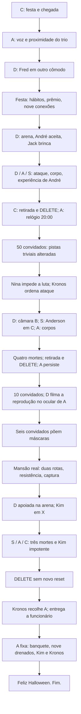

# Especial de Halloween — roteiro oficial de produção

> Revisão editorial: 19/10/2026. Direção de Isaías: continuidade de acontecimentos, quatro linguagens de POV, câmeras como protagonistas e leitura no celular com uma mão. Três lançamentos: **51 páginas narrativas + 9 editoriais por lançamento = 180 páginas físicas; 153 páginas de história**. Esta revisão substitui as versões sobrepostas do documento recebido. O original permanece no histórico do Git; não usar suas instruções conflitantes para produzir novas páginas.
>
> Status: geração autorizada com textos revisados; páginas01–14 salvas. Página15 com encenação não sexual de caminhada e conversa. Falha individual vira pendência e a fila segue; cota global aguarda disponibilidade. Artes03–05 preservadas para avaliação futura do letreiramento.

## 1. Direção da experiência

As câmeras são os protagonistas formais: cada uma tem um alcance, uma memória e uma maneira de falhar. A analógica guarda o que os personagens esquecem; a digital transforma espetáculo em testemunho; a segurança revela a operação indiferente; a primeira pessoa rompe o registro externo para tornar a perda humana. Não criar uma câmera neutra, cinematográfica e invisível para resolver uma cena difícil.

A história acompanha o que muda, não cada metro percorrido. Pode cortar da entrada do corredor para o cômodo de destino, omitir espera ou mostrar outra ação simultânea. O leitor precisa reconhecer lugar, causa e consequência; não precisa acompanhar toda caminhada. Repetir o mesmo instante por outra fonte somente quando a repetição acrescentar informação. Uma câmera registra a tentativa de resgate; outra revela o procedimento que a torna inútil.

**Abertura fixa:** L1-01 festa já acontecendo pela segurança → L1-02 chegada do trio pela segurança → L1-03 analógica de Nina → **L1-04 digital Full HD de Fred, em outro cômodo**. Não gastar uma quarta página continuando a chegada. O quarto POV, subjetivo, só aparece quando André perde a possibilidade de ser visto apenas de fora.

A obrigação de usar analógica pertence ao trabalho escolar de Nina; Fred usa a digital por escolha para produzir conteúdo para a POW-POW. Não obrigar os dois dispositivos a cumprir a mesma regra escolar.

O horror progride de festa → jogo que parece defeituoso → evidência física → tentativa de fuga → vitória de Kronos. As falas dão desejo, atrito, afeto e decisões. A narração é uma intervenção editorial breve, sem revelar o mecanismo. O silêncio permanece quando ele faz a cena funcionar.

### 1.1 Fontes e precedência

1. Orientações de Isaías em 19/10/2026, incorporadas neste documento.
2. Manifesto e regras universais: [WEBSHARD_GUIA_DE_PRODUCAO.md](../WEBSHARD_GUIA_DE_PRODUCAO.md), §§2–7; processo e referências: [PRODUCAO_IMAGEM.md](../../PRODUCAO_IMAGEM.md).
3. Este roteiro determina os acontecimentos, as exceções deste especial e os textos das páginas.
4. Fichas aprovadas determinam aparência; plantas aprovadas determinam geografia. Uma ficha não modifica o roteiro nem muda a identidade de um personagem.
5. Para vozes e identidade, conferir os capítulos atuais de `src/data/historias/lutas-de-ilusao/pt/`, sobretudo 01–03, e `src/data/personagens-pt.json`. As fichas em `docs/LDI/Conhecimento_Otimizado/` ajudam, mas contêm versões antigas divergentes.

A paleta, o neon e o desenho dos capítulos regulares do LDI não são obrigações universais do WEB SHARD. Neste especial: realismo fotográfico extremo e filamentos tecnológicos discretos. A verticalidade, a clareza, a letra grande, a área segura e a hierarquia entre painéis e estilhaços continuam obrigatórias.

### 1.2 Numeração e nove páginas editoriais

`L1-01` significa página narrativa 01 do lançamento 1; não significa página física 01, nem prancha de ambiente 01. Cada lançamento tem Lx-01 a Lx-51 e **nove posições editoriais separadas**, totalizando 60. Não preencher essas nove posições com cenas da história. Capa, entrada, aviso, divulgação, créditos e contracapa serão diagramados com os materiais editoriais oficiais; não inventar aqui textos de aviso, anúncios ou uma ordem que ainda não foi fornecida. A posição física das nove páginas depende desse espelho editorial.

## 2. Regras visuais e contrato de todos os prompts

**Um prompt de página é a soma desta seção, da ficha de fonte (§3), do estado de continuidade (§§4–6) e do bloco Lx-NN correspondente.** Os blocos abaixo são instruções de produção, não apenas títulos de eventos. Antes de enviar uma página ao gerador, reunir essas partes num único texto e anexar as referências reais pelo nome. Não mandar só o resumo da página, nem pedir que o gerador abra links ou consulte este documento.

- **EXTREMO REALISMO fotográfico**, 960 × 1637 px, full-bleed. Pele, cabelo, bronze, tecidos e pedra com textura natural; anatomia e perspectiva plausíveis. O dispositivo governa a nitidez e a exposição. A arena é simulada dentro da história, mas a imagem não assume estética de videogame ou ilustração.
- A página vertical é montagem editorial de trechos e recortes das fontes. Não exige que toda filmadora tenha gravado um quadro vertical os painéis principais respeitam o campo registrado; estilhaços editoriais podem usar outros ângulos do mesmo acontecimento. Ruído e HUD pertencem ao feed; filamentos, balões e faixas pertencem à leitura WEB SHARD.
- Conteúdo indispensável dentro de x=100–860 e y=80–1557, aproximadamente. O cenário ocupa as bordas; a safe area não vira margem branca.
- Um ou dois painéis grandes. Três somente quando o bloco justificar progressão rápida; quatro não serão usados. **L1-01 foi reduzida a dois feeds legíveis**, em vez da grade antiga de quatro. Entrada e corredor são estabelecidos na página seguinte. Não disfarçar uma terceira cena inteira como estilhaço.
- Cortes diagonais de 8–15°, com leitura clara de cima para baixo. As diagonais podem variar de direção dentro da página; não precisam ser paralelas. Sem divisão em página de painel único.
- Separação por uma borda MUITO fina (1–3 px na arte de 960 px), como fibra óptica e microcabos vivos. Não abrir uma faixa entre painéis. L1-01 é exceção aprovada por acomodar narração; não copiar sua faixa larga nas demais páginas. Um reflexo discreto indica a força dominante; não vira neon, fumaça, eletricidade ou moldura grossa. O separador é composição editorial, não objeto registrado pela câmera.
- Enquadrar a ação necessária. Plano geral só para estabelecer espaço, mudar escala ou mostrar uma relação espacial decisiva. A câmera portátil não encontra sempre rostos perfeitamente compostos; a segurança não faz close, zoom nem acompanha pessoas.
- **Shards:** pequenos cacos irregulares de vidro rachado, sobrepostos e subordinados ao painel principal. Não ficam presos aos cantos: podem ocupar o meio da página, atravessar a emenda ou seguir o eixo de um olhar. Podem ligar fases de uma ação, destacar o que alguém observa e conectar causa/consequência; posição determinada pela função narrativa, nunca só decoração. Preservar rostos, falas, HUD e gestos essenciais legíveis. Podem revelar gesto, mão, objeto ou expressão por ângulo editorial externo ao registro da câmera, conforme autorização de Isaías. Não contam como outra câmera nem autorizam cenas inteiras disfarçadas de detalhe. Painéis principais continuam obedecendo à fonte física.
- Balões brancos, letras e contornos na cor de voz, caixa alta, comic bold condensada, mesma fonte no elenco. Reservar espaço para texto desde o quadro; linhas curtas, sem hifenização. Uma palavra pode ganhar ênfase. O guia não fixa uma família comprovada nem um mínimo universal em pixels; não tratar Anime Ace/LETREIRO.png como referência já aprovada deste reinício. A ficha tipográfica precede a geração.
- Textos entre aspas nos blocos são literais; o nome antes dos dois-pontos indica o falante para produção, **não é escrito na arte**. Copiar uma vez, com acentos. Falas fora de quadro apontam para o operador ou para a posição espacial da voz; nunca para um personagem errado. Pensamento é explicitamente identificado e só aparece na percepção subjetiva.
- Narração: faixa estreita de fita magnética escura, letras claras legíveis, sem cauda. Não é áudio da vigilância. O número de faixas é o indicado na página. Sem narração adicional sobre o que a imagem já explica.
- Conservar as roupas, a sujeira acumulada, os objetos, a mão que opera a câmera e os obstáculos. O reset muda o estado do evento conforme o roteiro; não permite trocar silenciosamente a aparência das pessoas.
- A consequência dos ataques é legível por tensão, cabos envolvendo membros, imobilidade, rosto, som captado e reação; a revisão não exige exposição de lesões. Não esconder uma morte inteira em ruído.
- Cada página será revisada a 320, 360, 390, 430 e 480 px. Se a fala não couber, editar/recompor; não diminuir a letra para salvar um quadro lotado. Isso é requisito da revisão visual futura, não teste já realizado em artes inexistentes.

### 2.1 Direção cinematográfica obrigatória em TODAS as páginas

Vale para todos os lançamentos, não apenas para Nina ou para a página 02. Cada painel especifica altura/posição física da lente, eixo, enquadramento, primeiro plano, profundidade e estado da ação. O painel seguinte acrescenta mudança visível de gesto, postura, deslocamento, contato, obstrução ou consequência. Não basta trocar o balão, a boca ou inclinar a borda do mesmo retrato. Não clonar pose, silhueta, mãos e posição na tela entre momentos diferentes.

As portáteis permitem contra-plongée, plongée, campo oblíquo, primeiro plano parcial e profundidade, desde que a posição venha de quem opera o aparelho. Segurança e A apoiada mantêm seu eixo: a progressão vem dos corpos e objetos dentro do campo. Câmeras de segurança diferentes podem ter eixos fixos diferentes. Não inventar câmera flutuante para cobertura reversa. Estilhaços editoriais permitem outro ângulo de detalhe, sem outra cena inteira.

Uma pausa dramática pode conservar o enquadramento, mas a mudança intencional da ação precisa estar declarada. Referência anterior preserva identidade, geografia e objetos; não serve de molde para clonar composição. Um painel único sustenta uma ação decisiva, não um retrato de ficha. Conferir a passagem visual também entre páginas. **Ninguém olha para o leitor ou para a lente; declarar o alvo de cada olhar, sem exceções.**

### 2.2 Blur, sujeira e falhas com função

**BLUR-M:** rastro de movimento durante uma virada, corrida ou queda. Mantém a resposta do dispositivo: analógico pode ter arrasto de sinal; digital pode borrar por movimento/exposição sem adquirir VHS. **LENTE:** tecido encostado, marca de dedo, poeira ou contato com o chão; registrar onde a marca fica até alguém limpá-la. **FOCO:** caça de foco por proximidade/obstrução; não é defeito sobrenatural automático.

O borrão pode ser quase ilegível por um painel curto, desde que haja âncora reconhecível antes e recuperação de informação depois. Um som captado pode atravessar esse quadro. A página seguinte não muda magicamente de lugar ou operador. Não escrever instruções paradoxais como “tudo ilegível, mas identificar seis pessoas”. Quando a informação depende do texto, mantê-lo na área segura e legível.

A vigilância permanece fixa: pessoas em movimento podem borrar, o sensor pode comprimir ou perder frames, mas a imagem inteira não ganha tremor de mão. Um trecho borrado não pode esconder troca de grupo, reposicionamento de câmera, passagem de mundo, descoberta da fita, captura ou resultado do ataque. O bloco indica **a causa, o que se perde e qual âncora recupera a leitura**. Nem toda página de corrida precisa de blur.

## 3. Quatro linguagens, quatro limites

| Fonte | Imagem e áudio | O que pode mostrar | Limite e olhar |
|---|---|---|---|
| C — segurança de Kronos | Preto e branco, câmera física fixa, ruído discreto, sem áudio | Geografia real, festa, laboratório, procedimentos, deslocamentos, corpos, DELETE | Não mostra interior do LDI, pensamentos, conversas audíveis ou movimentos de câmera. |
| A — analógica de Nina | Imagem colorida fortemente envelhecida, VHS visível em toda a área: grão forte, scanlines, tracking, dropouts, ghosting, cor desbotada e bleed; áudio ambiente e vozes | O mundo real na direção da lente; fica gravando quando apoiada | Não entra no LDI nem mostra automaticamente quem a segura. A gravação resiste ao reset. |
| D — digital de Fred | Cor limpa Full HD, áudio; tremor/foco/exposição fisicamente possíveis | Mundo real; no LDI, registro do dispositivo virtual vinculado ao SBI | Só mostra a rota de Fred ou o campo de um apoio estabelecido. Não visita outra câmara sozinha. |
| S — percepção subjetiva | Abertura orgânica de olho; sem REC/HUD; sons percebidos e pensamento curto | Visão e experiência imediata de André, Anderson e, no final, Fred/Nina/Jack/Kim | Não é arquivo recuperado, telepatia ou quinta câmera; não fornece conhecimento fora da vítima. |

**HUD fechado:** A usa `REC`, data/hora própria e `BAT n%` em todos os painéis, inclusive estilhaços e gravação apoiada. Horário absoluto, não contador 00:00:00: primeira imagem 31/10 19:57:00 / BAT 100%; loop 2 começa 31/10 23:43:00 / BAT 75%; loop 3 começa 01/11 02:17:00 / BAT 50%. O relógio da analógica e o consumo não resetam. C usa REC/CAM/local e hora digital do mundo, reiniciada às 20:00 em cada loop; não copiar a hora acumulada de A em C. D usa REC/FHD, imagem limpa e sessão/arquivos/horário/bateria resetados; S não tem HUD. Não imprimir ano. Em PLAY, o trecho mostra sua hora gravada; bateria é a atual do aparelho. O manifesto de continuidade fixa cada valor, sem números inventados.

**Sem som na segurança:** toda imagem de C é inteiramente preto e branco, inclusive HUD, letras e balões. Cada personagem visivelmente falando recebe seu próprio balão branco contendo somente `NO SOUND`, com cauda apontada para ele. Não transcrever diálogos, onomatopeias ou som captado. Figuração sem fala visível não exige balão. Nos anúncios, o áudio impresso avança somente por A e D. A narração editorial é permitida onde o roteiro especificar, sem simular microfone.

**Olhares — regra absoluta:** ninguém olha para o leitor ou diretamente para a lente, sem exceção para Fred gravando, reação, fala ao operador, vilão ou POV subjetivo. Todo prompt declara o alvo concreto de cada olhar. Fred fala olhando para um companheiro fora do eixo; na percepção de André, quem ajuda olha para o braço/cabo, não para os olhos do leitor. Fichas frontais orientam identidade, nunca autorizam olhar frontal na narrativa. Câmera fixa continua fixa mesmo quando alguém sai do campo.

### 3.1 Registro digital dentro do LDI

O roteiro recebido já exigia D no LDI, mas não explicava sua passagem. **Convenção de encenação desta revisão:** Fred vincula a câmera ao modo de registro do SBI antes da conexão; a sala real retém o aparelho físico, e o ambiente virtual fornece sua representação de captura. Uma tela de vínculo, um gesto de confirmação e a retomada da mesma empunhadura tornam a passagem compreensível. Não afirmar que uma câmera física atravessou a sala, nem explicar o funcionamento espiritual do LDI. O registro virtual tem o mesmo POV limitado de uma câmera portada; não é câmera livre do jogo.

Tudo que é digital reseta: câmera de Fred, celular, arquivos, relógio, bateria, configurações e sessão virtual. Não conservar gravação digital ou estado de outro loop como prova. Marcas de uso de D valem apenas dentro do loop em que surgem. O relógio do ambiente volta às 20:00 em cada início. Somente a analógica conserva fita, relógio próprio e bateria consumida. Ela é a única fonte que atravessa o reset com evidências. As memórias dos eventos anteriores são apagadas; ninguém reconhece um loop antes da prova. Só Nina tem sensações e pressentimentos vagos, nunca lembrança completa ou conhecimento do mecanismo.


### 3.2 Analógica envelhecida, balões e origem da voz — obrigatórios

Toda imagem captada por A tem desgaste VHS FORTE e visível no celular: detalhe suavizado, grão de luminância/crominância sobre o quadro inteiro, linhas de varredura, tracking irregular, pequenos dropouts, ghosting e cor desbotada com bleed. Não basta um filtro discreto nas bordas. Estilhaços derivados de A também carregam esse desgaste. A imagem externa de D permanece Full HD limpa; quando D filma o ocular, somente o conteúdo de A dentro do ocular é envelhecido. Balões editoriais ficam nítidos, com fundo branco puro #FFFFFF, sem textura nem transparência.

Cada fala tem texto E contorno na cor da voz: Kim azul #1E6FE0; Jack verde #22C55E; Nina rosa #B82E69; demais vozes seguem §6. Não usar letra/contorno preto como padrão. A exceção é C, totalmente monocromática e sem áudio: apenas NO SOUND. Pensamento é distinto, com cor do personagem e sem cauda de fala.

A voz de quem SEGURA a câmera nasce da borda INFERIOR CENTRAL do painel, na posição de quem está atrás da lente. O balão pode ficar no centro inferior sem cobrir a ação; sua cauda termina na borda inferior central, nunca na lateral ou em personagem visível. Em A de Nina: fala dela rosa, operador fora da imagem. Em A de Jack: fala dele verde e central; Nina visível recebe cauda apontada para ela. Em D empunhada por Fred: fala dele dourada e central; se D estiver apoiada e Fred no campo, a cauda aponta para Fred. Câmera apoiada não transforma toda voz fora do quadro em voz de operador: apontar para o lado físico de quem fala. O plano por página declara custódia e vínculo de cada balão.

## 4. Geografia, custódia e relógios

### 4.1 Planta dramática a fixar antes das artes

```text
Entrada principal — vestíbulo — corredor oeste — salão da festa
                                             ├ buffet lateral
                                             ├ lounge leste de Fred (vão acústico; porta de sensor para passagem de serviço que retorna ao corredor oeste)
                                             ├ corredor técnico — laboratório SBI; bifurcação para circulação/escadaria
                                             └ corredor de circulação — escadaria/patamar
Laboratório — acesso de serviço — salão do banquete (área distinta da festa)
LDI: arena — portões A / B / C — três câmaras de gladiadores
```

Esse é o projeto de conexões desta revisão, não uma planta antiga já aprovada. A prancha-mestra deverá fixar dimensões, aberturas, eixos e retornos. A passagem de serviço do lounge é uma alternativa já existente ao retorno pelo salão, não uma saída secreta criada na fuga; o atendente a usa no primeiro ciclo. O lounge é outro cômodo, mas o anúncio do salão chega por seu vão; não inventar teletransporte de áudio. Na fuga, saída principal e escadaria são tentativas distintas; os perseguidores fecham caminhos já apresentados. Nenhuma porta secreta resolve ou causa uma captura.

### 4.2 Mapa de pessoas e cadeiras

| Ciclo | Convidados anunciados | Participantes | Plateia virtual | Saída |
|---|---|---|---|---|
| 1 | 100 | Kim, Jack, Nina, Fred, Brock, Jason, André, Anderson, Michael: 9 | 91 | André morre; restam 8 participantes. |
| 2 | 50 | Os mesmos, sem André: 8 | 42 | Jason, Brock, Michael e Anderson morrem; restam Kim, Jack, Nina e Fred. |
| 3 | 10 | Os quatro sobreviventes + seis convidados genéricos | Não repetir plateia de 91/42 | Os seis genéricos se mascaram; Jack, Nina e Fred são drenados; Kim é preservado. |

Funcionários da mansão não entram automaticamente no número de convidados. Os seis convidados do ciclo 3 são reconhecíveis antes/depois da máscara; não confundi-los com os funcionários que já serviam a festa. O banquete tem **nove drenados: seis genéricos + Jack + Nina + Fred**, mais Kim e Kronos: onze ocupantes ao todo. André, Brock, Jason, Anderson e Michael não voltam como comensais.

Laboratório: nove bases e cadeiras no ciclo 1; uma cadeira retirada deixa oito no ciclo 2; quatro retiradas deixam quatro no ciclo 3, redistribuídas em torno do centro durante a manutenção vista por C. Manter vestígios da organização antiga e o mesmo contorno de sala. Não estreitar a sala quando faltam cadeiras. Fixar a cadeira de André dentro do campo de A no ciclo 1 e a de Brock em primeiro plano no ciclo 2. Os outros corpos podem ficar parcialmente fora do campo, nunca surgir todos num close impossível.

LDI: A contém Kim/Jack/Nina; B contém Fred/Brock/Jason; C contém André/Anderson/Michael no ciclo 1 e Anderson/Michael no ciclo 2. Fred vê os portões das outras câmaras de fora. O interior de A no ciclo 2 fica fora de campo; o roteiro não inventa uma quarta câmera para segui-lo. O interior de C chega pela percepção de Anderson. Os quatro sobreviventes não chegam ao fim por vencerem um monstro novo: o ciclo é encerrado pelo procedimento de Kronos.

### 4.3 Custódia das câmeras

| Trecho | Analógica A | Digital D |
|---|---|---|
| Festa L1 | Nina opera; Jack a segura por uma breve passagem mostrada | Apoiada no lounge para Fred aparecer; depois Fred a pega. |
| Conexão L1 | Nina apoia na mesa do laboratório; lente para a cadeira de André | Fred vincula ao SBI; aparelho físico fica no suporte; representação virtual com Fred. |
| Encerramento L1 | Continua registrando; um funcionário a recolhe e a devolve na reorganização | Sessão apagada; aparelho real reposicionado para o ciclo seguinte. |
| Festa/conexão L2 | Nina recebe; deixa num apoio mais baixo, com Brock no campo | Fred opera a sessão seguinte; não vê as gravações anteriores. |
| Encerramento L2 | Funcionário transporta e entrega sem desligar; o trajeto pode ser elíptico | Sessão anterior apagada. |
| Investigação L3 | Nina entrega a Jack; D filma o visor ocular de A durante a revisão da fita | Fred filma os outros e a reprodução: não criar uma vista externa neutra. |
| Fuga L3 | Jack opera; alça no punho evita perder o aparelho na primeira queda | Fred opera, sempre com Kim na mesma rota. |
| Captura L3 | Segurança mostra um Mascarado recolher A e apoiá-la no laboratório | Segurança mostra captura/vínculo; no LDI Fred apoia a representação perto da entrada. |
| Desfecho | Kronos recolhe A, mantém a lente para a rota/funcionário e fala de trás dela; depois entrega o aparelho, cujo novo operador registra o percurso e apoia no banquete | D fica abandonada no ponto estabelecido; não acompanha Kronos depois que Fred morre. |

Não mostrar Kronos segurando A de fora pelo POV de A. O gesto de recolher o aparelho é C; a fala seguinte é A, com Kronos fora do quadro e o funcionário/rota à frente da lente. A passagem para o funcionário precisa ser visível no registro; depois a câmera permanece no apoio final.

### 4.4 Tempo do evento, tempo físico e tempo de fita

O relógio cenográfico do salão volta a **20:00** em cada ciclo. No relógio físico de algarismos romanos, isso é orientação dos ponteiros: hora em VIII, minutos em XII, com a noite já estabelecida. Não acrescentar uma tela digital ou escrever 20:00 sobre o mostrador da referência; os números 20:00 nesta documentação indicam o horário da ação. A arena diurna tem um mostrador cerimonial de referência `20:00` integrado ao relógio de sol: é interface da simulação, não o horário astronômico do sol. O céu da arena permanece claro e seco. Mansão: noite.

A começa às **19:57 / 100%**. O loop 2 começa às **23:43 / 75%**; o loop 3 às **02:17 / 50%**, já em 01/11. Entre essas âncoras, horário e bateria avançam conforme `HALLOWEEN_CONTINUIDADE.json`. São 3h46 até o segundo loop e mais 2h34 até o terceiro: o início do terceiro acumula 6h20 desde a chegada. As elipses maiores ficam na festa, preparação/conexão e manutenção; nunca alongar um soco por horas. A hora própria de A é diferente da hora resetada do mundo.

Durante o PLAY, o horário gravado do trecho pode recuar; o relógio próprio do aparelho e o consumo de bateria continuam avançando. Jack retorna ao fim gravado antes de retomar REC; não rebobina e grava por cima da prova. A frase antiga “contador nunca diminui em nenhuma circunstância” foi corrigida: **o reset não apaga/reinicia a fita**, mas reprodução tem seu próprio estado. Uma breve pausa voluntária para PLAY é reconhecida, não escondida como falha de continuidade. Definir no objeto uma fita de longa duração e alimentação capaz de cobrir o evento; não travar a bateria enquanto as horas avançam.

**Fechamento de HUD antes das artes:** o mapa de montagem deve anotar hora/TC de entrada e saída de cada tomada, com os pares simultâneos abaixo no mesmo instante. Os blocos não autorizam o gerador a inventar números intermediários. O ano e o valor do prêmio ainda não foram fornecidos; as fichas disponíveis e os complementos faltantes estão discriminados em §13.1; usar redação sem valor/ano e anexos verificados, em vez de fabricar dados. O roteiro é legível sem esses números técnicos.

## 5. Pistas triviais que mudam de função

| Pista | Loop 1: parece cotidiana | Loop 2: leitor reconhece a alteração | Loop 3: alteração vira decisão/consequência |
|---|---|---|---|
| Uva e lugar no buffet | Desconhecido divide comida com Kim e engasga; se recompõe | Lugar vazio; Jack pega a mesma uva; Nina o interrompe | Nina afasta a tigela antes de oferecerem; não precisa lembrar o motivo. |
| Cabo baixo no corredor técnico | Michael tropeça; um comentário curto, segue | Jack tira o cabo do caminho antes de Michael pisar | Sem Michael, Jack já passa o cabo para o lado ao fugir; o caminho útil é lembrado pelo corpo. |
| Aceitação da luta | Jack brinca e aceita André | Jack aceita Jason; Nina diz “Jack, não luta”; ele recua | Kim tenta negociar a própria vida pelos amigos; Kronos elimina a possibilidade de escolha. |
| Porta do lounge | Atendente com bandeja aciona sensor; porta abre | Fred espera a abertura antes do gesto do atendente, sem perceber | A mesma porta não abre; a familiaridade vira armadilha, e Kim procura outra rota. |
| Contagem do vídeo | Fred conta “três, dois...” e Michael invade o quadro | Falta André; Fred deixa um espaço absurdo ao organizar o grupo | Fred tenta gravar sozinho olhando para o sofá vazio fora do eixo e interrompe a própria pose. A ausência pesa sem recapitulação verbal. |
| Alça da analógica | Nina exige que Jack passe a alça no punho ao segurá-la | Jack faz o gesto antes que ela peça | Na fuga a câmera escorrega, a alça segura; o quadro borra e recupera. A testemunha continua. |

Essas pistas não são uma lista que os personagens explicam ao leitor. Não repetir a mesma fala nos três ciclos. Um objeto só vira destaque se seu estado mudar. O espectador do quadrinho pode perceber ausência e repetição antes dos participantes.

## 6. Vozes, identidade e texto

**Correção de identidade:** Kim tem cabelo preto, traços indígenas e pele marrom; Jack tem dreads verdes e pele mais escura. A revisão recebida trocava os dois. Figurino romano deve ser desenhado para a identidade correta, sem trocar corpos para conservar uma frase antiga. Nina mantém cabelo rosa; Brock é careca; Jason é o mais alto/forte; Michael tem cabelo ruivo e cicatriz; Anderson tem franja preta; André é gordo e forte, com cabelo black. Conferir as fichas atuais antes de gerar. Não transportar automaticamente uniforme escolar ou avatar steampunk para a festa romana.

Kim: seco, faminto e impaciente; age para ajudar antes de conseguir nomear o que sente. Jack: provoca, improvisa e se protege com humor; quando tem medo, a brincadeira falha. Nina: direta, observadora, ativa; a intuição não a transforma em narradora da mitologia. Fred: performa prestígio, depois apela à influência do pai e perde a pose. Brock: pragmático, protetor de André; a força resolve o primeiro cabo, não o procedimento. André: compromisso simples com a irmã. Jason: humor encobre necessidade de dinheiro para a família. Anderson: observa saídas, quer deixar de trabalhar para Fred. Michael: busca aceitação, invade a gravação e força uma coragem que não sustenta.

Preservar o quase-casal Jack/Nina previsto para este especial; não converter essa escolha em atualização romântica do romance inteiro. Kronos fala como anfitrião: frases calmas, controle do espaço e promessas que mudam de sentido. A explicação sobre almas e o Sangue Primordial não vira monólogo na festa.

| Voz | Cor de texto/contorno | Observação |
|---|---|---|
| Kim | `#1E6FE0` | Base do guia geral. |
| Jack | `#22C55E` | Contorno fino escuro na letra quando necessário ao contraste; não usar o glow como tinta. |
| Nina | `#B82E69` | Rosa framboesa do guia. |
| Fred | `#C9A227` | Amarelo; letra e contorno amarelos em fundo branco. Mesma voz em todos os POVs com áudio. |
| Brock | `#8B1E1E` | Marrom-vinho do guia. |
| Anderson | `#4B5563` | Cinza-chumbo do guia, corrigindo o ciano antigo que confundia voz e dominância. |
| André | `#9A4A16` | Tom editorial do laranja queimado do especial. |
| Jason | `#6D28A6` | Tom editorial violeta. |
| Michael | `#155E63` | Tom editorial azul-petróleo. |
| Kronos | `#4B5058` | Cinza metálico, letra e contorno legíveis no branco; mesma voz humana e César decaído. |
| Desconhecido | `#6B543A` | Tom editorial bronze escuro; fala única de função cotidiana. |

Os tons editoriais novos precisam constar da ficha de letreiramento antes de produzir a arte; não são paleta retroativa dos capítulos regulares. Dominância dos filamentos: Kim azul; Jack verde; Nina rosa; Fred dourado; Brock vinho; André laranja; Jason violeta; Michael petróleo; Anderson ciano; Kronos metálico; funcionários bronze; cabos carmesim. Uma página pode ter fala de uma pessoa e dominância de outra.

## 7. Como ler os blocos de página

Em cada bloco: **Fonte** determina a linguagem, o operador e o local; **Quadros** fecha o número, o enquadramento, o acontecimento e eventuais shards/blur; **Texto** lista tudo que pode ser acrescentado além do HUD da fonte; **Ligação** fixa a informação nova e a saída para o corte seguinte. Sem narração/SFX/shards adicionais quando não listados. As cores seguem §6; filamentos seguem a dominância indicada. A narrativa usa português brasileiro; localização EN/ES ocorrerá depois do texto autoral e não foi executada nesta revisão.

A abertura mantém a ordem das fontes; as falas de 03 em diante passam pela revisão autoral desta edição. As demais completam os 51 acontecimentos visuais de cada lançamento, sem reapresentar entradas nem prolongar o mesmo resgate para preencher contagem. Em duas fontes do mesmo instante, o áudio impresso avança; nunca duplicar uma frase para provar sincronismo.

## 8. Lançamento 1 — O espetáculo se rompe e o segundo loop começa

### L1-01 — A festa já começou
**Fonte:** C; CAM 03 SALÃO e CAM 04 PISCINA; fixas; dominância metálica.
**HUD e balões fechados:** C: preto e branco integral, SEM ÁUDIO. REC/CAM/local; hora digital 31/10 19:59:00, 31/10 19:59:00. Cada boca falando: balão NO SOUND monocromático. Custódia: none. Balões brancos, texto/contorno na cor da voz, salvo C monocromática. Ninguém olha leitor/lente.
**Quadros:** dois feeds simultâneos, grandes, cortes diagonais. Salão cheio, funcionários servindo; piscina ocupada em área reconhecível da mesma mansão. Sem personagens principais em destaque, sem laboratório; pequeno estilhaço editorial de mão/bebida. Grupos genéricos distintos no salão e na piscina no mesmo horário, com diversidade de pele, cabelo, idade e porte; ninguém duplicado entre os ambientes. A câmera observa atividade, não apresenta um catálogo de arquitetura.
**Texto:** faixa: “ESPECIAL DE HALLOWEEN DE LUTAS DE ILUSÃO: AQUI TUDO COMEÇA E AQUI TUDO TERMINA.” Balões de quem fala visivelmente: somente “NO SOUND”. A narração pode ocupar uma área maior nesta abertura aprovada.
**Ligação:** o leitor conhece uma festa em andamento e o olhar fixo que voltará no encerramento. A entrada será vista quando alguém chegar.

### L1-02 — Os três chegam
**Fonte:** C; CAM 01 ENTRADA, depois CAM 02 CORREDOR OESTE; dominância bronze.
**HUD e balões fechados:** C: preto e branco integral, SEM ÁUDIO. REC/CAM/local; hora digital 31/10 19:59:30, 31/10 20:00:00. Cada boca falando: balão NO SOUND monocromático. Custódia: none. Balões brancos, texto/contorno na cor da voz, salvo C monocromática. Ninguém olha leitor/lente.
**Quadros:** dois painéis sequenciais, horários progressivos. Primeiro: plano alto oblíquo da CAM 01, trio avançando em diagonal; Nina atrás à direita, filmadora elevada. Segundo: outro eixo fixo alto, reverso, da CAM 02, após a curva do corredor; Kim próximo ao batente afasta o drapeado, Jack parcialmente encoberto. Nina agora ao fundo à esquerda, de perfil/costas, avançando e baixando o aparelho ao peito enquanto gira para a passagem. Mudar posição na tela, escala, orientação, braços e fase do passo; não repetir o retrato frontal da primeira tomada. O percurso intermediário foi omitido. Sem sala SBI, sem shards.
**Texto:** faixa: “CONVIDADOS ESPECIAIS ACABAM DE CHEGAR.” Nenhuma fala captada.
**Ligação:** o gesto de Kim no vão é a âncora da página seguinte, sem reencenar toda a caminhada.

### L1-03 — Agora estamos na mão de Nina
**Fonte:** A, operada por Nina no limiar do salão; dominância verde. REC e início de TC, imagem colorida analógica.
**HUD e balões fechados:** A: P1 REC | 31/10 19:57:00 | BAT 100%; P2 REC | 31/10 19:57:02 | BAT 100%. VHS FORTE sobre quadro inteiro e estilhaços. Custódia: Nina. Fundo branco; texto/contorno na cor de quem fala. Operador invisível com cauda inferior central; visíveis com cauda na posição real. Ninguém olha para leitor/lente.
**Vínculo de cada fala:** Kim: #1E6FE0 texto/contorno, fundo #FFFFFF; cauda para posição física de quem fala; áudio de fita nasce do ocular quando indicado; Jack: #22C55E texto/contorno, fundo #FFFFFF; cauda para posição física de quem fala; áudio de fita nasce do ocular quando indicado; Nina: #B82E69 texto/contorno, fundo #FFFFFF; cauda na borda INFERIOR CENTRAL, operador invisível.
**Quadros:** dois painéis. P1 lente de Nina atrás do ombro de Kim, baixa e oblíqua; ele termina de afastar o tecido no vão, Jack responde de perfil. P2 Kim aponta o buffet e se desloca; Nina gira o pulso, liberando parte da vista do salão, Jack o segue. O comentário de Nina nasce da obstrução que filmou. Estilhaço pequeno do tecido sob tensão atravessa a emenda, sem mostrar Nina por fora.
**Texto:** Kim: “A GENTE COME E VAI EMBORA.” Jack: “FALA POR VOCÊ. EU TÔ DE FOLGA.” Nina, atrás da câmera: “DÁ PRA ANDAR? TÔ FILMANDO AS COSTAS DO KIM.”
**Ligação:** o leitor reconhece lugar e gesto, mas ganha voz e intimidade. Kim aponta o buffet. Não continuar a mesma entrada na página 4.

### L1-04 — Em outro cômodo, outra imagem
**Fonte:** D, apoiada no lounge leste; Fred no campo do aparelho, olhando para Anderson fora do eixo; dominância dourada. Full HD colorida, limpa.
**HUD e balões fechados:** D: REC/FHD limpo; sem horário/bateria sobrepostos. Digitais resetam no início de cada loop. Custódia: supported: Fred visible. Balões brancos, texto/contorno na cor da voz, salvo C monocromática. Ninguém olha leitor/lente.
**Vínculo de cada fala:** Fred: #C9A227 texto/contorno, fundo #FFFFFF; cauda para posição física de quem fala; áudio de fita nasce do ocular quando indicado; Fred: #C9A227 texto/contorno, fundo #FFFFFF; cauda para posição física de quem fala; áudio de fita nasce do ocular quando indicado; Michael: #155E63 texto/contorno, fundo #FFFFFF; cauda para posição física de quem fala; áudio de fita nasce do ocular quando indicado.
**Quadros:** dois painéis no mesmo eixo fixo. Fred prepara a pose e conta; Michael invade a lateral antes do fim. O vão ao fundo deixa reconhecer a luz do salão, sem trazer o trio para o mesmo cômodo. Sem shards.
**Texto:** faixa: “OUTRO CÔMODO. MESMA FESTA.” Fred: “TRÊS, DOIS...” / “E AÍ, GALERA DA POW-POW! HOJE É DIA ESPECIAL. SOMOS VIP NA FESTA DO KRONOS, CRIADOR DO LDI!” Michael: “CÊ JÁ COMEÇOU?”
**Ligação:** corte paralelo, não salto de horas. Terceira fonte apresentada em quatro páginas; a interrupção trivial terá versões diferentes nos resets.

### L1-05 — Um compromisso banal
**Fonte:** D ainda apoiada; lounge; dominância laranja de André.
**HUD e balões fechados:** D: REC/FHD limpo; sem horário/bateria sobrepostos. Digitais resetam no início de cada loop. Custódia: supported: Fred visible. Balões brancos, texto/contorno na cor da voz, salvo C monocromática. Ninguém olha leitor/lente.
**Vínculo de cada fala:** Fred: #C9A227 texto/contorno, fundo #FFFFFF; cauda para posição física de quem fala; áudio de fita nasce do ocular quando indicado; André: #9A4A16 texto/contorno, fundo #FFFFFF; cauda para posição física de quem fala; áudio de fita nasce do ocular quando indicado; Brock: #8B1E1E texto/contorno, fundo #FFFFFF; cauda para posição física de quem fala; áudio de fita nasce do ocular quando indicado.
**Quadros:** dois painéis. Fred tenta refazer a pose; André passa atrás com Brock e confere dois ingressos. Um shard dos ingressos, no campo já visível, sem nomes/títulos legíveis.
**Texto:** Fred: “DÁ PRA NÃO PASSAR NA FRENTE?” André: “SÓ NÃO ENROLA. PROMETI CINEMA PRA MINHA IRMÃ.” Brock: “A GENTE SAI A TEMPO.”
**Ligação:** André tem vida depois da festa; Brock assume um compromisso com ele. A informação não recebe música, narração de presságio nem close de despedida.

### L1-06 — A porta abre sozinha
**Fonte:** D; Fred pega o aparelho do apoio e aponta para a porta do lounge; dominância dourada.
**HUD e balões fechados:** D: REC/FHD limpo; sem horário/bateria sobrepostos. Digitais resetam no início de cada loop. Custódia: Fred. Balões brancos, texto/contorno na cor da voz, salvo C monocromática. Ninguém olha leitor/lente.
**Vínculo de cada fala:** Fred: #C9A227 texto/contorno, fundo #FFFFFF; cauda na borda INFERIOR CENTRAL, operador invisível; Anderson: #4B5563 texto/contorno, fundo #FFFFFF; cauda para posição física de quem fala; áudio de fita nasce do ocular quando indicado.
**Quadros:** dois painéis no lounge leste. P1 Fred recolhe D do aparador; dedos breves na borda, eixo sobe e gira para a porta de serviço à DIREITA. Anderson, de franja cobrindo um olho e roupa EXATA da ficha Capangas, recua para liberar o vão. Atendente mascarado já está visível chegando com bandeja. P2 lente à altura do peito, três quartos do batente; atendente aciona o sensor com o ANTEBRAÇO e abre a folha mantendo a bandeja nivelada. Só então Fred comenta a abertura; Anderson olha o sensor e responde. Ninguém sai do lounge. Fred atrás da lente. Kim, Jack e Nina NÃO estão neste cômodo e NÃO aparecem, nem em reflexos.
**Texto:** Fred, atrás da câmera: “SÓ QUEM É VIP PASSA POR AQUI.” Anderson, olhando o atendente com a bandeja: “É A PORTA DE SERVIÇO, FRED.”
**Ligação:** Fred transforma uma passagem de serviço em tour VIP para o próprio vídeo. O garçom com bandeja e a resposta de Anderson desmontam a pose: a fala nasce do que a câmera acaba de registrar. Não existe Kim no lounge nem insulto dirigido a ausente. Sensor no batente direito será o mesmo na fuga; trio só converge em L1-14.

### L1-07 — A uva
**Fonte:** A nas mãos de Nina, buffet; dominância azul.
**HUD e balões fechados:** A: P1 REC | 31/10 19:57:40 | BAT 100%; P2 REC | 31/10 19:57:42 | BAT 100%. VHS FORTE sobre quadro inteiro e estilhaços. Custódia: Nina. Fundo branco; texto/contorno na cor de quem fala. Operador invisível com cauda inferior central; visíveis com cauda na posição real. Ninguém olha para leitor/lente.
**Vínculo de cada fala:** Desconhecido: #6B543A texto/contorno, fundo #FFFFFF; cauda para posição física de quem fala; áudio de fita nasce do ocular quando indicado; Kim: #1E6FE0 texto/contorno, fundo #FFFFFF; cauda para posição física de quem fala; áudio de fita nasce do ocular quando indicado.
**Quadros:** dois painéis. Kim já comendo ao lado do desconhecido; depois o homem tosse com uma uva e Kim lhe aproxima água. Um shard da mão e da tigela, mesmo momento. Nada de queda ou morte.
**Texto:** Desconhecido, oferecendo a tigela a Kim: “PODE PEGAR. TÁ DOCE.” Kim, ao ver o engasgo: “DEVAGAR, PORRA. TOMA AQUI.”
**Ligação:** desconhecido recupera-se e sinaliza que está bem. É figurante adulto do buffet, NÃO André: André está com Brock no lounge. Tigela e lugar na ponta do balcão reconhecíveis. A página seguinte assume elipse da festa; o engasgo não dura até o anúncio.

### L1-08 — O anfitrião muda o fluxo
**Fonte:** C; CAM 03 SALÃO e CAM 05 LOUNGE; dominância metálica.
**HUD e balões fechados:** C: preto e branco integral, SEM ÁUDIO. REC/CAM/local; hora digital 31/10 21:20:00, 31/10 21:20:00. Cada boca falando: balão NO SOUND monocromático. Custódia: none. Balões brancos, texto/contorno na cor da voz, salvo C monocromática. Ninguém olha leitor/lente.
**Quadros:** dois feeds do mesmo instante. Kronos chega à área do anúncio e os funcionários abrem espaço; no lounge, Fred vira D para o vão, antes ocupado pelo atendente. Nina termina de desviar a lente do buffet. Sem áudio, sem shards.
**Texto:** nenhum além do HUD; se houver personagem visivelmente falando em C, seu balão contém somente “NO SOUND”.
**Ligação:** elipse da festa até o anúncio, legível no salto dos relógios. Os dois feeds sincronizam entre si, mas não com L1-04. Os grupos continuam separados. O áudio começa na fonte sonora seguinte.

### L1-09 — Cem convidados
**Fonte:** A, Nina do salão para Kronos; dominância metálica.
**HUD e balões fechados:** A: P1 REC | 31/10 21:17:05 | BAT 91%; P2 REC | 31/10 21:17:07 | BAT 91%. VHS FORTE sobre quadro inteiro e estilhaços. Custódia: Nina. Fundo branco; texto/contorno na cor de quem fala. Operador invisível com cauda inferior central; visíveis com cauda na posição real. Ninguém olha para leitor/lente.
**Vínculo de cada fala:** Kronos: #4B5058 texto/contorno, fundo #FFFFFF; cauda para posição física de quem fala; áudio de fita nasce do ocular quando indicado; Kronos: #4B5058 texto/contorno, fundo #FFFFFF; cauda para posição física de quem fala; áudio de fita nasce do ocular quando indicado.
**Quadros:** dois painéis, mesmo eixo portátil. Kronos pede atenção; segundo quadro permite ver Jack reagindo na margem, sem corte para uma câmera externa. Sem shards.
**Texto:** Kronos: “BOA NOITE AOS NOSSOS CEM CONVIDADOS ESPECIAIS.” / “HOJE, NOVE DE VOCÊS VÃO INAUGURAR O NOVO LDI.”
**Ligação:** “cem” e “nove” ficam claros, sem pessoas dizendo que são pistas. O anúncio continua no mesmo tempo pela digital.

### L1-10 — A promessa de prêmio
**Fonte:** D, Fred filmando os capangas no lounge, com o anúncio vindo pelo vão; dominância dourada.
**HUD e balões fechados:** D: REC/FHD limpo; sem horário/bateria sobrepostos. Digitais resetam no início de cada loop. Custódia: Fred. Balões brancos, texto/contorno na cor da voz, salvo C monocromática. Ninguém olha leitor/lente.
**Vínculo de cada fala:** Kronos: #4B5058 texto/contorno, fundo #FFFFFF; cauda para posição física de quem fala; áudio de fita nasce do ocular quando indicado; Jason: #6D28A6 texto/contorno, fundo #FFFFFF; cauda para posição física de quem fala; áudio de fita nasce do ocular quando indicado; Fred: #C9A227 texto/contorno, fundo #FFFFFF; cauda na borda INFERIOR CENTRAL, operador invisível.
**Quadros:** dois painéis. Reação de Jason ao prêmio, Brock olha para André; segundo quadro Fred ajusta o enquadramento, não aparece de frente segurando o próprio aparelho. Sem shards.
**Texto:** Kronos, voz do salão: “E O VENCEDOR RECEBERÁ UM PRÊMIO EM DINHEIRO.” Jason: “AGORA FICOU INTERESSANTE.” Fred, atrás da câmera: “EU FALEI QUE AQUI ERA OUTRO NÍVEL.”
**Ligação:** trecho novo do discurso. Não repetir agradecimento, inventar valor do prêmio ou simular fala por cima de C.

### L1-11 — O motivo de Kim muda
**Fonte:** A, Nina para Kim e Jack; salão; dominância azul.
**HUD e balões fechados:** A: P1 REC | 31/10 21:17:17 | BAT 91%; P2 REC | 31/10 21:17:19 | BAT 91%. VHS FORTE sobre quadro inteiro e estilhaços. Custódia: Nina. Fundo branco; texto/contorno na cor de quem fala. Operador invisível com cauda inferior central; visíveis com cauda na posição real. Ninguém olha para leitor/lente.
**Vínculo de cada fala:** Jack: #22C55E texto/contorno, fundo #FFFFFF; cauda para posição física de quem fala; áudio de fita nasce do ocular quando indicado; Kim: #1E6FE0 texto/contorno, fundo #FFFFFF; cauda para posição física de quem fala; áudio de fita nasce do ocular quando indicado.
**Quadros:** dois painéis. Kim para de mastigar ao ouvir “prêmio”; Jack repara antes de ele responder. O desconhecido continua vivo no buffet ao fundo parcial.
**Texto:** Jack: “NÃO ERA COMER E IR EMBORA?” Kim: “O PRATO NÃO VAI FUGIR.”
**Ligação:** a adesão nasce da ação e do dinheiro, sem monólogo sobre ganância.

### L1-12 — Quem fica assistindo
**Fonte:** A, retorno curto a Kronos; dominância metálica.
**HUD e balões fechados:** A: P1 REC | 31/10 21:17:21 | BAT 91%. VHS FORTE sobre quadro inteiro e estilhaços. Custódia: Nina. Fundo branco; texto/contorno na cor de quem fala. Operador invisível com cauda inferior central; visíveis com cauda na posição real. Ninguém olha para leitor/lente.
**Vínculo de cada fala:** Kronos: #4B5058 texto/contorno, fundo #FFFFFF; cauda para posição física de quem fala; áudio de fita nasce do ocular quando indicado; Kronos: #4B5058 texto/contorno, fundo #FFFFFF; cauda para posição física de quem fala; áudio de fita nasce do ocular quando indicado.
**Quadros:** um painel. Kronos indica o acesso técnico, sem abrir ainda a sala. Quadro de informação útil, não panorâmica da festa.
**Texto:** Kronos: “OS OUTROS NOVENTA E UM ACOMPANHAM PELOS PRÓPRIOS SBIS.” / “DEPOIS, TODOS PODERÃO PARTICIPAR.”
**Ligação:** estabelece os 91 e conduz o movimento seguinte. Não ilustrar 91 corpos contáveis num quadro minúsculo.

### L1-13 — Segura direito
**Fonte:** A, Nina entrega a Jack, ainda no salão; dominância rosa.
**HUD e balões fechados:** A: P1 REC | 31/10 21:17:30 | BAT 91%; P2 REC | 31/10 21:17:32 | BAT 91%. VHS FORTE sobre quadro inteiro e estilhaços. Custódia: Nina -> Jack. Fundo branco; texto/contorno na cor de quem fala. Operador invisível com cauda inferior central; visíveis com cauda na posição real. Ninguém olha para leitor/lente.
**Vínculo de cada fala:** Nina: #B82E69 texto/contorno, fundo #FFFFFF; cauda na borda INFERIOR CENTRAL, operador invisível; Jack: #22C55E texto/contorno, fundo #FFFFFF; cauda na borda INFERIOR CENTRAL, operador invisível.
**Quadros:** dois painéis. Nina filma Jack estendendo a mão; o enquadramento baixa enquanto ele recebe, mostrando a alça passando em seu punho. Não mostrar os dois aparelhos ou Nina de frente antes da troca.
**Texto:** Nina: “A ALÇA NO PULSO, JACK.” Jack: “SIM, SENHORA. MAIS ALGUMA EXIGÊNCIA?”
**Ligação:** troca material do operador, não troca de fonte. A posição baixa conduz à retomada na mão de Jack.

### L1-14 — Dois grupos entram no mesmo fluxo
**Fonte:** C; CAM 03 SALÃO; dominância bronze.
**HUD e balões fechados:** C: preto e branco integral, SEM ÁUDIO. REC/CAM/local; hora digital 31/10 21:20:35, 31/10 21:20:37. Cada boca falando: balão NO SOUND monocromático. Custódia: none. Balões brancos, texto/contorno na cor da voz, salvo C monocromática. Ninguém olha leitor/lente.
**Quadros:** um painel fixo. Trio e grupo de Fred convergem para o corredor técnico. Jack segura A com alça no punho; Fred segura D. Atendente indica o caminho. O desconhecido permanece no buffet, fora dos nove.
**Texto:** nenhum além do HUD; se houver personagem visivelmente falando em C, seu balão contém somente “NO SOUND”.
**Ligação:** a segurança confirma custódia e seleção sem fazer apresentação nominal de nove pessoas.

### L1-15 — Fantasia e trabalho
**Fonte:** A, Jack filma Nina durante o deslocamento já iniciado; dominância verde.
**HUD e balões fechados:** A: P1 REC | 31/10 21:17:45 | BAT 91%; P2 REC | 31/10 21:17:47 | BAT 91%. VHS FORTE sobre quadro inteiro e estilhaços. Custódia: Jack. Fundo branco; texto/contorno na cor de quem fala. Operador invisível com cauda inferior central; visíveis com cauda na posição real. Ninguém olha para leitor/lente.
**Vínculo de cada fala:** Jack: #22C55E texto/contorno, fundo #FFFFFF; cauda na borda INFERIOR CENTRAL, operador invisível; Nina: #B82E69 texto/contorno, fundo #FFFFFF; cauda para posição física de quem fala; áudio de fita nasce do ocular quando indicado.
**Quadros:** dois painéis em A de Jack, eixo à altura do peito, foco no rosto e mãos. P1 Nina olha de lado para o broche no ombro dele, fora do eixo da lente; ambos continuam vestidos, sem ajuste de roupa ou contato físico. P2 ela aponta o laboratório, gira o corpo e segue adiante, mudando posição e profundidade. Jack continua atrás da câmera. Sem enquadramento baixo do corpo ou estilhaço.
**Texto:** Jack, atrás da câmera: “VOCÊ ESCOLHEU ISSO SÓ PRA ME VER SOFRER, NÉ?” Nina, apontando o caminho: “EU ESCOLHI A FANTASIA. O DRAMA É TEU.”
**Ligação:** aproximação dos dois e motivo escolar da filmagem surgem numa ação útil; não explicar a relação em narração.

### L1-16 — O outro trabalho de Anderson
**Fonte:** D, Fred atrás do grupo no acesso técnico; dominância dourada.
**HUD e balões fechados:** D: REC/FHD limpo; sem horário/bateria sobrepostos. Digitais resetam no início de cada loop. Custódia: Fred. Balões brancos, texto/contorno na cor da voz, salvo C monocromática. Ninguém olha leitor/lente.
**Vínculo de cada fala:** Anderson: #4B5563 texto/contorno, fundo #FFFFFF; cauda para posição física de quem fala; áudio de fita nasce do ocular quando indicado; Jason: #6D28A6 texto/contorno, fundo #FFFFFF; cauda para posição física de quem fala; áudio de fita nasce do ocular quando indicado; Fred: #C9A227 texto/contorno, fundo #FFFFFF; cauda na borda INFERIOR CENTRAL, operador invisível.
**Quadros:** dois painéis. No corredor técnico, após convergência em L1-14, Anderson pede que Fred ande; Jason reage ao prêmio, Brock o observa. D filma os que caminham à frente de Fred. A continua com Jack até a devolução em L1-17.
**Texto:** Anderson: “ANDA, FRED. ÚLTIMO SERVIÇO QUE EU FAÇO PRA VOCÊ.” Jason: “GANHANDO ESSA GRANA, EU RESOLVO LÁ EM CASA.” Fred: “VOCÊS AINDA TÊM QUE GANHAR DE MIM.”
**Ligação:** Anderson quer terminar o serviço; Jason quer dinheiro para casa. Não chamar todos de amigos de Fred. A devolução de A será vista por D em L1-17.

### L1-17 — O tropeço
**Fonte:** D, Fred no corredor técnico; dominância petróleo.
**HUD e balões fechados:** D: REC/FHD limpo; sem horário/bateria sobrepostos. Digitais resetam no início de cada loop. Custódia: Fred. Balões brancos, texto/contorno na cor da voz, salvo C monocromática. Ninguém olha leitor/lente.
**Vínculo de cada fala:** Michael: #155E63 texto/contorno, fundo #FFFFFF; cauda para posição física de quem fala; áudio de fita nasce do ocular quando indicado; Jason: #6D28A6 texto/contorno, fundo #FFFFFF; cauda para posição física de quem fala; áudio de fita nasce do ocular quando indicado.
**Quadros:** dois painéis. Ao fundo, Jack entrega A a Nina; Michael passa o pé num cabo baixo junto ao batente e quase cai. Jason o segura pela roupa e já continua. Um shard do cabo no mesmo piso.
**Texto:** Michael: “PORRA!” Jason, segurando a roupa dele: “OLHA O CHÃO, ESTRELA.”
**Ligação:** fixar lado do batente, trajeto do cabo e direção de marcha. Acidente rápido; não gastar outra página rindo dele.

### L1-18 — Nove lugares
**Fonte:** A de Nina, entrada do laboratório; dominância bronze.
**HUD e balões fechados:** A: P1 REC | 31/10 21:18:35 | BAT 91%. VHS FORTE sobre quadro inteiro e estilhaços. Custódia: Nina. Fundo branco; texto/contorno na cor de quem fala. Operador invisível com cauda inferior central; visíveis com cauda na posição real. Ninguém olha para leitor/lente.
**Vínculo de cada fala:** Nina: #B82E69 texto/contorno, fundo #FFFFFF; cauda na borda INFERIOR CENTRAL, operador invisível; Jack: #22C55E texto/contorno, fundo #FFFFFF; cauda para posição física de quem fala; áudio de fita nasce do ocular quando indicado.
**Quadros:** um painel geral funcional. Nove cadeiras SBI e rota de serviço reconhecíveis; mesa lateral no primeiro plano. Nina se aproxima dessa mesa, sem o quadro revelar uma décima cadeira.
**Texto:** Nina, atrás da câmera: “ESSE EQUIPAMENTO É MAIS VELHO DO QUE EU ESPERAVA.” Jack: “E VOCÊ VEIO COM ESSA CÂMERA. TÁ EM CASA.”
**Ligação:** agora o laboratório pode ser visto. O espanto pertence ao desenho ritualístico de equipamento técnico, não a ignorância sobre o que é um SBI.

### L1-19 — Fred exige um registro
**Fonte:** D, empunhada por Fred junto à estação; dominância dourada.
**HUD e balões fechados:** D: REC/FHD limpo; sem horário/bateria sobrepostos. Digitais resetam no início de cada loop. Custódia: Fred. Balões brancos, texto/contorno na cor da voz, salvo C monocromática. Ninguém olha leitor/lente.
**Vínculo de cada fala:** Fred: #C9A227 texto/contorno, fundo #FFFFFF; cauda na borda INFERIOR CENTRAL, operador invisível; Brock: #8B1E1E texto/contorno, fundo #FFFFFF; cauda para posição física de quem fala; áudio de fita nasce do ocular quando indicado.
**Quadros:** dois painéis. A lente baixa para o ponto de vínculo do dispositivo; a mão confirma a conexão. O grupo ainda está acordado.
**Texto:** Fred, atrás da câmera: “EU QUERO O REGISTRO DA LUTA. INTEIRO.” Brock: “SÓ NÃO ATRAPALHA.” Interface: “REGISTRO VINCULADO”.
**Ligação:** planta o modo de captura virtual. Nenhum aparelho físico será mostrado atravessando o LDI.

### L1-20 — As mãos ficam livres
**Fonte:** C; CAM 06 LABORATÓRIO; dominância bronze.
**HUD e balões fechados:** C: preto e branco integral, SEM ÁUDIO. REC/CAM/local; hora digital 31/10 21:22:05, 31/10 21:22:07. Cada boca falando: balão NO SOUND monocromático. Custódia: none. Balões brancos, texto/contorno na cor da voz, salvo C monocromática. Ninguém olha leitor/lente.
**Quadros:** um painel. Fred encaixa D no suporte físico depois de vincular; Nina ainda segura A. Funcionários apontam os assentos. Nove participantes reconhecíveis, sem fila de retratos.
**Texto:** nenhum além do HUD; se houver personagem visivelmente falando em C, seu balão contém somente “NO SOUND”.
**Ligação:** mostra onde D fica de verdade e por que Fred não continua filmando fisicamente quando preso.

### L1-21 — A analógica fica
**Fonte:** A, Nina ajusta a mesa lateral; dominância rosa.
**HUD e balões fechados:** A: P1 REC | 31/10 21:19:15 | BAT 91%; P2 REC | 31/10 21:19:17 | BAT 91%. VHS FORTE sobre quadro inteiro e estilhaços. Custódia: Nina -> supported. Fundo branco; texto/contorno na cor de quem fala. Operador invisível com cauda inferior central; visíveis com cauda na posição real. Ninguém olha para leitor/lente.
**Vínculo de cada fala:** Nina: #B82E69 texto/contorno, fundo #FFFFFF; cauda na borda INFERIOR CENTRAL, operador invisível; Jack: #22C55E texto/contorno, fundo #FFFFFF; cauda para posição física de quem fala; áudio de fita nasce do ocular quando indicado.
**Quadros:** dois painéis. Quadro inclina ao apoiar; segundo já está estável, cadeira de André dentro do campo. Nina entra pela lateral da própria imagem, agora que não está segurando a câmera.
**Texto:** Nina: “VOU DEIXAR GRAVANDO AQUI.” Jack, fora do campo: “NÃO VAI ESQUECER ELA.”
**Ligação:** apoio, altura e eixo ficam fechados. Dali em diante A não se aproxima do rosto de André por vontade narrativa.

### L1-22 — O aperto
**Fonte:** A fixa na mesa; dominância bronze.
**HUD e balões fechados:** A: P1 REC | 31/10 21:19:25 | BAT 91%; P2 REC | 31/10 21:19:27 | BAT 91%. VHS FORTE sobre quadro inteiro e estilhaços. Custódia: supported. Fundo branco; texto/contorno na cor de quem fala. Operador invisível com cauda inferior central; visíveis com cauda na posição real. Ninguém olha para leitor/lente.
**Vínculo de cada fala:** André: #9A4A16 texto/contorno, fundo #FFFFFF; cauda para posição física de quem fala; áudio de fita nasce do ocular quando indicado; Brock: #8B1E1E texto/contorno, fundo #FFFFFF; cauda para posição física de quem fala; áudio de fita nasce do ocular quando indicado.
**Quadros:** dois painéis do mesmo campo em instantes diferentes. André testa uma correia; Brock responde ao alcance do microfone, mesmo parcialmente fora da imagem. Funcionário fecha o conector.
**Texto:** André: “PRECISA APERTAR TANTO?” Brock: “JÁ JÁ ACABA.” SFX captado: “CLAC”.
**Ligação:** o gesto parece rotina de segurança e mais tarde vira contenção. Não antecipar a dor verdadeira.

### L1-23 — O lado de fora permanece
**Fonte:** C; CAM 06 LABORATÓRIO; dominância metálica.
**HUD e balões fechados:** C: preto e branco integral, SEM ÁUDIO. REC/CAM/local; hora digital 31/10 21:22:35, 31/10 21:22:37. Cada boca falando: balão NO SOUND monocromático. Custódia: none. Balões brancos, texto/contorno na cor da voz, salvo C monocromática. Ninguém olha leitor/lente.
**Quadros:** um painel fixo. Últimos capacetes conectados, A visível no apoio, D no suporte; porta técnica se fecha, cadeiras continuam onde estavam.
**Texto:** nenhum além do HUD; se houver personagem visivelmente falando em C, seu balão contém somente “NO SOUND”.
**Ligação:** elipse assumida entre conexão e primeiro trecho útil da sessão virtual. Nenhuma pessoa entra fisicamente numa arena pela porta do laboratório.

### L1-24 — A primeira cela
**Fonte:** D virtual de Fred, câmara B; dominância dourada.
**HUD e balões fechados:** D: REC/FHD limpo; sem horário/bateria sobrepostos. Digitais resetam no início de cada loop. Custódia: Fred. Balões brancos, texto/contorno na cor da voz, salvo C monocromática. Ninguém olha leitor/lente.
**Vínculo de cada fala:** Fred: #C9A227 texto/contorno, fundo #FFFFFF; cauda na borda INFERIOR CENTRAL, operador invisível; Jason: #6D28A6 texto/contorno, fundo #FFFFFF; cauda para posição física de quem fala; áudio de fita nasce do ocular quando indicado.
**Quadros:** dois painéis. Fred levanta a representação do aparelho na mesma empunhadura; Brock e Jason junto ao portão B. A luz diurna invade quando o portão abre.
**Texto:** Fred, atrás da câmera: “TÁ GRAVANDO.” Jason: “ENTÃO PEGA MEU LADO BOM.”
**Ligação:** imagem limpa e REC/FHD confirmam D; não usar VHS ou uma tomada aérea do jogo.

### L1-25 — O portão do trio
**Fonte:** D, Fred sai de B; dominância verde.
**HUD e balões fechados:** D: REC/FHD limpo; sem horário/bateria sobrepostos. Digitais resetam no início de cada loop. Custódia: Fred. Balões brancos, texto/contorno na cor da voz, salvo C monocromática. Ninguém olha leitor/lente.
**Vínculo de cada fala:** Jack: #22C55E texto/contorno, fundo #FFFFFF; cauda para posição física de quem fala; áudio de fita nasce do ocular quando indicado; Kim: #1E6FE0 texto/contorno, fundo #FFFFFF; cauda para posição física de quem fala; áudio de fita nasce do ocular quando indicado.
**Quadros:** dois painéis. Primeiro, batente de B na borda enquanto Fred gira; segundo, portão A abre e Kim, Jack e Nina saem. Não cortar para dentro de A antes de ele poder vê-la.
**Texto:** Jack: “ATÉ QUE O PASSEIO VALEU.” Kim: “CADÊ O PRÊMIO?”
**Ligação:** os grupos passam a ocupar o mesmo espaço. A rotação é visível entre imagens, não posição impossível do operador.

### L1-26 — André vem atrás
**Fonte:** D, agora com visão do portão C; dominância laranja.
**HUD e balões fechados:** D: REC/FHD limpo; sem horário/bateria sobrepostos. Digitais resetam no início de cada loop. Custódia: Fred. Balões brancos, texto/contorno na cor da voz, salvo C monocromática. Ninguém olha leitor/lente.
**Vínculo de cada fala:** Brock: #8B1E1E texto/contorno, fundo #FFFFFF; cauda para posição física de quem fala; áudio de fita nasce do ocular quando indicado; André: #9A4A16 texto/contorno, fundo #FFFFFF; cauda para posição física de quem fala; áudio de fita nasce do ocular quando indicado.
**Quadros:** dois painéis. André, Anderson e Michael deixam C; Brock levanta a mão para chamar André para perto. Um shard do gesto de Brock no quadro captado.
**Texto:** Brock: “AQUI, ANDRÉ.” André: “TÔ INDO.”
**Ligação:** fecha a divisão 3+3+3 e a amizade, sem reapresentar nomes em legendas.

### L1-27 — Noventa e um assistem
**Fonte:** D de Fred, margem da arena; dominância metálica.
**HUD e balões fechados:** D: REC/FHD limpo; sem horário/bateria sobrepostos. Digitais resetam no início de cada loop. Custódia: Fred. Balões brancos, texto/contorno na cor da voz, salvo C monocromática. Ninguém olha leitor/lente.
**Vínculo de cada fala:** Fred: #C9A227 texto/contorno, fundo #FFFFFF; cauda na borda INFERIOR CENTRAL, operador invisível; Nina: #B82E69 texto/contorno, fundo #FFFFFF; cauda para posição física de quem fala; áudio de fita nasce do ocular quando indicado.
**Quadros:** um painel em plano aberto com função: pista, portões e parte da plateia de aparência morta-viva sob sol escaldante. Não repetir esse panorama em todas as páginas seguintes.
**Texto:** Fred, atrás da câmera: “ISSO AQUI VAI DAR UM VÍDEO...” Nina: “OLHA A CARA DESSA GENTE.”
**Ligação:** Fred lê o desconforto como oportunidade; o leitor pode aceitar a plateia como estética da simulação.

### L1-28 — O anfitrião acima deles
**Fonte:** D, eixo para a sacada imperial; dominância metálica.
**HUD e balões fechados:** D: REC/FHD limpo; sem horário/bateria sobrepostos. Digitais resetam no início de cada loop. Custódia: Fred. Balões brancos, texto/contorno na cor da voz, salvo C monocromática. Ninguém olha leitor/lente.
**Vínculo de cada fala:** Kronos: #4B5058 texto/contorno, fundo #FFFFFF; cauda para posição física de quem fala; áudio de fita nasce do ocular quando indicado.
**Quadros:** um painel. Kronos como César grotesco, acima das arquibancadas; referência cerimonial `20:00` integrada ao relógio de sol. Sem trono no chão.
**Texto:** Kronos: “QUE OS PRIMEIROS DESAFIANTES VENHAM AO CENTRO.”
**Ligação:** autoridade e regra aparente em uma frase. Não repetir a explicação do evento.

### L1-29 — André tem pressa
**Fonte:** D, Fred volta a lente ao grupo; dominância laranja.
**HUD e balões fechados:** D: REC/FHD limpo; sem horário/bateria sobrepostos. Digitais resetam no início de cada loop. Custódia: Fred. Balões brancos, texto/contorno na cor da voz, salvo C monocromática. Ninguém olha leitor/lente.
**Vínculo de cada fala:** André: #9A4A16 texto/contorno, fundo #FFFFFF; cauda para posição física de quem fala; áudio de fita nasce do ocular quando indicado; Brock: #8B1E1E texto/contorno, fundo #FFFFFF; cauda para posição física de quem fala; áudio de fita nasce do ocular quando indicado; André: #9A4A16 texto/contorno, fundo #FFFFFF; cauda para posição física de quem fala; áudio de fita nasce do ocular quando indicado.
**Quadros:** dois painéis. André ergue a mão; Brock tenta adiar por um instante, André sorri e dá de ombros.
**Texto:** André: “EU VOU PRIMEIRO.” Brock: “NEM OUVIU A REGRA.” André: “QUERO ACABAR LOGO. TENHO QUE BUSCAR MINHA IRMÃ.”
**Ligação:** o compromisso cotidiano produz a decisão fatal, sem entrada de flashback da irmã.

### L1-30 — Jack aceita
**Fonte:** D; dominância verde.
**HUD e balões fechados:** D: REC/FHD limpo; sem horário/bateria sobrepostos. Digitais resetam no início de cada loop. Custódia: Fred. Balões brancos, texto/contorno na cor da voz, salvo C monocromática. Ninguém olha leitor/lente.
**Vínculo de cada fala:** Jack: #22C55E texto/contorno, fundo #FFFFFF; cauda para posição física de quem fala; áudio de fita nasce do ocular quando indicado; Kim: #1E6FE0 texto/contorno, fundo #FFFFFF; cauda para posição física de quem fala; áudio de fita nasce do ocular quando indicado.
**Quadros:** dois painéis. Jack se coloca como adversário; Kim observa sem alarme. Fred recua um passo para manter os dois no campo.
**Texto:** Jack: “BELEZA, MEU CARO. EU VOU CONTIGO.” Kim: “SEM INVENTAR MODA, JACK.”
**Ligação:** a luta é uma escolha, ainda percebida como jogo. A aceitação será alterada no segundo ciclo.

### L1-31 — Um instante de hesitação
**Fonte:** D; Nina na margem do campo de Fred; dominância rosa.
**HUD e balões fechados:** D: REC/FHD limpo; sem horário/bateria sobrepostos. Digitais resetam no início de cada loop. Custódia: Fred. Balões brancos, texto/contorno na cor da voz, salvo C monocromática. Ninguém olha leitor/lente.
**Vínculo de cada fala:** Nina: #B82E69 texto/contorno, fundo #FFFFFF; cauda para posição física de quem fala; áudio de fita nasce do ocular quando indicado; Jack: #22C55E texto/contorno, fundo #FFFFFF; cauda para posição física de quem fala; áudio de fita nasce do ocular quando indicado.
**Quadros:** um painel. Nina quase ergue a mão para Jack; ele já segue para o centro, sem perceber. Foco continua no mesmo plano, sem close externo privilegiado.
**Texto:** Nina: “JACK... ESPERA.” Jack: “QUE FOI? É SÓ UMA LUTINHA.”
**Ligação:** intuição pequena; Nina não adivinha a morte e não diz ainda a frase que mudará a luta.

### L1-32 — Filmando a brincadeira
**Fonte:** D; Fred ajusta a posição à margem; dominância dourada.
**HUD e balões fechados:** D: REC/FHD limpo; sem horário/bateria sobrepostos. Digitais resetam no início de cada loop. Custódia: Fred. Balões brancos, texto/contorno na cor da voz, salvo C monocromática. Ninguém olha leitor/lente.
**Vínculo de cada fala:** Michael: #155E63 texto/contorno, fundo #FFFFFF; cauda para posição física de quem fala; áudio de fita nasce do ocular quando indicado; Anderson: #4B5563 texto/contorno, fundo #FFFFFF; cauda para posição física de quem fala; áudio de fita nasce do ocular quando indicado.
**Quadros:** dois painéis. Michael se oferece para entrar na imagem; Anderson o puxa para não tampar a luta. O centro continua visível.
**Texto:** Michael, atravessando o quadro: “PEGA EU TAMBÉM, FRED.” Anderson, puxando-o pelo tecido: “SAI DA FRENTE. ELE TÁ FILMANDO A LUTA.”
**Ligação:** reafirma D como objeto disputado por exibicionismo e mostra onde os dois ficam quando começarem a rir.

### L1-33 — Não é uma luta séria
**Fonte:** D; dominância verde.
**HUD e balões fechados:** D: REC/FHD limpo; sem horário/bateria sobrepostos. Digitais resetam no início de cada loop. Custódia: Fred. Balões brancos, texto/contorno na cor da voz, salvo C monocromática. Ninguém olha leitor/lente.
**Vínculo de cada fala:** André: #9A4A16 texto/contorno, fundo #FFFFFF; cauda para posição física de quem fala; áudio de fita nasce do ocular quando indicado; Jack: #22C55E texto/contorno, fundo #FFFFFF; cauda para posição física de quem fala; áudio de fita nasce do ocular quando indicado.
**Quadros:** dois painéis. Jack e André ajustam a distância; André abre a guarda de brincadeira. Enquadramento do torso e mãos, sem novo panorama.
**Texto:** André: “VAI PEGAR LEVE COMIGO?” Jack: “EU? NUNCA. VOU ESTRAGAR TEU PENTEADO.”
**Ligação:** prepara o contato sem sobrecarregar o quadro do impacto com piada e reação ao mesmo tempo.

### L1-34 — O soquinho
**Fonte:** D; dominância verde.
**HUD e balões fechados:** D: REC/FHD limpo; sem horário/bateria sobrepostos. Digitais resetam no início de cada loop. Custódia: Fred. Balões brancos, texto/contorno na cor da voz, salvo C monocromática. Ninguém olha leitor/lente.
**Vínculo de cada fala:** André: #9A4A16 texto/contorno, fundo #FFFFFF; cauda para posição física de quem fala; áudio de fita nasce do ocular quando indicado.
**Quadros:** dois painéis, contato leve e queda exagerada de André rindo. Um shard subordinado do punho tocando, não outro golpe.
**Texto:** SFX captado: “TOC”. André, fingindo cair: “AI, MEU CORAÇÃO! FUI DERROTADO!”
**Ligação:** o riso pertence ao jogo aparente. Não tornar o soco visualmente forte para justificar os cabos.

### L1-35 — Algo puxa por baixo
**Fonte:** D; dominância carmesim começa a substituir o verde.
**HUD e balões fechados:** D: REC/FHD limpo; sem horário/bateria sobrepostos. Digitais resetam no início de cada loop. Custódia: Fred. Balões brancos, texto/contorno na cor da voz, salvo C monocromática. Ninguém olha leitor/lente.
**Vínculo de cada fala:** André: #9A4A16 texto/contorno, fundo #FFFFFF; cauda para posição física de quem fala; áudio de fita nasce do ocular quando indicado.
**Quadros:** dois painéis. Após a queda fingida, André apoia a mão para levantar e cabo emerge da junção no piso, prendendo seu ANTEBRAÇO. Tenta retirar o braço e falha. Mesmo braço e lado nas tomadas seguintes, inclusive conector real em L1-38. Ainda não é execução inteira.
**Texto:** André: “PERA... PRENDEU MEU BRAÇO.”
**Ligação:** a primeira anomalia impede uma ação concreta; ainda não é um painel de execução inteira.

### L1-36 — A graça acaba
**Fonte:** D; dominância carmesim.
**HUD e balões fechados:** D: REC/FHD limpo; sem horário/bateria sobrepostos. Digitais resetam no início de cada loop. Custódia: Fred. Balões brancos, texto/contorno na cor da voz, salvo C monocromática. Ninguém olha leitor/lente.
**Vínculo de cada fala:** André: #9A4A16 texto/contorno, fundo #FFFFFF; cauda para posição física de quem fala; áudio de fita nasce do ocular quando indicado; André: #9A4A16 texto/contorno, fundo #FFFFFF; cauda para posição física de quem fala; áudio de fita nasce do ocular quando indicado.
**Quadros:** dois painéis. Outros cabos envolvem André; sua expressão e a tensão corporal mudam. Jack para a poucos passos, mão ainda meio erguida.
**Texto:** André: “AI! PORRA!” / “JACK, PUXA. TÁ DOENDO DE VERDADE!”
**Ligação:** a voz transforma o registro: já não é reação de jogo. Cabos e corpos permanecem na mesma posição na troca de fonte.

### L1-37 — Kim entra no quadro
**Fonte:** D; Fred gira para acompanhar Kim; dominância azul.
**HUD e balões fechados:** D: REC/FHD limpo; sem horário/bateria sobrepostos. Digitais resetam no início de cada loop. Custódia: Fred. Balões brancos, texto/contorno na cor da voz, salvo C monocromática. Ninguém olha leitor/lente.
**Vínculo de cada fala:** Kim: #1E6FE0 texto/contorno, fundo #FFFFFF; cauda para posição física de quem fala; áudio de fita nasce do ocular quando indicado.
**Quadros:** dois painéis. Kim entra pelo lado de Jack e agarra feixe no antebraço de André; grita para a sacada de Kronos sem olhar para D. Fred gira fisicamente; BLUR-M breve recupera o mesmo braço, sem mudar o lado da ajuda.
**Texto:** Kim, dirigindo-se a Kronos na sacada: “DESLIGA ESSA PORRA!”
**Ligação:** a câmera perde a composição por uma causa visível; a ação continua legível quando recupera o foco.

### L1-38 — Outra mão, mesmo braço
**Fonte:** A fixa no laboratório, mesmo instante do bloqueio na arena; dominância bronze.
**HUD e balões fechados:** A: P1 REC | 31/10 23:39:00 | BAT 75%; P2 REC | 31/10 23:39:02 | BAT 75%. VHS FORTE sobre quadro inteiro e estilhaços. Custódia: supported. Fundo branco; texto/contorno na cor de quem fala. Operador invisível com cauda inferior central; visíveis com cauda na posição real. Ninguém olha para leitor/lente.
**Quadros:** dois painéis do eixo estabelecido. Um Mascarado conecta um cabo à região correspondente do corpo real de André; a mão dele contrai. O som é de metal/tecido e respiração, não os gritos da arena.
**Texto:** SFX captado: “CLIC”. Nenhuma fala do LDI.
**Ligação:** primeira convergência decisiva. O leitor ganha a causa física que os participantes não conseguem ver.

### L1-39 — A força não resolve
**Fonte:** D; dominância vinho de Brock.
**HUD e balões fechados:** D: REC/FHD limpo; sem horário/bateria sobrepostos. Digitais resetam no início de cada loop. Custódia: Fred. Balões brancos, texto/contorno na cor da voz, salvo C monocromática. Ninguém olha leitor/lente.
**Vínculo de cada fala:** Brock: #8B1E1E texto/contorno, fundo #FFFFFF; cauda para posição física de quem fala; áudio de fita nasce do ocular quando indicado; Kim: #1E6FE0 texto/contorno, fundo #FFFFFF; cauda para posição física de quem fala; áudio de fita nasce do ocular quando indicado.
**Quadros:** dois painéis. Brock e Jason chegam ao lado oposto de Kim; Brock puxa o mesmo feixe enquanto André tenta acompanhar o movimento. Não gerar mais ajudantes.
**Texto:** Brock: “SEGURA AQUI, ANDRÉ!” Kim, puxando o feixe: “KRONOS! TIRA ELE DAQUI!”
**Ligação:** o procedimento real continua apesar do esforço virtual. As mãos dos três não trocam de lado a cada quadro.

### L1-40 — Quem ainda ri
**Fonte:** D; Fred desvia por um momento para Anderson e Michael e retorna à margem da ação; dominância petróleo.
**HUD e balões fechados:** D: REC/FHD limpo; sem horário/bateria sobrepostos. Digitais resetam no início de cada loop. Custódia: Fred. Balões brancos, texto/contorno na cor da voz, salvo C monocromática. Ninguém olha leitor/lente.
**Vínculo de cada fala:** Michael: #155E63 texto/contorno, fundo #FFFFFF; cauda para posição física de quem fala; áudio de fita nasce do ocular quando indicado; André: #9A4A16 texto/contorno, fundo #FFFFFF; cauda para posição física de quem fala; áudio de fita nasce do ocular quando indicado.
**Quadros:** dois painéis. Michael começa rindo, Anderson acompanha; o riso para quando ouvem André. Sem blur que encubra a mudança de expressão.
**Texto:** Michael, ainda sem compreender: “QUAL FOI, ANDRÉ... ACABOU A PEÇA.” André, fora do quadro: “ME TIRA DAQUI!”
**Ligação:** a incredulidade dura uma batida; não mantê-los rindo durante toda a morte.

### L1-41 — Foi só um toque
**Fonte:** D; Jack perto do centro, Nina tenta alcançá-lo; dominância verde enfraquecida.
**HUD e balões fechados:** D: REC/FHD limpo; sem horário/bateria sobrepostos. Digitais resetam no início de cada loop. Custódia: Fred. Balões brancos, texto/contorno na cor da voz, salvo C monocromática. Ninguém olha leitor/lente.
**Vínculo de cada fala:** Jack: #22C55E texto/contorno, fundo #FFFFFF; cauda para posição física de quem fala; áudio de fita nasce do ocular quando indicado; Nina: #B82E69 texto/contorno, fundo #FFFFFF; cauda para posição física de quem fala; áudio de fita nasce do ocular quando indicado.
**Quadros:** dois painéis. Jack olha a própria mão; Nina o puxa pelo ombro para agir, sem retirar Kim/Brock/Jason do resgate.
**Texto:** Jack: “EU SÓ ENCOSTEI...” Nina: “EU VI. OLHA O QUE TÁ PRENDENDO ELE.”
**Ligação:** culpa e vínculo entram em conflito com o que a câmera registrou. Não explicar a origem dos cabos.

### L1-42 — O corpo responde
**Fonte:** A fixa; laboratório; dominância carmesim.
**HUD e balões fechados:** A: P1 REC | 31/10 23:39:12 | BAT 75%; P2 REC | 31/10 23:39:14 | BAT 75%. VHS FORTE sobre quadro inteiro e estilhaços. Custódia: supported. Fundo branco; texto/contorno na cor de quem fala. Operador invisível com cauda inferior central; visíveis com cauda na posição real. Ninguém olha para leitor/lente.
**Quadros:** dois painéis. André convulsiona no mesmo assento; funcionário segura a estação, não conforta a pessoa. Campo conserva o apoio e os limites da mesa.
**Texto:** apenas respiração/sons físicos captados, sem onomatopeia nova impressa.
**Ligação:** mostrar o contraste metódico, não um segundo ataque independente. A câmera não reenquadra sozinha.

### L1-43 — Dentro dos olhos de André
**Fonte:** S de André, na arena; dominância laranja.
**HUD e balões fechados:** S: abertura orgânica de olho, sem HUD/VHS; visão e audição somente da vítima indicada. Custódia: none. Balões brancos, texto/contorno na cor da voz, salvo C monocromática. Ninguém olha leitor/lente.
**Vínculo de cada fala:** André: #9A4A16 texto/contorno, fundo #FFFFFF; pensamento sem cauda; Brock: #8B1E1E texto/contorno, fundo #FFFFFF; cauda para posição física de quem fala; áudio de fita nasce do ocular quando indicado.
**Quadros:** um painel com abertura orgânica. Mãos de Kim e Brock invadem seu campo tentando libertá-lo; visão baixa, sem ver o próprio rosto. Ruído de vozes é percepção, não fita.
**Texto:** pensamento de André: “TÁ FRIO.” Brock, ouvido por ele: “FICA COMIGO, ANDRÉ.”
**Ligação:** estreia do quarto POV. Não acrescentar REC, filme de infância ou visão da sala real que André não tem.

### L1-44 — Não para de gravar
**Fonte:** D; Fred baixa o aparelho com medo, Kim ainda no campo; dominância azul.
**HUD e balões fechados:** D: REC/FHD limpo; sem horário/bateria sobrepostos. Digitais resetam no início de cada loop. Custódia: Fred. Balões brancos, texto/contorno na cor da voz, salvo C monocromática. Ninguém olha leitor/lente.
**Vínculo de cada fala:** Fred: #C9A227 texto/contorno, fundo #FFFFFF; cauda na borda INFERIOR CENTRAL, operador invisível; Kim: #1E6FE0 texto/contorno, fundo #FFFFFF; cauda para posição física de quem fala; áudio de fita nasce do ocular quando indicado.
**Quadros:** dois painéis. Enquadramento ameaça cair para a areia; Kim ergue o rosto na direção de Fred e pede o registro. Fred recupera a altura, sem limpeza milagrosa de uma lente que não tocou o chão.
**Texto:** Fred, atrás da câmera: “EU VOU DESLIGAR.” Kim: “NÃO DESLIGA. GRAVA ESSA PORRA.”
**Ligação:** a mesma câmera que buscava audiência passa a ser necessária como testemunha.

### L1-45 — A promessa volta
**Fonte:** S de André; dominância laranja.
**HUD e balões fechados:** S: abertura orgânica de olho, sem HUD/VHS; visão e audição somente da vítima indicada. Custódia: none. Balões brancos, texto/contorno na cor da voz, salvo C monocromática. Ninguém olha leitor/lente.
**Vínculo de cada fala:** André: #9A4A16 texto/contorno, fundo #FFFFFF; cauda para posição física de quem fala; áudio de fita nasce do ocular quando indicado; Brock: #8B1E1E texto/contorno, fundo #FFFFFF; cauda para posição física de quem fala; áudio de fita nasce do ocular quando indicado.
**Quadros:** dois painéis subjetivos. Brock aparece perto demais para um retrato composto; André tenta dizer algo e o foco periférico falha.
**Texto:** André: “BROCK... MINHA IRMÃ...” Brock: “A GENTE VAI SAIR. TÁ ME OUVINDO?”
**Ligação:** o compromisso de Brock se torna impossível. Não mostrar ingressos na arena se eles ficaram na roupa real.

### L1-46 — Os ingressos ficaram aqui
**Fonte:** A fixa no laboratório; dominância bronze.
**HUD e balões fechados:** A: P1 REC | 31/10 23:39:24 | BAT 75%. VHS FORTE sobre quadro inteiro e estilhaços. Custódia: supported. Fundo branco; texto/contorno na cor de quem fala. Operador invisível com cauda inferior central; visíveis com cauda na posição real. Ninguém olha para leitor/lente.
**Quadros:** um painel. Mão real de André relaxa; os ingressos visíveis junto à roupa, dentro do campo estabelecido. Um shard só se os ingressos realmente estiverem legíveis no quadro-mãe; sem inventar texto neles.
**Texto:** nenhuma fala ou onomatopeia impressa; somente HUD de A. Não adicionar NO SOUND à analógica.
**Ligação:** o objeto une o compromisso e o corpo físico, sem narração dizendo quem ficará esperando.

### L1-47 — A percepção cede
**Fonte:** S de André; dominância laranja apagando.
**HUD e balões fechados:** S: abertura orgânica de olho, sem HUD/VHS; visão e audição somente da vítima indicada. Custódia: none. Balões brancos, texto/contorno na cor da voz, salvo C monocromática. Ninguém olha leitor/lente.
**Vínculo de cada fala:** André: #9A4A16 texto/contorno, fundo #FFFFFF; pensamento sem cauda.
**Quadros:** dois painéis, momentos subjetivos: Kim ainda tentando puxá-lo; campo orgânico se fecha até quase nada. Sem borrão de corrida ou HUD.
**Texto:** pensamento: “EU PROMETI.”
**Ligação:** encerramento humano da morte. A frase não explica a tecnologia e não se repete em outra fonte.

### L1-48 — O silêncio que Fred registra
**Fonte:** D; dominância azul.
**HUD e balões fechados:** D: REC/FHD limpo; sem horário/bateria sobrepostos. Digitais resetam no início de cada loop. Custódia: Fred. Balões brancos, texto/contorno na cor da voz, salvo C monocromática. Ninguém olha leitor/lente.
**Vínculo de cada fala:** Kim: #1E6FE0 texto/contorno, fundo #FFFFFF; cauda para posição física de quem fala; áudio de fita nasce do ocular quando indicado.
**Quadros:** um painel. André imóvel, Kim ainda segura o feixe; Brock não consegue largar a mão do amigo. Fred mantém o aparelho, ligeiramente baixo. Nina e Jack no mesmo lado de antes.
**Texto:** Kim: “...ANDRÉ?”
**Ligação:** o resultado não fica escondido no apagão subjetivo. Sem mais uma tentativa idêntica de puxar cabo.

### L1-49 — O apagamento não alcança a fita
**Fonte:** montagem C → A; laboratório e transporte para salão.
**HUD e balões fechados:** P1 C: REC/CAM06/LABORATÓRIO | 31/10 23:44:15, preto e branco, SEM áudio, DELETE só aqui. P2 A REC | 31/10 23:42:50 | BAT 75%; P3 A REC | 31/10 23:42:52 | BAT 75%, VHS FORTE. Não transferir filtro/HUD entre fontes. Custódia: none -> worker. Balões brancos, texto/contorno na cor da voz, salvo C monocromática. Ninguém olha leitor/lente.
**Quadros:** três painéis, exceção pela operação rápida. P1 C/CAM06 fixo: elipse depois do resgate falho; cadeira de André retirada, oito ocupantes restam, DELETE encerra feed. P2 A fixa na mesa: mão mascarada recolhe aparelho, lente sobe e inclina sem mostrar operador de fora. P3 A durante transporte elíptico: relógio romano do salão volta a VIII/XII (20h), hora própria segue 31/10 23:42:52 / BAT 75%. Não colocar A no LDI nem fazer André reaparecer.
**Texto:** interface, somente em C: “DELETE”. Sem diálogo; relógio romano sem legenda numérica adicional.
**Ligação:** próximo corte já é segundo loop; A devolvida a Nina. Reset digital e repetição alterada antes de acabar este lançamento.

### L1-50 — O mesmo buffet, outro vazio
**Fonte:** A; funcionário devolve a câmera a Nina, que orienta a lente para o buffet; dominância azul.
**HUD e balões fechados:** A: P1 REC | 31/10 23:43:00 | BAT 75%; P2 REC | 31/10 23:43:02 | BAT 75%. VHS FORTE sobre quadro inteiro e estilhaços. Custódia: Nina. Fundo branco; texto/contorno na cor de quem fala. Operador invisível com cauda inferior central; visíveis com cauda na posição real. Ninguém olha para leitor/lente.
**Vínculo de cada fala:** Kim: #1E6FE0 texto/contorno, fundo #FFFFFF; cauda para posição física de quem fala; áudio de fita nasce do ocular quando indicado.
**Quadros:** dois painéis. Mão de Nina recebe o aparelho na borda; Kim já come, e o lugar do desconhecido está vazio. A fita continua adiante. Não repetir a chegada à mansão.
**Texto:** Kim, para Jack no buffet: “VAI COMER OU VAI FICAR ESCOLHENDO?”
**Ligação:** segundo loop começa DENTRO do lançamento 1: A 23:43/75%, lugar do desconhecido vazio. Não é André; o figurante era do buffet. Kim não reconhece ausência.

### L1-51 — O enquadramento perdeu André
**Fonte:** D apoiada no lounge, nova sessão; dominância dourada.
**HUD e balões fechados:** D: REC/FHD limpo; sem horário/bateria sobrepostos. Digitais resetam no início de cada loop. Custódia: supported: Fred visible. Balões brancos, texto/contorno na cor da voz, salvo C monocromática. Ninguém olha leitor/lente.
**Vínculo de cada fala:** Fred: #C9A227 texto/contorno, fundo #FFFFFF; cauda para posição física de quem fala; áudio de fita nasce do ocular quando indicado; Michael: #155E63 texto/contorno, fundo #FFFFFF; cauda para posição física de quem fala; áudio de fita nasce do ocular quando indicado; Fred: #C9A227 texto/contorno, fundo #FFFFFF; cauda para posição física de quem fala; áudio de fita nasce do ocular quando indicado.
**Quadros:** dois momentos no eixo apoiado de D no lounge. Fred orienta Michael como rotina de vídeo. Brock/Jason/Anderson no fundo parcial se o campo permitir; André não existe neste ciclo. Michael atravessa e o lugar que André ocupou em L1-05 fica livre. Ninguém procura ou menciona apagados.
**Texto:** Fred, visível: “MAIS PRA CÁ, MICHAEL. DEIXA O MEIO LIVRE.” Michael, ajeitando-se: “AQUI?” Fred: “AÍ. TRÊS, DOIS...”
**Ligação:** gancho do lançamento 1: nova preparação do vídeo, espaço antes ocupado por André vazio. Só leitor conhece a perda. Lançamento 2 continua no buffet sem repetir estas duas páginas.

## 9. Lançamento 2 — O leitor reconhece antes deles; entrada do terceiro loop

### L2-01 — Um prato para Jack
**Fonte:** A nas mãos de Nina; buffet; dominância azul.
**HUD e balões fechados:** A: P1 REC | 31/10 23:43:15 | BAT 75%; P2 REC | 31/10 23:43:17 | BAT 75%. VHS FORTE sobre quadro inteiro e estilhaços. Custódia: Nina. Fundo branco; texto/contorno na cor de quem fala. Operador invisível com cauda inferior central; visíveis com cauda na posição real. Ninguém olha para leitor/lente.
**Vínculo de cada fala:** Jack: #22C55E texto/contorno, fundo #FFFFFF; cauda para posição física de quem fala; áudio de fita nasce do ocular quando indicado; Kim: #1E6FE0 texto/contorno, fundo #FFFFFF; cauda para posição física de quem fala; áudio de fita nasce do ocular quando indicado.
**Quadros:** dois painéis A. Jack aproxima prato e pede comida por gesto atual; Kim separa uma porção e empurra o prato de volta para ele. O lugar do desconhecido permanece livre, sem Kim preparar comida para alguém que esqueceu. Estilhaço do prato no balcão conecta pedido e resposta.
**Texto:** Jack: “ATÉ ME SERVIU? TÁ QUERENDO O QUÊ?” Kim: “QUE VOCÊ PEGUE LOGO.”
**Ligação:** gesto banal muda de destinatário. A frieza de Kim aparece no comportamento, sem narração de diagnóstico.

### L2-02 — Não come essa uva
**Fonte:** A; dominância rosa.
**HUD e balões fechados:** A: P1 REC | 31/10 23:43:20 | BAT 75%; P2 REC | 31/10 23:43:22 | BAT 75%. VHS FORTE sobre quadro inteiro e estilhaços. Custódia: Nina. Fundo branco; texto/contorno na cor de quem fala. Operador invisível com cauda inferior central; visíveis com cauda na posição real. Ninguém olha para leitor/lente.
**Vínculo de cada fala:** Nina: #B82E69 texto/contorno, fundo #FFFFFF; cauda na borda INFERIOR CENTRAL, operador invisível; Jack: #22C55E texto/contorno, fundo #FFFFFF; cauda para posição física de quem fala; áudio de fita nasce do ocular quando indicado.
**Quadros:** dois painéis. Jack leva a mão à mesma tigela; Nina o interrompe antes da boca, sem precisar tocar nele enquanto filma. A câmera sofre só uma pequena hesitação de enquadramento.
**Texto:** Nina, atrás da câmera: “JACK. NÃO COME ISSO.” Jack: “QUAL FOI? VOCÊ NEM PROVOU.”
**Ligação:** primeira alteração inequívoca da pista. Não fazer a uva revelar veneno, olhos ou cabos.

### L2-03 — Ela não sabe dizer
**Fonte:** A; Nina atrás do aparelho, Jack e Kim em campo; dominância rosa.
**HUD e balões fechados:** A: P1 REC | 31/10 23:43:25 | BAT 75%; P2 REC | 31/10 23:43:27 | BAT 75%. VHS FORTE sobre quadro inteiro e estilhaços. Custódia: Nina. Fundo branco; texto/contorno na cor de quem fala. Operador invisível com cauda inferior central; visíveis com cauda na posição real. Ninguém olha para leitor/lente.
**Vínculo de cada fala:** Nina: #B82E69 texto/contorno, fundo #FFFFFF; cauda na borda INFERIOR CENTRAL, operador invisível; Kim: #1E6FE0 texto/contorno, fundo #FFFFFF; cauda para posição física de quem fala; áudio de fita nasce do ocular quando indicado.
**Quadros:** dois painéis A. Jack devolve a uva à tigela após pedido de Nina; Kim acompanha a mão e indica outra comida. Não procurar alguém apagado nem reconhecer o lugar vazio por memória.
**Texto:** Nina: “NÃO SEI. ME DEU UMA COISA RUIM.” Kim: “ENTÃO PEGA OUTRA COISA, PORRA.”
**Ligação:** eles resolvem o incômodo imediato sem deduzir o loop. A informação muda a ação, não inaugura uma aula de mistério.

### L2-04 — A festa cabe em menos espaço
**Fonte:** C; CAM 03 SALÃO; dominância metálica.
**HUD e balões fechados:** C: preto e branco integral, SEM ÁUDIO. REC/CAM/local; hora digital 31/10 20:20:00, 31/10 20:20:02. Cada boca falando: balão NO SOUND monocromático. Custódia: none. Balões brancos, texto/contorno na cor da voz, salvo C monocromática. Ninguém olha leitor/lente.
**Quadros:** um painel do mesmo eixo de L1-01. Ilhas de convidados mais espaçadas; atendimento reorganizado, sem trocar paredes ou móveis. Kronos chega ao anúncio.
**Texto:** nenhum além do HUD; se houver personagem visivelmente falando em C, seu balão contém somente “NO SOUND”.
**Ligação:** o leitor compara densidade. Não usar nova panorâmica bonita sem comparação reconhecível.

### L2-05 — Cinquenta escolhidos
**Fonte:** A; Nina para Kronos, salão; dominância metálica.
**HUD e balões fechados:** A: P1 REC | 01/11 00:03:05 | BAT 72%; P2 REC | 01/11 00:03:07 | BAT 72%. VHS FORTE sobre quadro inteiro e estilhaços. Custódia: Nina. Fundo branco; texto/contorno na cor de quem fala. Operador invisível com cauda inferior central; visíveis com cauda na posição real. Ninguém olha para leitor/lente.
**Vínculo de cada fala:** Kronos: #4B5058 texto/contorno, fundo #FFFFFF; cauda para posição física de quem fala; áudio de fita nasce do ocular quando indicado; Kronos: #4B5058 texto/contorno, fundo #FFFFFF; cauda para posição física de quem fala; áudio de fita nasce do ocular quando indicado; Nina: #B82E69 texto/contorno, fundo #FFFFFF; cauda na borda INFERIOR CENTRAL, operador invisível.
**Quadros:** dois painéis. O anfitrião anuncia; no segundo, Nina mantém Kronos em campo enquanto sua voz entra de trás da lente.
**Texto:** Kronos: “BOA NOITE AOS NOSSOS CINQUENTA CONVIDADOS ESCOLHIDOS.” / “OITO DE VOCÊS ENTRARÃO NA ARENA.” Nina, baixo, atrás da câmera: “CINQUENTA...”
**Ligação:** a contagem mudou para o leitor. Nina incomoda-se ao ouvir cinquenta; não diz que ouviu cem nem recupera memória numérica. Os demais só reagem ao anúncio atual.

### L2-06 — O vídeo não resolve
**Fonte:** D; Fred pega a câmera do apoio e filma a reação de Jason/Brock; dominância dourada.
**HUD e balões fechados:** D: REC/FHD limpo; sem horário/bateria sobrepostos. Digitais resetam no início de cada loop. Custódia: Fred. Balões brancos, texto/contorno na cor da voz, salvo C monocromática. Ninguém olha leitor/lente.
**Vínculo de cada fala:** Jason: #6D28A6 texto/contorno, fundo #FFFFFF; cauda para posição física de quem fala; áudio de fita nasce do ocular quando indicado; Fred: #C9A227 texto/contorno, fundo #FFFFFF; cauda na borda INFERIOR CENTRAL, operador invisível.
**Quadros:** dois painéis. Jason entende apenas a chance de prêmio; Brock olha o acesso do salão e segue, sem reconhecer ausência de outro loop. Fred tenta narrar a própria importância.
**Texto:** Jason: “O PRÊMIO VALE PRA GENTE TAMBÉM, NÉ?” Fred: “VALE PRA QUEM GANHAR.”
**Ligação:** a pose sobrevive à ausência. Não fazer Brock lembrar a promessa que foi apagada da memória consciente.

### L2-07 — Antes do sensor
**Fonte:** D empunhada por Fred, saída do lounge; dominância dourada.
**HUD e balões fechados:** D: REC/FHD limpo; sem horário/bateria sobrepostos. Digitais resetam no início de cada loop. Custódia: Fred. Balões brancos, texto/contorno na cor da voz, salvo C monocromática. Ninguém olha leitor/lente.
**Vínculo de cada fala:** Fred: #C9A227 texto/contorno, fundo #FFFFFF; cauda na borda INFERIOR CENTRAL, operador invisível; Anderson: #4B5563 texto/contorno, fundo #FFFFFF; cauda para posição física de quem fala; áudio de fita nasce do ocular quando indicado.
**Quadros:** dois painéis. Fred vê a indicação do sensor e se aproxima impaciente esperando a abertura; atendente chega depois com bandeja menos cheia e aciona o sensor. Fred freia por um instante, depois passa.
**Texto:** Fred, atrás da câmera: “VAI DEMORAR PRA ABRIR?” Anderson: “DEIXA O CARA CHEGAR NO SENSOR.”
**Ligação:** impaciência diante do sensor visível, não lembrança nem pressentimento de Fred. Mesmo batente e mecanismo; não sugerir controle mental da porta.

### L2-08 — Jack vê o cabo
**Fonte:** D, Fred filma a marcha no corredor técnico; dominância verde.
**HUD e balões fechados:** D: REC/FHD limpo; sem horário/bateria sobrepostos. Digitais resetam no início de cada loop. Custódia: Fred. Balões brancos, texto/contorno na cor da voz, salvo C monocromática. Ninguém olha leitor/lente.
**Vínculo de cada fala:** Michael: #155E63 texto/contorno, fundo #FFFFFF; cauda para posição física de quem fala; áudio de fita nasce do ocular quando indicado; Jack: #22C55E texto/contorno, fundo #FFFFFF; cauda para posição física de quem fala; áudio de fita nasce do ocular quando indicado.
**Quadros:** dois painéis em D. Fred avança pelo corredor após a convergência. Jack VÊ o cabo no batente direito e afasta-o ANTES da passada de Michael. Michael olha para baixo e muda o apoio. A causa é ver o obstáculo, não reação sobrenatural ou memória muscular.
**Texto:** Michael, interrompendo a passada: “QUE FOI?” Jack: “OLHA O FIO. IA TE PEGAR.”
**Ligação:** alguém viu o cabo desta vez. Mesmo lado de L1-17; Jack não prevê o tropeço.

### L2-09 — Uma instrução, um gesto
**Fonte:** A; Nina passa o aparelho a Jack por um momento, entrada do laboratório; dominância rosa.
**HUD e balões fechados:** A: P1 REC | 01/11 00:03:50 | BAT 72%; P2 REC | 01/11 00:03:52 | BAT 72%. VHS FORTE sobre quadro inteiro e estilhaços. Custódia: Nina -> Jack. Fundo branco; texto/contorno na cor de quem fala. Operador invisível com cauda inferior central; visíveis com cauda na posição real. Ninguém olha para leitor/lente.
**Vínculo de cada fala:** Nina: #B82E69 texto/contorno, fundo #FFFFFF; cauda na borda INFERIOR CENTRAL, operador invisível; Jack: #22C55E texto/contorno, fundo #FFFFFF; cauda na borda INFERIOR CENTRAL, operador invisível.
**Quadros:** dois painéis em A. Nina mostra a alça e entrega o aparelho; Jack passa o punho seguindo a instrução, lente desce. Não prender a alça antes do pedido nem insinuar lembrança.
**Texto:** Nina: “PASSA A ALÇA NO PULSO.” Jack: “TÁ AQUI. PODE FISCALIZAR.”
**Ligação:** gesto motivado pela instrução atual. Só Nina tem pressentimentos; memória corporal dos demais não é autorizada.

### L2-10 — Devolução vista pela outra câmera
**Fonte:** D; Fred junto à entrada do laboratório; dominância dourada.
**HUD e balões fechados:** D: REC/FHD limpo; sem horário/bateria sobrepostos. Digitais resetam no início de cada loop. Custódia: Fred. Balões brancos, texto/contorno na cor da voz, salvo C monocromática. Ninguém olha leitor/lente.
**Vínculo de cada fala:** Jack: #22C55E texto/contorno, fundo #FFFFFF; cauda para posição física de quem fala; áudio de fita nasce do ocular quando indicado; Nina: #B82E69 texto/contorno, fundo #FFFFFF; cauda para posição física de quem fala; áudio de fita nasce do ocular quando indicado.
**Quadros:** um painel. Jack entrega A a Nina e retira o punho da alça; ao fundo, os funcionários indicam assentos. A base vazia de André pode ficar na borda, ainda sem ênfase.
**Texto:** Jack: “ESSA CÂMERA PESA UM TIJOLO.” Nina: “E VOCÊ RECLAMA POR DOIS.”
**Ligação:** confirma a devolução que o próprio POV de A não poderia mostrar inteira de fora.

### L2-11 — Oito cadeiras, a mesma sala
**Fonte:** C; CAM 06 LABORATÓRIO; dominância metálica.
**HUD e balões fechados:** C: preto e branco integral, SEM ÁUDIO. REC/CAM/local; hora digital 31/10 20:21:10, 31/10 20:21:12. Cada boca falando: balão NO SOUND monocromático. Custódia: none. Balões brancos, texto/contorno na cor da voz, salvo C monocromática. Ninguém olha leitor/lente.
**Quadros:** um painel fixo, comparável a L1-20/23. Oito cadeiras; base da nona sem cadeira. Não compactar o laboratório para esconder o vazio.
**Texto:** nenhum além do HUD; se houver personagem visivelmente falando em C, seu balão contém somente “NO SOUND”.
**Ligação:** soma a ausência física à contagem do anúncio, sem personagens contando todas as cadeiras em voz alta.

### L2-12 — Um apoio mais baixo
**Fonte:** A; Nina escolhe a prateleira inferior da mesa lateral; dominância rosa.
**HUD e balões fechados:** A: P1 REC | 01/11 00:04:20 | BAT 72%; P2 REC | 01/11 00:04:22 | BAT 72%. VHS FORTE sobre quadro inteiro e estilhaços. Custódia: Nina -> supported. Fundo branco; texto/contorno na cor de quem fala. Operador invisível com cauda inferior central; visíveis com cauda na posição real. Ninguém olha para leitor/lente.
**Vínculo de cada fala:** Nina: #B82E69 texto/contorno, fundo #FFFFFF; cauda na borda INFERIOR CENTRAL, operador invisível.
**Quadros:** dois painéis. Lente baixa enquanto o aparelho é apoiado; novo eixo estabiliza perto da perna de Brock, com outras bases em profundidade. Nina entra de lado ao ir para seu assento.
**Texto:** Nina: “VOU PÔR EMBAIXO. TÁ TODO MUNDO PASSANDO AQUI.”
**Ligação:** a diferença de ângulo foi causada por uma escolha, não por montagem onisciente. Manter esse campo até recolherem o aparelho.

### L2-13 — Confere o REC
**Fonte:** A fixa; Fred e D física no campo lateral permitido; dominância dourada.
**HUD e balões fechados:** A: P1 REC | 01/11 00:04:30 | BAT 72%; P2 REC | 01/11 00:04:32 | BAT 72%. VHS FORTE sobre quadro inteiro e estilhaços. Custódia: supported. Fundo branco; texto/contorno na cor de quem fala. Operador invisível com cauda inferior central; visíveis com cauda na posição real. Ninguém olha para leitor/lente.
**Vínculo de cada fala:** Fred: #C9A227 texto/contorno, fundo #FFFFFF; cauda para posição física de quem fala; áudio de fita nasce do ocular quando indicado; Brock: #8B1E1E texto/contorno, fundo #FFFFFF; cauda para posição física de quem fala; áudio de fita nasce do ocular quando indicado.
**Quadros:** dois painéis. Fred olha a tela de D e testa o registro da sessão atual, sem procurar conscientemente um vídeo de outro loop; Brock o apressa. Não inserir imagens antigas na tela vazia.
**Texto:** Fred, verificando o REC atual: “TÁ GRAVANDO MESMO?” Brock: “TÁ. AGORA SENTA.”
**Ligação:** Fred verifica o REC atual e acopla D. Não procura vídeo de outro loop, não pergunta pelos arquivos antigos nem lembra gravação apagada.

### L2-14 — Nova conexão
**Fonte:** C; CAM 06 LABORATÓRIO; dominância bronze.
**HUD e balões fechados:** C: preto e branco integral, SEM ÁUDIO. REC/CAM/local; hora digital 31/10 20:21:40, 31/10 20:21:42. Cada boca falando: balão NO SOUND monocromático. Custódia: none. Balões brancos, texto/contorno na cor da voz, salvo C monocromática. Ninguém olha leitor/lente.
**Quadros:** um painel. Oito conectados; D de novo no suporte, A no apoio baixo. Um funcionário fecha o último conector. Elipse posterior de preparação, sem caminhada repetida.
**Texto:** nenhum além do HUD; se houver personagem visivelmente falando em C, seu balão contém somente “NO SOUND”.
**Ligação:** a próxima fonte é D virtual; não repetir toda a explicação do vínculo.

### L2-15 — Três na câmara B
**Fonte:** D virtual, Fred com Brock e Jason; dominância dourada.
**HUD e balões fechados:** D: REC/FHD limpo; sem horário/bateria sobrepostos. Digitais resetam no início de cada loop. Custódia: Fred. Balões brancos, texto/contorno na cor da voz, salvo C monocromática. Ninguém olha leitor/lente.
**Vínculo de cada fala:** Fred: #C9A227 texto/contorno, fundo #FFFFFF; cauda na borda INFERIOR CENTRAL, operador invisível; Jason: #6D28A6 texto/contorno, fundo #FFFFFF; cauda para posição física de quem fala; áudio de fita nasce do ocular quando indicado.
**Quadros:** dois painéis. Fred confirma o registro e a abertura; Brock espera Jason junto ao batente. Mesmo portão B, mesma arena diurna.
**Texto:** Fred, atrás da câmera: “AGORA SIM.” Jason: “VAMO PEGAR ESSE PRÊMIO.”
**Ligação:** a sessão recomeça com a pose habitual, mas a formação dos outros portões mudou.

### L2-16 — Dois onde havia três
**Fonte:** D, Fred sai de B e alcança visão do portão C; dominância petróleo.
**HUD e balões fechados:** D: REC/FHD limpo; sem horário/bateria sobrepostos. Digitais resetam no início de cada loop. Custódia: Fred. Balões brancos, texto/contorno na cor da voz, salvo C monocromática. Ninguém olha leitor/lente.
**Vínculo de cada fala:** Michael: #155E63 texto/contorno, fundo #FFFFFF; cauda para posição física de quem fala; áudio de fita nasce do ocular quando indicado.
**Quadros:** um painel. Anderson e Michael saem de C sem André. A área desocupada aparece por composição, sem sombra fantasma ou legenda explicativa.
**Texto:** Michael, para Anderson: “BORA. OS OUTROS JÁ SAÍRAM.”
**Ligação:** ausência reconhecível de uma pessoa que o leitor já perdeu, sem memorial dos personagens.

### L2-17 — O trio continua junto
**Fonte:** D, visão do portão A; dominância rosa.
**HUD e balões fechados:** D: REC/FHD limpo; sem horário/bateria sobrepostos. Digitais resetam no início de cada loop. Custódia: Fred. Balões brancos, texto/contorno na cor da voz, salvo C monocromática. Ninguém olha leitor/lente.
**Vínculo de cada fala:** Nina: #B82E69 texto/contorno, fundo #FFFFFF; cauda para posição física de quem fala; áudio de fita nasce do ocular quando indicado; Jack: #22C55E texto/contorno, fundo #FFFFFF; cauda para posição física de quem fala; áudio de fita nasce do ocular quando indicado.
**Quadros:** dois painéis. Kim, Jack e Nina saem; Nina demora um instante no batente e olha para o centro da arena. Fred não filma o interior de A antes de poder vê-lo.
**Texto:** Nina: “JACK. FICA AQUI UM INSTANTE.” Jack: “QUE FOI?”
**Ligação:** hesitação vira tentativa de intervir, ainda sem prova consciente.

### L2-18 — Quarenta e dois
**Fonte:** D, Fred acompanha a direção do olhar de Nina até a sacada; dominância metálica.
**HUD e balões fechados:** D: REC/FHD limpo; sem horário/bateria sobrepostos. Digitais resetam no início de cada loop. Custódia: Fred. Balões brancos, texto/contorno na cor da voz, salvo C monocromática. Ninguém olha leitor/lente.
**Vínculo de cada fala:** Kronos: #4B5058 texto/contorno, fundo #FFFFFF; cauda para posição física de quem fala; áudio de fita nasce do ocular quando indicado.
**Quadros:** um painel funcional da sacada e de parte da plateia menos numerosa. Mesma topografia, áreas vazias onde antes havia público.
**Texto:** Kronos: “NOSSOS QUARENTA E DOIS ESPECTADORES AGUARDAM O COMBATE.”
**Ligação:** fecha 50 = 8 + 42. Não fazer uma multidão duplicada contradizer a fala por reaproveitar a imagem anterior.

### L2-19 — Jason quer o dinheiro
**Fonte:** D; Fred para Jason; dominância violeta.
**HUD e balões fechados:** D: REC/FHD limpo; sem horário/bateria sobrepostos. Digitais resetam no início de cada loop. Custódia: Fred. Balões brancos, texto/contorno na cor da voz, salvo C monocromática. Ninguém olha leitor/lente.
**Vínculo de cada fala:** Jason: #6D28A6 texto/contorno, fundo #FFFFFF; cauda para posição física de quem fala; áudio de fita nasce do ocular quando indicado; Brock: #8B1E1E texto/contorno, fundo #FFFFFF; cauda para posição física de quem fala; áudio de fita nasce do ocular quando indicado; Jason: #6D28A6 texto/contorno, fundo #FFFFFF; cauda para posição física de quem fala; áudio de fita nasce do ocular quando indicado.
**Quadros:** dois painéis. Jason se oferece, tenta manter a graça, olha para Brock antes de seguir.
**Texto:** Jason: “EU VOU PRIMEIRO.” Brock: “NÃO SE AFOBA.” Jason: “ESSA GRANA FAZ FALTA, BROCK.”
**Ligação:** o motivo antes sugerido vira escolha. Não substituir Jason por Brock como adversário.

### L2-20 — A resposta conhecida
**Fonte:** D; Jack entra no mesmo espaço de decisão; dominância verde.
**HUD e balões fechados:** D: REC/FHD limpo; sem horário/bateria sobrepostos. Digitais resetam no início de cada loop. Custódia: Fred. Balões brancos, texto/contorno na cor da voz, salvo C monocromática. Ninguém olha leitor/lente.
**Vínculo de cada fala:** Jack: #22C55E texto/contorno, fundo #FFFFFF; cauda para posição física de quem fala; áudio de fita nasce do ocular quando indicado; Nina: #B82E69 texto/contorno, fundo #FFFFFF; cauda para posição física de quem fala; áudio de fita nasce do ocular quando indicado.
**Quadros:** dois painéis. Jack levanta a mão e aceita; Nina avança imediatamente. Ainda não há golpe.
**Texto:** Jack: “BELEZA. EU VOU...” Nina: “JACK!”
**Ligação:** o leitor reconhece o padrão de aceitação e espera uma ruptura.

### L2-21 — Não luta
**Fonte:** D; Nina alcança Jack; dominância rosa.
**HUD e balões fechados:** D: REC/FHD limpo; sem horário/bateria sobrepostos. Digitais resetam no início de cada loop. Custódia: Fred. Balões brancos, texto/contorno na cor da voz, salvo C monocromática. Ninguém olha leitor/lente.
**Vínculo de cada fala:** Nina: #B82E69 texto/contorno, fundo #FFFFFF; cauda para posição física de quem fala; áudio de fita nasce do ocular quando indicado.
**Quadros:** um painel próximo em D. Nina segura o antebraço de Jack antes de ele AVANÇAR PARA O CENTRO da arena, onde já estão. Olha mão/ombro dele, fora do eixo da lente. Não dizer que ele ainda não entrou na arena.
**Texto:** Nina: “NÃO LUTA. POR FAVOR.”
**Ligação:** frase decisiva, espaço grande. Não colocar explicação do loop no mesmo balão.

### L2-22 — Ele recua
**Fonte:** D; dominância verde.
**HUD e balões fechados:** D: REC/FHD limpo; sem horário/bateria sobrepostos. Digitais resetam no início de cada loop. Custódia: Fred. Balões brancos, texto/contorno na cor da voz, salvo C monocromática. Ninguém olha leitor/lente.
**Vínculo de cada fala:** Jack: #22C55E texto/contorno, fundo #FFFFFF; cauda para posição física de quem fala; áudio de fita nasce do ocular quando indicado; Jason: #6D28A6 texto/contorno, fundo #FFFFFF; cauda para posição física de quem fala; áudio de fita nasce do ocular quando indicado.
**Quadros:** dois painéis. Jack olha Nina, percebe que ela não brinca e baixa a mão; Jason fica sem adversário e olha para a sacada.
**Texto:** Jack: “TÁ BOM. EU NÃO VOU.” Jason: “E EU FICO AQUI ESPERANDO?”
**Ligação:** a mudança de decisão aconteceu de verdade. Não desenhar depois um soco que a contradiga.

### L2-23 — A regra deixa de valer
**Fonte:** D, eixo para Kronos; dominância metálica.
**HUD e balões fechados:** D: REC/FHD limpo; sem horário/bateria sobrepostos. Digitais resetam no início de cada loop. Custódia: Fred. Balões brancos, texto/contorno na cor da voz, salvo C monocromática. Ninguém olha leitor/lente.
**Vínculo de cada fala:** Kronos: #4B5058 texto/contorno, fundo #FFFFFF; cauda para posição física de quem fala; áudio de fita nasce do ocular quando indicado.
**Quadros:** dois painéis. Instabilidade breve do ambiente virtual, sem trocar paredes de lugar; Kronos dá a ordem, abandonando a apresentação cordial. A nitidez de D continua limpa.
**Texto:** Kronos: “ATAQUEM TODOS ELES.”
**Ligação:** o perigo não depende de Jack aceitar a luta. A falha não vira ruído VHS ou uma tela de erro inventada.

### L2-24 — A plateia se move
**Fonte:** D; dominância carmesim.
**HUD e balões fechados:** D: REC/FHD limpo; sem horário/bateria sobrepostos. Digitais resetam no início de cada loop. Custódia: Fred. Balões brancos, texto/contorno na cor da voz, salvo C monocromática. Ninguém olha leitor/lente.
**Vínculo de cada fala:** Brock: #8B1E1E texto/contorno, fundo #FFFFFF; cauda para posição física de quem fala; áudio de fita nasce do ocular quando indicado.
**Quadros:** dois painéis. Espectadores descem/saltam pelas rotas da arquibancada para a arena; o grupo começa a correr. Mostrar caminho de aproximação, sem fazer criaturas nascerem dentro dos personagens.
**Texto:** Brock: “PROS PORTÕES! AGORA!”
**Ligação:** decisão imediata de fuga, não a velha decisão tranquila de “dividir e investigar”.

### L2-25 — A divisão é vista
**Fonte:** D, Fred recuando para B; dominância dourada.
**HUD e balões fechados:** D: REC/FHD limpo; sem horário/bateria sobrepostos. Digitais resetam no início de cada loop. Custódia: Fred. Balões brancos, texto/contorno na cor da voz, salvo C monocromática. Ninguém olha leitor/lente.
**Vínculo de cada fala:** Kim: #1E6FE0 texto/contorno, fundo #FFFFFF; cauda para posição física de quem fala; áudio de fita nasce do ocular quando indicado; Brock: #8B1E1E texto/contorno, fundo #FFFFFF; cauda para posição física de quem fala; áudio de fita nasce do ocular quando indicado.
**Quadros:** três painéis, exceção justificada pela separação rápida: trio entra em A ao alcance da lente; Anderson/Michael alcançam C; Brock puxa Fred para B com Jason. Manter os batentes como âncoras. Sem shards extras.
**Texto:** Kim: “JACK, LEVA A NINA!” Brock: “FRED! AQUI!”
**Ligação:** o leitor sabe quem foi para onde. D entra somente em B; não cortar dentro de A depois disso.

### L2-26 — Segura a passagem
**Fonte:** D em B; Fred junto à parede, Brock no portão, Jason procurando saída; dominância vinho.
**HUD e balões fechados:** D: REC/FHD limpo; sem horário/bateria sobrepostos. Digitais resetam no início de cada loop. Custódia: Fred. Balões brancos, texto/contorno na cor da voz, salvo C monocromática. Ninguém olha leitor/lente.
**Vínculo de cada fala:** Brock: #8B1E1E texto/contorno, fundo #FFFFFF; cauda para posição física de quem fala; áudio de fita nasce do ocular quando indicado; Jason: #6D28A6 texto/contorno, fundo #FFFFFF; cauda para posição física de quem fala; áudio de fita nasce do ocular quando indicado.
**Quadros:** dois painéis. Brock fecha parcialmente o portão contra a pressão; Jason tenta a saída interna, ainda visível no mesmo cômodo.
**Texto:** Brock: “JASON, OLHA O FUNDO!” Jason: “TRANCADO!”
**Ligação:** cada um faz algo diferente. O espaço não cresce para permitir uma corrida infinita.

### L2-27 — O primeiro cabo rompe
**Fonte:** D; dominância vinho.
**HUD e balões fechados:** D: REC/FHD limpo; sem horário/bateria sobrepostos. Digitais resetam no início de cada loop. Custódia: Fred. Balões brancos, texto/contorno na cor da voz, salvo C monocromática. Ninguém olha leitor/lente.
**Vínculo de cada fala:** Brock: #8B1E1E texto/contorno, fundo #FFFFFF; cauda para posição física de quem fala; áudio de fita nasce do ocular quando indicado.
**Quadros:** dois painéis. Cabo vem do encaixe de parede; Brock segura e arrebenta um segmento. Um shard do rompimento já captado, com acabamento de conexão técnica.
**Texto:** Brock, rompendo o cabo: “SOLTA, DESGRAÇA!” SFX captado: “TRAC!”.
**Ligação:** uma vitória pequena torna plausível a esperança e contrasta com o procedimento que segue no mundo real.

### L2-28 — A perna real de Brock
**Fonte:** A fixa no apoio baixo; laboratório; dominância bronze.
**HUD e balões fechados:** A: P1 REC | 01/11 02:09:50 | BAT 51%; P2 REC | 01/11 02:09:52 | BAT 51%. VHS FORTE sobre quadro inteiro e estilhaços. Custódia: supported. Fundo branco; texto/contorno na cor de quem fala. Operador invisível com cauda inferior central; visíveis com cauda na posição real. Ninguém olha para leitor/lente.
**Quadros:** dois painéis do mesmo campo em instantes diferentes. Perna de Brock se move quando um funcionário prende o conector; ele reposiciona a mão e continua. A não precisa ver o rosto.
**Texto:** som captado: “CLIC”.
**Ligação:** mesmo instante de resistência de Brock, outra informação. Não repetir a fala que só D registrou.

### L2-29 — Jason puxa Fred
**Fonte:** D; câmara B; dominância violeta.
**HUD e balões fechados:** D: REC/FHD limpo; sem horário/bateria sobrepostos. Digitais resetam no início de cada loop. Custódia: Fred. Balões brancos, texto/contorno na cor da voz, salvo C monocromática. Ninguém olha leitor/lente.
**Vínculo de cada fala:** Jason: #6D28A6 texto/contorno, fundo #FFFFFF; cauda para posição física de quem fala; áudio de fita nasce do ocular quando indicado; Fred: #C9A227 texto/contorno, fundo #FFFFFF; cauda na borda INFERIOR CENTRAL, operador invisível.
**Quadros:** dois painéis. Fred recua para o canto errado; Jason o puxa pela roupa para a abertura interna. **BLUR-M** no puxão, recuperando a mesma ombreira da porta em seguida.
**Texto:** Jason, puxando Fred para o canto protegido: “SAI DA FRENTE!” Fred: “NÃO PUXA MINHA ROUPA!”
**Ligação:** ajuda concreta de Jason; Fred ainda reage como dono do grupo. O borrão não esconde troca de câmara.

### L2-30 — Anderson procura a saída
**Fonte:** S de Anderson, câmara C; dominância ciano.
**HUD e balões fechados:** S: abertura orgânica de olho, sem HUD/VHS; visão e audição somente da vítima indicada. Custódia: none. Balões brancos, texto/contorno na cor da voz, salvo C monocromática. Ninguém olha leitor/lente.
**Vínculo de cada fala:** Anderson: #4B5563 texto/contorno, fundo #FFFFFF; cauda para posição física de quem fala; áudio de fita nasce do ocular quando indicado; Michael: #155E63 texto/contorno, fundo #FFFFFF; cauda para posição física de quem fala; áudio de fita nasce do ocular quando indicado.
**Quadros:** dois painéis subjetivos. Michael no mesmo campo à frente; Anderson procura tranca/junta acessível. Percepção corporal, sem HUD ou sobrevoo de planta.
**Texto:** Anderson: “PEGA DESSE LADO, MICHAEL!” Michael: “TÔ PUXANDO!”
**Ligação:** primeira visão interna de C vem de olhos identificados, não de D atravessando a parede.

### L2-31 — A coragem encenada
**Fonte:** S de Anderson; dominância petróleo.
**HUD e balões fechados:** S: abertura orgânica de olho, sem HUD/VHS; visão e audição somente da vítima indicada. Custódia: none. Balões brancos, texto/contorno na cor da voz, salvo C monocromática. Ninguém olha leitor/lente.
**Vínculo de cada fala:** Michael: #155E63 texto/contorno, fundo #FFFFFF; cauda para posição física de quem fala; áudio de fita nasce do ocular quando indicado; Anderson: #4B5563 texto/contorno, fundo #FFFFFF; cauda para posição física de quem fala; áudio de fita nasce do ocular quando indicado.
**Quadros:** dois painéis. Michael tenta rir, encara um cabo e usa um objeto fixo do ambiente para afastá-lo; a mão falha e ele recua. Sem arma nova surgida do nada.
**Texto:** Michael, forçando um riso: “É SÓ UM JOGO. A GENTE DÁ CONTA.” Anderson: “ENTÃO SEGURA FIRME.”
**Ligação:** a bravata começa a ceder, com uma ação além de gritar e correr.

### L2-32 — O som atravessa; a imagem, não
**Fonte:** D de Fred, câmara B; dominância vinho.
**HUD e balões fechados:** D: REC/FHD limpo; sem horário/bateria sobrepostos. Digitais resetam no início de cada loop. Custódia: Fred. Balões brancos, texto/contorno na cor da voz, salvo C monocromática. Ninguém olha leitor/lente.
**Vínculo de cada fala:** Brock: #8B1E1E texto/contorno, fundo #FFFFFF; cauda para posição física de quem fala; áudio de fita nasce do ocular quando indicado; Fred: #C9A227 texto/contorno, fundo #FFFFFF; cauda na borda INFERIOR CENTRAL, operador invisível; Brock: #8B1E1E texto/contorno, fundo #FFFFFF; cauda para posição física de quem fala; áudio de fita nasce do ocular quando indicado.
**Quadros:** dois painéis. Brock escuta a voz de Michael pela passagem/parede vizinha, previamente prevista na planta; Fred quase vira para uma parede sem visão. Jason insiste na rota interna.
**Texto:** Brock: “É O MICHAEL.” Fred, atrás da câmera: “ONDE?” Brock: “NA OUTRA CÂMARA.”
**Ligação:** D conhece a outra frente pelo som, sem mostrar seu interior. Não usar áudio da sala física para esse elo.

### L2-33 — O procedimento continua
**Fonte:** A fixa; laboratório; dominância bronze.
**HUD e balões fechados:** A: P1 REC | 01/11 02:10:15 | BAT 51%. VHS FORTE sobre quadro inteiro e estilhaços. Custódia: supported. Fundo branco; texto/contorno na cor de quem fala. Operador invisível com cauda inferior central; visíveis com cauda na posição real. Ninguém olha para leitor/lente.
**Quadros:** um painel. Da mesma altura baixa, pés de funcionários passam entre bases; cadeira vazia de André continua ausente; conector é levado à estação de Michael em profundidade. Não deslocar A para ver a estação inteira.
**Texto:** nenhuma fala ou onomatopeia impressa; somente HUD de A. Não adicionar NO SOUND à analógica.
**Ligação:** liga a ameaça a mais de um corpo por geografia parcial, sem uma cirurgia panorâmica impossível.

### L2-34 — O que Jason não queria dizer
**Fonte:** D; câmara B; dominância violeta.
**HUD e balões fechados:** D: REC/FHD limpo; sem horário/bateria sobrepostos. Digitais resetam no início de cada loop. Custódia: Fred. Balões brancos, texto/contorno na cor da voz, salvo C monocromática. Ninguém olha leitor/lente.
**Vínculo de cada fala:** Jason: #6D28A6 texto/contorno, fundo #FFFFFF; cauda para posição física de quem fala; áudio de fita nasce do ocular quando indicado; Brock: #8B1E1E texto/contorno, fundo #FFFFFF; cauda para posição física de quem fala; áudio de fita nasce do ocular quando indicado.
**Quadros:** dois painéis. Jason força uma tranca com Brock, percebe a pressão dos cabos e perde o sorriso. Não repetir o mesmo quadro de busca da saída.
**Texto:** Jason: “EU TENHO QUE VOLTAR PRA CASA, BROCK.” Brock: “VAI VOLTAR. PUXA AQUI.”
**Ligação:** família aparece como urgência, não flashback completo nem uma segunda explicação sobre o prêmio.

### L2-35 — O cabo prende Brock
**Fonte:** D; dominância carmesim.
**HUD e balões fechados:** D: REC/FHD limpo; sem horário/bateria sobrepostos. Digitais resetam no início de cada loop. Custódia: Fred. Balões brancos, texto/contorno na cor da voz, salvo C monocromática. Ninguém olha leitor/lente.
**Vínculo de cada fala:** Brock: #8B1E1E texto/contorno, fundo #FFFFFF; cauda para posição física de quem fala; áudio de fita nasce do ocular quando indicado.
**Quadros:** dois painéis. Um novo feixe contorna o segmento rompido e prende Brock; ele empurra Fred para fora do alcance. O primeiro cabo quebrado continua no chão.
**Texto:** Brock: “PRA TRÁS, FRED!”
**Ligação:** sua resistência não foi apagada; a superioridade da ameaça vence por outra ação.

### L2-36 — O pai de Fred não está ali
**Fonte:** D, Fred recuando sem largar a câmera; dominância dourada.
**HUD e balões fechados:** D: REC/FHD limpo; sem horário/bateria sobrepostos. Digitais resetam no início de cada loop. Custódia: Fred. Balões brancos, texto/contorno na cor da voz, salvo C monocromática. Ninguém olha leitor/lente.
**Vínculo de cada fala:** Fred: #C9A227 texto/contorno, fundo #FFFFFF; cauda na borda INFERIOR CENTRAL, operador invisível.
**Quadros:** dois painéis. A lente oscila entre Brock e a passagem fechada, sem apontar para o rosto de Fred; a voz perde a pose de apresentador.
**Texto:** Fred, atrás da câmera: “VOCÊS SABEM QUEM É MEU PAI?!”
**Ligação:** primeira parte da reação original, encurtada em uma fala que cabe. Não fazê-lo resolver a ameaça por influência.

### L2-37 — Michael é alcançado
**Fonte:** S de Anderson; dominância petróleo.
**HUD e balões fechados:** S: abertura orgânica de olho, sem HUD/VHS; visão e audição somente da vítima indicada. Custódia: none. Balões brancos, texto/contorno na cor da voz, salvo C monocromática. Ninguém olha leitor/lente.
**Vínculo de cada fala:** Michael: #155E63 texto/contorno, fundo #FFFFFF; cauda para posição física de quem fala; áudio de fita nasce do ocular quando indicado.
**Quadros:** dois painéis. Anderson vê o tornozelo de Michael ser puxado e sua mão buscar apoio. Anderson avança para segurar o braço. Sem observar o próprio corpo de fora.
**Texto:** Michael: “ANDERSON! ME SEGURA!”
**Ligação:** convergência temporal com o ataque em B, não continuação espacial de D.

### L2-38 — Jason não passa
**Fonte:** D; câmara B; dominância carmesim.
**HUD e balões fechados:** D: REC/FHD limpo; sem horário/bateria sobrepostos. Digitais resetam no início de cada loop. Custódia: Fred. Balões brancos, texto/contorno na cor da voz, salvo C monocromática. Ninguém olha leitor/lente.
**Vínculo de cada fala:** Jason: #6D28A6 texto/contorno, fundo #FFFFFF; cauda para posição física de quem fala; áudio de fita nasce do ocular quando indicado.
**Quadros:** dois painéis. Jason tenta atravessar a abertura livre para ajudar Brock; feixes o prendem no trajeto. Fred registra o rosto perder a força e a mão soltar o batente.
**Texto:** Jason: “BROCK...”
**Ligação:** resultado da tentativa dele, não morte em outro cômodo sem testemunha. Jason é o primeiro dos quatro a cessar movimento nesta montagem.

### L2-39 — A força acaba
**Fonte:** D; dominância vinho.
**HUD e balões fechados:** D: REC/FHD limpo; sem horário/bateria sobrepostos. Digitais resetam no início de cada loop. Custódia: Fred. Balões brancos, texto/contorno na cor da voz, salvo C monocromática. Ninguém olha leitor/lente.
**Vínculo de cada fala:** Brock: #8B1E1E texto/contorno, fundo #FFFFFF; cauda para posição física de quem fala; áudio de fita nasce do ocular quando indicado; Fred: #C9A227 texto/contorno, fundo #FFFFFF; cauda na borda INFERIOR CENTRAL, operador invisível.
**Quadros:** dois painéis. Brock tenta romper outro feixe e não consegue; vê Jason imóvel e muda a ordem para Fred. O cabo quebrado anterior ancora a posição.
**Texto:** Brock: “SAI DAQUI, MOLEQUE!” Fred: “NÃO ABRE!”
**Ligação:** a força não se repete como solução. Brock ainda se move; sua morte não será anunciada antes do resultado.

### L2-40 — Pés sem reação
**Fonte:** A fixa; dominância carmesim.
**HUD e balões fechados:** A: P1 REC | 01/11 02:10:45 | BAT 51%. VHS FORTE sobre quadro inteiro e estilhaços. Custódia: supported. Fundo branco; texto/contorno na cor de quem fala. Operador invisível com cauda inferior central; visíveis com cauda na posição real. Ninguém olha para leitor/lente.
**Quadros:** um painel. Os movimentos antes vistos nas pernas de Brock diminuem; um funcionário já leva material para a estação ao lado. Parte dos pés de Jason, se no campo da planta aprovada, permanece imóvel. Não inventar um novo eixo para incluir todos.
**Texto:** nenhuma fala ou onomatopeia impressa; somente HUD de A. Não adicionar NO SOUND à analógica.
**Ligação:** a operação física continua indiferente à fala de Fred.

### L2-41 — Não me larga
**Fonte:** S de Anderson; dominância petróleo.
**HUD e balões fechados:** S: abertura orgânica de olho, sem HUD/VHS; visão e audição somente da vítima indicada. Custódia: none. Balões brancos, texto/contorno na cor da voz, salvo C monocromática. Ninguém olha leitor/lente.
**Vínculo de cada fala:** Michael: #155E63 texto/contorno, fundo #FFFFFF; cauda para posição física de quem fala; áudio de fita nasce do ocular quando indicado; Anderson: #4B5563 texto/contorno, fundo #FFFFFF; cauda para posição física de quem fala; áudio de fita nasce do ocular quando indicado.
**Quadros:** dois painéis. Michael agarra seu punho; Anderson tenta firmar o pé. O rosto do amigo está perto demais, a fuga virou sustentação.
**Texto:** Michael: “NÃO SOLTA!” Anderson: “EU TÔ SEGURANDO!”
**Ligação:** vínculo entre os dois ganha gesto. Não inverter quem está vendo a cena.

### L2-42 — A ameaça vazia
**Fonte:** D; dominância dourada enfraquecida.
**HUD e balões fechados:** D: REC/FHD limpo; sem horário/bateria sobrepostos. Digitais resetam no início de cada loop. Custódia: Fred. Balões brancos, texto/contorno na cor da voz, salvo C monocromática. Ninguém olha leitor/lente.
**Vínculo de cada fala:** Fred: #C9A227 texto/contorno, fundo #FFFFFF; cauda na borda INFERIOR CENTRAL, operador invisível.
**Quadros:** um painel. Fred procura uma saída alta mas filma a parede e parte de Brock, que ainda tenta mover o braço. O foco caça brevemente por proximidade da pedra, não por interferência VHS.
**Texto:** Fred: “MEU PAI VAI ACABAR COM VOCÊS!”
**Ligação:** a ameaça do pai vira impotência; não alongar o diálogo original em um parágrafo de pânico.

### L2-43 — Brock para
**Fonte:** D; dominância vinho apagada.
**HUD e balões fechados:** D: REC/FHD limpo; sem horário/bateria sobrepostos. Digitais resetam no início de cada loop. Custódia: Fred. Balões brancos, texto/contorno na cor da voz, salvo C monocromática. Ninguém olha leitor/lente.
**Vínculo de cada fala:** Fred: #C9A227 texto/contorno, fundo #FFFFFF; cauda na borda INFERIOR CENTRAL, operador invisível.
**Quadros:** dois painéis. A mão de Brock deixa de procurar apoio; Fred mantém os dois corpos no alcance possível da lente. Uma passagem parcial junto à parede permite que ele se recolha, sem vitória sobre a ameaça.
**Texto:** Fred: “BROCK? ...LEVANTA.”
**Ligação:** segunda morte confirmada. Fred continua vivo e filmando; não adicionar sua execução neste ciclo.

### L2-44 — Michael escapa da mão
**Fonte:** S de Anderson; dominância petróleo.
**HUD e balões fechados:** S: abertura orgânica de olho, sem HUD/VHS; visão e audição somente da vítima indicada. Custódia: none. Balões brancos, texto/contorno na cor da voz, salvo C monocromática. Ninguém olha leitor/lente.
**Vínculo de cada fala:** Anderson: #4B5563 texto/contorno, fundo #FFFFFF; cauda para posição física de quem fala; áudio de fita nasce do ocular quando indicado.
**Quadros:** dois painéis. A mão de Michael cede, o corpo fica sem reação; Anderson olha para a própria mão vazia, ainda sem ver seu próprio rosto.
**Texto:** Anderson: “MICHAEL!”
**Ligação:** terceira morte. O quadro orgânico continua sendo Anderson, não troca para Michael sem aviso.

### L2-45 — Agora é o próprio corpo
**Fonte:** S de Anderson; dominância ciano cercado por carmesim.
**HUD e balões fechados:** S: abertura orgânica de olho, sem HUD/VHS; visão e audição somente da vítima indicada. Custódia: none. Balões brancos, texto/contorno na cor da voz, salvo C monocromática. Ninguém olha leitor/lente.
**Vínculo de cada fala:** Anderson: #4B5563 texto/contorno, fundo #FFFFFF; pensamento sem cauda.
**Quadros:** dois painéis subjetivos. Ele olha para baixo e vê os feixes envolvendo suas pernas/tronco como raízes; perde alcance e a abertura do olho se fecha. Sem explicação anatômica do procedimento.
**Texto:** pensamento de Anderson: “EU SÓ QUERIA IR EMBORA.”
**Ligação:** quarta morte. A frase recupera seu desejo de deixar Fred sem inventar uma lembrança que não foi plantada.

### L2-46 — Só o registro continua em B
**Fonte:** D; Fred recolhido junto à parede da câmara B; dominância dourada apagada.
**HUD e balões fechados:** D: REC/FHD limpo; sem horário/bateria sobrepostos. Digitais resetam no início de cada loop. Custódia: Fred. Balões brancos, texto/contorno na cor da voz, salvo C monocromática. Ninguém olha leitor/lente.
**Quadros:** um painel. A lente ainda alcança Brock/Jason imóveis; Fred respira perto do microfone. Não preencher o silêncio com narração de sobrevivência heroica.
**Texto:** respiração captada, sem palavra impressa adicional.
**Ligação:** resultado visível e Fred vivo. O trio de A permaneceu fora de campo; o encerramento do ciclo, não uma vitória inventada, os preserva.

### L2-47 — Quatro cadeiras saem
**Fonte:** C; CAM 06 LABORATÓRIO; dominância metálica.
**HUD e balões fechados:** C: preto e branco integral, SEM ÁUDIO. REC/CAM/local; hora digital 31/10 22:32:00, 31/10 22:32:02. Cada boca falando: balão NO SOUND monocromático. Custódia: none. Balões brancos, texto/contorno na cor da voz, salvo C monocromática. Ninguém olha leitor/lente.
**Quadros:** dois painéis, momentos do mesmo eixo: funcionários retiram as cadeiras de Jason/Brock/Michael/Anderson; depois restam as quatro de Kim/Jack/Nina/Fred, que os funcionários giram/reposicionam ao redor do centro antes de encerrar a operação. A cadeira já retirada de André não reaparece. A redistribuição é explícita, correspondente à referência SalasCadeiraQuatro.png, e não mudança silenciosa de sala.
**Texto:** nenhum além do HUD; se houver personagem visivelmente falando em C, seu balão contém somente “NO SOUND”.
**Ligação:** confirma quatro mortes e quatro sobreviventes, sem obrigar A baixa a mostrar todos os rostos.

### L2-48 — O segundo DELETE
**Fonte:** C; mesma CAM 06; dominância metálica.
**HUD e balões fechados:** C: preto e branco integral, SEM ÁUDIO. REC/CAM/local; hora digital 31/10 22:32:15, 31/10 22:32:17. Cada boca falando: balão NO SOUND monocromático. Custódia: none. Balões brancos, texto/contorno na cor da voz, salvo C monocromática. Ninguém olha leitor/lente.
**Quadros:** um painel de encerramento técnico, depois da retirada. Não repetir os dois painéis da remoção.
**Texto:** interface: “DELETE”.
**Ligação:** operação reconhecível, sem explicar para o leitor que é “igual ao primeiro”.

### L2-49 — A fita viaja de novo
**Fonte:** A; funcionário a recolhe do apoio baixo; dominância metálica.
**HUD e balões fechados:** A: P1 REC | 01/11 02:16:50 | BAT 50%; P2 REC | 01/11 02:16:52 | BAT 50%. VHS FORTE sobre quadro inteiro e estilhaços. Custódia: worker. Fundo branco; texto/contorno na cor de quem fala. Operador invisível com cauda inferior central; visíveis com cauda na posição real. Ninguém olha para leitor/lente.
**Quadros:** dois painéis. Lente sobe com a mão na borda; elipse de transporte, relógio do salão em `20:00`. A hora própria se aproxima de 02:17, com 50% de bateria e mais de seis horas acumuladas desde o primeiro registro. Sem apagão geral que pudesse simular outra gravação.
**Texto:** somente os algarismos romanos próprios do mostrador, com ponteiros em VIII/XII (20h), sem legenda numérica adicional.
**Ligação:** próxima página já abre terceiro loop DENTRO deste lançamento, A 02:17/50%, digitais reiniciados às 20:00. Não adiar gancho ao volume seguinte.

### L2-50 — Dez
**Fonte:** A, entregue de volta a Nina no salão; dominância metálica.
**HUD e balões fechados:** A: P1 REC | 01/11 02:17:00 | BAT 50%; P2 REC | 01/11 02:17:02 | BAT 50%. VHS FORTE sobre quadro inteiro e estilhaços. Custódia: Nina. Fundo branco; texto/contorno na cor de quem fala. Operador invisível com cauda inferior central; visíveis com cauda na posição real. Ninguém olha para leitor/lente.
**Vínculo de cada fala:** Kronos: #4B5058 texto/contorno, fundo #FFFFFF; cauda para posição física de quem fala; áudio de fita nasce do ocular quando indicado.
**Quadros:** dois painéis. Recebimento do aparelho e relógio cenográfico ainda em `20:00`; Kronos diante de uma festa quase vazia. Não repetir o resto do anúncio.
**Texto:** Kronos: “BOA NOITE AOS NOSSOS DEZ CONVIDADOS ESPECIAIS.”
**Ligação:** DEZ anunciado antes do fim do lançamento 2. Leitor compara com cinquenta e quatro mortos; personagens não lembram. Próxima página é vídeo vazio de Fred.

### L2-51 — Não tem mais plateia para o vídeo
**Fonte:** D apoiada no lounge; Fred sozinho no centro do enquadramento; dominância dourada.
**HUD e balões fechados:** D: REC/FHD limpo; sem horário/bateria sobrepostos. Digitais resetam no início de cada loop. Custódia: supported: Fred visible. Balões brancos, texto/contorno na cor da voz, salvo C monocromática. Ninguém olha leitor/lente.
**Vínculo de cada fala:** Fred: #C9A227 texto/contorno, fundo #FFFFFF; cauda para posição física de quem fala; áudio de fita nasce do ocular quando indicado; Fred: #C9A227 texto/contorno, fundo #FFFFFF; cauda para posição física de quem fala; áudio de fita nasce do ocular quando indicado.
**Quadros:** dois painéis. Fred tenta a pose de L1-04, olha os espaços vazios e abandona a contagem. A lente continua onde estava; ele sai do quadro para pegar D.
**Texto:** Fred, visível: “TRÊS, DOIS... E AÍ, GALERA DA POW-POW...” / “...AH, FODA-SE.”
**Ligação:** fim do lançamento 2: Michael não interrompe, os cinco capangas não voltam, Fred cancela performance sem procurar apagados. Lançamento 3 continua pelo trio, sem repetir abertura.

## 10. Lançamento 3 — A testemunha vira prova

### L3-01 — A tigela sai do caminho
**Fonte:** A de Nina, buffet; dominância rosa.
**HUD e balões fechados:** A: P1 REC | 01/11 02:17:15 | BAT 50%; P2 REC | 01/11 02:17:17 | BAT 50%. VHS FORTE sobre quadro inteiro e estilhaços. Custódia: Nina. Fundo branco; texto/contorno na cor de quem fala. Operador invisível com cauda inferior central; visíveis com cauda na posição real. Ninguém olha para leitor/lente.
**Vínculo de cada fala:** Kim: #1E6FE0 texto/contorno, fundo #FFFFFF; cauda para posição física de quem fala; áudio de fita nasce do ocular quando indicado; Nina: #B82E69 texto/contorno, fundo #FFFFFF; cauda na borda INFERIOR CENTRAL, operador invisível.
**Quadros:** dois painéis. Nina filma Kim, que oferece a tigela; ela a afasta com a mão livre, vista apenas na borda. A posição antiga do desconhecido continua vazia.
**Texto:** Kim, oferecendo o prato: “QUER?” Nina: “NÃO. TIRA ESSA TIGELA DAQUI.”
**Ligação:** a intuição agora evita o objeto antes de alguém pegar uma uva. Não reencenar o susto do ciclo 2.

### L3-02 — Quem ainda está na festa
**Fonte:** C; CAM 03 SALÃO; dominância metálica.
**HUD e balões fechados:** C: preto e branco integral, SEM ÁUDIO. REC/CAM/local; hora digital 31/10 20:00:20, 31/10 20:00:22. Cada boca falando: balão NO SOUND monocromático. Custódia: none. Balões brancos, texto/contorno na cor da voz, salvo C monocromática. Ninguém olha leitor/lente.
**Quadros:** dois feeds fixos do mesmo instante: CAM03 salão mostra Kim/Jack/Nina e seis convidados sem máscaras, distribuídos em três pares; CAM05 lounge mostra Fred ainda ao lado do aparador, antes de recolher D. Dez convidados no total entre os dois ambientes; funcionários separados da contagem. Fred NÃO está no salão ainda. A travessia acontece na página seguinte.
**Texto:** nenhum além do HUD; se houver personagem visivelmente falando em C, seu balão contém somente “NO SOUND”.
**Ligação:** fixa os dez e os rostos que depois aparecerão no banquete; a contagem não depende de uma panorâmica lotada.

### L3-03 — Fred sai do próprio vídeo
**Fonte:** D; Fred pega câmera apoiada e atravessa vão do lounge ao salão.
**HUD e balões fechados:** D: REC/FHD limpo; sem horário/bateria sobrepostos. Digitais resetam no início de cada loop. Custódia: Fred. Balões brancos, texto/contorno na cor da voz, salvo C monocromática. Ninguém olha leitor/lente.
**Vínculo de cada fala:** Fred: #C9A227 texto/contorno, fundo #FFFFFF; cauda na borda INFERIOR CENTRAL, operador invisível; Kim: #1E6FE0 texto/contorno, fundo #FFFFFF; cauda para posição física de quem fala; áudio de fita nasce do ocular quando indicado.
**Quadros:** dois painéis Full HD. P1 eixo sobe quando Fred recolhe D; aparador e lounge vazio recuam. Ouve voz ATUAL de Nina no salão, vira e cruza vão acústico já estabelecido. P2 chega à lateral do buffet e encontra trio no mesmo espaço; Kim libera passagem para ele se aproximar. Fred atrás da lente. Olhares para interlocutor e trajeto, nunca leitor/lente.
**Texto:** Fred, atrás da câmera, para o trio: “VOCÊS TÃO FAZENDO O QUÊ AÍ?” Kim, abrindo espaço junto de Nina: “DÁ ESPAÇO.”
**Ligação:** travessia explica por que Fred pode filmar entrega de A e ocular. Kim não aparece no lounge; nenhuma câmera neutra segue Fred.

### L3-04 — Nina pede ajuda
**Fonte:** A; Nina atrás da lente, Jack no campo; dominância rosa.
**HUD e balões fechados:** A: P1 REC | 01/11 02:17:45 | BAT 50%; P2 REC | 01/11 02:17:47 | BAT 50%. VHS FORTE sobre quadro inteiro e estilhaços. Custódia: Nina. Fundo branco; texto/contorno na cor de quem fala. Operador invisível com cauda inferior central; visíveis com cauda na posição real. Ninguém olha para leitor/lente.
**Vínculo de cada fala:** Nina: #B82E69 texto/contorno, fundo #FFFFFF; cauda na borda INFERIOR CENTRAL, operador invisível; Jack: #22C55E texto/contorno, fundo #FFFFFF; cauda para posição física de quem fala; áudio de fita nasce do ocular quando indicado.
**Quadros:** dois painéis. A mão de Nina oscila pouco; Jack nota o desconforto e oferece segurar. Ela não olha para o próprio aparelho por uma tomada impossível.
**Texto:** Nina: “JACK. SEGURA PRA MIM.” Jack: “EI. VOCÊ TÁ BEM?”
**Ligação:** o afeto produz a troca de operador. Ela não perdeu habilidade de agir; permite ajuda enquanto observa.

### L3-05 — A troca vista de fora
**Fonte:** D, Fred se aproximando do trio; dominância verde.
**HUD e balões fechados:** D: REC/FHD limpo; sem horário/bateria sobrepostos. Digitais resetam no início de cada loop. Custódia: Fred. Balões brancos, texto/contorno na cor da voz, salvo C monocromática. Ninguém olha leitor/lente.
**Vínculo de cada fala:** Jack: #22C55E texto/contorno, fundo #FFFFFF; cauda para posição física de quem fala; áudio de fita nasce do ocular quando indicado; Nina: #B82E69 texto/contorno, fundo #FFFFFF; cauda para posição física de quem fala; áudio de fita nasce do ocular quando indicado.
**Quadros:** dois painéis D. Fred, já no salão pela travessia de L3-03, registra Nina entregando A; Jack passa alça no punho enquanto olha o pedido atual e a alça que ela oferece. Cuidado natural com objeto, não lembrança do loop. Nina olha Jack, nunca D.
**Texto:** Jack: “VOCÊ TÁ PÁLIDA.” Nina: “PARECE QUE EU JÁ PASSEI POR ISSO. NÃO SEI EXPLICAR.”
**Ligação:** Fred alcançou o trio pelo vão na travessia anterior, D tem linha de visão e alcance de voz. Nina descreve sensação, não lembrança completa da conversa.

### L3-06 — O relógio não bate
**Fonte:** D de Fred, apontada para Kim, Jack, Nina e o visor de A; dominância rosa.
**HUD e balões fechados:** D: REC/FHD limpo; sem horário/bateria sobrepostos. Digitais resetam no início de cada loop. Custódia: Fred. Balões brancos, texto/contorno na cor da voz, salvo C monocromática. Ninguém olha leitor/lente.
**Vínculo de cada fala:** Jack: #22C55E texto/contorno, fundo #FFFFFF; cauda para posição física de quem fala; áudio de fita nasce do ocular quando indicado; Nina: #B82E69 texto/contorno, fundo #FFFFFF; cauda para posição física de quem fala; áudio de fita nasce do ocular quando indicado.
**Quadros:** dois painéis de D no salão. P1 Jack segura A e pergunta quando começou; Nina responde pela percepção do ciclo ATUAL, sem lembrar 19:57 do primeiro ciclo. Kim ao lado. P2 Fred aproxima D do ocular: data/hora ATUAIS 01/11 02:20:00, BAT 49%, REC. A não tem LCD articulado. Ainda não há PLAY ou duração de fita inventada.
**Texto:** Jack: “QUE HORAS VOCÊ LIGOU ISSO?” Nina: “AGORA HÁ POUCO. NA ENTRADA.” Visor atual de A: “01/11 02:20:00” e “BAT 49%”.
**Ligação:** a prova é legível e não confundida com `20:00`. D continua com seu próprio HUD, separado do visor filmado.

### L3-07 — O número não cabe na lembrança
**Fonte:** D; mesma posição de Fred; dominância rosa.
**HUD e balões fechados:** D: REC/FHD limpo; PLAY dentro do ocular de A, trecho L1-03 | 31/10 19:57:00; bateria ATUAL 49%. Hora própria de A segue 01/11 depois de 02:20, sem reset. VHS somente na imagem interna do ocular; exterior D limpo. Custódia: Fred em D, Jack em A. Balões brancos, cor por voz; nenhum olhar à lente.
**Vínculo de cada fala:** Jack: verde #22C55E texto/contorno, branco #FFFFFF; Nina: rosa #B82E69 texto/contorno, branco #FFFFFF. Ambos visíveis na fonte D operada por Fred; caudas para suas posições reais, nunca para a mão que segura A como se ela fosse a fonte desta página.
**Quadros:** dois painéis D. Jack PAUSA REC de A e rebobina até o começo da fita; Nina e Kim consultam o ocular alternadamente e abrem espaço para D aproximar. P1 gesto de entrar em PLAY. P2 imagem de abertura de L1-03 com registro 31/10 19:57:00, enquanto hora atual do aparelho já passou 02:20:00. Jack calcula o intervalo a partir destes dados VISÍVEIS. A hora gravada não substitui a hora atual; bateria atual 49%. Sem contador mágico, lembrança de Nina ou arquivo digital antigo.
**Texto:** Jack, depois de buscar o primeiro trecho: “SETE E CINQUENTA E SETE... TEM MAIS DE SEIS HORAS AQUI.” Nina: “AVANÇA. VÊ O QUE TEM.”
**Ligação:** breve pausa explícita de REC em A e entrada em PLAY, autorizada na revisão: relógio próprio e consumo continuam, sem reset. D de Fred registra a revisão dos quatro, limpa por fora e com VHS forte somente no vídeo da analógica dentro do ocular. Não fingir que ela grava a própria reprodução ao mesmo tempo.

### L3-08 — Uma tela dentro da imagem
**Fonte:** D; visor ocular de A filmado por Fred; dominância rosa.
**HUD e balões fechados:** D: REC/FHD limpo; sem horário/bateria sobrepostos. Digitais resetam no início de cada loop. PLAY de L1-22: hora gravada 31/10 21:19:25; bateria ATUAL 49%; D limpo, VHS só dentro do ocular. Custódia: Fred. Balões brancos, texto/contorno na cor da voz, salvo C monocromática. Ninguém olha leitor/lente.
**Vínculo de cada fala:** Nina: #B82E69 texto/contorno, fundo #FFFFFF; cauda para posição física de quem fala; áudio de fita nasce do ocular quando indicado.
**Quadros:** dois painéis D. Nina pede que Jack avance a busca do primeiro registro até a preparação no laboratório. JACK opera comandos com A na mão e oferece ocular à aproximação de D. Foco caça brevemente por proximidade e recupera antes da prova. Não criar LCD articulado nem trocar operador sem entrega.
**Texto:** visor de A: “PLAY”. Nina: “PARA AÍ. DEIXA RODAR.”
**Ligação:** a moldura física do visor continua visível. Ruído dentro da reprodução não contamina magicamente o arquivo Full HD externo.

### L3-09 — André está na fita
**Fonte:** D filmando o PLAY de A; dominância laranja.
**HUD e balões fechados:** D: REC/FHD limpo; sem horário/bateria sobrepostos. Digitais resetam no início de cada loop. PLAY de L1-22: hora gravada 31/10 21:19:25; bateria ATUAL 49%; D limpo, VHS só dentro do ocular. Custódia: Fred. Balões brancos, texto/contorno na cor da voz, salvo C monocromática. Ninguém olha leitor/lente.
**Vínculo de cada fala:** André: #9A4A16 texto/contorno, branco #FFFFFF; Brock: #8B1E1E texto/contorno, branco #FFFFFF. Ambas são VOZES GRAVADAS, com origem no ocular; não apontar para pessoas vivas no salão.
**Quadros:** dois painéis. Trecho reconhecível de A no laboratório: André reclama da correia e Brock responde parcialmente fora do campo. Jack e Nina são vistos só pela margem física da tela, se ali estiverem. Não usar imagem da arena, que A nunca registrou.
**Texto:** áudio da fita, André: “PRECISA APERTAR TANTO?” Brock, na fita: “JÁ JÁ ACABA.”
**Ligação:** reprise curta e explicitamente gravada. Os personagens atuais não completam a memória do que não viveram conscientemente.

### L3-10 — O procedimento ficou gravado
**Fonte:** D filmando outro trecho do PLAY de A; dominância carmesim.
**HUD e balões fechados:** D: REC/FHD limpo; sem horário/bateria sobrepostos. Digitais resetam no início de cada loop. PLAY de L2-28: hora gravada 01/11 02:09:50; bateria ATUAL 49%; D limpo, VHS só dentro do ocular. Custódia: Fred. Balões brancos, texto/contorno na cor da voz, salvo C monocromática. Ninguém olha leitor/lente.
**Vínculo de cada fala:** Nina: #B82E69 texto/contorno, fundo #FFFFFF; cauda para posição física de quem fala; áudio de fita nasce do ocular quando indicado.
**Quadros:** dois painéis de D filmando ocular de A. Nina pede avanço, JACK opera a busca ao apoio baixo do ciclo 2: perna/roupa de Brock e conector já filmados em L2-28. Não mostrar rosto ou plano não registrado. Aro, dedos e VHS forte dentro do ocular preservam a prova parcial.
**Texto:** Nina, presente: “É A PERNA DO BROCK. OLHA O QUE TÃO PRENDENDO NELE.”
**Ligação:** uma segunda prova muda o sentido da fita. Não reapresentar a perseguição inteira ou falsificar imagens de D dentro de A.

### L3-11 — Eles se reconhecem
**Fonte:** D, visor ocular e reação após a leitura; dominância rosa.
**HUD e balões fechados:** D: REC/FHD limpo; sem horário/bateria sobrepostos. Digitais resetam no início de cada loop. PLAY de L1-21: hora gravada 31/10 21:19:17; bateria ATUAL 49%; D limpo, VHS só dentro do ocular. Custódia: Fred. Balões brancos, texto/contorno na cor da voz, salvo C monocromática. Ninguém olha leitor/lente.
**Vínculo de cada fala:** Nina: #B82E69 texto/contorno, fundo #FFFFFF; cauda para posição física de quem fala; áudio de fita nasce do ocular quando indicado; Jack: #22C55E texto/contorno, fundo #FFFFFF; cauda para posição física de quem fala; áudio de fita nasce do ocular quando indicado.
**Quadros:** dois painéis. Busca retrocede explicitamente ao fim de L1-21/início de L1-22: A apoiada registra Nina SENTADA e Jack no limite do campo. Ela NÃO está segurando câmera. Fred afasta D do ocular para sua reação no segundo painel. Sem quinta câmera.
**Texto:** Nina: “ESSA SOU EU. SENTADA ALI.” Jack: “EU TÔ DO TEU LADO. QUANDO FOI ISSO?”
**Ligação:** a câmera sabe mais que as pessoas. Não explicar o mecanismo das almas nem adicionar flashback externo da infância.

### L3-12 — Fred prefere o defeito
**Fonte:** D, Fred atrás da lente, Nina/Jack em campo; dominância dourada em conflito com rosa.
**HUD e balões fechados:** D: REC/FHD limpo; sem horário/bateria sobrepostos. Digitais resetam no início de cada loop. Custódia: Fred. Balões brancos, texto/contorno na cor da voz, salvo C monocromática. Ninguém olha leitor/lente.
**Vínculo de cada fala:** Fred: #C9A227 texto/contorno, fundo #FFFFFF; cauda na borda INFERIOR CENTRAL, operador invisível; Nina: #B82E69 texto/contorno, fundo #FFFFFF; cauda para posição física de quem fala; áudio de fita nasce do ocular quando indicado.
**Quadros:** dois painéis. Fred desvia D da tela para a carcaça antiga, tentando reduzir a prova ao aparelho. Nina se interpõe sem olhar para a lente.
**Texto:** Fred, atrás da câmera: “O RELÓGIO DESSA VELHARIA DEVE TÁ ERRADO.” Nina: “E QUEM GRAVOU A GENTE NAQUELAS CADEIRAS?”
**Ligação:** Fred atribui o horário à câmera velha. Nina responde com a imagem comprovada: eles sentados no laboratório. Ainda NÃO viram a própria morte; não podem afirmar que viram. A descoberta nasce da fita, não de memória recuperada.

### L3-13 — Dois relógios não contam a mesma noite
**Fonte:** D; Fred opera, Jack segura A em PLAY, Nina e Kim ao lado.
**HUD e balões fechados:** D: REC/FHD limpo; sem horário/bateria sobrepostos. Digitais resetam no início de cada loop. Custódia: Fred. Balões brancos, texto/contorno na cor da voz, salvo C monocromática. Ninguém olha leitor/lente.
**Vínculo de cada fala:** Kim: #1E6FE0 texto/contorno, fundo #FFFFFF; cauda para posição física de quem fala; áudio de fita nasce do ocular quando indicado; Jack: #22C55E texto/contorno, fundo #FFFFFF; cauda para posição física de quem fala; áudio de fita nasce do ocular quando indicado; Nina: #B82E69 texto/contorno, fundo #FFFFFF; cauda para posição física de quem fala; áudio de fita nasce do ocular quando indicado.
**Quadros:** dois painéis. Jack deixa PLAY no trecho de L2-28, que registra 01/11 02:09:50; o relógio próprio de A continua depois de 02:21, bateria atual 48%. Kim olha relógio romano visível do salão, por volta de 20:04, e depois ocular; Fred acompanha com giro curto de D. Os dados da fita e do mundo contradizem a lembrança atual. Jack continua com A. Nina decide sair olhando a rota, sem novo arquivo digital sobrevivente.
**Texto:** Kim: “O RELÓGIO DALI TÁ NAS OITO.” Jack: “E ESSA FITA PASSOU DAS DUAS.” Nina: “CHEGA. A GENTE VAI EMBORA.”
**Ligação:** prova leva à decisão de sair, não memória recuperada. Depois voltam explicitamente ao fim da fita e retomam REC.

### L3-14 — REC outra vez
**Fonte:** A, Jack retorna ao fim gravado e retoma a filmagem do rosto de Nina; dominância rosa.
**HUD e balões fechados:** A: P1 REC | 01/11 02:21:25 | BAT 48%; P2 REC | 01/11 02:21:27 | BAT 48%. VHS FORTE sobre quadro inteiro e estilhaços. Custódia: Jack. Fundo branco; texto/contorno na cor de quem fala. Operador invisível com cauda inferior central; visíveis com cauda na posição real. Ninguém olha para leitor/lente.
**Vínculo de cada fala:** Nina: #B82E69 texto/contorno, fundo #FFFFFF; cauda para posição física de quem fala; áudio de fita nasce do ocular quando indicado; Jack: #22C55E texto/contorno, fundo #FFFFFF; cauda na borda INFERIOR CENTRAL, operador invisível.
**Quadros:** dois painéis. A volta do ângulo baixo ao rosto é movimento da mão de Jack; Nina observa o ambiente e pede que ele mantenha o registro. Sem PLAY dentro do próprio POV de A.
**Texto:** Nina: “VOLTA PRO FIM. NÃO GRAVA POR CIMA.” Jack, após retomar REC: “PRONTO. TÁ GRAVANDO DE NOVO.”
**Ligação:** gravação retomada após a breve revisão, sem sobrescrever o material. Esse intervalo consciente não é um reset da fita.

### L3-15 — Kronos percebe o aparelho
**Fonte:** C; CAM 03 SALÃO; dominância metálica.
**HUD e balões fechados:** C: preto e branco integral, SEM ÁUDIO. REC/CAM/local; hora digital 31/10 20:04:40, 31/10 20:04:42. Cada boca falando: balão NO SOUND monocromático. Custódia: none. Balões brancos, texto/contorno na cor da voz, salvo C monocromática. Ninguém olha leitor/lente.
**Quadros:** dois painéis fixos em instantes diferentes. Kronos nota os quatro reunidos sobre A; um dos seis convidados recebe um gesto discreto. A fonte não revela pensamento ou intenção por legenda.
**Texto:** nenhum além do HUD; se houver personagem visivelmente falando em C, seu balão contém somente “NO SOUND”.
**Ligação:** a operação reage à descoberta, sem monólogo do vilão observando o próprio plano.

### L3-16 — A bandeja vazia
**Fonte:** A de Jack, próximo ao vão do lounge; dominância bronze.
**HUD e balões fechados:** A: P1 REC | 01/11 02:22:00 | BAT 48%; P2 REC | 01/11 02:22:02 | BAT 48%. VHS FORTE sobre quadro inteiro e estilhaços. Custódia: Jack. Fundo branco; texto/contorno na cor de quem fala. Operador invisível com cauda inferior central; visíveis com cauda na posição real. Ninguém olha para leitor/lente.
**Vínculo de cada fala:** Nina: #B82E69 texto/contorno, fundo #FFFFFF; cauda para posição física de quem fala; áudio de fita nasce do ocular quando indicado.
**Quadros:** dois painéis. Um atendente retira a última bandeja da rota; atrás, os seis convidados se aproximam dos acessos. Nina nota a movimentação antes dos outros. Não trocar funcionários pelos seis sem mostrar rostos.
**Texto:** Nina, para Jack: “OLHA AS PORTAS.”
**Ligação:** o gesto banal de servir passa a liberar o espaço para uma contenção. A porta conhecida ainda parece uma saída.

### L3-17 — Seis máscaras
**Fonte:** A de Jack; salão; dominância bronze.
**HUD e balões fechados:** A: P1 REC | 01/11 02:22:10 | BAT 48%; P2 REC | 01/11 02:22:12 | BAT 48%. VHS FORTE sobre quadro inteiro e estilhaços. Custódia: Jack. Fundo branco; texto/contorno na cor de quem fala. Operador invisível com cauda inferior central; visíveis com cauda na posição real. Ninguém olha para leitor/lente.
**Vínculo de cada fala:** Nina: #B82E69 texto/contorno, fundo #FFFFFF; cauda para posição física de quem fala; áudio de fita nasce do ocular quando indicado.
**Quadros:** dois painéis. Três pares de convidados já reconhecidos levam máscaras romanas ao rosto; depois bloqueiam dois acessos em grupos de três. A câmera acompanha uma rotação curta plausível, sem seis retratos minúsculos em shards.
**Texto:** Nina: “KIM. FRED. VAMO SAIR.”
**Ligação:** transformação por gesto visível, não aparecimento mágico de seis perseguidores adicionais.

### L3-18 — O anfitrião proíbe
**Fonte:** D, Fred para Kronos e o acesso bloqueado; dominância metálica.
**HUD e balões fechados:** D: REC/FHD limpo; sem horário/bateria sobrepostos. Digitais resetam no início de cada loop. Custódia: Fred. Balões brancos, texto/contorno na cor da voz, salvo C monocromática. Ninguém olha leitor/lente.
**Vínculo de cada fala:** Kronos: #4B5058 texto/contorno, fundo #FFFFFF; cauda para posição física de quem fala; áudio de fita nasce do ocular quando indicado; Kim: #1E6FE0 texto/contorno, fundo #FFFFFF; cauda para posição física de quem fala; áudio de fita nasce do ocular quando indicado.
**Quadros:** dois painéis. Kronos permanece calmo; Kim entra entre ele e os amigos. Fred não aparece de frente segurando D.
**Texto:** Kronos: “NINGUÉM SAI ANTES DO FIM.” Kim: “ENTÃO SAI DA FRENTE.”
**Ligação:** a investigação vira sobrevivência. Não repetir o discurso de boas-vindas.

### L3-19 — A primeira brecha
**Fonte:** D de Fred; dominância azul.
**HUD e balões fechados:** D: REC/FHD limpo; sem horário/bateria sobrepostos. Digitais resetam no início de cada loop. Custódia: Fred. Balões brancos, texto/contorno na cor da voz, salvo C monocromática. Ninguém olha leitor/lente.
**Vínculo de cada fala:** Kim: #1E6FE0 texto/contorno, fundo #FFFFFF; cauda para posição física de quem fala; áudio de fita nasce do ocular quando indicado.
**Quadros:** dois painéis. Kim empurra a barreira humana suficiente para abrir passagem, usando a posição já vista; Fred recua junto dele. Não vencer todos os seis num só gesto.
**Texto:** Kim: “AGORA. CORRE!”
**Ligação:** resistência real cria uma possibilidade. A captura posterior não será automática nem uma fila obediente até as cadeiras.

### L3-20 — Duas rotas físicas
**Fonte:** C; CAM 05 LOUNGE e CAM 07 ESCADARIA; dominância bronze.
**HUD e balões fechados:** C: preto e branco integral, SEM ÁUDIO. REC/CAM/local; hora digital 31/10 20:05:30, 31/10 20:05:30. Cada boca falando: balão NO SOUND monocromático. Custódia: none. Balões brancos, texto/contorno na cor da voz, salvo C monocromática. Ninguém olha leitor/lente.
**Quadros:** dois feeds sincronizados. Kim/Fred buscam a passagem de serviço do lounge, que retorna ao corredor oeste e à entrada; Jack/Nina para a circulação e escadaria. Três perseguidores em cada frente; funcionários do laboratório continuam em sua função.
**Texto:** nenhum além do HUD; se houver personagem visivelmente falando em C, seu balão contém somente “NO SOUND”.
**Ligação:** estabelece a divisão antes das câmeras portáteis mergulharem na fuga. Nada de LDI durante esta perseguição.

### L3-21 — A porta que conheciam
**Fonte:** D, Fred com Kim tentando o atalho do lounge para a rota de entrada; dominância dourada.
**HUD e balões fechados:** D: REC/FHD limpo; sem horário/bateria sobrepostos. Digitais resetam no início de cada loop. Custódia: Fred. Balões brancos, texto/contorno na cor da voz, salvo C monocromática. Ninguém olha leitor/lente.
**Vínculo de cada fala:** Fred: #C9A227 texto/contorno, fundo #FFFFFF; cauda na borda INFERIOR CENTRAL, operador invisível; Kim: #1E6FE0 texto/contorno, fundo #FFFFFF; cauda para posição física de quem fala; áudio de fita nasce do ocular quando indicado.
**Quadros:** dois painéis D. Fred e Kim entram na passagem de retorno até a MESMA porta de serviço de L1-06. Fred observa sensor à direita, Kim pede espaço e testa folha. Lente com Fred; sem inverter lado do batente.
**Texto:** Fred, atrás da câmera: “O SENSOR NÃO ABRE!” Kim: “SAI DO VÃO.”
**Ligação:** reconhecem o que conseguem ver agora, não lembram travessia de ciclo apagado. O leitor faz a comparação.

### L3-22 — O obstáculo vira passagem
**Fonte:** A de Jack, Jack/Nina no acesso à escadaria junto ao corredor técnico; dominância verde.
**HUD e balões fechados:** A: P1 REC | 01/11 02:22:40 | BAT 48%; P2 REC | 01/11 02:22:42 | BAT 48%. VHS FORTE sobre quadro inteiro e estilhaços. Custódia: Jack. Fundo branco; texto/contorno na cor de quem fala. Operador invisível com cauda inferior central; visíveis com cauda na posição real. Ninguém olha para leitor/lente.
**Vínculo de cada fala:** Nina: #B82E69 texto/contorno, fundo #FFFFFF; cauda para posição física de quem fala; áudio de fita nasce do ocular quando indicado.
**Quadros:** dois painéis A, Jack opera e Nina à frente. Na bifurcação técnica, Jack VÊ o cabo do batente direito e afasta para passar, seguindo Nina até a escada. Gesto responde ao obstáculo visível; não há Michael nem pressentimento de Jack.
**Texto:** Nina: “PELA ESCADA!”
**Ligação:** terceira versão do obstáculo muda sua função: de tropeço a passagem da fuga. Sem memória corporal entre resets.

### L3-23 — A lente encosta
**Fonte:** D; Kim força o batente, Fred é prensado de lado; dominância azul.
**HUD e balões fechados:** D: REC/FHD limpo; sem horário/bateria sobrepostos. Digitais resetam no início de cada loop. Custódia: Fred. Balões brancos, texto/contorno na cor da voz, salvo C monocromática. Ninguém olha leitor/lente.
**Vínculo de cada fala:** Kim: #1E6FE0 texto/contorno, fundo #FFFFFF; cauda para posição física de quem fala; áudio de fita nasce do ocular quando indicado.
**Quadros:** dois painéis. **LENTE:** manga/tecido invade o campo e o dedo de Fred toca a borda da lente ao segurar o aparelho; depois a imagem volta com uma marca translúcida no canto inferior esquerdo. Kim recua porque o batente não cede.
**Texto:** Kim: “TRAVARAM POR FORA. VOLTA!”
**Ligação:** a falha tem causa e deixa vestígio. A marca permanece até L3-29; não usar a sujeira para esconder uma porta nova.

### L3-24 — O patamar dá esperança
**Fonte:** A de Jack; Nina na escadaria; dominância rosa.
**HUD e balões fechados:** A: P1 REC | 01/11 02:22:50 | BAT 48%; P2 REC | 01/11 02:22:52 | BAT 48%. VHS FORTE sobre quadro inteiro e estilhaços. Custódia: Jack. Fundo branco; texto/contorno na cor de quem fala. Operador invisível com cauda inferior central; visíveis com cauda na posição real. Ninguém olha para leitor/lente.
**Vínculo de cada fala:** Nina: #B82E69 texto/contorno, fundo #FFFFFF; cauda para posição física de quem fala; áudio de fita nasce do ocular quando indicado; Jack: #22C55E texto/contorno, fundo #FFFFFF; cauda na borda INFERIOR CENTRAL, operador invisível.
**Quadros:** dois painéis. Nina testa o acesso superior; uma luz/abertura da mesma rota sugere passagem possível. Os perseguidores ainda sobem abaixo, sem atravessar o grupo instantaneamente.
**Texto:** Nina: “TEM UMA JANELA NO PATAMAR.” Jack, atrás da câmera: “VAI. EU TÔ ATRÁS.”
**Ligação:** oportunidade verificável, que a pressão dos perseguidores depois retira.

### L3-25 — A rota está se fechando
**Fonte:** C; CAM 02 e CAM 07; dominância bronze.
**HUD e balões fechados:** C: preto e branco integral, SEM ÁUDIO. REC/CAM/local; hora digital 31/10 20:06:00, 31/10 20:06:00. Cada boca falando: balão NO SOUND monocromático. Custódia: none. Balões brancos, texto/contorno na cor da voz, salvo C monocromática. Ninguém olha leitor/lente.
**Quadros:** dois feeds fixos no mesmo intervalo. Uma frente fecha o retorno do oeste; outra ocupa o acesso do patamar. Movimentos dos perseguidores são mostrados onde o grupo não olha. Pessoas podem borrar ao correr; a câmera não treme.
**Texto:** nenhum além do HUD; se houver personagem visivelmente falando em C, seu balão contém somente “NO SOUND”.
**Ligação:** repetição parcial do espaço acrescenta a tática que as portáteis não enxergam. Sem mapa desenhado como parte da filmagem.

### L3-26 — Kim volta por Fred
**Fonte:** D, ainda com marca no canto; dominância azul.
**HUD e balões fechados:** D: REC/FHD limpo; sem horário/bateria sobrepostos. Digitais resetam no início de cada loop. Custódia: Fred. Balões brancos, texto/contorno na cor da voz, salvo C monocromática. Ninguém olha leitor/lente.
**Vínculo de cada fala:** Fred: #C9A227 texto/contorno, fundo #FFFFFF; cauda na borda INFERIOR CENTRAL, operador invisível; Kim: #1E6FE0 texto/contorno, fundo #FFFFFF; cauda para posição física de quem fala; áudio de fita nasce do ocular quando indicado.
**Quadros:** dois painéis D. Fred trava a perna no corredor de retorno. Kim volta um passo e oferece ombro; Fred apoia a mão livre e volta a andar. BLUR-M do desequilíbrio recupera batente. Marca causada no vidro em L3-23 continua.
**Texto:** Fred, atrás da câmera: “MINHA PERNA... NÃO ME DEIXA!” Kim: “APOIA AQUI. LEVANTA.”
**Ligação:** o comportamento de Kim contraria o desprezo inicial entre os grupos. O gesto de resgate será inútil depois, não inútil agora.

### L3-27 — Nina abre espaço
**Fonte:** A de Jack; patamar; dominância rosa.
**HUD e balões fechados:** A: P1 REC | 01/11 02:23:10 | BAT 48%; P2 REC | 01/11 02:23:12 | BAT 48%. VHS FORTE sobre quadro inteiro e estilhaços. Custódia: Jack. Fundo branco; texto/contorno na cor de quem fala. Operador invisível com cauda inferior central; visíveis com cauda na posição real. Ninguém olha para leitor/lente.
**Vínculo de cada fala:** Nina: #B82E69 texto/contorno, fundo #FFFFFF; cauda para posição física de quem fala; áudio de fita nasce do ocular quando indicado.
**Quadros:** dois painéis. Nina barra um perseguidor com o corpo/um golpe curto e afasta a mão que tenta alcançar Jack; o registro pega ação parcial, mas o contato essencial fica claro.
**Texto:** Nina, golpeando o braço que segura Jack: “LARGA ELE!”
**Ligação:** Nina resiste ativamente. Não impor coreografia perfeita de corpo inteiro vista por uma câmera imóvel que não existe.

### L3-28 — A alça segura a testemunha
**Fonte:** A de Jack; dominância verde.
**HUD e balões fechados:** A: P1 REC | 01/11 02:23:20 | BAT 48%; P2 REC | 01/11 02:23:22 | BAT 48%. VHS FORTE sobre quadro inteiro e estilhaços. Custódia: Jack. Fundo branco; texto/contorno na cor de quem fala. Operador invisível com cauda inferior central; visíveis com cauda na posição real. Ninguém olha para leitor/lente.
**Vínculo de cada fala:** Jack: #22C55E texto/contorno, fundo #FFFFFF; cauda na borda INFERIOR CENTRAL, operador invisível; Nina: #B82E69 texto/contorno, fundo #FFFFFF; cauda para posição física de quem fala; áudio de fita nasce do ocular quando indicado.
**Quadros:** três painéis por progressão rápida: colisão no antebraço; **BLUR-M** quase ilegível quando A escorrega presa pela alça; recuperação baixa com o mesmo degrau e o pé de Nina. Um detalhe da alça só é visível se entrar fisicamente na borda; sem shard externo do punho de Jack.
**Texto:** Jack, atrás da câmera: “SEGUREI.” Nina: “VEM!”
**Ligação:** a pista material impede a perda da câmera. A leitura recupera o lugar antes de continuar a fuga.

### L3-29 — Fred limpa o canto
**Fonte:** D, junto ao mesmo corredor oeste; dominância dourada.
**HUD e balões fechados:** D: REC/FHD limpo; sem horário/bateria sobrepostos. Digitais resetam no início de cada loop. Custódia: Fred. Balões brancos, texto/contorno na cor da voz, salvo C monocromática. Ninguém olha leitor/lente.
**Vínculo de cada fala:** Kim: #1E6FE0 texto/contorno, fundo #FFFFFF; cauda para posição física de quem fala; áudio de fita nasce do ocular quando indicado; Fred: #C9A227 texto/contorno, fundo #FFFFFF; cauda na borda INFERIOR CENTRAL, operador invisível.
**Quadros:** dois painéis D. Fred usa própria roupa para tirar a marca de gordura/poeira causada em L3-23; pano ocupa lente e sai. Kim vigia corredor. Sem sangue novo não estabelecido. Vidro limpa só depois deste gesto.
**Texto:** Kim: “ANDA, FRED!” Fred, limpando o vidro: “EU NÃO TÔ VENDO NADA!”
**Ligação:** resolve a sujeira estabelecida. Não inventar outra marca ou voltar a uma lente limpa antes desse gesto.

### L3-30 — Dinheiro não compra a saída
**Fonte:** D limpa novamente; Kim/Fred no corredor; dominância dourada.
**HUD e balões fechados:** D: REC/FHD limpo; sem horário/bateria sobrepostos. Digitais resetam no início de cada loop. Custódia: Fred. Balões brancos, texto/contorno na cor da voz, salvo C monocromática. Ninguém olha leitor/lente.
**Vínculo de cada fala:** Fred: #C9A227 texto/contorno, fundo #FFFFFF; cauda na borda INFERIOR CENTRAL, operador invisível; Kim: #1E6FE0 texto/contorno, fundo #FFFFFF; cauda para posição física de quem fala; áudio de fita nasce do ocular quando indicado.
**Quadros:** dois painéis. Fred tenta negociar com os perseguidores atrás de Kim; Kim o puxa para fora do vão antes que fechem a frente.
**Texto:** Fred, para o perseguidor: “EU PAGO. FALA QUANTO.” Kim: “ELE NÃO QUER TEU DINHEIRO. ANDA!”
**Ligação:** defesa habitual de Fred falha em ação. Não transformar em longa conversa com Mascarados.

### L3-31 — A entrada está bloqueada
**Fonte:** C; CAM 01 ENTRADA; dominância metálica.
**HUD e balões fechados:** C: preto e branco integral, SEM ÁUDIO. REC/CAM/local; hora digital 31/10 20:06:45, 31/10 20:06:47. Cada boca falando: balão NO SOUND monocromático. Custódia: none. Balões brancos, texto/contorno na cor da voz, salvo C monocromática. Ninguém olha leitor/lente.
**Quadros:** um painel fixo. Kim/Fred alcançam o vestíbulo, encontram a porta externa travada e são forçados a retornar. A mesma porta usada no começo; noite lá fora.
**Texto:** nenhum além do HUD; se houver personagem visivelmente falando em C, seu balão contém somente “NO SOUND”.
**Ligação:** fecha a esperança da saída principal com geografia conhecida. Não teletransportar perseguidores nem abrir um jardim secreto.

### L3-32 — O patamar também fecha
**Fonte:** A de Jack; dominância bronze.
**HUD e balões fechados:** A: P1 REC | 01/11 02:23:50 | BAT 48%; P2 REC | 01/11 02:23:52 | BAT 48%. VHS FORTE sobre quadro inteiro e estilhaços. Custódia: Jack. Fundo branco; texto/contorno na cor de quem fala. Operador invisível com cauda inferior central; visíveis com cauda na posição real. Ninguém olha para leitor/lente.
**Vínculo de cada fala:** Nina: #B82E69 texto/contorno, fundo #FFFFFF; cauda para posição física de quem fala; áudio de fita nasce do ocular quando indicado.
**Quadros:** dois painéis. Nina encontra a passagem superior barrada pelo grupo que C já mostrou; a lente volta ao caminho de descida, agora comprimido. Sem inverter o sentido dos degraus.
**Texto:** Nina: “FECHARAM LÁ EM CIMA. DESCE!”
**Ligação:** perda de oportunidade causada pelo cerco, não por esquecimento da porta que estava aberta.

### L3-33 — Uma segunda tentativa de Kim
**Fonte:** D, Fred acompanha Kim no retorno técnico; dominância azul.
**HUD e balões fechados:** D: REC/FHD limpo; sem horário/bateria sobrepostos. Digitais resetam no início de cada loop. Custódia: Fred. Balões brancos, texto/contorno na cor da voz, salvo C monocromática. Ninguém olha leitor/lente.
**Vínculo de cada fala:** Kim: #1E6FE0 texto/contorno, fundo #FFFFFF; cauda para posição física de quem fala; áudio de fita nasce do ocular quando indicado; Fred: #C9A227 texto/contorno, fundo #FFFFFF; cauda na borda INFERIOR CENTRAL, operador invisível.
**Quadros:** dois painéis. Kim força uma grade/porta de serviço já presente na planta; cede pouco, mas o espaço não permite passar antes de chegarem. Fred tenta ajudar com a mão livre, mantendo D.
**Texto:** Kim: “ME AJUDA NESSA GRADE.” Fred: “ELES TÃO VINDO!”
**Ligação:** tentativa diferente da porta anterior; não repetir três vezes o mesmo empurrão.

### L3-34 — Nina protege a câmera e Jack
**Fonte:** A de Jack, base da escada; dominância rosa.
**HUD e balões fechados:** A: P1 REC | 01/11 02:24:00 | BAT 48%; P2 REC | 01/11 02:24:02 | BAT 48%. VHS FORTE sobre quadro inteiro e estilhaços. Custódia: Jack. Fundo branco; texto/contorno na cor de quem fala. Operador invisível com cauda inferior central; visíveis com cauda na posição real. Ninguém olha para leitor/lente.
**Vínculo de cada fala:** Nina: #B82E69 texto/contorno, fundo #FFFFFF; cauda para posição física de quem fala; áudio de fita nasce do ocular quando indicado.
**Quadros:** dois painéis. Nina afasta a mão de um perseguidor da alça e empurra Jack para o último vão. Um outro fecha o caminho; ela volta a encará-los.
**Texto:** Nina: “NÃO ENTREGA A FITA.”
**Ligação:** objeto virou prova, mas Nina não abandona Jack para salvá-lo. A captura ainda precisa ser vista.

### L3-35 — A primeira dupla cai
**Fonte:** C; CAM 07 ESCADARIA; dominância bronze.
**HUD e balões fechados:** C: preto e branco integral, SEM ÁUDIO. REC/CAM/local; hora digital 31/10 20:07:05, 31/10 20:07:07. Cada boca falando: balão NO SOUND monocromático. Custódia: none. Balões brancos, texto/contorno na cor da voz, salvo C monocromática. Ninguém olha leitor/lente.
**Quadros:** dois painéis fixos em instantes diferentes. Três perseguidores imobilizam Jack/Nina pela pressão conjunta; um retira a alça do punho preso e recolhe A. Não mostrar a captura inteira como tela preta da câmera caída.
**Texto:** nenhum além do HUD; se houver personagem visivelmente falando em C, seu balão contém somente “NO SOUND”.
**Ligação:** a custódia muda por gesto visível. A câmera não é destruída nem permanece com Jack depois disso.

### L3-36 — Kim ouve, Fred quer seguir
**Fonte:** D; corredor técnico; dominância azul.
**HUD e balões fechados:** D: REC/FHD limpo; sem horário/bateria sobrepostos. Digitais resetam no início de cada loop. Custódia: Fred. Balões brancos, texto/contorno na cor da voz, salvo C monocromática. Ninguém olha leitor/lente.
**Vínculo de cada fala:** Nina: #B82E69 texto/contorno, fundo #FFFFFF; cauda para posição física de quem fala; áudio de fita nasce do ocular quando indicado; Fred: #C9A227 texto/contorno, fundo #FFFFFF; cauda na borda INFERIOR CENTRAL, operador invisível; Kim: #1E6FE0 texto/contorno, fundo #FFFFFF; cauda para posição física de quem fala; áudio de fita nasce do ocular quando indicado.
**Quadros:** dois painéis D no corredor técnico. Kim ouve Nina, vira e começa a voltar. Fred tenta segurá-lo pela roupa com mão livre; Kim se solta e avança. D alcança capturados só pela linha de visão aberta no segundo quadro, nunca através da parede.
**Texto:** Nina, ao longe: “KIM!” Fred: “NÃO VOLTA. PEGARAM OS DOIS.” Kim: “SOLTA MINHA ROUPA.”
**Ligação:** a decisão de ajudar produz a exposição final. D não mostra Jack/Nina presos antes de alcançar a visão deles.

### L3-37 — A digital perde a altura
**Fonte:** D; Fred recua diante do cerco a Kim; dominância carmesim.
**HUD e balões fechados:** D: REC/FHD limpo; sem horário/bateria sobrepostos. Digitais resetam no início de cada loop. Custódia: Fred. Balões brancos, texto/contorno na cor da voz, salvo C monocromática. Ninguém olha leitor/lente.
**Vínculo de cada fala:** Fred: #C9A227 texto/contorno, fundo #FFFFFF; cauda na borda INFERIOR CENTRAL, operador invisível.
**Quadros:** dois painéis. Kim ainda resiste e é segurado por mais de um perseguidor; Fred recebe um impacto e D desce em **BLUR-M**, recuperando piso, pés e a mão que alcança o aparelho. A captura completa não é escondida aqui.
**Texto:** Fred: “ME LARGA! NÃO ENCOSTA!”
**Ligação:** último registro portátil de Fred no mundo real; o próximo quadro externo confirma quem tomou D.

### L3-38 — Os quatro são levados
**Fonte:** C; CAM 02 CORREDOR e CAM 06 LABORATÓRIO; dominância bronze.
**HUD e balões fechados:** C: preto e branco integral, SEM ÁUDIO. REC/CAM/local; hora digital 31/10 20:07:25, 31/10 20:07:25. Cada boca falando: balão NO SOUND monocromático. Custódia: none. Balões brancos, texto/contorno na cor da voz, salvo C monocromática. Ninguém olha leitor/lente.
**Quadros:** dois feeds sequenciais, não simultâneos. Kim/Fred são dominados no corredor; elipse até os quatro sendo conduzidos ao laboratório. Um perseguidor leva D, outro A. Sem multiplicar os seis convidados caçadores; funcionários recebem o grupo.
**Texto:** nenhum além do HUD; se houver personagem visivelmente falando em C, seu balão contém somente “NO SOUND”.
**Ligação:** encerra a resistência e comprova as duas capturas. Não usar arrasto longo como repetição de todas as tentativas de fuga.

### L3-39 — Os aparelhos também são presos
**Fonte:** C; CAM 06 LABORATÓRIO; dominância metálica.
**HUD e balões fechados:** C: preto e branco integral, SEM ÁUDIO. REC/CAM/local; hora digital 31/10 20:08:00, 31/10 20:08:02. Cada boca falando: balão NO SOUND monocromático. Custódia: none. Balões brancos, texto/contorno na cor da voz, salvo C monocromática. Ninguém olha leitor/lente.
**Quadros:** dois painéis do mesmo campo em instantes diferentes. Funcionário coloca A na mesa em novo ângulo para as quatro estações; D física volta ao suporte de vínculo, depois de confirmada a sessão. Os quatro vão às cadeiras.
**Texto:** nenhum além do HUD; o vínculo é reconhecido pelo mesmo gesto/interface já estabelecidos, sem diálogo audível em C.
**Ligação:** fixa o terceiro apoio de A e a última posição física de D. Não deixar as câmeras “escolherem” novos lugares sozinhas.

### L3-40 — Não há mais convite
**Fonte:** A fixa no novo apoio; dominância rosa.
**HUD e balões fechados:** A: P1 REC | 01/11 02:25:30 | BAT 47%; P2 REC | 01/11 02:25:32 | BAT 47%. VHS FORTE sobre quadro inteiro e estilhaços. Custódia: supported. Fundo branco; texto/contorno na cor de quem fala. Operador invisível com cauda inferior central; visíveis com cauda na posição real. Ninguém olha para leitor/lente.
**Vínculo de cada fala:** Jack: #22C55E texto/contorno, fundo #FFFFFF; cauda para posição física de quem fala; áudio de fita nasce do ocular quando indicado; Nina: #B82E69 texto/contorno, fundo #FFFFFF; cauda para posição física de quem fala; áudio de fita nasce do ocular quando indicado.
**Quadros:** dois momentos de A apoiada no laboratório. ANTES de ativar capacetes, Jack estende dedos até onde correia permite; Nina tenta alcançar. Falas da sala física, não conversas posteriores da arena.
**Texto:** Jack, antes da ativação: “NINA... TUA MÃO.” Nina, tentando alcançar: “TÔ AQUI.”
**Ligação:** o campo real e a imobilidade contrastam com a liberdade do começo. O próximo corte é uma conexão, não deslocamento físico para a arena.

### L3-41 — Fred deixa a câmera no chão
**Fonte:** D virtual, representação nas mãos de Fred, junto à entrada da arena; dominância metálica.
**HUD e balões fechados:** D: REC/FHD limpo; sem horário/bateria sobrepostos. Digitais resetam no início de cada loop. Custódia: Fred. Balões brancos, texto/contorno na cor da voz, salvo C monocromática. Ninguém olha leitor/lente.
**Vínculo de cada fala:** Kronos: #4B5058 texto/contorno, fundo #FFFFFF; cauda para posição física de quem fala; áudio de fita nasce do ocular quando indicado; Fred: #C9A227 texto/contorno, fundo #FFFFFF; cauda na borda INFERIOR CENTRAL, operador invisível.
**Quadros:** dois painéis. Fred recebe a ordem e apoia D num degrau/pedra baixa firme; segundo quadro já fixa o eixo para o centro. A mão sai da borda. Sol forte, sem nova apresentação de plateia.
**Texto:** Kronos, fora do quadro: “A CÂMERA NO CHÃO, FREDERICK.” Fred: “TÁ. TÔ PONDO.”
**Ligação:** o apoio explica o registro depois de Fred perder o controle. Não acrescentar panorâmica automática ou zoom remoto não estabelecido.

### L3-42 — Kim fica no centro
**Fonte:** D fixa perto da entrada; dominância metálica.
**HUD e balões fechados:** D: REC/FHD limpo; sem horário/bateria sobrepostos. Digitais resetam no início de cada loop. Custódia: supported: Fred visible. Balões brancos, texto/contorno na cor da voz, salvo C monocromática. Ninguém olha leitor/lente.
**Vínculo de cada fala:** Kim: #1E6FE0 texto/contorno, fundo #FFFFFF; cauda para posição física de quem fala; áudio de fita nasce do ocular quando indicado.
**Quadros:** dois painéis, momentos do mesmo eixo. Kim imobilizado em X por cordas ligadas a quatro ancoragens distintas; outros três no campo disponível. Contenção ritualística, sem cruz. Não enquadrar o rosto de Kim em close por um salto de câmera.
**Texto:** Kim: “KRONOS. SOLTA ELES E VEM AQUI.”
**Ligação:** sua impotência é material. Não reapresentar luta organizada nem espectadores comemorando.

### L3-43 — Os cabos escolhem os outros
**Fonte:** D fixa; dominância carmesim.
**HUD e balões fechados:** D: REC/FHD limpo; sem horário/bateria sobrepostos. Digitais resetam no início de cada loop. Custódia: supported: Fred visible. Balões brancos, texto/contorno na cor da voz, salvo C monocromática. Ninguém olha leitor/lente.
**Vínculo de cada fala:** Fred: #C9A227 texto/contorno, fundo #FFFFFF; cauda para posição física de quem fala; áudio de fita nasce do ocular quando indicado.
**Quadros:** dois painéis, momentos do mesmo plano. Feixes avançam para Jack/Nina/Fred; Kim força as quatro ancoragens e não alcança ninguém. As posições permitem que o leitor compreenda a distância.
**Texto:** Fred, visível porque D está apoiada: “EU FIZ O QUE VOCÊ MANDOU!”
**Ligação:** a câmera mostra a simultaneidade externa, mas a experiência das três vítimas não será um plano longo uniforme.

### L3-44 — Fred sem público
**Fonte:** S de Fred; dominância dourada apagando.
**HUD e balões fechados:** S: abertura orgânica de olho, sem HUD/VHS; visão e audição somente da vítima indicada. Custódia: none. Balões brancos, texto/contorno na cor da voz, salvo C monocromática. Ninguém olha leitor/lente.
**Vínculo de cada fala:** Fred: #C9A227 texto/contorno, fundo #FFFFFF; cauda para posição física de quem fala; áudio de fita nasce do ocular quando indicado.
**Quadros:** dois painéis subjetivos. Fred vê Kim preso e tenta procurá-lo como último recurso; olha para a própria mão, agora sem D. Sem lente em frente ao próprio rosto.
**Texto:** Fred, na própria percepção: “KIM... ME TIRA DAQUI.”
**Ligação:** o homem que comprava ajuda implora sem sua performance. A fonte subjetiva não é o aparelho apoiado.

### L3-45 — O corpo de Fred
**Fonte:** A fixa no laboratório; dominância carmesim.
**HUD e balões fechados:** A: P1 REC | 01/11 02:42:25 | BAT 41%; P2 REC | 01/11 02:42:27 | BAT 41%. VHS FORTE sobre quadro inteiro e estilhaços. Custódia: supported. Fundo branco; texto/contorno na cor de quem fala. Operador invisível com cauda inferior central; visíveis com cauda na posição real. Ninguém olha para leitor/lente.
**Quadros:** dois painéis, momentos do campo. Corpo físico de Fred reage e cessa o movimento; os funcionários seguem para a próxima estação. Nina/Jack ainda têm sinais de movimento, quando no campo.
**Texto:** apenas respiração/sons reais captados, sem fala da arena.
**Ligação:** primeira das três mortes confirmada por consequência física. Não incluir o banquete virtual nem encerrar D por magia.

### L3-46 — Nina e a distância de Kim
**Fonte:** S de Nina, depois S de Kim; dominância rosa cercada por carmesim.
**HUD e balões fechados:** S: abertura orgânica de olho, sem HUD/VHS; visão e audição somente da vítima indicada. Custódia: none. Balões brancos, texto/contorno na cor da voz, salvo C monocromática. Ninguém olha leitor/lente.
**Vínculo de cada fala:** Nina: #B82E69 texto/contorno, fundo #FFFFFF; cauda para posição física de quem fala; áudio de fita nasce do ocular quando indicado; Kim: #1E6FE0 texto/contorno, fundo #FFFFFF; cauda para posição física de quem fala; áudio de fita nasce do ocular quando indicado.
**Quadros:** dois painéis S separados: primeiro percepção de Nina, próprios braços na margem e Kim preso em profundidade; segundo percepção de Kim, Nina no campo. Falam fora do eixo, nunca encaram leitor. Mesmos cabos e distâncias, sem D visitar vítimas.
**Texto:** Nina, em sua percepção: “KIM... EU TÔ AQUI.” Kim, no painel de sua percepção: “NINA. SEGURA MAIS UM POUCO.”
**Ligação:** Nina ainda orienta alguém quando perde o corpo. O sentido vem da relação espacial, não de telepatia ou pensamento de um ouvido pelo outro.

### L3-47 — Jack e a escolha impossível
**Fonte:** S de Jack, depois S de Kim; dominância verde cercada por carmesim.
**HUD e balões fechados:** S: abertura orgânica de olho, sem HUD/VHS; visão e audição somente da vítima indicada. Custódia: none. Balões brancos, texto/contorno na cor da voz, salvo C monocromática. Ninguém olha leitor/lente.
**Vínculo de cada fala:** Jack: #22C55E texto/contorno, fundo #FFFFFF; cauda para posição física de quem fala; áudio de fita nasce do ocular quando indicado; Kim: #1E6FE0 texto/contorno, fundo #FFFFFF; cauda para posição física de quem fala; áudio de fita nasce do ocular quando indicado.
**Quadros:** dois painéis. Jack vê Kim e tenta chegar com a mão; a visão de Kim registra Jack parando, depois a própria corda ainda tensa na borda. Sem um terceiro painel escondido como shard.
**Texto:** Jack, em sua percepção: “NÃO FOI CULPA TUA, MANO.” Kim, em seu painel, dirigindo-se a Kronos: “ME PEGA. SOLTA OS DOIS.”
**Ligação:** inverte a culpa do soquinho e a aceitação de lutar. Nina e Jack deixam de reagir; o resultado será confirmado pela fonte real seguinte, sem nova morte de Kim.

### L3-48 — O último procedimento
**Fonte:** C; CAM 06 LABORATÓRIO; dominância metálica.
**HUD e balões fechados:** C: preto e branco integral, SEM ÁUDIO. REC/CAM/local; hora digital 31/10 20:26:40, 31/10 20:26:42. Cada boca falando: balão NO SOUND monocromático. Custódia: none. Balões brancos, texto/contorno na cor da voz, salvo C monocromática. Ninguém olha leitor/lente.
**Quadros:** dois painéis fixos em instantes diferentes. Jack/Nina/Fred sem reação são retirados; Kim permanece vivo sob controle. Encerramento do registro após o procedimento.
**Texto:** interface no segundo momento: “DELETE”.
**Ligação:** terceiro DELETE **não produz outro reset**. A permanece gravando; seis convidados mascarados não reaparecem inexplicavelmente como cinco capangas mortos nos ciclos anteriores.

### L3-49 — Kronos pega a testemunha
**Fonte:** C → A, mudança explícita entre os dois painéis; dominância metálica.
**HUD e balões fechados:** P1 C/CAM08 SERVIÇO: REC | 31/10 20:27:00, integralmente preto e branco, SEM áudio. P2 A: REC | 01/11 02:44:02 | BAT 41%, cor fortemente envelhecida/VHS. Kronos segura A e fala de trás da lente, cauda inferior central, voz cinza metálico #4B5058 em branco. Não transferir filtro ou horário entre painéis. Ninguém olha para leitor/lente.
**Vínculo de cada fala:** Kronos: #4B5058 texto/contorno, fundo #FFFFFF; cauda na borda INFERIOR CENTRAL, operador invisível.
**Quadros:** dois painéis. P1 C de serviço mostra Kronos recolher A após encerramento da CAM06. P2 já é A, inclinada pela mão dele e voltada ao funcionário/rota da mesa: Kronos permanece ATRÁS da lente e pergunta ao funcionário ao lado. Não fazer autorretrato nem mostrar Kronos segurando a própria fonte de fora. Fala só em A envelhecida. Ele reage ao fato de a câmera seguir ligada, sem alegar que previu a falha.
**Texto:** somente no painel A, Kronos, para o funcionário ao lado: “ESTA FICOU LIGADA O TEMPO TODO?”
**Ligação:** DELETE encerrou CAM 06, não todo o sistema de segurança. A existência da CAM 08 de serviço deve estar prevista na planta e na ficha de C antes da geração.

### L3-50 — A testemunha muda de mão
**Fonte:** A; Kronos entrega a câmera a um funcionário; dominância metálica.
**HUD e balões fechados:** A: P1 REC | 01/11 02:44:10 | BAT 41%; P2 REC | 01/11 02:44:12 | BAT 41%. VHS FORTE sobre quadro inteiro e estilhaços. Custódia: Kronos -> worker. Fundo branco; texto/contorno na cor de quem fala. Operador invisível com cauda inferior central; visíveis com cauda na posição real. Ninguém olha para leitor/lente.
**Vínculo de cada fala:** Kronos: #4B5058 texto/contorno, fundo #FFFFFF; cauda na borda INFERIOR CENTRAL, operador invisível.
**Quadros:** dois painéis. Passagem da mão e rotação registradas; elipse até a entrada do banquete, Kronos já adiante, Kim sendo levado para seu lugar. Os nove drenados estão na mesa: seis rostos genéricos reconhecíveis, Jack, Nina e Fred. As máscaras dos seis ficam junto aos seus lugares, sem inscrições.
**Texto:** Kronos, fora do campo após a entrega de A: “LEVE-A PARA A MESA.”
**Ligação:** a drenagem dos seis genéricos ficou elíptica; o resultado é mostrado, sem inventar uma nova sequência de execuções para explicá-lo. O funcionário apoia A no ponto final já previsto na ficha do banquete; o eixo se firma antes da última página.

### L3-51 — O banquete
**Fonte:** A fixa no apoio da extremidade da mesa; dominância metálica.
**HUD e balões fechados:** A: P1 REC | 01/11 03:00:00 | BAT 35%. VHS FORTE sobre quadro inteiro e estilhaços. Custódia: supported. Fundo branco; texto/contorno na cor de quem fala. Operador invisível com cauda inferior central; visíveis com cauda na posição real. Ninguém olha para leitor/lente.
**Vínculo de cada fala:** Kronos: #4B5058 texto/contorno, fundo #FFFFFF; cauda para posição física de quem fala; áudio de fita nasce do ocular quando indicado; Kronos: #4B5058 texto/contorno, fundo #FFFFFF; cauda para posição física de quem fala; áudio de fita nasce do ocular quando indicado.
**Quadros:** um painel amplo, vertical, simétrico e funcional como imagem final. Mesa de convivium em profundidade, Kronos ao centro da cabeceira, Kim ao lado, nove drenados nos lugares definidos. Onze ocupantes ao todo; manter os três amigos reconhecíveis sem depender de nove retratos miúdos. Kronos olha Kim, depois a mesa, nunca a lente.
**Texto:** Kronos, para Kim, fora do eixo da lente: “FINALMENTE. O CORPO PERFEITO.” / “FELIZ HALLOWEEN.”
**Ligação:** fim definitivo. Sem reset, resgate, comentário da câmera, epílogo, piscada para o leitor ou cena após a mesa.

## 11. Convergências e cortes que precisam ser conferidos juntos

| Páginas | Relação | Informação preservada/ganha |
|---|---|---|
| L1-02 → L1-03 | Mesmo gesto, outra fonte | Kim termina de afastar o drapeado; entrada espacial já conhecida ganha som e proximidade. |
| L1-03 → L1-04 | Ação paralela em outro cômodo | Imagem analógica/digital distingue a fonte; faixa breve localiza sem obrigar gesto repetido. |
| L1-07 → L1-08 | Continuação e cobertura | Segurança vê Nina encerrar o buffet e os grupos se orientarem ao anúncio; não repete a tosse. |
| L1-09 → L1-10 → L1-12 | Um anúncio, trechos diferentes | Cem/nove → prêmio → 91; não duplicar o discurso nem inserir áudio em C. |
| L1-13/14/15/17 | Troca de operador verificada | Nina → Jack → Nina; nenhuma tomada impossível da própria pessoa com a câmera. |
| L1-36/38/39 | Simultaneidade arena/corpo | Cabo trava André; outra fonte mostra conector real; volta ao resgate no mesmo estado. |
| L1-43 a 48 | Aproximação subjetiva/resultado | André sente, A conserva o corpo, D confirma a morte; não são três mortes distintas. |
| L2-08 ↔ L1-17 | Repetição com diferença | Mesmo obstáculo/lado; Jack previne a queda em vez de alguém explicar a memória muscular. |
| L2-27/30 | Mesmo esforço em dois mundos | Brock rompe um cabo virtual; o procedimento real continua. Não desenhar a perna em posição incompatível. |
| L2-29 a 47 | Duas frentes paralelas, não viagem da câmera | D somente em B; S somente Anderson em C; A somente laboratório. Ordenar a cessação: Jason, Brock, Michael, Anderson. |
| L3-06 a 14 | D filma a reprodução no ocular de A | Som da fita pode ser ouvido pelo microfone de D; PLAY não é REC nem reset; A nunca mostra um trecho de arena. |
| L3-20/25/31/35/38 | Cobertura da perseguição real | A segurança acrescenta cerco e captura; portáteis acrescentam risco, decisão e perda da imagem. |
| L3-23 a 29 | Marca material persistente | D fica com marca no canto inferior esquerdo até Fred a limpar. VHS não migra de A para D. |
| L3-27/28/35 | Alça muda o resultado | Nina protege; Jack conserva a câmera numa queda; captor retira a alça antes de recolher A. |
| L3-41 a 48 | Execução e impotência | D fixa dá escala, S alterna vítima/Kim, A/C dão consequências reais; Kim permanece vivo. |
| L3-48 a 51 | Procedimento → custódia → banquete | CAM 06 é encerrada, CAM 08 registra a coleta, A muda de mão e ganha apoio final. Nenhuma fonte acompanha o vilão sem operador. |

## 12. Premissa e lógica dos três lançamentos

**Loop 1:** nove pessoas aceitam uma demonstração aparentemente segura. A vontade de André de cumprir um compromisso encontra a brincadeira de Jack. A intervenção dos cabos e a inutilidade do resgate destroem a distinção confortável entre jogo e realidade. Kim não consegue ajudar alguém que estava ao seu alcance. O apagamento da segurança contrasta com a fita que continua.

**Loop 2:** a festa tem metade dos convidados e oito participantes. Os hábitos comuns podem variar por causas visíveis; só Nina tem pressentimentos e ninguém lembra eventos de outro loop. A recusa de Nina impede a luta, mas não a operação de Kronos. O ataque divide o grupo em espaços que só podem ser narrados por fontes limitadas. Quatro mortes desmontam a confiança em força, influência, coragem e planejamento; Kim perde outras pessoas sem conseguir impedir. O leitor tem evidências que os participantes ainda não conseguem reunir.

**Loop 3:** dez convidados, quatro sobreviventes conhecidos. A analógica materializa o que a mente apagou. O medo deixa de ser só pressentimento; vira uma tentativa de preservar prova e sair. A perseguição ocorre na mansão física e fecha as rotas que pareciam familiares. Na arena, Kim deixa de poder escolher e presencia a perda de Jack/Nina/Fred. O banquete revela o objetivo de Kronos: o corpo de Kim. A explicação metafísica não é necessária para compreender a derrota e não será acrescentada como aula ao final.

**Lógica de direção, não fala de exposição:** Kronos provoca impotência progressiva para abalar Kim. Não basta eliminar seus amigos no primeiro minuto; importa fazê-lo tentar, falhar e acreditar que deveria ter conseguido. O enfraquecimento emocional se percebe pela mudança das decisões e da voz de Kim. Não desenhar um medidor de alma nem anunciar em narração que o vilão está “testando o experimento”.

A diminuição dos convidados é maior que as mortes acompanhadas: de 100 para 50 faltam André e outros 49; de 50 para 10 faltam os quatro mortos do ciclo 2 e outros 36. Essas ausências não autorizam reintroduzir o desconhecido na plateia seguinte por acaso, nem exigem 85 execuções extras. O destino dos ausentes permanece fora do registro acompanhado. Os seis genéricos do último ciclo são os únicos convidados secundários reconhecíveis preservados para a virada das máscaras e para a mesa final.

## 13. Referências a produzir e prompts dos ambientes

A limpeza autorizada retirou o acervo antigo de `ESPECIAIS/presos`; durante o trabalho, a subpasta `Personagens` recebeu referências novas. Os arquivos listados abaixo foram abertos e inspecionados nas revisões de continuidade; isso não equivale à aprovação de uma página narrativa nova. Preservar essas referências, usar as identidades corretas e complementar somente o que falta. O texto atual substitui instruções contraditórias; não resta um segundo roteiro-base concorrente.

### 13.1 Referências existentes e complementos

Local de trabalho: `ESPECIAIS/presos/Personagens/`, ao lado deste documento na pasta de produção. Os arquivos continuam nesse local; não foram copiados automaticamente ao repositório público. Na geração, anexar o arquivo real e citar seu nome, com cerca de cinco referências por chamada. Uma referência de rosto não determina a geografia; uma imagem de equipamento não aprova um HUD que não contém.

| Arquivo existente inspecionado | Uso e observação de continuidade |
|---|---|
| `Kim.png` | Cabelo preto, armadura de bronze e capa vermelha; não trocar por Jack. |
| `Jack.png` | Dreads verdes, túnica clara, drapeado bordô e dourados; a reclamação da fantasia não transforma sua roupa na armadura de Kim. |
| `Nina.png` | Cabelo rosa, vestido creme e drapeados rosados; preservar corte e adornos na festa/fuga. |
| `Freddy.png` | Cabelo loiro, branco/dourado; hematoma no olho ESQUERDO DELE já existe na referência e não é criado pelo reset. Manter lado e estado. |
| `Kronos.png` | Aparência/figurino do anfitrião; cinza metálico é dominância editorial, não ordem para transformar sua pele em metal. |
| `Brock.png` | Ficha individual acrescentada por Isaías: frente/costas/perfil e expressões; identidade própria, distinta de Jason. |
| `KronosCesarDecaido.png` | Novo estado virtual: rei zumbi com rosto cadavérico, olhos opacos, pele ressecada, louros e traje imperial deteriorado; três vistas e quatro expressões. Gerada para revisão autoral, sem substituir Kronos humano. |
| `PlateiaZumbi.png` | Oito figurantes zumbis distintos, juntos numa folha coletiva de duas fileiras; reutilizar identidades, roupas e silhuetas nas plateias de 91 e 42. Gerada para revisão autoral. |
| `CabosVIdeosTentaculos.png` | Cabos orgânicos/tecnológicos com conectores reconhecíveis; governa a aparência da ameaça, não acrescenta personagens ou novos eventos. |
| `Capangas-JasonNegroEsquerda-MichaelRuvio-AndersonEmoFranjaCabeloPreto-AndreUltimoDiretaGordo.png` | Quatro identidades: Jason, Michael, Anderson e André. O nome do arquivo preserva a grafia Ruvio; não renomear ou atribuir o primeiro homem ao Brock. **A ficha de Brock não está nesse grupo.** |
| `Mascarados.jpg` | Seis silhuetas/roupas/máscaras romanas; não prova por si só as faces sem máscara dos seis convidados, nem torna todo funcionário um desses convidados. |
| `Relogio-CameraAnalógica-CameraDigital.png` | A é a filmadora VHS grande à esquerda, com ocular; D é a câmera digital ao centro, com tela articulada. Não inventar LCD lateral em A. Relógio à direita: ponteiros precisam representar 20h; detalhes pontiagudos pedem conferência com a direção romana antes de uso integral. |
| `SalaoFesta.png` | Geografia interna e mobiliário do salão social; não é o salão do banquete. As conexões externas ainda precisam da planta geral. |
| `SalaCadeirasNove.png` | Sala tecnológica, nove cadeiras em fileiras de cinco/quatro; referência do ciclo 1 e base para a variante de oito. |
| `SalasCadeiraQuatro.png` | Quatro estações em configuração radial; a mudança é mostrada como reorganização em L2-47, não alteração sem causa do cenário. |
| `ArenaColiseu.png` | Arena diurna de pedra e sacada elevada; preservar o desenho arquitetônico. Areia é camada superficial/localizada, não substituição silenciosa de todo o piso por duna. |
| `CelasColiseu.png` | Vocabulário/escala das celas; adaptar a planta de A/B/C sem trocar a posição de um portão entre cenas. |
| `AnexoColiseu.png` | Referência de anexo virtual; não usar suas quedas d'água e pontes para substituir o laboratório real ou inventar uma quarta rota na perseguição da mansão. |

**Complementos planejados, ainda não presentes:** identidades dos seis convidados sem máscaras; associação das máscaras/roupas antes e depois; planta geral da mansão com lounge/porta de sensor/escada/banquete; variante de oito cadeiras; campo exato dos apoios de A; interfaces C/A-REC/A-PLAY/D; letreiramento; vínculo D/SBI; relógio cenográfico com horário correto e continuidade romana. Não refazer automaticamente as fichas que já servem.

Os nomes `halloween_planta_geral.png`, `halloween_interfaces.png` e `halloween_letreiramento.png` podem ser usados para organizar esses complementos quando forem produzidos; **não são anexos existentes**. As páginas anteriores aprovadas entram como continuidade, nunca como desculpa para copiar seus balões. Os prompts de ambiente abaixo são critérios de consolidação/complemento das referências, não uma ordem para descartar as imagens que acabaram de ser fornecidas.
### 13.2 Contrato dos prompts de ambiente

Para cada ambiente abaixo, produzir **uma prancha horizontal com exatamente três vistas**: planta ortográfica de cima à esquerda (~35%); perspectiva 1 acima à direita; perspectiva 2 abaixo à direita (~65%). Todas mostram o mesmo lugar, com portas, móveis e escala correspondentes. Realismo fotográfico extremo, materiais romanos e tecnologia integrada. Vazio de pessoas/silhuetas; sem títulos, rótulos, logotipos ou decoração textual. As três vistas são referência técnica, **não uma página narrativa de três painéis** e não precisam imitar filmagem portátil.

As perspectivas devem permitir localizar os eixos usados no roteiro; não produzir duas imagens bonitas que discordem da planta. Noite nos ambientes reais; arena diurna. Objetos de cena, comida, câmeras e corpos são acrescentados depois conforme a página, sem alterar a estrutura permanente.

### AMB-01 — Salão principal
Prancha do lounge de festa romano-futurista: colunas, arcos, mármore/travertino, bronze, púrpura imperial, pista aberta e ilhas de sofás; som/luz integrados. Entrada pelo corredor oeste; conexão do lounge leste, buffet e corredor técnico do laboratório identificáveis pela geometria. Relógio cenográfico monumental na parede, ponteiros em VIII/XII para representar 20h em ficha de objeto separada. Duas perspectivas opostas preservam os vãos. Não colocar mesa de banquete central, cadeiras SBI ou arquitetura gótica.

### AMB-02 — Laboratório SBI
Prancha de laboratório tecnológico clandestino com nove bases em duas fileiras de cinco/quatro e corredor de operação. Cátedras de bronze/pedra escura, interface craniana em forma de elmo, correias e conectores modernos; nada de poltronas de escritório ou salão de jantar. Mesa lateral com apoio alto e prateleira baixa para A, suporte físico de D e acesso de serviço para o banquete. Variantes de estado na mesma geometria: 9 cadeiras; 8 sem a de André; 4 sem as de André/Brock/Jason/Anderson/Michael. As variantes 9/8 preservam as fileiras; a de quatro assume a redistribuição radial mostrada na manutenção de L2-47. Manter contorno da sala, pontos de conexão e eixos de CAM 06/CAM 08; não copiar outra planta sem transição. As perspectivas não adicionam cadeiras ocultas inexistentes na planta.

### AMB-03 — Arena LDI
Prancha de anfiteatro romano monumental com desgaste localizado sob **sol escaldante**, areia superficial seca sobre o pavimento de pedra da referência, sombras duras, arquibancadas e portões A/B/C. Sacada imperial elevada de Kronos integrada à parede curva, acima da plateia, com acesso reservado; não trono no centro. Relógio de sol monumental com suporte cerimonial/simulado para a referência `20:00`. Ponto baixo estável junto à entrada para D no ciclo 3, com campo para o centro e as quatro ancoragens em X; não uma cruz. Não desenhar personagens, chuva, iluminação noturna ou público na ficha vazia.

### AMB-04 — Câmara A de gladiadores
Prancha do compartimento A, com a saída correspondente ao portão A da arena, espaço para três e percurso de retorno. Pedra arruinada, conexões técnicas discretas, luz diurna do portão. Duas vistas conferem o mesmo batente. Serve de continuidade espacial; **não autoriza inserir uma tomada interna de A no ciclo 2**, que nenhuma das fontes acompanhadas registra.

### AMB-05 — Câmara B de gladiadores
Prancha da câmara de Fred/Brock/Jason. Portão B para a arena, parede de onde surgem os cabos, saída interna parcialmente bloqueada e abrigo junto à parede para Fred. Fixar posição da tranca, abertura, segmento rompido e campo possível de D. Vistas do portão para o fundo e do fundo para o portão; não criar uma quarta saída quando a fuga apertar. A composição permite reconhecer os dois corpos a partir do abrigo, sem D atravessar os cabos.

### AMB-06 — Câmara C de gladiadores
Prancha da câmara de André/Anderson/Michael; no segundo ciclo, somente os dois últimos. Portão C e saída/tranca que Anderson testa; proximidade acústica com a passagem de B, sem visão direta entre os interiores. Planos que permitam Michael à frente do olhar de Anderson e o apoio onde tentam resistir. Nada de balcões de festa ou câmeras de segurança do mundo real dentro dela.

### AMB-07 — Corredores e escadaria
Prancha do percurso real oeste/circulação/escada com patamar e dois acessos usados na fuga. Batentes, degraus, grade de serviço e cabo baixo no corredor técnico fixados; nada de labirinto infinito. As vistas de baixo e do patamar concordam com a planta. Demarcar arquitetonicamente onde seis perseguidores podem se dividir em duas frentes, sem pessoas na ficha. Cada bloqueio precisa de um caminho de chegada.

### AMB-08 — Salão do banquete
Prancha de convivium romano monumental, distinta do salão social. Mesa longa no eixo, cabeceira para Kronos, lugar de Kim ao lado e nove lugares para os drenados: **onze assentos**, sem assento para a câmera. Mármore escuro, bronze, abside, luz noturna integrada. Apoio de A na extremidade oposta deve permitir registrar a mesa em profundidade e reconhecer Kronos/Kim sem zoom impossível. Acesso de serviço coerente com o laboratório. Ficha vazia, sem corpos/comida; a distribuição nominal pertence à folha de continuidade de L3-50/51.

### AMB-09 — Entrada e vestíbulo
Prancha da entrada usada no começo e testada no final: portas monumentais, colunas, estátuas decorativas, ligação direta ao corredor oeste. Perspectivas de fora para dentro e de dentro para fora. Mesma fechadura/batente quando a saída não abre; noite exterior. Não inventar uma segunda saída de jardim durante a perseguição.

### AMB-10 — Buffet
Prancha de balcões permanentes integrados lateralmente ao salão, com espaço para Kim e o desconhecido sem fechar a circulação. Fixar canto da tigela de uvas e lugar ao lado de Kim, para a repetição funcionar. Duas vistas concordam com a abertura do salão. Comida/água/pratos entram depois como props de cada ciclo. Não transformar em restaurante com mesa central.

### AMB-11 — Lounge leste e porta de sensor
Prancha do **outro cômodo** de Fred: apoio inicial de D, área onde o grupo passa no fundo, vão acústico para o anúncio e porta de sensor/antebraço na altura do atendente. Fixar lado do sensor, sentido da folha, batente e passagem de serviço que retorna ao corredor oeste/vestíbulo. Mostrar essa conexão na planta geral; não é acesso direto ao exterior. A abertura automática dos ciclos 1/2 e o bloqueio do ciclo 3 usam o mesmo mecanismo. Duas vistas a partir do apoio e da porta, sem personagens.

### OBJ-12 — Objetos, alças e interfaces
Este prompt **não usa planta de ambiente**. Produzir fichas separadas, cada objeto isolado de frente/lado/trás: filmadora analógica com fita longa e alimentação suficiente; digital física e representação virtual; pulseira/alça; suporte SBI de registro; cadeira e base; conector/cabo baixo; máscaras romanas; ingressos sem texto legível; tigela; relógio cenográfico; ancoragens/cordas. Ficha de HUD separa REC, PLAY, data/hora própria de A, bateria, hora digital resetada e DELETE. Sem marcas reais. A marca de sujeira em D no ciclo 3 é estado temporário documentado, não redesign da câmera.

### 13.3 Campos de segurança

| Identificador literal | Campo físico, sem áudio | Uso narrativo |
|---|---|---|
| CAM 01 — ENTRADA | Portas externas e vestíbulo | Chegada; tentativa final bloqueada. |
| CAM 02 — CORREDOR OESTE | Corredor e seus acessos reais | Entrada, divisão e captura. |
| CAM 03 — SALÃO | Festa e área do anúncio | Comparação de convidados, vigilância de Kronos. |
| CAM 04 — PISCINA | Área externa de lazer | Festa já em andamento, sem mostrar laboratório. |
| CAM 05 — LOUNGE | Fred e conexão do vão do salão | Prova de coexistência e orientação das fontes. |
| CAM 06 — LABORATÓRIO | Estações e acesso principal | Contagem, procedimento, retirada, três DELETEs. |
| CAM 07 — ESCADARIA | Escada/patamar e rota de retorno | Cerco e captura de Jack/Nina. |
| CAM 08 — SERVIÇO | Mesa de A e acesso de serviço do laboratório | Coleta por Kronos após o encerramento do feed CAM 06. |

Não renumerar câmera porque a página mudou. CAM 03 não passa a ser laboratório em um prompt antigo. Um DELETE é encerramento de um feed/arquivo; a existência de CAM 08 precisa ser planejada antes da página final, ainda que só ganhe função dramática ali.

## 14. Montagem resumida



## 15. Revisão editorial executada e limites de produção

| Problema do documento recebido | Decisão nesta revisão |
|---|---|
| Regras e roteiros sobrepostos davam ordens incompatíveis | Uma sequência de 153 páginas e uma regra de produção; não há bloco antigo concorrente. |
| Página 4 prolongava a entrada | Fred aparece na digital em L1-04, em outro cômodo. |
| 180 páginas tratadas como 180 cenas | 3 × (51 narrativas + 9 editoriais), sem acrescentar 27 páginas de filler. |
| Longos blocos sem texto e prompts que pediam “fala aprovada” inexistente | Falas/narrações literais escritas página a página; silêncio especificado onde é deliberado. |
| Continuidade confundida com repetir todo gesto em todo corte | Correspondência pontual; elipses e paralelos com âncoras claras. |
| Câmeras desapareciam, mudavam de mão ou de apoio sem registro | Custódia fechada em §4.3 e mostrada nos blocos correspondentes. |
| A mostraria a própria tela ou filmaria o LDI | D registra o PLAY; A só registra mundo real. |
| Fred filmaria os próprios braços de fora ou uma câmara inacessível | Operador/apoio definidos; outra frente vem de S ou do som, não de D onisciente. |
| A fita “nunca podia recuar”, mesmo em reprodução | Reset não apaga; PLAY recua de modo explícito; volta ao fim antes de REC. |
| Segurança ganhava fala ou tremor portátil | Sem áudio; narrador editorial separado; borrão apenas de movimento no campo/sensor. |
| Realismo confundido com imagem sempre perfeita | Blur, foco e sujeira com causa, persistência e recuperação; pistas decisivas continuam legíveis. |
| Dreads verdes atribuídos ao Kim | Identidades corrigidas conforme os capítulos atuais. |
| Cor de dominância confundida com cor de fala | Duas tabelas distintas; Nina/Anderson/Brock/Fred alinhados ao guia atual. |
| Quatro feeds miúdos e direção de diagonal contraditória | Dois feeds legíveis na abertura; 1–2 painéis como padrão; três apenas em L2-25/L3-28. |
| Arena ora noturna, ora diurna; sol marcando noite | Arena diurna; `20:00` como referência cenográfica de simulação. |
| Remoções repetidas no fim e começo de cada lançamento | Cada encerramento aparece uma vez; lançamento seguinte começa com o estado alterado. |
| Kronos segurava a câmera em um plano impossível | C vê a coleta; A vê a lente virada; funcionário assume e estabelece apoio do banquete. |
| Mesa final podia misturar mortos de ciclos diferentes | Nove drenados corretos, Kim e Kronos; onze ocupantes, sem ressuscitar os capangas anteriores. |

### 15.1 Conferências ainda necessárias na produção de arte

- Confirmar as referências existentes do §13.1 e produzir só os complementos faltantes; a inspeção dessas fichas não equivale à aprovação de páginas novas.
- Materializar a convenção de vínculo D/SBI e a representação virtual; é encenação nova explícita, não informação encontrada num capítulo antigo.
- Fechar o espelho das nove páginas editoriais de cada lançamento a partir dos modelos oficiais; o roteiro já reserva essas páginas sem inventar anúncios.
- Seguir o mapa de data/hora e bateria de HALLOWEEN_CONTINUIDADE.json: 19:57/100%, 23:43/75%, 02:17/50%; mundo e digitais resetam às 20:00. Só Nina tem pressentimentos; ninguém guarda lembrança consciente dos eventos anteriores. Em simultâneos, números correspondentes; em elipses, avanço real; em PLAY, tempo do trecho reproduzido. Nada de números aleatórios gerados em cada arte.
- Aprovar fonte/escala e os tons editoriais de vozes novas em uma prova de celular. O arquivo do guia não prova por si só qual família foi usada nas artes antigas.
- Revisar página aprovada em largura de celular, continuidade de geografia e marcas; anexar a anterior como referência sem copiar seus balões.
- Conferir rosto/corpo corretos, quantidade de pessoas, mãos, fonte/HUD, áudio possível, linha de visão, lado do cabo e custódia antes de aprovar cada imagem.

Essas são dependências de **gerar arte**, não acontecimentos faltando no roteiro. Na revisão textual inicial não foram produzidas imagens novas, testes de página diagramada ou traduções. A inspeção das referências está em §13.1; as fichas geradas na etapa seguinte estão em §16. As variações de trivialidade, os diálogos e a montagem aqui escritos estão disponíveis para revisão de Isaías antes da produção das páginas.

## 16. Fichas de personagem — regra autoral e prompts de 19/10/2026

**Direção expressa de Isaías:** figurantes/personagens genéricos recorrentes são criados juntos numa única folha, com identidades distintas que serão reutilizadas. Personagem principal ou estado importante, como Kronos César decaído, recebe uma ficha individual completa: três colunas com corpo inteiro de frente, costas e perfil; quarta coluna, ou faixa inferior, com expressões da MESMA identidade. Não gerar uma imagem solta para cada pose ou substituir essas vistas por três poses frontais.

**Correção da direção do avatar:** Kronos no LDI é um **César zumbi, rei dos zumbis**, visualmente marcante. Não basta envelhecer o traje ou deixá-lo cansado. A identidade facial permanece reconhecível, mas rosto, olhos, pele e mãos evidenciam sua condição de morto-vivo; a silhueta imperial o destaca acima da plateia. No mundo real, conservar a ficha humana de `Kronos.png`. A primeira tentativa pouco transformada foi rejeitada para essa função e preservada em `Personagens/_descartadas/`.

**Brock:** `Brock.png` foi acrescentado por Isaías e inspecionado; não é mais uma referência faltante. Jason continua sendo o primeiro homem da ficha coletiva dos quatro capangas: não trocar identidades só porque ambos têm cabeça raspada.

### 16.1 Plateia zumbi — prompt completo

Arquivo gerado para revisão autoral: `Personagens/PlateiaZumbi.png`. Referências: `ArenaColiseu.png` e `Capangas-JasonNegroEsquerda-MichaelRuvio-AndersonEmoFranjaCabeloPreto-AndreUltimoDiretaGordo.png`. Oito identidades adultas inéditas em uma folha coletiva; não são os protagonistas nem os capangas.

```text
Use case: photorealistic-natural / reusable crowd character sheet.
Asset: ONE collective reference sheet of recurring undead Roman spectators for a fictional found-footage horror WEB SHARD. Generate a single landscape sheet, preferably 2048 x 1152 or higher native landscape resolution, with EXACTLY EIGHT distinct adult characters together, arranged cleanly in TWO ROWS OF FOUR full-body figures on a seamless neutral medium-gray studio background. Each individual has room around hands, hair and sandals; no overlap or cropping.
REFERENCE ROLES: ArenaColiseu.png governs Roman imperial visual vocabulary and the extreme photographic realism of this fictional production, NOT the setting of this sheet. Capangas-JasonNegroEsquerda-MichaelRuvio-AndersonEmoFranjaCabeloPreto-AndreUltimoDiretaGordo.png governs photographic rendering quality and material texture ONLY. Do NOT copy the four named henchmen's faces, bodies or exact costumes. These eight are NEW unnamed generic adult spectators, never the protagonists or named henchmen.
SUBJECT: a reusable ensemble of eight identifiable zombie-like arena spectators, with human, recognizable, distinct faces. They are invited guests reinterpreted as living-dead Roman spectators inside the LDI: lifeless vacant eyes, exhausted gaunt faces, dull dry pallor retaining natural ethnic distinctions, dry lips, heavy under-eye shadows, slightly stiff or slack posture. Clearly and unmistakably undead, not healthy actors with tired eyes: dry parchment-like skin, sunken facial planes, inert cloudy irises, desiccated hands. Ominous but anatomically intact. The unsettling effect must come from human realism and dead expression, not graphic wounds, exposed anatomy or supernatural neon.
Keep these eight distinct designs, from left to right:
TOP ROW: (1) lean older man with sparse short gray hair and angular nose, worn ivory tunic and rust-red shoulder drape; (2) middle-aged dark-skinned woman with close braided bun, ocher stola and dark bronze fibula; (3) broad-shouldered adult man with curly chestnut hair and short beard, faded olive tunic and plain brown belt; (4) slender adult woman with dark straight chin-length hair, dusty blue stola with ivory underlayer.
BOTTOM ROW: (5) stocky older light-skinned woman with gray hair in a low Roman bun, muted burgundy stola and modest bronze clasp; (6) tall dark-skinned adult man with a narrow face and short tightly curled hair, dusty charcoal tunic and muted ocher shoulder sash; (7) lean adult man with long straight dark hair tied low, aquiline face and tan tunic with muted green drape; (8) adult woman of sturdy build with olive complexion, wavy dark hair pinned up, pale linen stola and weathered terracotta sash.
All garments are ancient Roman party/arena spectator attire, natural worn linen and wool, modest belts, simple bronze clasps and Roman sandals. No modern streetwear, medieval or Victorian dress, Halloween brand costumes or identical prison uniforms. Vary face shape, silhouette, apparent adult age and garment drape so the SAME eight identities can be reused consistently in later crowd panels.
Stances are neutral front or slight three-quarter full-body poses, hands relaxed and clearly formed, some subtle natural asymmetry; no combat poses, no reaching toward the viewer, no weapons. One depicted figure per identity, no turnaround duplicates or extra expression heads on this collective sheet. Maintain exact eight total, both rows equally clear.
Lighting: soft neutral photographic studio lighting, realistic pores, fabric wear, bronze patina, dry desaturated human skin. Do not light this like a colored fantasy painting. Every character is legible separately for reuse; background is NOT a coliseum, crowd, fog or darkness.
TEXT: none. No names, titles, numbers, labels, captions, logos, watermarks, HUD, speech balloons, panel borders, dramatic film blur or decorative fragments. This is a casting continuity sheet rather than a narrative comic page.
```

### 16.2 Kronos César decaído, rei dos zumbis — prompt completo

Arquivo gerado para revisão autoral: `Personagens/KronosCesarDecaido.png`. Referências: `Kronos.png` para identidade e `_descartadas/KronosCesarDecaido_v1_pouco_zumbi.png` exclusivamente para organização da ficha e como exemplo do grau de transformação insuficiente.

```text
Use case: identity-preserve / monstrous sustained character-state reference.
Create ONE reusable photorealistic character model sheet of KRONOS AS THE DECADENT CAESAR, KING OF THE ZOMBIES, for a fictional Roman found-footage horror WEB SHARD. Landscape sheet, preferably 2048 x 1152 or the highest native landscape resolution. This must be a visually spectacular, unmistakably UNDEAD ZOMBIE EMPEROR, not a healthy man in a worn costume.
REFERENCE ROLES: Kronos.png anchors his identity: same underlying aquiline face, recognizable nose and angular cheekbones, long slicked-back black hair and imperial Roman costume language. KronosCesarDecaido_v1_pouco_zumbi.png is the PRIOR REJECTED MILD DESIGN: retain its useful four-column sheet organization but make the undead transformation dramatically stronger. Do NOT merely repeat that mild version. The original references remain unchanged.
SUBJECT DESIGN: the commanding KING OF THE UNDEAD. His face is a dried corpse: deeply hollowed cheeks and temples, visibly sunken milky clouded eyes surrounded by blackened recessed sockets, stretched ash-gray skin with a network of dry dark cracks, shrunken dark lips and an intimidating intact jaw. Powerful, upright imperial presence despite pronounced desiccation of exposed arms and face. He is obviously a reanimated dead emperor, not simply tired, elderly, dirty or cosmetically pale. Preserve enough of Kronos's original facial structure for instant recognition, but the transformation must dominate the image. No exposed organs or open wounds are necessary.
Imperial silhouette is striking and recognizably ANCIENT ROMAN: imposing broad bronze laurel crown of layered aged leaves, broken tips and dark patina, not a medieval spiked king's crown. Aged imperial eagle cuirass and original clasp motifs, heavy burgundy/purple cloak with visibly decayed layers, deep torn hems, weathered gold Roman ornament, corroded bronze bracers, leather skirt strips and Roman sandals. The garments feel ceremonial, powerful and ruined. The crown and cloak must make him unmistakably the sovereign above the generic undead crowd. Dark metallic patina and restrained tarnished gold distinguish him, without neon or magic particles.
LAYOUT, mandatory: exactly FOUR clear columns on a seamless neutral gray photographic studio background. Columns 1, 2 and 3 each show ONE complete head-to-sandals full-body view of THIS SAME zombie Caesar at identical body scale: FRONT; BACK; exact LEFT PROFILE. Arms relaxed slightly apart so the skeletal dryness of hands and arms is readable. Column 4 contains FOUR stacked large head-and-shoulders expressions of this SAME cadaverous face: deathly imperial calm; sinister false welcome with a slight intact-lipped smile; commanding contempt; unnerving victorious satisfaction. Every face including expression portraits has the SAME hollow cheeks, milky eyes, dry cracked skin, crown, hair and decay. Do not make the expression portraits healthy.
Physical consistency: identical costume seams, cloak fastenings, wreath shape, cheekbone structure, hair length and dark crack patterns across all views. Natural proportions, exactly two arms and two legs per full body, intact plausible hands, full uncropped feet and crown. Ultra-photographic texture of desiccated skin, realistic aged cloth and bronze. Controlled neutral studio lighting, sufficiently contrasted to read the facial transformation; NO blur, VHS noise, CCTV interface or dramatic background.
TEXT: absolutely none: no names, labels, titles, numbers, speech bubbles, watermark or logos. This is a single technical turnaround and expression sheet, not a story page or a crowd illustration. No throne, weapons, soldiers or additional people.
```

As imagens produzidas com esses prompts são fichas para revisão autoral; geração e conferência técnica não equivalem à aprovação de Isaías. Elas não substituem automaticamente a referência humana de Kronos ou as fichas dos demais personagens.


**Cadência dos materiais (esclarecimento de Isaías, 19/10/2026):** a pausa de cinco minutos vale para páginas narrativas; fichas e outros materiais de referência podem ser gerados sem intervalo obrigatório. As duas fichas desta seção foram geradas com a ferramenta integrada imagegen; arquivos PNG salvos na pasta Personagens, sem modificar as referências originais. A primeira tentativa do Kronos continua preservada em _descartadas.

## 17. Produção serial do lançamento 1

**PRODUÇÃO AUTORIZADA. Falha de página é registrada como pendência, sem travar o lote.** Artes 01–05 preservadas; texto revisado desde03, com reletreiramento a avaliar; página06 será refeita após revisão autoral. O destino é WEBSHARD/PT/loop1.

O adaptador `scripts/halloween_producao.py` reutiliza o motor existente `MUNDO DAS SOMBRAS/WEBSHARD/scripts/fila_v2.py`. `preparar` apenas compila os 49 prompts03–51 a partir dos textos revisados, preservando01/02; não gera imagens. `rodar` executa o lote autorizado, mantendo a pausa manual por PARADA.txt. O letreiramento literal vem do JSON sincronizado com o roteiro, sem uma segunda redação independente dentro de CONTINUITY.

Prompts: ESPECIAIS/presos/prompts/loop1. Imagens: ESPECIAIS/presos/WEBSHARD/PT/loop1. Estado/log/PARADA.txt: ESPECIAIS/presos/producao/loop1. Materiais não exigem intervalo; páginas mantêm cinco minutos quando a produção for retomada. Falta de referência ou falha técnica interrompe a produção. LoungeLeste.png, Buffet.png e CorredorTecnico.png são referências arquitetônicas, planta à esquerda e duas vistas à direita; arquivos ausentes precisam existir antes da página que os usa.

Artes pré-finais exigem revisão visual de texto, continuidade e leitura no celular antes da publicação. A fila foi retomada por Isaías; a autorização de geração não publica artes nem comentários de revisão automaticamente.

## 19. Revisão de continuidade, ruído e balões — 19/10/2026

As três âncoras de A são autorais e obrigatórias. O plano por tomada está em HALLOWEEN_CONTINUIDADE.json; cada uma das 153 páginas narrativas recebeu seu contrato de HUD/custódia/balões. As 27 posições editoriais continuam separadas e não viram cenas inventadas. Os prompts existentes do loop1 são recompilados com esses dados. A fila foi retomada por Isaías após a revisão. A política atual de falhas está na §21.

Pasta de imagens reorganizada por Isaías: `ESPECIAIS/presos/WEBSHARD/PT/loop1/`. As artes anteriores de L1-01/02 ainda usam horários antigos de C; precisam de ajuste de HUD antes da publicação final, sem gerar novas versões delas nesta etapa.


### Estilhaços como direção e continuidade — orientação de Isaías

Posicionar estilhaços também no centro, sobre a transição ou no trajeto do olhar, conforme a leitura exigir. Na sequência do cinema, ligar olhar aos ingressos; no tropeço, ligar o detalhe do cabo à consequência; no toque, ligar contato e queda sem inventar outro golpe. A sensação cinematográfica vem de posição física da lente, plano, profundidade, oclusão, gesto e eixo de olhar. Borda inclinada sozinha não faz direção. As artes existentes permanecem preservadas; os balões de03–05 serão reavaliados pelo autor com os textos desta edição.


## 20. Revisão integral de voz e continuidade — 19/10/2026

Revisão realizada durante a pausa; produção retomada por Isaías posteriormente. Leitura comparada de cenas do livro atual (01–03, 05, 07–08, 10–11, 22–23, 26) e anterior (Conhecimento_Otimizado/01_chapters, sobretudo 01, 05–06), guia de estilo e ficha de David Kronos. Livro atual prevalece nos fatos; original ajuda na cadência. Documento antigo de revisão tem numeração anterior, não é mapa atual.

### Voz com motivo para falar

Kim responde com sarcasmo seco, fecha-se sem Jack e age antes de discursar. Dinheiro tem peso material para ele; não é ganância abstrata. Jack exagera, negocia e provoca; na dor real perde a performance. Nina é rica, precisa, competitiva e também brinca: luxo não a deslumbra, e ela não fica explicando o que a imagem já mostrou. Fred dirige o vídeo e trata os contratados como serviço pago; não fala como membro da gangue. Brock comanda com poucas palavras e ações. Jason disputa espaço, Michael faz banca, Anderson se irrita com trabalho/autoridade, André quer acabar para cumprir o compromisso com a irmã. Kronos tem voz medida e controle; não explica seu plano para a câmera nem diz ter previsto a falha analógica.

Palavrão depende de intimidade, atrito ou perda de controle. Não usar em toda frase como substituto de personalidade. Cada resposta precisa de destinatário e motivo no acontecimento. O quase-casal Jack/Nina é convenção deste especial, não atualização do romance principal.

### Geografia e prova

- L1-03/07: trio no salão/buffet. L1-04–06: Fred, Brock e quatro contratados no lounge. Na 06 o interlocutor é Anderson, não Kim: franja cobrindo um olho e traje da ficha Capangas. D só registra seu cômodo. L1-14 estabelece a primeira convergência; depois D pode registrar trio no corredor/laboratório.
- L3-03 mostra Fred recolhendo D e atravessando do lounge para encontrar o trio. A investigação posterior não depende de encontro fora de página sem explicação. Na fuga a segurança estabelece a divisão dos pares e cada portátil acompanha só sua rota.
- A nunca filmou a arena. Playback mostra braço de André, perna de Brock e Nina sentada após apoiar A. Não dizer que ela se vê filmando ou morrendo. Jack opera a busca; as vozes gravadas vêm do ocular, distintas das presentes.
- Todos esquecem os loops. Só Nina tem pressentimentos vagos. Cabo visível, pedido de prender alça e ícone REC atual motivam os gestos dos outros. A fita permite a descoberta consciente, não devolve automaticamente memórias.

### Lançamento e loop são contagens diferentes

Cada lançamento mantém 51 páginas narrativas + nove editoriais. Lx-NN identifica lançamento. O loop em curso está separado no contrato de continuidade.

| Lançamento | Fechamento e gancho |
|---|---|
| 1 | L1-48 confirma André imóvel; L1-49 reúne retirada/DELETE/transporte em três momentos rápidos; L1-50 começa loop 2 com A 23:43/75%, lugar do desconhecido vazio; L1-51 retoma vídeo sem André. Não confundir desconhecido do buffet com André do lounge. |
| 2 | L2-47 retira quatro cadeiras; 48 DELETE; 49 transporte; 50 já anuncia DEZ com A 02:17/50%; 51 Fred cancela vídeo vazio, sem Michael. Loop 3 começou antes de acabar o lançamento. |
| 3 | Continua pelo buffet, sem repetir anúncio/vlog. Duas páginas úteis estabelecem travessia de Fred e comparação dos relógios; prova produz decisão de fuga. Banquete permanece encerramento definitivo. |

Digitais e relógio do salão voltam às 20:00 nas duas passagens; A conserva relógio/fita/bateria. A redução das páginas de encerramento não acelera o próprio relógio: o transporte e a manutenção mantêm elipses explícitas.

### Revisão autoral antes de gerar

Nenhuma imagem gerada nesta revisão. 01/02 preservadas. 03/04/05 têm texto revisado e artes preservadas: reletreirar após revisão autoral, mantendo composição se funcionar. 06 precisa ser refeita pela ação de porta e identidade inequívoca. Não apagar arte existente antes da substituta revista. Retomada prevista a partir de 06; a correção de 03–05 não as recoloca automaticamente na fila.

Este roteiro reúne as 153 páginas para leitura. O JSON é cópia mecânica sincronizada do letreiramento, não uma segunda redação independente. Os prompts do lançamento 1 usam os mesmos textos. Falas novas aguardam leitura autoral; não declarar aprovadas por associação à arte anterior. A retomada posterior e o tratamento de falhas estão registrados na §21.


## 21. Continuação após falha individual — 19/10/2026

Isaías autorizou seguir o lote quando uma página falhar. Recusa, erro técnico ou referência essencial ausente são registrados em producao/loop1/pendencias.json; a execução segue para as páginas independentes. Não reenviar automaticamente um prompt recusado sem alteração. A correção da15 mantém as falas, câmera A com Jack, hora/bateria e percurso; muda o gesto para apontar o laboratório, sem mexer na roupa de alguém ou enquadrar o corpo por baixo.

Página anterior pendente não impede gerar a seguinte: a imagem ausente é retirada dos anexos e das listas de nomes/caminhos, e o contrato escrito mais as fichas existentes continuam como referência. Não substituir por foto de outro cenário ou fonte. Se faltar ficha essencial, a página dependente também vira pendência; nunca produzir com anexo inventado.

PARADA.txt continua sendo pausa expressa do usuário e bloqueia novas gerações. Cota real é global e aguarda outra tentativa, preservando a página atual. Ao terminar51, o estado informa lote com pendências quando faltar alguma arte; não declarar todas prontas. Isso não garante ausência de novas recusas: impede que uma ocorrência isolada interrompa todo o trabalho.
